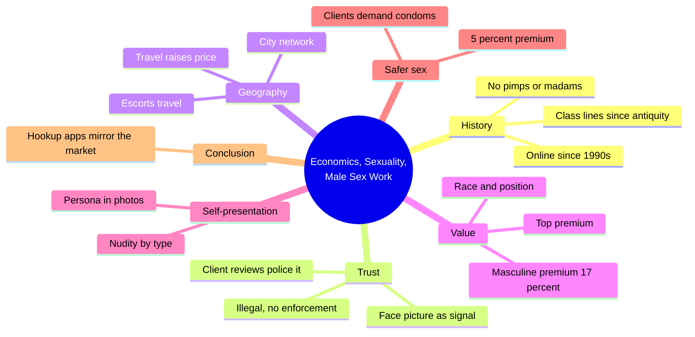
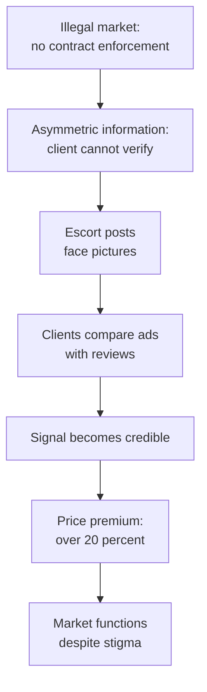
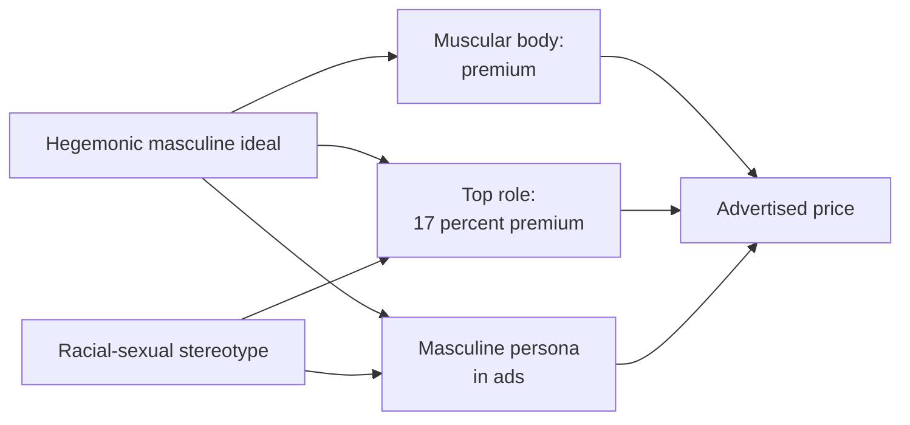

# 🧬 MSX.59 — Economics, Sexuality, and Male Sex Work — Logan (2017)
### Knowledge Entry — Distill

Trevon Logan, an economist at Ohio State, published this Cambridge University Press study in 2017. It treats online male escorting in the United States as a market and tests theories of gay masculinity against its prices.

## TABLE OF CONTENTS
- [Core Thesis](#1-core-thesis)
- [Mind Models](#2-mind-models)
- [Framework](#3-framework--structure)
- [Key Concepts](#4-key-concepts)
- [Heuristics](#5-heuristics--decision-rules)
- [Invariants](#6-invariants)
- [Pitfalls](#7-pitfalls--myths)
- [Application](#8-application)
- [Cross-References](#9-cross-references)
- [Provenance](#10-provenance--confidence)

---

## 1 · CORE THESIS

Male sex work is a market, and its prices show what gay desire values. Escorts solve the trust problem with face pictures, and clients pay a premium for masculine presentation and the "top" role. Race shapes both. The market mirrors gay society more broadly.

---

## 2 · MIND MODELS

**Diagram 1 — the whole argument.**
Caption: *Part I explains how the market works at all; Part II shows what the prices say about desire; the conclusion says the same cues run the noncommercial market.*

**Diagram 2 — the central mechanism (a trust signal in an illegal market).**
Caption: *no court can enforce a deal, so the escort posts something costly to fake, clients check it with reviews, and the signal earns a price premium.*

**Diagram 3 — masculinity into price.**
Caption: *social ideals turn into prices through three channels, and race modifies each channel.*

---

## 3 · FRAMEWORK / STRUCTURE

The book has an introduction, seven chapters, and six appendices. Part I is market analysis. Part II adds gender and sexuality theory.

| Part | Governing move |
|---|---|
| Introduction (pp. 1-17) | Three scandal cases show male sex work "hidden in plain view"; Logan frames it as a market |
| 1. Antiquity to Online (pp. 19-37) | Short history and the data: ads and client reviews |
| 2. Face Value (pp. 39-74) | Face pictures as a signal under asymmetric information |
| 3. Market Movers (pp. 75-109) | Travel, cities, and the escort network |
| 4. Illicit Intersections (pp. 111-141) | Prices by body, position, and race |
| 5. Show, Tell, and Sell (pp. 142-170) | How escorts present their bodies in photos |
| 6. Service Fees (pp. 171-203) | Masculinity, safer sex, and prices |
| 7. Every Man a Sex Worker? (pp. 204-226) | Compares commercial ads with noncommercial hookup profiles |
| Appendices (pp. 227-278) | Data, signaling model, network measures, estimates |

---

## 4 · KEY CONCEPTS

| Concept | What it is | Why it matters |
|---|---|---|
| **Hidden in plain view** | Male sex work is easy to find and rarely noticed until a scandal (intro, p. 2) | The Gannon, Frank, and Rentboy cases show the pattern |
| **No intermediaries** | Male escorts work independently, with no pimps or madams (intro, p. 5) | Escorts keep their fees and compete directly |
| **Asymmetric information** | The escort knows if he is trustworthy; the client does not (ch. 2, pp. 39-41) | It threatens to stop deals before they start |
| **The face picture signal** | A face photo works as a bond (intro, p. 8; ch. 2, p. 58) | It earns more than 20 percent, and headless nude photos cost more than 5 percent |
| **Hegemonic masculinity** | The dominant ideal of manhood, which gay men may reproduce (ch. 4, p. 113) | Logan tests whether a counter-hegemonic group prizes it |
| **Top premium** | Penetrative escorts earn 17 percent more, about $10,000 a year (ch. 4, p. 114) | Logan rejects a scarcity explanation and reads it as social |
| **Racial-sexual stereotypes** | Black men expected dominant, Asian men passive (ch. 4, p. 137) | The market pays men who match the stereotype |
| **Gay sexual field** | Field theory of how a setting shapes desire (ch. 4, pp. 116-117) | Logan tests it by comparing commercial and noncommercial markets |
| **Safer sex premium** | Escorts who advertise condom sex earn 5 percent more (intro, p. 13) | Clients demand condoms, which contradicts compensating-differential theory |
| **The hookup mirror** | Grindr-style profiles use the same cues as escort ads (conclusion, pp. 204-206) | Logan argues the two markets overlap |

---

## 5 · HEURISTICS & DECISION RULES

| Situation | Do this | Not this |
|---|---|---|
| Writing an escort | Make him a small independent businessman: ads, prices, reviews, travel | Make him a victim with a pimp |
| Writing trust between escort and client | Give the escort one visible costly signal and show clients checking it | Write blind trust |
| Writing a character who markets himself | Let a persona follow the market: masculine, a position, a body | Write the persona as pure inner nature |
| Writing race in a gay sexual setting | Show inclusion on stereotype terms and what it costs | Show interracial sex as automatically egalitarian |
| Writing a client | Show him demanding condoms and paying for them | Show him paying more for risk |
| Writing an escort who travels | Tie travel to demand and competition | Tie it only to personal restlessness |
| Writing a scandal | Show a story the public could always see | Show a secret that took detective work |

---

## 6 · INVARIANTS

1. Male sex work operates as a market, with buyers, sellers, prices, and competition (intro, p. 5).
2. Without contract enforcement, a credible signal replaces it (ch. 2, pp. 39-41, 58).
3. Prices reflect social ideals of masculinity as well as economic inputs (ch. 4, p. 114).
4. Race changes what a sexual behavior is worth (ch. 4, pp. 137-140).
5. Escorts who travel earn more, and travel follows demand (intro, p. 9).
6. Clients, not escorts, drive condom use in this market (intro, p. 13).

---

## 7 · PITFALLS / MYTHS

- Treating the sample as all male sex work. Logan states he covers online professionals and says little about men in survival sex or with temporary attachments (intro, p. 6).
- Treating advertised prices as proven transactions. Ch. 2 checks ads against client reviews. Both are self-reported or client-reported, and both are online.
- Dating: the data comes from the 2010s US online market (Rentboy closed in 2015). Practice shifted since, including app-based and subscription work.
- Reading the 17 percent top premium as causal for any one person. It is an average across ads.
- Reading the book as ethnography. The findings come from advertisements, reviews, and models. They show what the market pays, not how any worker feels.
- Reading the safer-sex finding as health advice. It is a price finding.
- Treating the stereotype findings as truths about men of any race. Logan reports them as evidence of stereotype in demand.
- Method warning: Logan himself notes older research (such as Humphreys' 1970 study) used controversial methods (ch. 4, p. 117).

---

## 8 · APPLICATION

*Proposed for the ORANGE work, not ruled.*

- **Spine level:** L5.
- **12-layer character stack:** L12 FUNCTION (primary, the trust signal); L3 SOCIAL (primary, masculinity's price); L9 EROS (primary, persona); L8 IMPRINT (supporting, stereotype); L10 SHADOW (supporting, hidden in plain view); L2 VITAL (contextual, the priced body).
- **plot_systems:** a character's persona and his real desire can diverge. The market pays for one and the scene reveals the other.
- **Setting:** an escort ad board with reviews gives a ready institution: a reputation economy with its own signals, awards, and sting risks.

Logan gives the ORANGE system an occupation-as-market lens, not a moral one. A character who sells sex has a business problem (trust), a branding problem (persona), and a travel problem (demand). Those three drive scenes without needing misery or glamour.

The strongest addition is the persona-price gap. A character presents as a masculine top because the market pays for it, and his private wants differ. The gap carries story.

Proposed use: write one explicit scene where a character's ad persona fails at the door.

---

## 9 · CROSS-REFERENCES

| Related entry | Relation |
|---|---|
| [[🧬 MSX.19 — The Routledge Handbook of Male Sex Work — Scott, Grov & Minichiello (2021)]] | The handbook surveys the field; Logan supplies one quantitative study |
| [[🧬 MSX.18 — Porn Work — Berg (2021)]] | Berg studies work in the porn industry; Logan studies escorts as independent firms |
| [[🧬 MSX.43 — One Hundred Years of Homosexuality — Halperin (1990)]] | Halperin's Athenian male prostitution is the ancient case of the same market |
| [[🧬 MSX.36 — The History of Sexuality — Foucault (1978)]] | Foucault's naming of types meets Logan's pricing of types |

---

## 10 · PROVENANCE & CONFIDENCE

Full text by pdftotext, about 346 pdf pages; book page = pdf page minus 20. Title page and copyright confirm Trevon D. Logan, *Economics, Sexuality, and Male Sex Work*, Cambridge University Press, 2017.

Read in full: the Introduction (pp. 1-14); ch. 4's opening and summary (pp. 111-117, 136-140); ch. 2's core results (pp. 39-41, 58-59); ch. 7's opening (pp. 204-206). Skipped: ch. 1, the rest of ch. 2, chs. 3, 5, 6, the appendices, and the statistical tables. Figures such as the 17 percent top premium and the 5 percent condom premium come from Logan's own chapter summaries. The regressions were not checked.

Contested: the data is two online escort sites and client reviews, and it covers professionals only. The method rests on advertisements, which can be inflated or strategic. The conclusions about gay masculinity are Logan's reading of price data. Confidence is medium.

The `feeds:` keying is this distill's own synthesis. Logan uses no layer vocabulary.

## META
- Template: BVX-LEARN-v4.0
- Source classification: full-text pdftotext, introduction and selected chapters read, rest skipped
- Created / Updated: 2026-10-04
