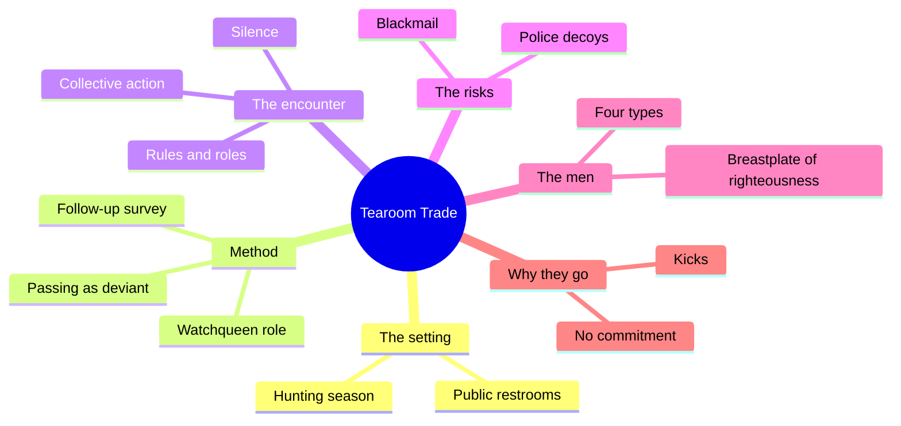
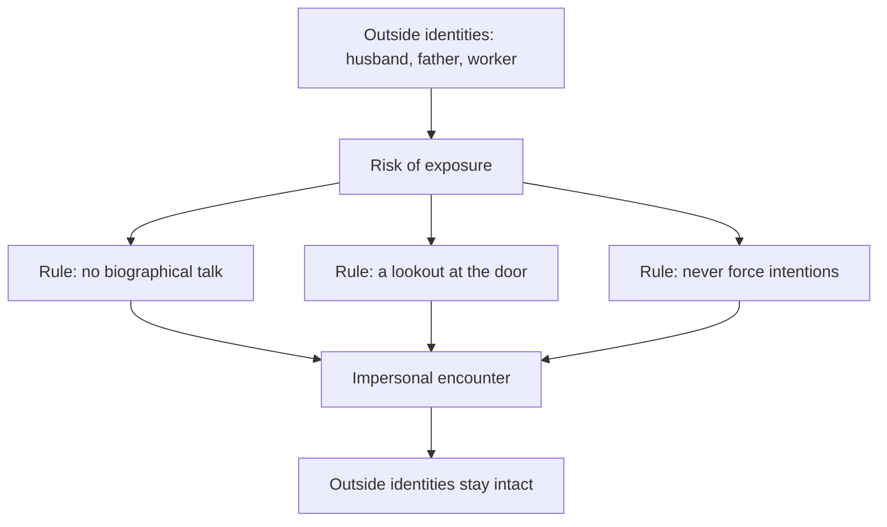
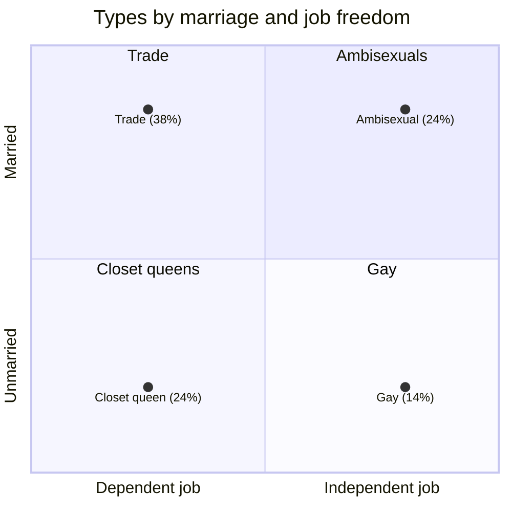
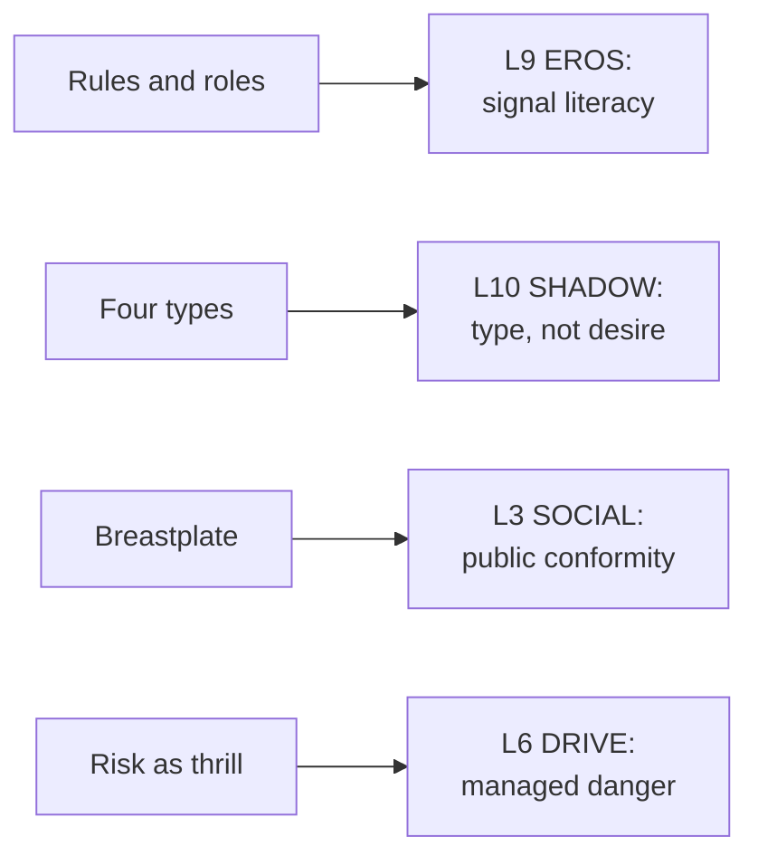

# 🧬 MSX.60 — Tearoom Trade — Humphreys (1970)
### Knowledge Entry — Distill

Humphreys' 1970 study observes men who have impersonal sex in public park restrooms in a Midwestern city. It is a sociology of covert behavior, and its methods are still debated.

> *Fantasy, not a how-to: what happens in these pages stays in them. Reader discretion advised.*

## TABLE OF CONTENTS
- [Core Thesis](#1-core-thesis)
- [Mind Models](#2-mind-models)
- [Framework](#3-framework--structure)
- [Key Concepts](#4-key-concepts)
- [Heuristics](#5-heuristics--decision-rules)
- [Invariants](#6-invariants)
- [Pitfalls](#7-pitfalls--myths)
- [Application](#8-application)
- [Cross-References](#9-cross-references)
- [Provenance](#10-provenance--confidence)

---

## 1 · CORE THESIS

Men who have impersonal sex in public restrooms follow strict rules that protect their other lives. Most do not belong to a gay subculture, and the label "homosexual" hides four different kinds of men.

---

## 2 · MIND MODELS

**Diagram 1 — the whole argument.**
Caption: *the book moves from the place, to the rules, to the men, to the reasons.*

**Diagram 2 — the central mechanism (information control).**
Caption: *every rule in the encounter protects an identity outside it, so silence is a service, not a lack.*

**Diagram 3 — the four types and their resources.**
Caption: *the types differ by marriage and job independence, and those two facts decide how well each can absorb exposure.*

**Diagram 4 — mapped onto the Command's 12-layer stack.**
Caption: *Humphreys gives EROS a signal grammar, SHADOW a type, and SOCIAL a compensation rule.*

---

## 3 · FRAMEWORK / STRUCTURE

Eight chapters and a postscript on ethics.

| Part | What it does |
|---|---|
| Foreword (Lee Rainwater) | Places the book among studies of city life and information control |
| Ch. 1, Public Settings for "Private" Encounters | Why restrooms: accessible, recognizable, little visibility |
| Ch. 2, Methods: The Sociologist as Voyeur | Passing as deviant, the watchqueen role, and the follow-up survey |
| Ch. 3, Rules and Roles | The encounter as a game of chance with rules and roles |
| Ch. 4, Patterns of Collective Action | How strangers coordinate without speech |
| Ch. 5, Risks of the Game | Police decoys, blackmail, violence, arrest |
| Ch. 6, The People Next Door | Four types of participant, by marriage and occupation |
| Ch. 7, The Breastplate of Righteousness | Conservatism as compensation, information control |
| Ch. 8, Kicks, Commitment, and Social Control | Why men choose this market |
| Postscript, A Question of Ethics | Humphreys' defense of his method |

---

## 4 · KEY CONCEPTS

| Concept | What it is | Why it matters |
|---|---|---|
| **Tearoom** | A public restroom that gains a reputation for sexual encounters (Ch. 1, PDF p. 21-22) | Twenty of ninety restrooms in the city were in regular use |
| **Hunting season** | April through October, when activity peaks (PDF p. 22) | The setting has a calendar |
| **Impersonal sex** | Sex with no obligation or commitment, often with silence (Ch. 1, PDF p. 21) | The encounter is built to stay anonymous |
| **Watchqueen** | The lookout who coughs at an approach (Ch. 2, PDF p. 46) | An optional sexual role that serves the others |
| **Passing as deviant** | The researcher pretends to be a participant (Ch. 2, PDF p. 44) | It is the method, and the source of the ethics dispute |
| **Rules of the game** | Avoid biographical data, watch for teenagers, never force, never knock a trick, honor trade agreements (Ch. 3, PDF p. 66) | Safety is a set of rules every player knows |
| **Trade** | A partner who does not yet consider himself homosexual (PDF p. 66) | The label marks identity as a negotiation |
| **Insertor and insertee** | The two roles in the act (Ch. 3, PDF p. 69-70) | Humphreys found no clear tie between gender self-image and role |
| **Settlement phase** | The stage when the outcome of the game shows (Ch. 3, PDF p. 69) | A role becomes visible only as the action ends |
| **Four types** | Trade (38%), ambisexual (24%), gay (14%), closet queen (24%) of 50 interviewed (Ch. 6, PDF p. 130-144) | Each type has a different bundle of risk and resource |
| **Breastplate of righteousness** | Conservative views that cover covert behavior (Ch. 7, PDF p. 156) | Public conformity is sized to the risk |
| **Information control** | Concealing and uncovering knowledge (Ch. 7, PDF p. 151) | It is the book's master variable |

---

## 5 · HEURISTICS & DECISION RULES

| Situation | Do this | Not this |
|---|---|---|
| A married character with a covert life | Give him a rule set: no names, a lookout, a fixed time | Make him reckless without a system |
| A scene of silent signaling | Use gaze, position and one gesture (PDF p. 66, 69) | Fill it with dialogue |
| A character called "straight" who has sex with men | Let him resist the label, and show the work he does to keep it (PDF p. 66) | Force a label on him |
| A venue with a code | Name the code, the season and the watchers | Treat the place as free of rules |
| A character under legal risk | Show who can pay, who can call a friend, who cannot (Ch. 6, PDF p. 138-139) | Treat risk as equal for all classes |
| A character who is publicly conservative | Check whether the conservatism is his breastplate (PDF p. 156) | Read it only as belief |
| A closet-queen type | Give him isolation and a close tie to one parent (PDF p. 144-146) | Give him a social scene he does not use |

---

## 6 · INVARIANTS

1. Impersonal sex is organized by rules, not by chaos (Ch. 3).
2. Silence in the encounter protects identities outside it (Foreword, PDF p. 12).
3. Most participants live outside the gay subculture (Ch. 6).
4. The label "homosexual" covers different careers (Foreword, PDF p. 13).
5. Resources for information control sort the types (Ch. 7, PDF p. 151).
6. Risk adds to the thrill for those who can afford it (Ch. 6, PDF p. 139).

---

## 7 · PITFALLS / MYTHS

- The book's method is contested. Humphreys observed without telling the men, noted license plates, and later interviewed some as health-survey respondents. Critics, including those who reviewed the book, called this deception and a risk to the subjects. His own Postscript defends it (PDF p. 187-188). This entry reports both sides once, plainly.
- The sample is small: fifty participants interviewed, from one Midwestern city in the mid-1960s. Humphreys says his findings may not apply elsewhere (Ch. 2, PDF p. 38).
- The interviews were made under a cover, so the book says little about why men go, in their own inner terms. The Foreword states this gap (PDF p. 16).
- The typology is Humphreys' own, built from marriage and job status. It is not a diagnosis.
- Humphreys studies men in a hostile legal climate. The 1960s Midwest law is not a model for any other era.
- The book's tone toward some participants is an artifact of its time and of sociology's vocabulary then.

---

## 8 · APPLICATION

*Proposed, not ruled.*

- **Spine level:** L5.
- **12-layer character stack:** L9 EROS (primary: signal grammar, concealment inside and outside); L10 SHADOW (primary: type as a set of resources); L3 SOCIAL (supporting: the breastplate); L7 ORIGIN (supporting: venue world); L6 DRIVE (supporting: managed danger).
- **plot_systems:** a venue with a code can drive a thriller beat: a rule broken, a lookout missing, a stranger who talks.
- **Setting:** a DCUS-area park, rest stop or locker room can carry its own season and its own code.

For the ORANGE work, Humphreys gives EROS a language without speech. A reader can learn from the first line who stands where and who looks first. The four types give SHADOW a way to differ by resources, not just by feeling. Two men with the same act can have different stakes, because one has a lover and a self-chosen job and the other has a wife and a boss. The breastplate idea gives SOCIAL a tell: the louder the public conformity, the larger the private risk. A story can use that tell without ever naming the secret.

---

## 9 · CROSS-REFERENCES

| Related entry | Relation |
|---|---|
| [[🧬 MSX.56 — Coming Out — Weeks (1977)]] | Weeks gives the history of the homosexual role Humphreys cites (PDF p. 141) |
| [[🧬 MSX.44 — Between Men — Sedgwick (1985)]] | Sedgwick's male line shows why these men need the breastplate |
| [[🧬 PSY.50 — Sexual Behavior in the Human Male — Kinsey (1948)]] | Kinsey counts the men whose acts and labels differ; Humphreys shows how they live |
| [[🧬 PSY.53 — The Social Organization of Sexuality — Laumann et al. (1994)]] | Laumann et al. separate behavior, desire and identification, which the four types embody |
| [[🧬 MSX.64 — Bigger Than Life — Escoffier (2009)]] | Escoffier's gay porn history overlaps in the same decades |

---

## 10 · PROVENANCE & CONFIDENCE

Full text, pdftotext extraction, 256 PDF pages. The front matter is image pages with no text, so the year comes from the book's own references: it cites its first public coverage in 1970 and the text shows no later date. This entry dates it 1970 on that evidence. The extract has no printed page numbers, so every cite is a PDF page.

Read: Rainwater's Foreword, Ch. 1 opening, Ch. 2 on method and the watchqueen role, Ch. 3 opening and the rules, Ch. 6 on the four types, Ch. 7 on information control and the breastplate, Ch. 8 opening, and the Postscript opening.

Skipped: Ch. 4 and 5 in full, the middle of Ch. 2 on the follow-up survey, the rest of Ch. 6 to 8, the appendix material and the notes. The `feeds:` keying is this distill's own work. Humphreys uses no 12-layer vocabulary.

## META
- Template: BVX-LEARN-v4.0
- Source classification: full-text pdftotext extraction, targeted read of the Foreword, Ch. 1 to 3, 6 to 8 and the Postscript
- Created / Updated: 2026-10-04
