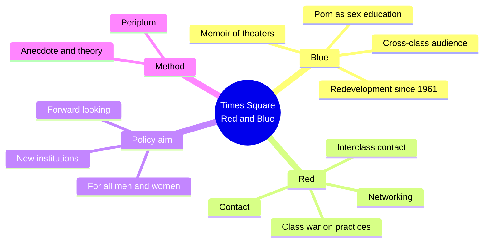
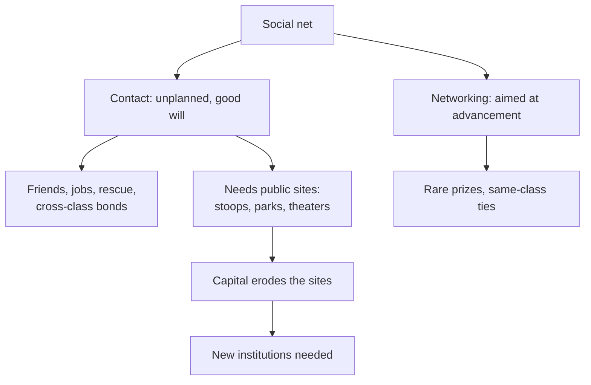
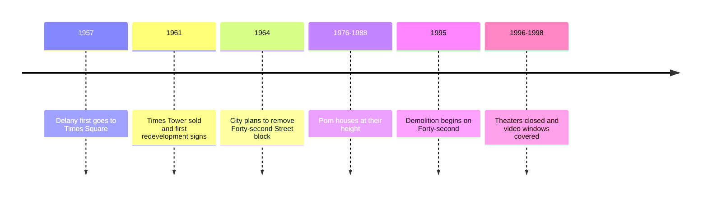
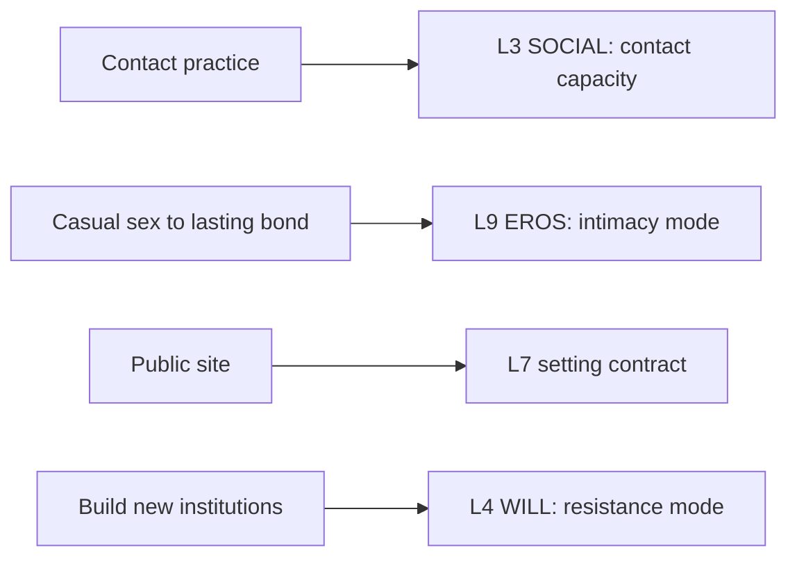

# 🧬 MSX.61 — Times Square Red, Times Square Blue — Delany (1999)
### Knowledge Entry — Distill

Fantasy, not a how-to: what happens in these pages stays in them. Reader discretion advised.

Samuel R. Delany's 1999 book pairs two essays on the redevelopment of New York's Times Square. "Times Square Blue" is a memoir of the porn theaters; "Times Square Red" is a theory of interclass contact.

## TABLE OF CONTENTS
- [Core Thesis](#1-core-thesis)
- [Mind Models](#2-mind-models)
- [Framework](#3-framework--structure)
- [Key Concepts](#4-key-concepts)
- [Heuristics](#5-heuristics--decision-rules)
- [Invariants](#6-invariants)
- [Pitfalls](#7-pitfalls--myths)
- [Application](#8-application)
- [Cross-References](#9-cross-references)
- [Provenance](#10-provenance--confidence)

---

## 1 · CORE THESIS

Cities work best when people of different classes meet by chance and in good will. Public sex sites gave that contact a home. Capital and law erode such sites, so each era must build new ones.

---

## 2 · MIND MODELS

**Diagram 1 — the whole argument.**
Caption: *two essays attack one problem from opposite sides: a first-person memoir of the sites, then a theory of why they mattered.*

**Diagram 2 — the central mechanism (contact versus networking).**
Caption: *contact is open-ended and cross-class; networking aims at gain and tends to stay inside one class, and Delany prizes the first.*

**Diagram 3 — the arc of the Deuce.**
Caption: *the old strip was marked for demolition from 1961, held on through the seventies and eighties, and fell in the nineties.*

**Diagram 4 — mapped onto the Command's 12-layer character stack.**
Caption: *Delany gives SOCIAL a contact trait, EROS a route to lasting bonds, and the setting a place that can be lost.*

---

## 3 · FRAMEWORK / STRUCTURE

| Part | What it does |
|---|---|
| Writer's Preface (pp. xi-xx) | Sets the redevelopment story and says the book is not a plea to reopen the theaters. |
| Part 1, Times Square Blue (pp. 1-108) | A memoir of the theaters, bars, and street, with a long look at 1970s porn and its audience. |
| Part 2, Three, Two, One, Contact: Times Square Red (pp. 109-200) | A numbered theory of contact, networking, class, and public space. |
| Works Cited | Lists sources, with Jane Jacobs central. |

---

## 4 · KEY CONCEPTS

| Concept | What it is | Why it matters |
|---|---|---|
| **Contact** | Unplanned talk or touch among strangers (Part 2, p. 123) | It includes casual sex in public, and it builds friendships. |
| **Networking** | Contact aimed at advancement (p. 130) | It yields prizes rarely, and its folklore sustains it. |
| **Interclass contact** | Contact across class lines (p. 126) | Delany ranks it above contact inside one class. |
| **Primary thesis** | Life is best when many seek interclass contact in good will (p. 111) | The whole book argues this. |
| **Class war on practices** | Class conflict erodes the practices and institutions of contact (p. 111) | Sites vanish by policy, not by accident. |
| **Public and private** | Contact needs a firm line between them (p. 126) | If every encounter moves to a home, sex becomes anxious and class-bound (p. 127). |
| **The Deuce** | The Forty-second Street strip, Seventh to Eighth Avenue (Preface, p. xi) | The place that carried the world. |
| **Redevelopment** | A planned forty-year demolition (Preface, p. xi) | The loss was designed. |
| **Periplum** | A coastline description that lets later travelers navigate (Preface, p. xviii) | The essays are impressions meant for later study. |
| **Porn as education** | The theaters taught a working-class audience new sexual norms (Part 1, p. 78) | Delany claims porn made sex "friendlier, more relaxed" (p. 78). |

---

## 5 · HEURISTICS & DECISION RULES

| Situation | Do this | Not this |
|---|---|---|
| Writing a city or school | Give it public sites where strangers of different classes meet | Make every meeting private or planned |
| Writing a casual encounter | Let it open a talk, a favor, or a long friendship | Make it a dead end |
| Writing an ambitious character | Show networking as a hope kept alive by rare wins | Make him a pure cynic |
| Writing a closure | Show the planned business moves behind it | Show it as a sudden moral clean-up |
| Writing a loss of place | Name each site and what it did | Say "the neighborhood changed" |
| Writing an activist | Aim at building a new institution for all | Aim only at restoring the old one |

---

## 6 · INVARIANTS

1. **Contact needs sites.** Streets, stoops, parks, and theaters carry it (Part 2, pp. 123-127).
2. **Class pressure erodes those sites.** The loss comes from policy and capital (p. 111).
3. **Contact crosses class more than networking does.** Delany prizes the cross-class kind (p. 126).
4. **A private/public line must hold.** If it falls, people distrust contact (p. 126).
5. **The loss of a site is an event with a date.** Delany names the sale, the plan, and the demolition (Preface, p. xiv).

---

## 7 · PITFALLS / MYTHS

- **It is memoir and polemic, not a survey.** Delany writes as a participant, so the claims rest on his experience and argument.
- **He says the book is not nostalgic.** He does not ask to reopen the old theaters (Preface, p. xvii), so do not read it as a defense of porn houses alone.
- **His claim about porn teaching sex norms is a personal impression.** The book gives no audience data for it.
- **The sample is male and Times Square.** Delany himself notes that his model covers a time and a place.
- Reading contact as community. Delany says contact is often strongest between communities (note, p. 127).
- Reading the book as a plea for sexual license. Its stated aim is institution building (Preface, p. xvii).

---

## 8 · APPLICATION

*Proposed, not ruled.*

- **Spine level:** L5.
- **12-layer character stack:** L3 SOCIAL (contact capacity, primary; networking posture, supporting); L9 EROS (intimacy mode, primary); L7 (setting contract, contextual); L4 WILL (resistance, contextual).
- **plot_systems:** a closure or rezoning gives a ready midpoint.
- **Setting:** an old theater, bar, or school corner can serve as the "site" that holds a world.

Delany gives the ORANGE work a plain way to make a place matter. A story can name the sites where strangers meet and say what each one did. A character can be a contact person, easy with strangers, and the story can reward him with the very friendships Delany lists. A networker's hunger gives a contrasting type. A proposed variable, `contact_sites`, would list the public places in a character's life on L7. Delany's refusal to be nostalgic also gives a useful rule: the plot should ask what to build next.

---

## 9 · CROSS-REFERENCES

| Related entry | Relation |
|---|---|
| [[🧬 MSX.49 — Publics and Counterpublics — Warner (2002)]] | Warner and Berlant argue the same zoning fight in "Sex in Public." |
| [[🧬 MSX.45 — Gay New York — Chauncey (1994)]] | Chauncey gives the earlier history of Times Square as a gay enclave. |
| [[🧬 MSX.65 — Gay Pornography — Mercer (2017)]] | Mercer studies the pornography that Delany sees from the theater seats. |

---

## 10 · PROVENANCE & CONFIDENCE

Full-text pdftotext extraction, 223 pdf pages. Front matter confirms Samuel R. Delany, New York University Press, New York, 1999 (paperback 2001). Printed page equals pdf page minus 21. Read: the Writer's Preface in full (pp. xi-xx), Part 1 pp. 76-79 (the porn audience), and Part 2 pp. 111-112 and 123-134 (theses, contact, networking, the writers' conference example).

Skipped: most of Part 1 (pp. 1-75, 80-108), Part 2 pp. 113-122 and 135-200, and the works cited. The long middle of Part 2 on class and the real-estate machinery was not read. Confidence is medium. The `feeds:` keying is this distill's synthesis.

## META
- Template: BVX-LEARN-v4.0
- Source classification: full-text extraction, targeted read of preface, Part 1 excerpt, Part 2 opening
- Created / Updated: 2026-10-04
