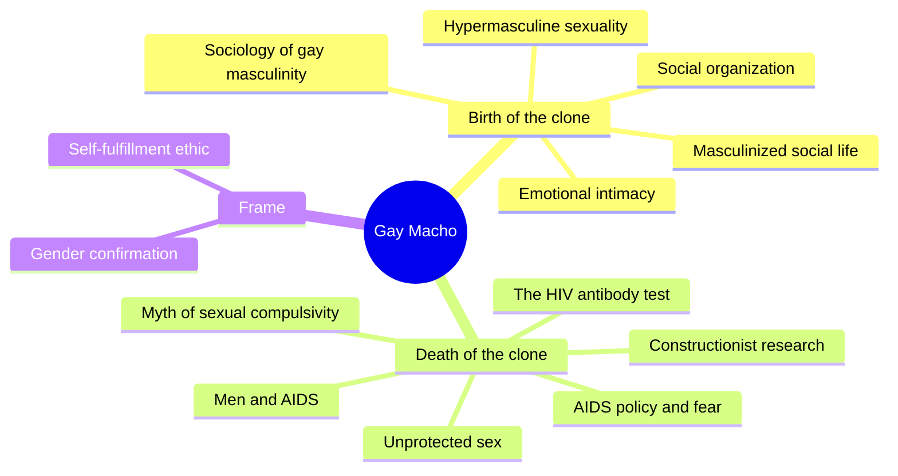
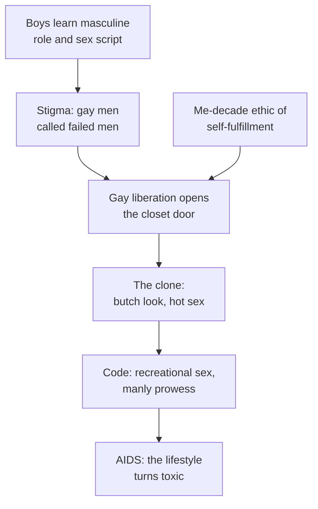
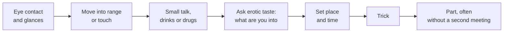
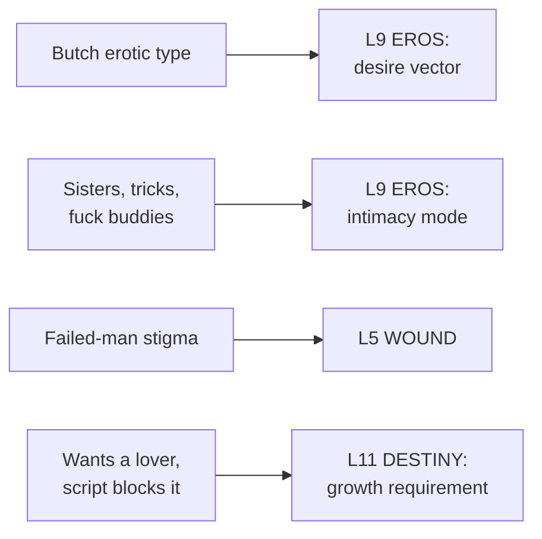

# 🧬 MSX.62 — Gay Macho — Levine (1998)
### Knowledge Entry — Distill

Martin Levine's ethnography studies the "clone," the mustached, gym-built, flannel-wearing gay man who defined 1970s urban gay life, and follows what AIDS did to him. Michael Kimmel edited it after Levine's death in 1993. It sits on the shelf as a field record of one gay masculinity and its sexual code.

## TABLE OF CONTENTS
- [Core Thesis](#1-core-thesis)
- [Mind Models](#2-mind-models)
- [Framework](#3-framework--structure)
- [Key Concepts](#4-key-concepts)
- [Heuristics](#5-heuristics--decision-rules)
- [Invariants](#6-invariants)
- [Pitfalls](#7-pitfalls--myths)
- [Application](#8-application)
- [Cross-References](#9-cross-references)
- [Provenance](#10-provenance--confidence)

---

## 1 · CORE THESIS

Gay liberation freed gay men to act out masculinity, and the clone did, with a gym body, a blue-collar look, and a code of impersonal sex. Levine reads that code as gender confirmation, not pathology. AIDS then forced the community to abandon it.

---

## 2 · MIND MODELS

*Required. Minimum two diagrams, maximum five.*

**Diagram 1 — the whole argument.**
Caption: *Part One builds the clone from masculinity and liberation, and Part Two follows his death through AIDS policy and research.*

**Diagram 2 — the central mechanism (how the clone formed).**
Caption: *three inputs, male socialization, stigma, and the self-fulfillment ethic, met at liberation and produced one social type.*

**Diagram 3 — the cruising sequence.**
Caption: *a pickup ran in short stages, and a stall at any stage ended it, which is why timing and signal reading matter.*

**Diagram 4 — mapped onto the Command's 12-layer character stack.**
Caption: *Levine's code lands on four layers: the butch type on desire, the friend and trick taxonomy on intimacy, stigma on wound, and the blocked lover on destiny.*

---

## 3 · FRAMEWORK / STRUCTURE

Two parts and an epilogue. Part One is an ethnography of the late-1970s New York clone. Part Two is Levine's AIDS-era writing.

| Part and chapter | Governing move |
|---|---|
| Introduction (pp. 3-9) | A scene on Christopher Street. States the thesis, defines the clone, and sets the period (1975 start) |
| 1. Sociology of Gay Masculinity (p. 10) | Gay men learn the same male role and sex script as other men. Gay liberation then removed the barriers to acting on it |
| 2. Social Organization (p. 30) | The clone community's structure. Not read here |
| 3. Masculinization of Social Life (p. 55) | Interaction styles. Not read here |
| 4. Hypermasculine Sexuality (p. 77) | Cruising, searching, signaling, and the sex act as proof of manhood |
| 5. Emotional Intimacy (p. 100) | Friends, tricks, and fuck buddies. Intimacy and sex split |
| Part II, chs. 6-12 (pp. 125-246) | AIDS policy in 1983 and 1984, men and AIDS, the myth of sexual compulsivity, antibody testing, unprotected sex, and constructionist research |
| Epilogue (p. 247) | Levine's life, 1950-1993 |

Levine says clones were the community's most defining type but not its only one. Others included liberationists, "twinkies," drag queens, and leathermen (p. 7).

---

## 4 · KEY CONCEPTS

| Concept | What it is | Why it matters |
|---|---|---|
| **The clone** | The 1970s urban gay type: gym body, mustache, blue-collar clothes, hard partying (pp. 7-8) | The book's central figure |
| **Hypermasculine sexuality** | Gay sex enacted by masculine norms: detached, objectified, phallic, and aimed at conquest (p. 79) | Levine's reading of the code |
| **Gender confirmation** | Using a masculine performance to show that gay men are "real men" (p. 5) | The motive he gives for the code |
| **Self-fulfillment ethic** | The 1970s value that treats gratifying erotic need as a moral good (pp. 11, 79) | Pairs with masculinity to shape the clone |
| **Cruising** | The mechanism that created most sexual contact among gay men (p. 79) | Has stages, hours, and etiquette (pp. 80-87) |
| **The type** | The "hung, built, and butch" ideal. Class, region, and race mattered little beside butch (pp. 81-82) | Defined the desire vector |
| **Trick** | An impersonal, one-time sexual partner, but one that could carry warmth and a chance of romance (pp. 103-104) | Shows tricking had social content |
| **Fuck buddy** | A long-standing trick with no commitment (pp. 105-106) | Unique to the clone community in Levine's account |
| **Sisters and best friends** | Two kinds of nonsexual closeness (p. 102) | Where the intimacy went |
| **Account (justification, excuse)** | Culturally shaped explanations for improper acts (ch. 11, p. 208) | Gives a way to write how a character explains risk |
| **Sexual compulsion as label** | Levine and Troiden argue "sexual addiction" repathologizes sex that had become acceptable (ch. 9, pp. 158-160) | A constructionist critique of a clinical label |

---

## 5 · HEURISTICS & DECISION RULES

| Situation | Do this | Not this |
|---|---|---|
| Writing a cruising scene | Run the stages: look, range, talk, taste, plan | Skip to bed with no negotiation |
| Writing a hot man in this scene | Make the look carry the signal: build, mustache, jeans, nipples | Write attraction as undefined |
| Writing the aftermath | Let the parting be quick and sometimes cold | Make every encounter romantic or every one empty |
| Writing a lonely man in the scene | Let him want a lover and fail to turn a trick into one | Write his loneliness as proof the scene is bad |
| Writing friendships | Give sisters and best friends real weight and real jealousy of lovers | Treat friends as filler |
| Writing a risk | Let the character give an account, and note whether it justifies or excuses | Have the narrator judge the act |
| Writing a masculinity | Ask what stigma the performance answers | Treat butch as the default |

---

## 6 · INVARIANTS

1. **Gay men learn the male role like other men.** The training comes before the orientation shows (pp. 11-12).
2. **Stigma shapes the performance.** The clone answered the label of the failed man (p. 5).
3. **Sex and intimacy can run on separate tracks.** Levine ties this to gender more than to orientation (p. 102).
4. **Cruising is a structured exchange** with timing, hours, and shared signals (pp. 80-87).
5. **A look can be currency.** Butch outranked class and race in the type (pp. 81-82).
6. **Tricks carry feeling.** Impersonal sex still held affection, companionship, and hope for more (pp. 103-104).
7. **Accounts shape what men say about risk.** The same act gets justified or excused (ch. 11, p. 208).
8. **The clone was one type among several** and passed into the mainstream (pp. 7-9).

---

## 7 · PITFALLS / MYTHS

- Treating the clone as all gay men. Levine says clones were the defining but not the only type (p. 7).
- Treating one field site as a national finding. Levine's fieldwork began in 1975 in New York and drew on a population he describes as mostly middle-class white men (pp. 10-11, 82).
- Treating participant observation as a count. The account is a single researcher's field notes and interviews, not a survey.
- Treating the 1980s HIV facts as current. Part II's data on testing, condom use, and risk date from 1983 to 1992 and are superseded. The chapter 11 sample is 124 men in New York, 110 of them white and most with college education, interviewed in 1988-1990 (ch. 11, p. 210).
- Treating "hypermasculine" as an insult. Levine uses it as a descriptive term for a gender strategy (pp. 4-5).
- Reading "toxic" as moral judgment. Levine reports that scientists called the lifestyle "toxic" in the early 1980s, and he sets the word in quotation marks (p. 8).
- Treating chapter 9's critique of sexual addiction as a clinical verdict. It is a 1988 sociological argument, not a diagnosis (ch. 9, pp. 158-160).

---

## 8 · APPLICATION

*Proposed, never ruled.*

- **Spine level:** L5.
- **12-layer character stack:** L9 EROS (primary, desire vector and intimacy mode; supporting, signal fluency and risk account style); L5 WOUND (supporting, stigma); L11 DESTINY (supporting, blocked wish); L3 SOCIAL (contextual, body display).
- **plot_systems:** the cruising sequence is a scene engine, and the trick-to-fuck-buddy ladder is a relationship engine.
- **Setting:** the clone's circuit of bars, discos, baths, and Fire Island is a period SETTING for 1975 to 1983.

Levine gives the ORANGE work a relationship taxonomy with names. A character can have a sister, a best friend, a fuck buddy, a trick, and a lover, and each has its own rules. The L9 variable `intimacy_mode` now has five values grounded in one study, and a writer can show a man trying to move someone from one slot to another.

He also gives a way to read masculinity without mocking it. The clone performs manhood because stigma questioned it. A character's butch look can then carry a history, and the writer can put that history on L5.

The cruising stages are a craft file for scenes that must feel earned. The timing, the eye contact, and the "What are you into?" question all work as beats. The accounts typology in chapter 11 gives a separate tool for writing how a character talks about a risk afterward.

---

## 9 · CROSS-REFERENCES

| Related entry | Relation |
|---|---|
| [[🧬 MSX.46 — Deviations — Rubin (2011)]] | Rubin studied the San Francisco leather side of the same decade with the same method |
| [[🧬 MSX.54 — Intimate Matters — D'Emilio & Freedman (2012)]] | The history of the subculture Levine studied, from wartime to AIDS |
| [[🧬 MSX.20 — Sex on Premises Venues — Smith, Grierson & von Doussa (2010)]] | A later study of the baths and clubs as venues |
| [[🧬 MSX.29 — Cruising Guide — Thorne Harbour Health (2018)]] | A practical modern guide to the cruising Levine describes in the field |
| [[🧬 PSY.55 — Pleasure Consuming Medicine — Race (2009)]] | Race takes up the circuit scene after AIDS and the drug question |
| [[🧬 MSX.66 — The Culture of Queers — Dyer (2002)]] | Dyer's camp is the other pole of gay style Levine's clone rejected |

---

## 10 · PROVENANCE & CONFIDENCE

Full-text pdftotext extraction from an Internet Archive scan, about 280 pages, New York University Press, 1998, edited with an introduction by Michael S. Kimmel. The front matter confirms the author, title, subtitle, and 1998 copyright. The OCR is noisy in places. Page numbers come from running heads and may be off by a page.

Read in full or near-full: the contents page and Editor's Preface opening; the Introduction (pp. 3-9); chapter 1's opening (pp. 10-16); chapter 4 from its start through p. 88 (cruising, the type, signals, taste); chapter 5 from its start through p. 106 (friends, tricks, fuck buddies); the opening of chapter 9 (pp. 158-160); chapter 11's introduction, method, and sample (pp. 205-210).

Skipped: chapters 2 and 3; the rest of chapters 1, 4, and 5; chapters 6, 7, 8, 10, and 12; the rest of chapters 9 and 11; the Epilogue; the references. The sex-act and erotic-practice sections of chapter 4 and the "Accounts" findings of chapter 11 were not read past their setup.

Contested or dated: the sample is one city and period. The HIV material is from 1983 to 1992 and is superseded. The clone is an analytic type that Levine drew from his own research site.

The `feeds:` keying is this distill's own synthesis. The `risk_account_style` variable is proposed here and is not yet in the schema.

## META
- Template: BVX-LEARN-v4.0
- Source classification: full-text pdftotext extraction, targeted read of the Introduction and chapters 1, 4, 5, 9, 11
- Created / Updated: 2026-10-04
