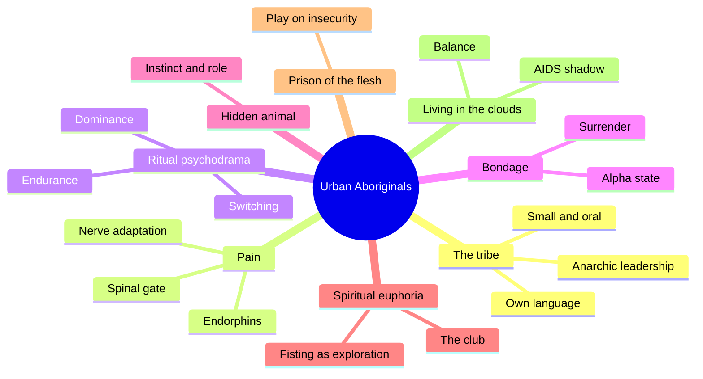
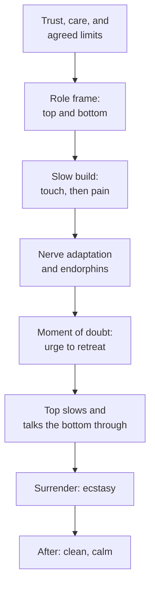

# 🧬 MSX.63 — Urban Aboriginals — Mains (1984)
### Knowledge Entry — Distill

Geoff Mains wrote this account of San Francisco's gay leather scene, published in 1984 by Gay Sunshine Press. It describes leathermen as a tribe and presents their rituals, bondage, fisting, and pain play as paths to trance and inner peace.

## TABLE OF CONTENTS
- [Core Thesis](#1-core-thesis)
- [Mind Models](#2-mind-models)
- [Framework](#3-framework--structure)
- [Key Concepts](#4-key-concepts)
- [Heuristics](#5-heuristics--decision-rules)
- [Invariants](#6-invariants)
- [Pitfalls](#7-pitfalls--myths)
- [Application](#8-application)
- [Cross-References](#9-cross-references)
- [Provenance](#10-provenance--confidence)

---

## 1 · CORE THESIS

Gay leathermen form a tribe: small, oral, anarchic, bound by a shared language and a code of limits. Mains argues their rituals reach states of trance, ecstasy, and balance that the dominant culture suppresses. He presents leather as a path to inner peace, with equality between partners.

---

## 2 · MIND MODELS

**Diagram 1 — the whole argument.**
Caption: *Mains moves from the tribe, to the body, to the mind, to the spirit, and ends on the claim that leather re-balances the human animal.*

**Diagram 2 — the central mechanism (a scene from limits to euphoria).**
Caption: *trust and agreed limits come first, pain rises under control, and the surrender at the peak is what Mains calls ecstasy.*

**Diagram 3 — how the club admits.**
Caption: *the Catacombs checks conduct and planning before anyone enters, so the room's purpose is set at the door.*

---

## 3 · FRAMEWORK / STRUCTURE

The book has eight chapters, each opening with a scene, and then exposition. Page numbers below are printed pages (pdf page minus 4).

| Chapter | Governing move |
|---|---|
| Foreword and Some Words on Words (pp. 9-12) | Rejects clinical terms such as sado-masochism and chooses "leather" |
| 1. Anatomy of a Culture (pp. 13-41) | The Ambush bar, the tribal analogy, leather's politics and identity |
| 2. The Flowers of Pain (pp. 43-63) | The Slot scene and the physiology of pain |
| 3. Ritual Psychodrama (pp. 65-83) | Vignettes of dominance, wrestling, switching, and slavery |
| 4. Bondage and Inner Peace (pp. 85-103) | A long bondage scene and alpha-state surrender |
| 5. Celebration of the Hidden Animal (pp. 105-121) | Instinct, role, and animal imagery |
| 6. Spiritual Euphoria (pp. 123-141) | The Catacombs club and fisting |
| 7. The Prison of the Flesh (pp. 143-163) | Play on the lovers' own insecurities |
| 8. Living in the Clouds (pp. 165-180) | Conclusion on balance, and the AIDS crisis |

---

## 4 · KEY CONCEPTS

| Concept | What it is | Why it matters |
|---|---|---|
| **Leatherspace** | The social and mental territory of leathermen (ch. 1, p. 17) | Mains says it overlaps the Lesbian-feminist and heterosexual spaces but stays distinct |
| **Tribe** | Small-scale, oral, anarchic, tied to animal instinct (ch. 1, pp. 17-18) | The tribal frame is Mains' main metaphor |
| **Stigma-built isolation** | Condemnation of "sado-masochism" fosters tribal behavior (ch. 1, pp. 19-20) | He says isolation made a culture |
| **Libertarian ethic** | Private life is for mutual authority, not law (ch. 1, p. 23) | Mains says the scene's politics vary but share this |
| **Role play with limits** | Gay role play "with emphasis on limits and couched in a fundamental equality" (p. 11) | He separates it from abuse |
| **Pain-pleasure physiology** | Adaptation, the spinal gate, and endorphins (ch. 2, pp. 52-54) | Mains argues the body can turn pain to euphoria |
| **Ritual psychodrama** | Roles contested, discussed, or switched (ch. 3, pp. 67-69) | Several couples fight for roles in earnest and good spirits |
| **Alpha state** | A calm, mantra-held state in bondage (ch. 4, p. 87) | Mains presents bondage as meditation |
| **Attitude screening** | The club admits by conduct, not looks (ch. 6, p. 126) | A social technology for safety and tone |
| **Play on insecurity** | Staged domination works an inner doubt into focus (ch. 7, pp. 145-146) | Play serves the lovers' wounds |

---

## 5 · HEURISTICS & DECISION RULES

| Situation | Do this | Not this |
|---|---|---|
| Writing a leather scene | Set trust, a role frame, and limits before any act | Start at violence |
| Writing the moment of doubt | Have the top slow down and speak to the bottom | Have the top push through |
| Writing a bottom | Give him a reason: proof of strength, giving, or release | Write him as damaged |
| Writing a top | Give him care, attention, and a teacher or mentor | Write him as cruel by nature |
| Writing a scene between lovers | Let the staged conflict touch a real insecurity both know | Make it only a game |
| Writing a bar or club | Give it entry rules, a roster, and a tone | Make it a free-for-all |
| Writing a leatherman's day job | Let him be a bank manager or a teacher, discreet at work | Make the scene his only identity |

---

## 6 · INVARIANTS

1. Role play in the leather scene rests on agreed limits and a base of equality (Some Words on Words, p. 11).
2. Nerves adapt, so pain falls with steady stimulation (ch. 2, p. 52).
3. Emotions such as trust and anxiety change how pain feels (ch. 2, p. 52).
4. The scene's politics vary widely, but its members share a distrust of state control of private life (ch. 1, pp. 22-23).
5. Leathermen are diverse in work, class, and politics (ch. 1, p. 22).
6. Mains says leather's capacities are not universal, and not all who could, should (ch. 8, p. 179).

---

## 7 · PITFALLS / MYTHS

- Treating the book as research. It has no stated method. Its scenes are narrated in the present tense, and the narrator guesses a character's inner life ("Sam, from the southlands, may be a military man," ch. 2, p. 47). Treat the vignettes as literary reporting, not data.
- Dated: the book's physiology comes from 1970s endorphin and pain literature (ch. 2 notes). The science has moved on, and Mains writes it as settled.
- Dated: the book was written before the AIDS crisis reached full force. Mains adds that "the waves of the AIDS crisis rise about us" near the end (ch. 8, pp. 176-178). Most scenes do not reflect later safer-sex norms.
- Its language is of its time. "Aboriginal," "tribe," and "primitive" borrow from anthropology in a way later scholars would challenge, since it takes living peoples as a metaphor.
- Its claim of stability and inner peace is Mains' assertion. He admits conflict, theft, and suicide exist among leathermen (ch. 8, p. 180).
- Its scope is San Francisco, mostly white, 1980s, male. Mains says the scene is a single group's adaptation, not a model for all (ch. 8, p. 179).

---

## 8 · APPLICATION

*Proposed for the ORANGE work, not ruled.*

- **Spine level:** L5.
- **12-layer character stack:** L3 SOCIAL (primary, a tribe with entry rules); L9 EROS (primary, role play between equals); L5 WOUND (primary, insecurity worked in play); L4 WILL (supporting, chosen endurance); L8 IMPRINT (supporting, the scene as self-image); L11 DESTINY (contextual, balance).
- **plot_systems:** a scene is a three-beat engine: agreed frame, rising intensity, a moment of doubt where the top's care decides the ending.
- **Setting:** the Catacombs model, with a phone roster, a private door, and a club tone, gives a ready venue with rules a writer can break.

Mains gives the ORANGE system the leather subculture as a social world with rules and a code. The strongest piece is play on insecurity (ch. 7). A character carries a wound he knows is false, and a scene with his lover lets him meet it in a frame he controls. That is a WOUND-layer variable with a built-in scene.

A second use is the day-job split. John is a discreet bank manager. David teaches biology. The scene lives beside a respected public life, and the seam between them is a story source.

Proposed use: write one scene in the leather frame as an act of trust, and let the explicit action carry the characters' history, not shock.

---

## 9 · CROSS-REFERENCES

| Related entry | Relation |
|---|---|
| [[🧬 MSX.22 — The Ultimate Guide to Kink — Taormino (2012)]] | Taormino gives the how-to; Mains gives a 1984 portrait of one culture |
| [[🧬 MSX.15 — The New Topping Book — Easton & Hardy (2003)]] | Easton and Hardy teach the top's craft; Mains shows mentorship in the scene |
| [[🧬 MSX.14 — The New Bottoming Book — Easton & Hardy (2001)]] | Same, for the bottom |
| [[🧬 MSX.20 — Sex on Premises Venues — Smith, Grierson & von Doussa (2010)]] | Venue study; Mains' Catacombs is a 1980s private-club case |
| [[🧬 MSX.12 — The Faggot Bible — FagMasterPDX (2018)]] | A later practitioner voice on the same territory |

---

## 10 · PROVENANCE & CONFIDENCE

Full text by pdftotext, about 196 pdf pages; printed page = pdf page minus 4. Title page and copyright confirm Geoff Mains (Geoffrey Mains), *Urban Aboriginals: A Celebration of Leathersexuality*, Gay Sunshine Press, San Francisco, first edition 1984, with photos by Robert Pruzan.

Read in full: the Foreword and Some Words on Words; ch. 1's opening scenes and first half (pp. 13-23); ch. 2's opening scene and the pain-physiology section (pp. 45-54); ch. 3's vignettes (pp. 67-69); ch. 4's opening scene (pp. 87-88); ch. 6's club section (pp. 125-127); ch. 7's opening scene (pp. 145-146); ch. 8's closing pages (pp. 178-180). Skipped: the rest of chs. 1 to 7, chapter 5 entirely, the references, and the resources list.

Dated and contested: the book is a mix of reportage, imagined scenes, and popular science from 1984. It has no sampling method, no stated number of interviews, and its scenes may be composites. Confidence is medium for that reason.

The `feeds:` keying is this distill's own synthesis. Mains uses no layer vocabulary.

## META
- Template: BVX-LEARN-v4.0
- Source classification: full-text pdftotext, scene openings and conclusion read, rest skipped
- Created / Updated: 2026-10-04
