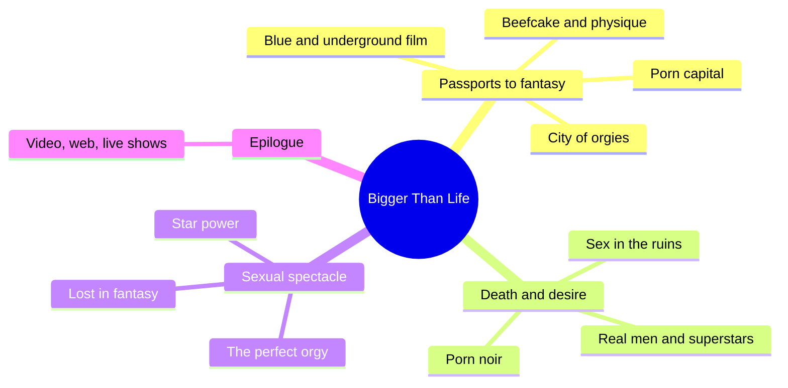
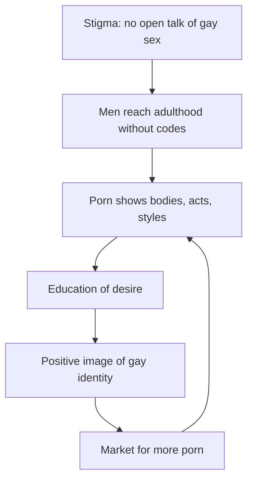
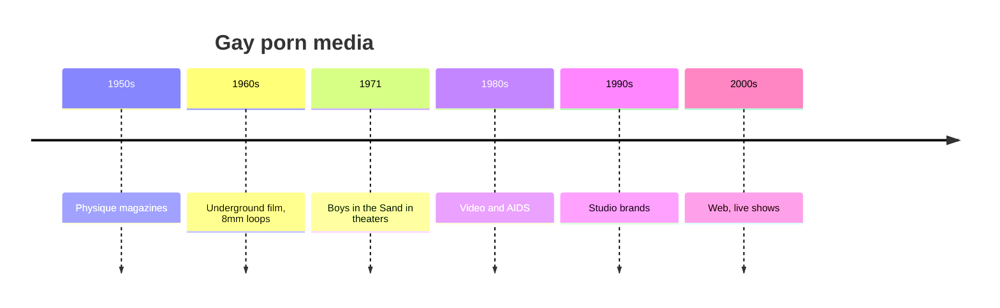
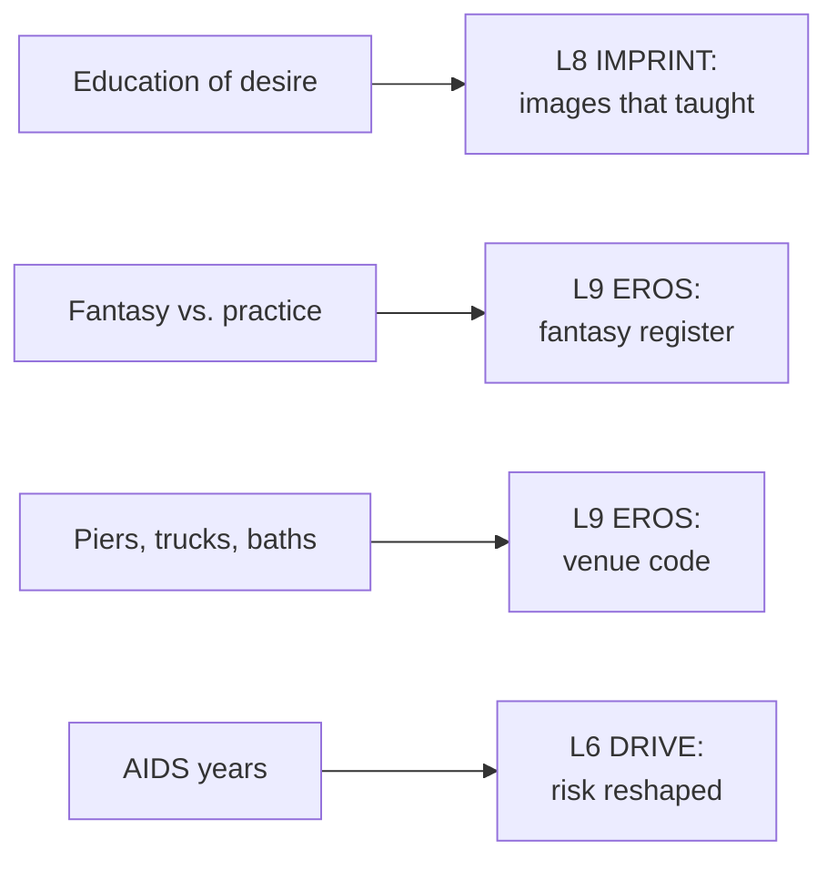

# 🧬 MSX.64 — Bigger Than Life — Escoffier (2009)
### Knowledge Entry — Distill

Escoffier's 2009 book is a history of gay porn film in the United States, from physique magazines to hardcore to the web. It treats porn as a medium for gay identity and desire.

> *Fantasy, not a how-to: what happens in these pages stays in them. Reader discretion advised.*

## TABLE OF CONTENTS
- [Core Thesis](#1-core-thesis)
- [Mind Models](#2-mind-models)
- [Framework](#3-framework--structure)
- [Key Concepts](#4-key-concepts)
- [Heuristics](#5-heuristics--decision-rules)
- [Invariants](#6-invariants)
- [Pitfalls](#7-pitfalls--myths)
- [Application](#8-application)
- [Cross-References](#9-cross-references)
- [Provenance](#10-provenance--confidence)

---

## 1 · CORE THESIS

Gay porn film grew from physique magazines and legal fights over obscenity into a medium that taught gay men how to desire. It shaped a masculine sexual style, and each new technology changed how and where gay men watched.

---

## 2 · MIND MODELS

**Diagram 1 — the whole argument.**
Caption: *the book runs from underground film to hardcore to the web, with AIDS as the hinge.*

**Diagram 2 — the central mechanism (the education of desire).**
Caption: *a closeted man has no social map, porn supplies one, and the map feeds back into the market.*

**Diagram 3 — the media timeline.**
Caption: *each change in medium moved the viewing place and changed the fantasy.*

**Diagram 4 — mapped onto the Command's 12-layer stack.**
Caption: *Escoffier gives IMPRINT a teacher, EROS a venue code and a fantasy register, and DRIVE the epidemic.*

---

## 3 · FRAMEWORK / STRUCTURE

Eleven chapters in three parts, with an introduction and epilogue. Each chapter works as a narrative essay with source tags.

| Part | What it does |
|---|---|
| Intro (p. 1-7) | The sexual revolution, obscenity law, porn as fantasy |
| Part One, Passports to Fantasy (Ch. 1-5) | Blue and underground film; Physique Pictorial and beefcake; the New York sex scene and Fire Island; the Los Angeles and San Francisco scenes; the real versus the fantastic |
| Part Two, Death and Desire (Ch. 6-8) | The AIDS years, the stars of the 1980s, porn noir |
| Part Three, Sexual Spectacle (Ch. 9-11) | The orgy film, star power, and porn in gay life |
| Epilogue, The End of Gay Hardcore Films (p. 345-348) | Video, the web and live shows |

---

## 4 · KEY CONCEPTS

| Concept | What it is | Why it matters |
|---|---|---|
| **Porn chic** | The early-1970s moment when hardcore films opened in mainstream theaters (Intro, p. 1) | *Boys in the Sand* (1971) was the first porn film previewed by *Variety* |
| **Roth standard** | The 1957 Supreme Court test for obscenity (Intro, p. 3) | Legal limits shaped what could be filmed and sold |
| **Physique magazine** | Beefcake magazines such as *Physique Pictorial* (Ch. 1, p. 17-18) | They were near-total gay culture in the 1950s, with a circulation above 750,000 |
| **Education of desire** | Richard Dyer's phrase for what porn teaches (Intro, p. 6) | It fills the gap left by stigma |
| **Gay masculinity** | The style of masculinity gay hardcore recorded and codified (Intro, p. 6) | It put homosexual desire in masculine territory, apart from identity |
| **Fantasy** | A sexual scenario without social side effects, heightened by risk (Intro, p. 6-7) | Fantasy is separate from reality and bounded by it (Ch. 5, p. 148) |
| **The trucks, the piers, the tubs** | Public and semi-public sex venues of 1970s New York (Ch. 3, p. 91-94) | A venue has etiquette, danger and a mythology |
| **The Mineshaft** | A New York S/M club opened in 1976, with a dress code and hired players (Ch. 5, p. 148-150) | The club works as a stage with roles |
| **Sex in the ruins** | The AIDS crisis and the sexual-ethic crisis inside the gay community (Ch. 6, p. 177-179) | It shifted debate from acts to a moral talk about promiscuity |
| **Superstar formula** | Two of three: face, body, or size (Ch. 7, p. 205) | The market stated its own selection rule |
| **Home video** | Moved viewing from theaters to private homes (Epilogue, p. 346) | The AIDS crisis reinforced the shift |
| **Web, live shows** | Escort sites, webcams, one-on-one sessions (Epilogue, p. 347-348) | The persona becomes a brand and an interactive service |

---

## 5 · HEURISTICS & DECISION RULES

| Situation | Do this | Not this |
|---|---|---|
| A character's first erotic images | Name the source: magazine, film, site | Leave his education of desire unstated |
| A character who has fantasy and practice | Keep the two registers apart, and let them differ | Make fantasy a preview of conduct |
| A venue scene (bath, pier, club) | Give it etiquette: how to invite, how to decline (p. 94) | Treat it as lawless |
| An era in the setting | Match media to date: magazine, loop, tape, site | Use one medium for all decades |
| A character who performs on camera | Give him a persona, a rate, and a reason (p. 205-208) | Treat it as a plot device |
| A character in the AIDS years | Show sex as calculation and porn as safe substitute (p. 178, 326) | Skip the epidemic or reduce it to a moral |
| A character raised in a small town | Let the stigma shape his path out (p. 207) | Let him move without cost |

---

## 6 · INVARIANTS

1. Stigma pushes sexual expression underground, and media fill the gap (Intro, p. 5).
2. Porn teaches desire, and it records a style (Intro, p. 6).
3. Fantasy sits apart from reality and depends on it (Ch. 5, p. 148).
4. A change in medium changes the viewing place and the fantasy (Epilogue, p. 346-348).
5. A venue carries a code, a danger and a myth (Ch. 3, p. 91-94).
6. A crisis in health becomes a crisis in sexual ethics (Ch. 6, p. 178).

---

## 7 · PITFALLS / MYTHS

- The book is a history of the commercial U.S. gay porn industry. It does not describe how most gay men live.
- Escoffier is both a historian and a participant. He dedicates the book to people in the trade (Dedication, PDF p. 6), so his view is sympathetic to it.
- The book leans on interviews, memoirs and magazine pieces, tagged in brackets in the text. Some accounts are one person's memory.
- Its sources are mostly male and mostly white, and the book names performers by stage name.
- The claim that porn "helped affirm" gay identity is Escoffier's argument. Critics read porn differently, and the book mentions both views (Intro, p. 2).
- The book was published in 2009, so the web chapter is a snapshot of the early broadband years.
- Porn performers' accounts of their motives, such as Stryker's, are first-person and promotional by nature.

---

## 8 · APPLICATION

*Proposed, not ruled.*

- **Spine level:** L5.
- **12-layer character stack:** L8 IMPRINT (primary: erotic education source); L9 EROS (primary: fantasy register; primary: venue code); L6 DRIVE (supporting: epidemic risk); L3 SOCIAL (supporting: persona as brand); L4 WILL (contextual: refusing a label).
- **plot_systems:** a "first images" beat. A character remembers what he saw first, and the later story answers it.
- **Setting:** DCUS-era media can be dated: magazine, tape, site. A venue can have a code with a smile for yes and a phrase for no.

For the ORANGE work, the book gives IMPRINT a concrete teacher. A character's erotic map came from somewhere, and the answer can be a magazine under a mattress or a browser tab. The book also licenses a clear split between fantasy and practice. Fantasy is not a rehearsal, so a story can let a character want a scene he never plans to live. For the explicit scenes this shelf supports, Escoffier's own frame fits: the fantasy comes first, and it has its own rules of risk, mystery and transgression. The venue code on p. 94 is a model for how to write a ritual with no dialogue.

---

## 9 · CROSS-REFERENCES

| Related entry | Relation |
|---|---|
| [[🧬 MSX.60 — Tearoom Trade — Humphreys (1970)]] | Humphreys' tearoom and Escoffier's piers and trucks are neighbor venues of the same decade |
| [[🧬 MSX.56 — Coming Out — Weeks (1977)]] | Weeks gives the political history of the same liberation Escoffier sets his story in |
| [[🧬 MSX.36 — The History of Sexuality — Foucault (1978)]] | Foucault's production of sex as discourse is a theory of what Escoffier's industry does |
| [[🧬 MSX.31 — Porn — An Oral History — Barton (2023)]] | Barton's oral history covers the same industry from performers' accounts |
| [[🧬 PSY.53 — The Social Organization of Sexuality — Laumann et al. (1994)]] | Laumann's scripting theory is a plain account of how Escoffier's "education of desire" works |

---

## 10 · PROVENANCE & CONFIDENCE

Full text, pdftotext extraction, 376 PDF pages. Title page and imprint: Jeffrey Escoffier, *Bigger Than Life*, Running Press, 2009. Printed page equals PDF page minus nine in the body.

Read: the Introduction in full (p. 1-7), the opening of Ch. 1 and the physique magazine passage (p. 11-18), Ch. 3 on the New York sex scene (p. 91-94), the opening of Ch. 5 and the Mineshaft (p. 147-150), the opening of Ch. 6 (p. 177-179), the opening of Ch. 7 (p. 205-208), the opening of Ch. 11 (p. 325-327) and the Epilogue in full (p. 345-348).

Skipped: Ch. 2 and 4, most of Ch. 1, 3, 5, 6 and 7, all of Ch. 8 to 10, the rest of Ch. 11, the notes and the index. Individual film histories, directors and performer profiles were not read. The `feeds:` keying is this distill's own work. Escoffier uses no 12-layer vocabulary.

## META
- Template: BVX-LEARN-v4.0
- Source classification: full-text pdftotext extraction, full read of the Introduction and Epilogue, targeted read of Ch. 1, 3, 5, 6, 7 and 11
- Created / Updated: 2026-10-04
