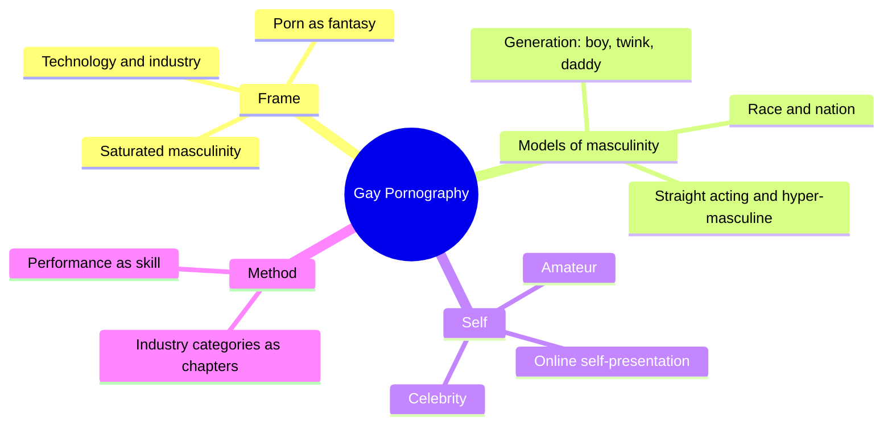
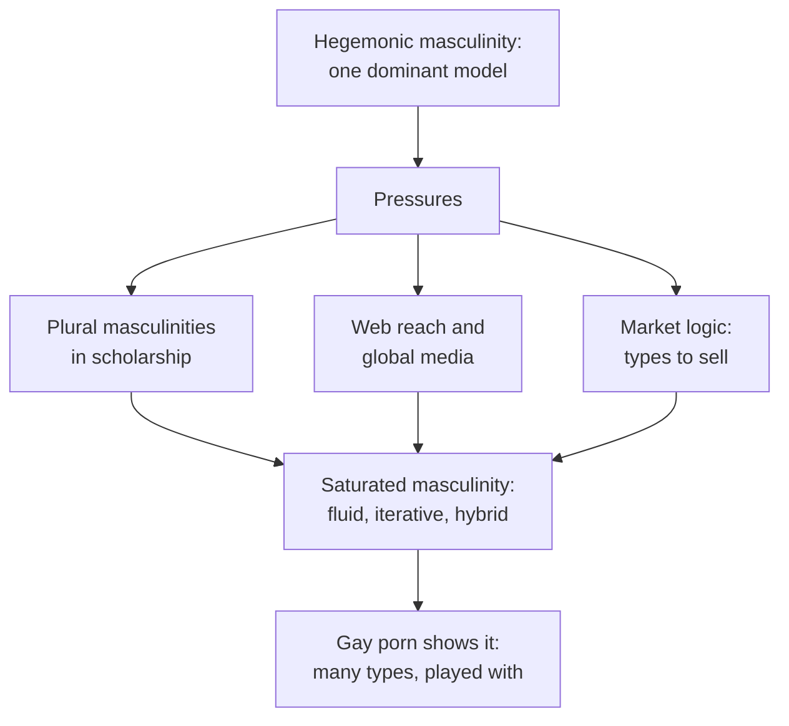
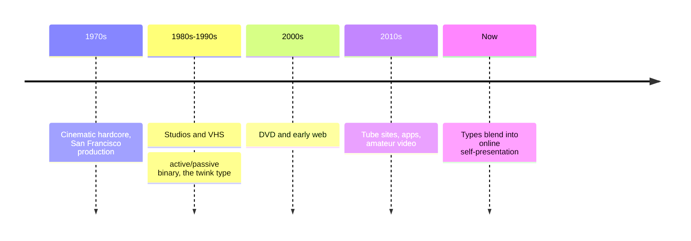
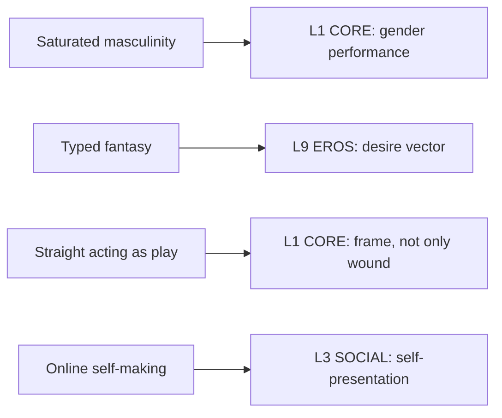

# 🧬 MSX.65 — Gay Pornography — Mercer (2017)
### Knowledge Entry — Distill

Fantasy, not a how-to: what happens in these pages stays in them. Reader discretion advised.

John Mercer's 2017 study reads online gay pornography as a catalog of masculine types. It treats porn as fantasy and as a mirror for masculinity at large, and it names the condition it finds "saturated masculinity."

## TABLE OF CONTENTS
- [Core Thesis](#1-core-thesis)
- [Mind Models](#2-mind-models)
- [Framework](#3-framework--structure)
- [Key Concepts](#4-key-concepts)
- [Heuristics](#5-heuristics--decision-rules)
- [Invariants](#6-invariants)
- [Pitfalls](#7-pitfalls--myths)
- [Application](#8-application)
- [Cross-References](#9-cross-references)
- [Provenance](#10-provenance--confidence)

---

## 1 · CORE THESIS

Gay porn produces many models of masculinity, and they keep changing. Mercer calls this "saturated masculinity": too many meanings for any one norm to hold. Porn is fantasy, not a mirror of the real world.

---

## 2 · MIND MODELS

**Diagram 1 — the whole argument.**
Caption: *the book frames saturated masculinity first, then walks the industry's own categories as chapters, ending on the self.*

**Diagram 2 — the central mechanism (how masculinity saturates).**
Caption: *old hegemonic masculinity is pressed by plural models, media reach, and market demand until no single type can claim the center.*

**Diagram 3 — the period arc of the genre.**
Caption: *technology moved the genre from cinema to tape to the web, and each stage changed its types and its audience.*

**Diagram 4 — mapped onto the Command's 12-layer character stack.**
Caption: *Mercer gives CORE a plural masculinity, EROS a typed but exceeding desire, and SOCIAL a self built from porn's vocabulary.*

---

## 3 · FRAMEWORK / STRUCTURE

| Part | What it does |
|---|---|
| Introduction (pdf pp. 15-38) | Defines "gay porn" as a genre for gay men and reviews two waves of scholarship. |
| Part 1, Contexts (Ch. 1-2) | Sets out saturated masculinity, then the industry and its technology. |
| Part 2, Models (Ch. 3-6) | Walks generation, straight acting and hypermasculinity, race and nation, and celebrity and amateur. |
| Conclusion: The Self (pdf pp. 219-223) | Links porn's vocabulary to online self-presentation. |

---

## 4 · KEY CONCEPTS

| Concept | What it is | Why it matters |
|---|---|---|
| **Saturated masculinity** | A condition where masculinity carries too many meanings for one norm (Ch. 1, pdf p. 56) | It names the book's finding. |
| **Hegemonic masculinity** | Connell's idea of one dominant model that others orbit (Ch. 1, pdf pp. 41-44) | Mercer argues it no longer holds in popular culture. |
| **Demotic idiom** | The shared visual and narrative conventions of commercial gay porn (Ch. 2, pdf p. 90) | It is the genre's common language. |
| **Fantasy** | A realm that does not reflect or command the real world (Intro, pdf p. 15) | Fantasy is a form of speech, not a plan. |
| **Active/passive binary** | The studio rule of fixed tops and bottoms (Ch. 3, pdf p. 99) | It shaped body types and the twink. |
| **Twink** | A smooth, young, usually white, receptive type (Ch. 3, pdf p. 100) | The term has so many senses that Mercer questions its use. |
| **Industrial standard of youth** | Performers aged 18 to 24 (Ch. 3, pdf p. 98) | The book states the industry's own rule. |
| **Straight acting** | A gay man who passes as straight, and straightness performed in porn (Ch. 4, pdf p. 130) | Mercer treats it as play, not only compensation. |
| **Exnomination** | Whiteness unmarked as the norm (Ch. 5, pdf pp. 172-173) | Porn's default body is a white, American one. |
| **International style** | A blended transnational look replacing national types (Ch. 5, pdf p. 173) | Local difference thins out. |
| **Performance as skill** | Porn work needs choreography and training (Ch. 2, pdf pp. 88-90) | It treats performers as skilled workers. |

---

## 5 · HEURISTICS & DECISION RULES

| Situation | Do this | Not this |
|---|---|---|
| Writing a fantasy-driven character | Let his desire use types but exceed them | Reduce him to one type |
| Writing a "straight acting" man | Show play and performance, as well as defense | Show only shame |
| Writing a masculinity | Give it many models and let it shift by scene | Give one fixed ideal |
| Writing online self-presentation | Borrow the iconography of a genre | Make profiles neutral |
| Writing a media setting | Let the tech set what can be shown | Ignore the medium |
| Writing a performer | Show craft: choreography, set-ups, training | Make him a puppet |

---

## 6 · INVARIANTS

1. **Fantasy is not a mirror and not an order.** Mercer builds on Kipnis here (Intro, pdf p. 15).
2. **Masculinity is plural.** One dominant model no longer explains the field (Ch. 1, pdf p. 59).
3. **Types are generative.** They keep producing new iterations (Intro, pdf p. 17).
4. **Technology shapes the genre.** Each medium changes what it shows (Ch. 2, pdf p. 61).
5. **Whiteness is the unmarked default.** It sits behind the types (Ch. 5, pdf p. 173).

---

## 7 · PITFALLS / MYTHS

- **It is cultural analysis of commercial and web material.** It rests on case studies of studios and sites, not on interviews with viewers or performers.
- **The corpus is mostly Anglophone and Western.** Mercer says the genre skews American and white (Ch. 5, pdf p. 172).
- **The "saturated masculinity" claim is a thesis.** It is borrowed from Gergen and Bauman and argued, not measured.
- **The market is the author's source of chapters.** The categories come from the industry, so the book inherits its blind spots.
- Reading porn as a mirror of real life. Mercer argues it is fantasy (pdf p. 15).
- Reading "straight acting" as plain self-hatred. Mercer calls that too narrow (pdf p. 131).

---

## 8 · APPLICATION

*Proposed, not ruled.*

- **Spine level:** L5.
- **12-layer character stack:** L1 CORE (gender performance, primary; frame, supporting); L9 EROS (desire vector, primary); L3 SOCIAL (self-presentation, supporting); L7 (setting contract, contextual).
- **plot_systems:** a fantasy scene that stages a type, then breaks it, gives a ready character beat.
- **Setting:** a media-tech era sets which types exist, so a DCUS-era story can name its own.

For the ORANGE work, the book gives a way to write desire as typed and yet bigger than the type. A character can want the athlete, the boy next door, or the older man, and the scene can show him play with the type. The straight-acting frame offers a second layer: a man's performance of straightness can be a game he enjoys. The online-self material gives writers a modern frame: a character's profile is a small porn-shaped self. A proposed variable, `type_vocabulary`, would list the types a character uses to think about desire on L9.

---

## 9 · CROSS-REFERENCES

| Related entry | Relation |
|---|---|
| [[🧬 MSX.61 — Times Square Red, Times Square Blue — Delany (1999)]] | Delany watches the theater audience; Mercer reads the product and the web. |
| [[🧬 MSX.36 — The History of Sexuality — Foucault (1978)]] | Typed fantasy parallels Foucault's species-making by naming. |
| [[🧬 PSY.51 — Sexual Behavior in the Human Female — Kinsey (1953)]] | Kinsey counts acts; Mercer reads the images people use to think about them. |

---

## 10 · PROVENANCE & CONFIDENCE

Full-text extraction by pdftotext from the PDF in the drop folder, 253 pdf pages. The assigned extract (n10) held a different book, Laura Kipnis's Bound and Gagged, so this distill uses a fresh extraction of Mercer's PDF. Front matter confirms John Mercer, I.B.Tauris, London and New York, 2017, in the Library of Gender and Popular Culture. The extraction has no running page numbers, so citations give the chapter and the pdf page. Read: the Introduction (pdf pp. 15-25), Ch. 1 pdf pp. 39-46 and 56-59, Ch. 2 pdf pp. 60-61 and 88-91, Ch. 3 pdf pp. 97-100, Ch. 4 pdf pp. 127-131, Ch. 5 pdf pp. 171-174, and the Conclusion (pdf pp. 219-223).

Skipped: most of Ch. 3 (including the intergenerational section), the bear and leather sections of Ch. 4, bareback porn (Ch. 4, pdf p. 162 on), the rest of Ch. 5, and all of Ch. 6 except its link to the Conclusion. The notes and bibliography were not read. Confidence is medium. The `feeds:` keying is this distill's synthesis.

## META
- Template: BVX-LEARN-v4.0
- Source classification: full-text extraction (fresh), targeted read of introduction, Ch. 1-5, conclusion
- Created / Updated: 2026-10-04
