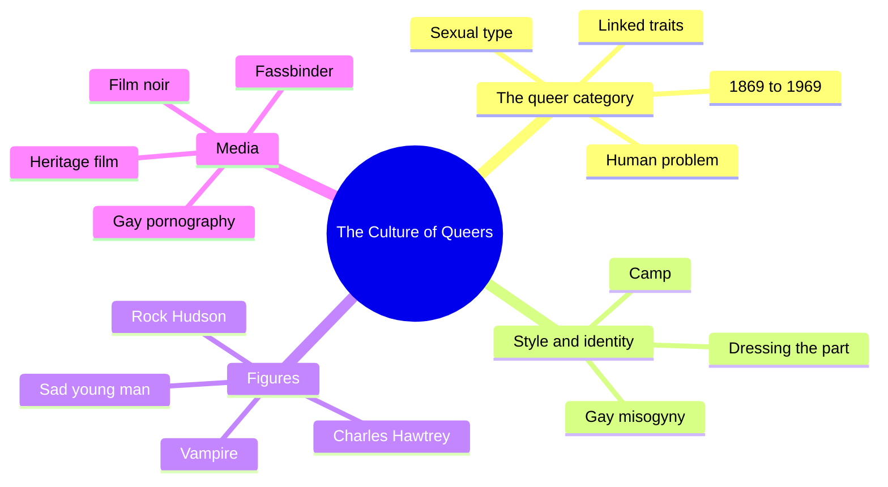
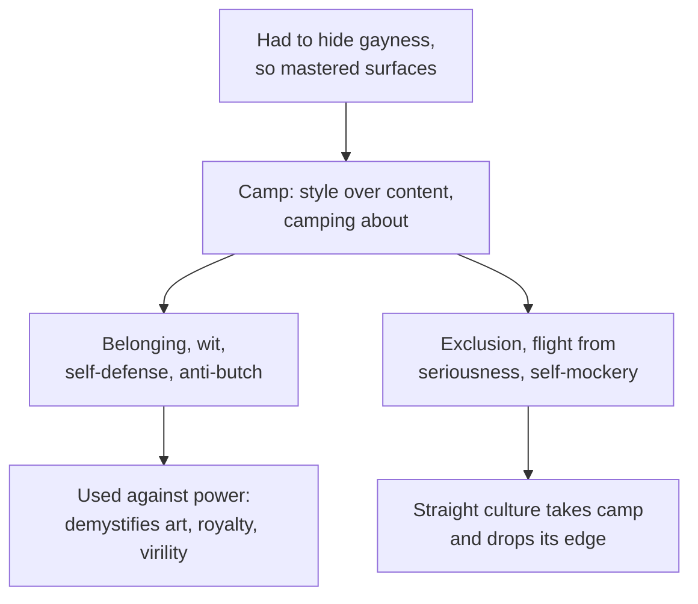
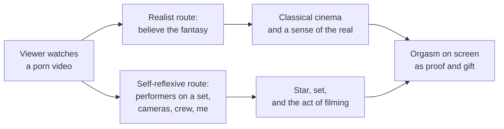
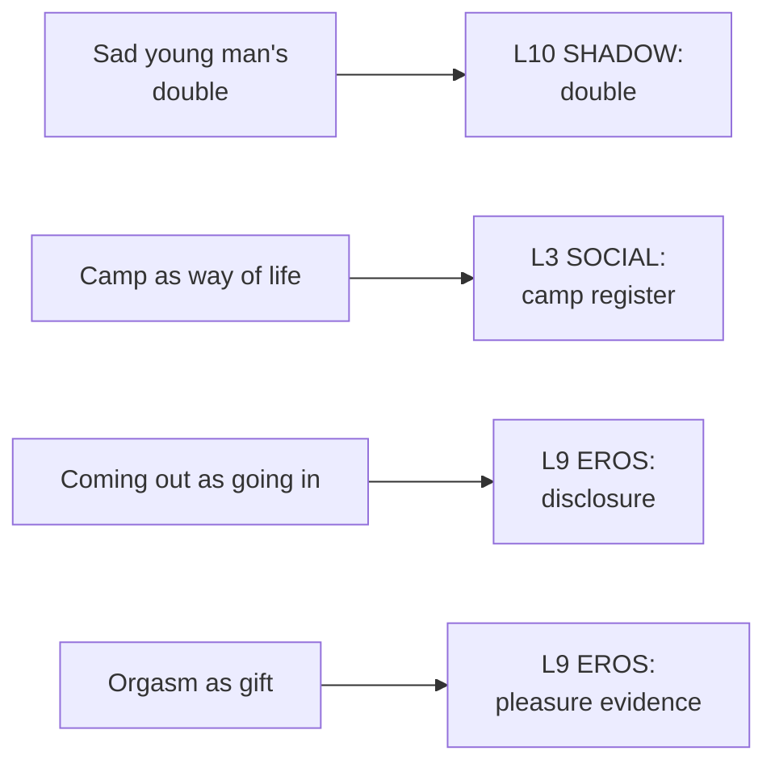

# 🧬 MSX.66 — The Culture of Queers — Dyer (2002)
### Knowledge Entry — Distill

Richard Dyer's 2002 essay collection reads a century of "queer" culture, from camp and vampires to sad young men and gay porn. It sits on the shelf as the media-and-style account of how gay male life looked from inside and from outside, and why those images stuck.

## TABLE OF CONTENTS
- [Core Thesis](#1-core-thesis)
- [Mind Models](#2-mind-models)
- [Framework](#3-framework--structure)
- [Key Concepts](#4-key-concepts)
- [Heuristics](#5-heuristics--decision-rules)
- [Invariants](#6-invariants)
- [Pitfalls](#7-pitfalls--myths)
- [Application](#8-application)
- [Cross-References](#9-cross-references)
- [Provenance](#10-provenance--confidence)

---

## 1 · CORE THESIS

From about 1869 to 1969, the "queer" was a sexual type tied to non-sexual traits and treated as a human problem. That category produced a culture of its own, camp, vampires, sad young men, and self-aware porn. Dyer reads each as a response to oppression, with both pride and scars.

---

## 2 · MIND MODELS

*Required. Minimum two diagrams, maximum five.*

**Diagram 1 — the whole argument.**
Caption: *the book defines the queer as a historical type, then reads fourteen cultural forms as ways of living inside that type.*

**Diagram 2 — the central mechanism (camp as a double-edged response).**
Caption: *camp grows from the need to disguise and the wish to belong, so each of its strengths has a matching cost.*

**Diagram 3 — two ways porn excites.**
Caption: *gay porn can work through belief in the story or through awareness of the cameras, and many titles invite the second.*

**Diagram 4 — mapped onto the Command's 12-layer character stack.**
Caption: *Dyer's figures sit on the stack as a shadow double, a camp register, a disclosure posture, and a pleasure read as a gift.*

---

## 3 · FRAMEWORK / STRUCTURE

An introduction and fourteen chapters, most of them earlier essays. The collection is arranged by theme and not by date.

| Chapter | Governing move |
|---|---|
| Introduction (pp. 1-14) | Defines "queer" as a historical category, 1869-1969, and separates it from homo-eroticism and capital-Q Queer theory |
| 1. The Politics of Gay Culture (p. 15) | What it means for a sexual group to have a culture. Not read here |
| 2. Believing in Fairies (p. 31) | The author and the homosexual in avant-garde film. Not read here |
| 3. Gay Misogyny (p. 46) | Gay men's attitudes toward women: shared male privilege and a special distance |
| 4. It's Being So Camp as Keeps Us Going (p. 49) | Camp as behavior and as taste, with its gains and costs |
| 5-7 | Dress, vampirism, queer film noir. Not read here |
| 8. Coming Out as Going In (p. 116) | The sad young man in 1940s-1960s paperbacks, film, and novels |
| 9-12 | L'Air de Paris, Hawtrey, Hudson, Fassbinder. Not read here |
| 13. Idol Thoughts (p. 187) | Orgasm and self-reflexivity in gay porn, through Ryan Idol |
| 14. Homosexuality and Heritage (p. 204) | Not read here |

The Introduction gives three features of "queers": a sexual category a man either belongs to or does not; a link to non-sexual qualities; and a status as humanly problematic (p. 1).

---

## 4 · KEY CONCEPTS

| Concept | What it is | Why it matters |
|---|---|---|
| **Queer (historical)** | A category of man from 1869 to 1969: defined by attraction to men, linked to other traits, seen as a problem (pp. 1-2) | A period type a writer can place a character inside |
| **Queer vs. Queer** | Lower-case is the historical type. Capital-Q is the later theory that stresses fluid, troubling desire (pp. 3-4) | Prevents mixing the two senses |
| **Homo-eroticism** | Attraction between men without necessarily sex, sometimes used to contain or desexualize it (pp. 3-4) | Another frame for male closeness |
| **Camping about** | Behaving in a distinct, witty, non-butch way together (p. 49) | Gives identity, fun, and self-defense |
| **Camp as sensibility** | Prying form from content and revelling in style (p. 52) | A way of looking that mocks seriousness |
| **Style professions** | Occupations like hairdressing and dance where camp sensibility gave gay men legitimacy (p. 52) | Shows how a taste became a niche |
| **Gay misogyny** | A habit of male privilege plus "adoration" of women that stays at a distance (pp. 46-48) | A trait for a character to hold or confront |
| **Sad young man** | A 1940s-60s image: young, attractive, melancholic, on the edge of becoming queer (pp. 128-129) | A stereotype with erotic pull |
| **Principle of maximum visibility** | Williams' term for porn's push to show more (cited, p. 191) | Links Dyer to MSX.42 |
| **Self-reflexive porn** | Porn that draws attention to its own making (pp. 192-193) | A sub-tradition, not the norm |
| **Orgasm as gift** | In gay sex, seeing another's climax signals excitement and gives part of oneself (p. 192) | A reading of the come shot that avoids pure proof |

---

## 5 · HEURISTICS & DECISION RULES

| Situation | Do this | Not this |
|---|---|---|
| Writing a character from before 1970 | Give him the three queer assumptions: type, traits, problem | Write him as a modern gay man in old clothes |
| Writing camp | Give it both sides: belonging and wit, plus exclusion and self-mockery | Make it only a joke or only a weapon |
| Writing a gay man with straight-acting looks | Let camp be one style among several (p. 51) | Equate gay with camp |
| Writing a gay man's talk about women | Let love and distance coexist | Write adoration as respect |
| Writing a coming-out | Try "going in" as a border crossing with a fear of the other world | Write it as a release only |
| Writing a fear of the future | Give the character a double, the shape he dreads | Leave the dread abstract |
| Writing a porn performer or watcher | Decide whether the pleasure is in the fantasy, the set, or both | Assume one way of watching |

---

## 6 · INVARIANTS

1. **The queer is a historical type.** It had a start, an end, and fuzzy edges (pp. 1-2).
2. **Same-sex acts are wider than the category.** Many men have sex with men without being "queers" (pp. 2-3).
3. **Camp comes from disguise.** Gay men learned surfaces because they had to hide (p. 59).
4. **Every strength of camp has a cost** (pp. 49-60).
5. **Straight culture can take camp and drop its edge** (p. 60).
6. **The stereotype carries both horror and desire.** The sad young man is both miserable and attractive (p. 128).
7. **Porn can be exciting because it is porn.** The thought of cameras can turn the viewer on (pp. 187-188).

---

## 7 · PITFALLS / MYTHS

- Reading "queer" in the historical sense as the modern word. Dyer separates them (pp. 3-4).
- Treating camp as only gay or only British. He writes from a British gay movement of the 1970s, with references to CHE and GLF (pp. 49-51).
- Taking his camp essay as a current style guide. It is a movement-era piece, and its terms ("silly Nelly," "a big girl") reflect that time (pp. 50-51).
- Treating his porn chapter as a survey. It rests on a few videos, chiefly Ryan Idol's, and Dyer says it may not be how everyone finds porn exciting (pp. 187-188).
- Treating white-and-young as universal. Dyer notes that the Catalina image is "highly specifically white, young, US and well fed" (p. 195).
- Assuming the vampire, noir, and Hudson essays say the same thing. They read different texts and are not read here.
- Assuming a gay critic equals a gay consensus. The essays are Dyer's readings.

---

## 8 · APPLICATION

*Proposed, never ruled.*

- **Spine level:** L5.
- **12-layer character stack:** L10 SHADOW (primary, the double); L3 SOCIAL (primary, camp register; contextual, relation to women); L9 EROS (supporting, disclosure and pleasure evidence); L7 ORIGIN (supporting, queer-era formation); L5 WOUND (supporting).
- **plot_systems:** the sad-young-man image is a story shape: a young man at a threshold with a feared future.
- **Setting:** the 1869-1969 queer era is a period SETTING with its own types and codes.

Dyer gives the ORANGE work a style layer. Camp is not decoration. It is a way of living that comes from disguise and brings belonging. A character's camp register tells the reader how he protects himself, how much it costs, and who it shuts out. The L3 variable can hold that.

His second gift is the double. The sad young man meets an old man who is himself. A shadow double that shows a character what he fears becoming is a story device the ORANGE work can use at the start of a character's arc, and the arc can then break the double.

His third gift is the gift reading of orgasm. In an explicit scene under the 06.1 ruling, the partner's climax can be written as something given and received. That pairs with Williams on the L9 variable `pleasure_evidence` and gives the two books a shared slot.

---

## 9 · CROSS-REFERENCES

| Related entry | Relation |
|---|---|
| [[🧬 MSX.42 — Hard Core — Williams (1989)]] | Dyer applies Williams' maximum visibility and money shot to gay porn (pp. 191-192) |
| [[🧬 MSX.36 — The History of Sexuality — Foucault (1978)]] | The historical "species" that Dyer's queer category builds on |
| [[🧬 MSX.62 — Gay Macho — Levine (1998)]] | The butch pole of 1970s gay style that camp pushed against |
| [[🧬 MSX.54 — Intimate Matters — D'Emilio & Freedman (2012)]] | The American history of the queer era and its end |
| [[🧬 MSX.50 — No Future — Edelman (2004)]] | A theory of the queer as figure, where Dyer reads figures in media |
| [[🧬 MSX.24 — Bareback Porn — Florêncio (2020)]] | A later study of explicit gay work |

---

## 10 · PROVENANCE & CONFIDENCE

Full-text pdftotext extraction from the Taylor and Francis e-book, about 251 pages, Routledge, London and New York, 2002, copyright Richard Dyer. The front matter confirms the author, title, publisher, and 2002 copyright. Page numbers come from running heads and are reliable. The essays were first published at different dates.

Read in full or near-full: the contents page; the Introduction (pp. 1-5 in detail); chapter 3, Gay Misogyny (pp. 46-48); chapter 4, camp, to p. 60; chapter 8, the sad young man, an excerpt (pp. 127-129); chapter 13, Idol Thoughts, from its start through p. 195.

Skipped: chapters 1, 2, 5, 6, 7, 9, 10, 11, 12, 14; the rest of the Introduction; chapter 8 outside the excerpt; chapter 13 after p. 195; the index. The vampire, noir, Hudson, Hawtrey, Fassbinder, and heritage essays rest on the contents page only.

Contested or dated: the camp essay is from the 1970s gay movement. The porn chapter is from the early 1990s. Both are single-author readings.

The `feeds:` keying is this distill's own synthesis. The `camp_register` and `relation_to_women` variables are proposed here and are not yet in the schema.

## META
- Template: BVX-LEARN-v4.0
- Source classification: full-text pdftotext extraction, targeted read of the Introduction and chapters 3, 4, 8, 13
- Created / Updated: 2026-10-04
