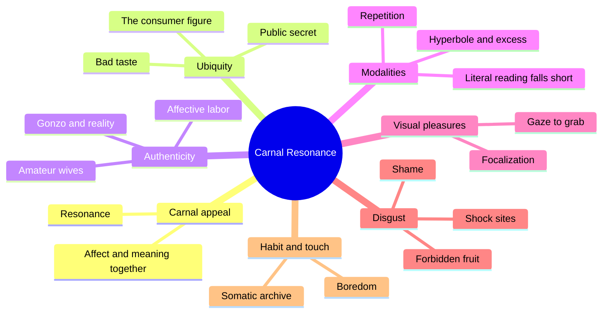
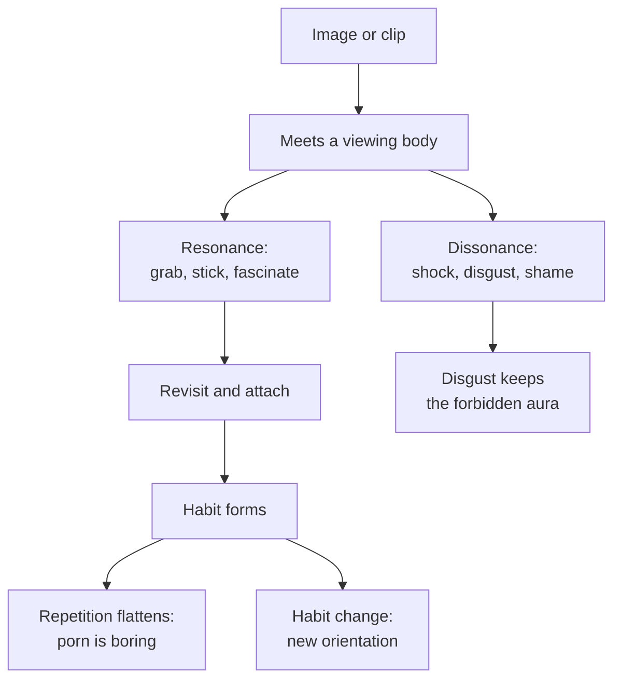
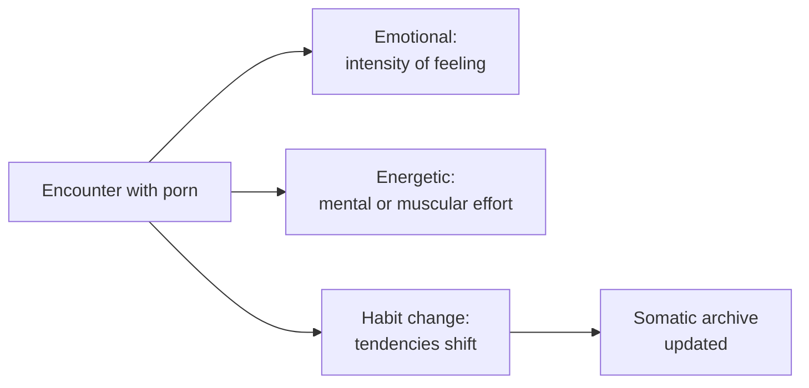

# 🧬 MSX.67 — Carnal Resonance — Paasonen (2011)
### Knowledge Entry — Distill

Susanna Paasonen, a Finnish media scholar, published this study with MIT Press in 2011. It treats online pornography through affect, the felt force of images, and argues that porn's pull is as much bodily as it is a matter of meaning.

## TABLE OF CONTENTS
- [Core Thesis](#1-core-thesis)
- [Mind Models](#2-mind-models)
- [Framework](#3-framework--structure)
- [Key Concepts](#4-key-concepts)
- [Heuristics](#5-heuristics--decision-rules)
- [Invariants](#6-invariants)
- [Pitfalls](#7-pitfalls--myths)
- [Application](#8-application)
- [Cross-References](#9-cross-references)
- [Provenance](#10-provenance--confidence)

---

## 1 · CORE THESIS

Online porn works through resonance: a bodily grab that images produce in viewers, and that no reading of meaning fully explains. Porn mixes authenticity and excess, disgust and pleasure, repetition and surprise. Paasonen argues that scholars should study what porn does, as well as what it depicts.

---

## 2 · MIND MODELS

**Diagram 1 — the whole argument.**
Caption: *the book builds from context, to authenticity, to the genre's style, to the viewing body, to disgust, and ends on touch.*

**Diagram 2 — the central mechanism (how an image grabs).**
Caption: *an image resonates when it meets the viewer's body at the right frequency, and then habit either deepens the attachment or flattens it.*

**Diagram 3 — three effects of a sign, applied to porn.**
Caption: *Paasonen borrows three effects from de Lauretis and Peirce, and the third one, habit change, is the one that matters for a character's development.*

---

## 3 · FRAMEWORK / STRUCTURE

The book has an introduction, five chapters, and a conclusion. It moves between distance and closeness on purpose, which Paasonen calls "a discomforting commute" (ch. 1, pp. 20-21).

| Chapter | Governing move |
|---|---|
| 1. Introduction: Carnal Appeal (pp. 1-29) | Defines affect and proposes resonance in place of identification |
| 2. Bad Taste, Miasmic Forces, and the Ubiquity of Online Porn (pp. 31-69) | Online porn as a public secret and the figure of the consumer |
| 3. Amateur Wives and the Attraction of Authenticity (pp. 71-113) | Amateur, gonzo, and reality porn, and affective labor |
| 4. The Literal and the Hyperbolic (pp. 115-163) | Content analysis of porn spam and the genre's excess |
| 5. Visual Pleasures: From Gaze to Grab and Resonance (pp. 165-205) | Replaces film theory's gaze with resonance, rhythm, and grab |
| 6. Absolutely Disgusting (pp. 207-249) | Viral videos, shock sites, disgust, and shame |
| 7. Conclusions: The Tactile Grab (pp. 251-261) | Habit, familiarity, tactility, and mediation |

---

## 4 · KEY CONCEPTS

| Concept | What it is | Why it matters |
|---|---|---|
| **Resonance** | Being moved by what is "tuned to the right frequency" (ch. 1, p. 16) | Paasonen uses it in place of identification, which implies sameness |
| **Grab** | Porn's visceral pull and power to disturb (ch. 1, p. 16) | The word names force without naming meaning |
| **Carnal residue** | The physical presence of performers that online media transmit (ch. 1, p. 17) | It anchors the sense of realness |
| **Affect** | Gut reactions, intensities, and bodily sensations (ch. 1, p. 15, and following) | Paasonen keeps it tied to meaning, not apart from it |
| **Public secret** | Everyone knows people use porn; few say so (ch. 2, p. 32) | The shame lives in the gap between knowing and saying |
| **Authenticity effect** | Amateur and gonzo porn promise the real (ch. 3, pp. 84-85) | Paasonen says amateur images are staged and conventional too |
| **Hyperbolic modality** | Porn runs on excess, stylization, and repetition (ch. 4, pp. 143-144) | She argues literal readings fall short |
| **Focalization** | The perspective from which a scene is shown (ch. 5, p. 167) | The faceless-penis, POV convention puts the viewer in the performer's place |
| **Dwelling in disgust** | Porn pulls the nasty close and pushes it away (ch. 6, p. 209) | The potential to upset keeps its forbidden aura |
| **Habit and somatic archive** | Viewing builds habits, and the body stores them (ch. 7, pp. 254-255) | Habit change is the third effect of a sign |

---

## 5 · HEURISTICS & DECISION RULES

| Situation | Do this | Not this |
|---|---|---|
| Writing why an image hooks a character | Describe the body's reaction first and the meaning second | Explain it only as symbol or ideology |
| Writing what a character likes | Let different images resonate for him at different times | Give him one fixed type |
| Writing boredom | Show repetition flattening a once-strong image | Write desire as constant |
| Writing a first exposure | Give it secrecy, risk, and no explanation | Give it a clean, educated frame |
| Writing shame about watching | Let shame and arousal arrive together | Split them into two moods |
| Writing an "authentic" amateur clip | Show the staging under the promise of the real | Write it as plain truth |
| Writing a viral extreme clip | Let people share it for the shock, with sexual arousal minor | Treat it as ordinary porn use |

---

## 6 · INVARIANTS

1. Resonance changes in form and intensity over time and with the viewer (ch. 1, p. 17).
2. Porn works through conventions, so familiar types and formulas shape its grab (ch. 7, p. 254).
3. The viewer is "ultimately an outsider looking in" and sees performers' feelings only as codified gesture (ch. 4, p. 144).
4. Disgust and interest are tied in the genre, and shame is central (ch. 6, pp. 209-211).
5. Sensing and making sense cannot be separated (ch. 7, p. 255).
6. Porn is a public secret: widespread and unadmitted (ch. 2, p. 32).

---

## 7 · PITFALLS / MYTHS

- Treating the book as a study of gay porn. Paasonen states she addresses mainstream, mostly heterosexual, commercial online porn, and she names gay and queer porn as outside her focus (ch. 1, pp. 6-7). Her examples carry a male-viewer, female-performer default.
- Dated: the book describes the web as of 2010, with spam, early tube sites, and pay sites. She notes that tubes and amateur content had already changed the landscape (ch. 1, p. 6). Streaming platforms and subscription sites came later.
- Her sample is a body of 366 spam messages and a set of popular sites, read by a "lurker" (ch. 1, p. 6; ch. 5, p. 167). It is a close reading, not a survey of users, and the author says participant observation would have given other insights.
- Reading "resonance" as a measurable effect. Paasonen says she does not mean specific causal effects and the movement "has no predictable direction" (ch. 1, p. 17).
- Heavy theory: much of ch. 1 argues with Deleuzian and film-theory scholars. A reader seeking scene craft gets it mostly from chs. 4 to 7.
- Reading her autobiographical story as typical. She gives it as one framework from a Finnish context (ch. 7, p. 253).

---

## 8 · APPLICATION

*Proposed for the ORANGE work, not ruled.*

- **Spine level:** L5.
- **12-layer character stack:** L9 EROS (primary, resonance profile); L8 IMPRINT (primary, somatic archive); L10 SHADOW (primary, disgust and shame pull); L3 SOCIAL (supporting, public secret); L7 ORIGIN (supporting, forbidden first exposure); L6 DRIVE (contextual, boredom and novelty).
- **plot_systems:** a character's media diet is a trace of habit change over time. What he watched at 15, 25, and 35 can serve as a timeline without a diary.
- **Setting:** a viewing space, whether a room, a phone, or a shared screen, has its own norms of distance and closeness.

The book gives the ORANGE system a language for the sensory side of a character's erotic life. EROS can carry a resonance profile: what grabs him, what goes flat, what repels and still pulls. IMPRINT can carry the archive that profile builds from.

The strongest addition is the resonance-and-boredom loop. A character finds what grabs him, repeats it until habit flattens it, then moves on, with shame sitting beside the pull. That gives a writer a mechanism for changing tastes with no trauma story.

Proposed use: add `resonance_profile` to EROS, paired with `somatic_archive` on IMPRINT, and let the story show habit change as scenes.

---

## 9 · CROSS-REFERENCES

| Related entry | Relation |
|---|---|
| [[🧬 MSX.26 — Pornographic Art and the Aesthetics of Pornography — Maes (2013)]] | Maes argues from aesthetics; Paasonen from affect. Both resist a purely moral reading |
| [[🧬 MSX.24 — Bareback Porn — Florêncio (2020)]] | Florêncio's gay male case sits outside Paasonen's mainstream-heterosexual sample |
| [[🧬 MSX.31 — Porn — An Oral History — Barton (2023)]] | Barton gives the performers' voices that Paasonen's close reading lacks |
| [[🧬 MSX.18 — Porn Work — Berg (2021)]] | Berg covers the labor that Paasonen's ch. 3 names as affective labor |
| [[🧬 MSX.36 — The History of Sexuality — Foucault (1978)]] | Foucault's incitement to discourse meets Paasonen's public secret |

---

## 10 · PROVENANCE & CONFIDENCE

Full text by pdftotext, about 332 pdf pages; book page = pdf page minus 11. Title page and copyright confirm Susanna Paasonen, *Carnal Resonance: Affect and Online Pornography*, MIT Press, Cambridge, Massachusetts, 2011.

Read in full: the Preface; ch. 1 (pp. 5-29, with the definition of resonance on pp. 15-17 and the chapter outline); ch. 2's opening (pp. 31-33); ch. 3's authenticity passage (pp. 84-85); ch. 4's discussion of Zizek (pp. 143-144); ch. 5's opening on focalization (pp. 166-169); ch. 6's opening (pp. 208-211); ch. 7 (pp. 251-256). Skipped: most of chs. 2 to 6, the notes, and the references. Ch. 4's content-analysis tables and ch. 6's case studies are known only from the intro's outline and the passages read.

Dated and contested: the empirical base is 2002-2010 spam and websites. Affect theory is a contested field, and Paasonen argues against several of its leading voices (ch. 1, pp. 9-12). Confidence is medium.

The `feeds:` keying is this distill's own synthesis. Paasonen uses no layer vocabulary.

## META
- Template: BVX-LEARN-v4.0
- Source classification: full-text pdftotext, introduction and conclusion read, selected chapters sampled
- Created / Updated: 2026-10-04
