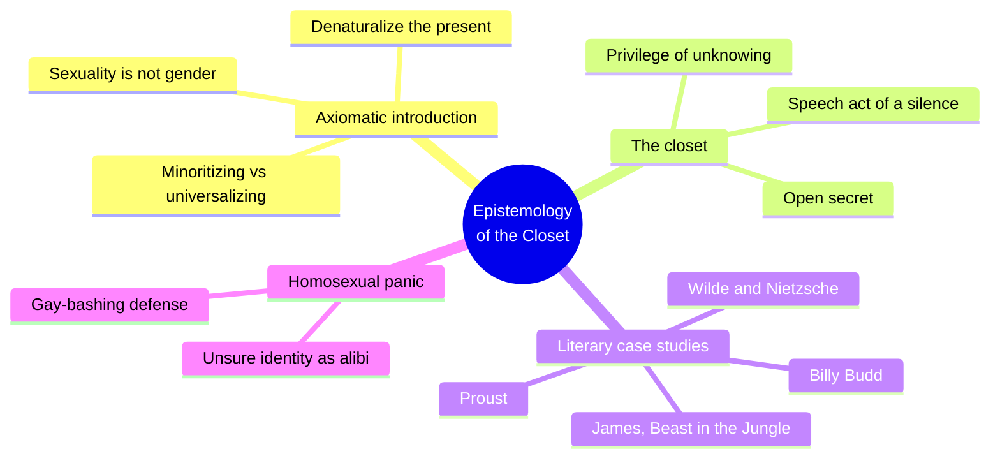
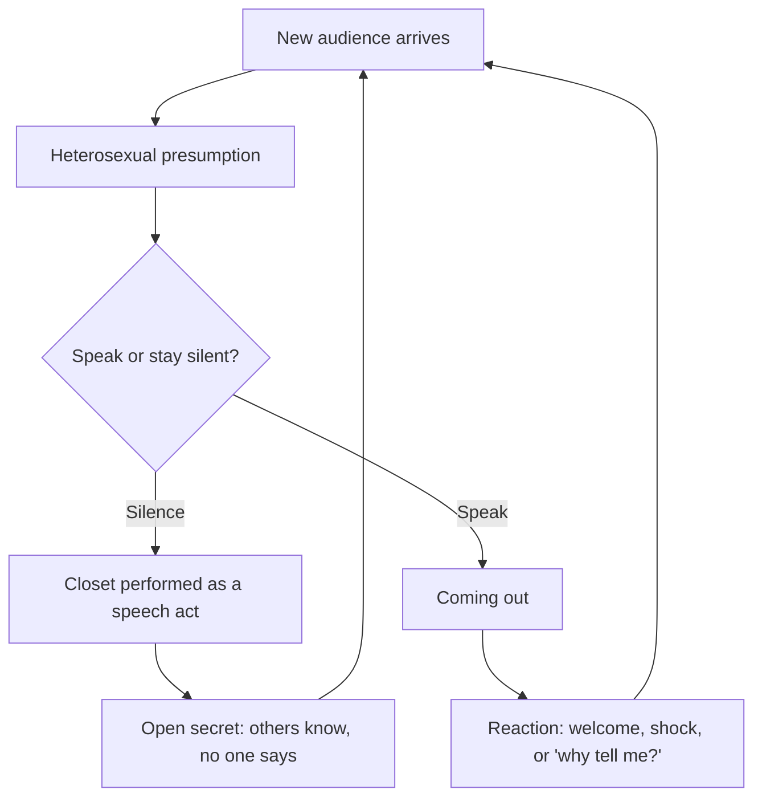
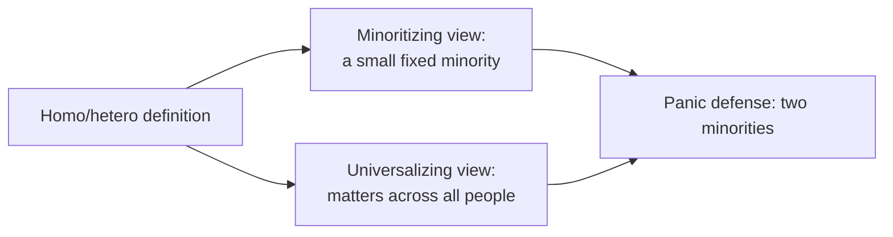
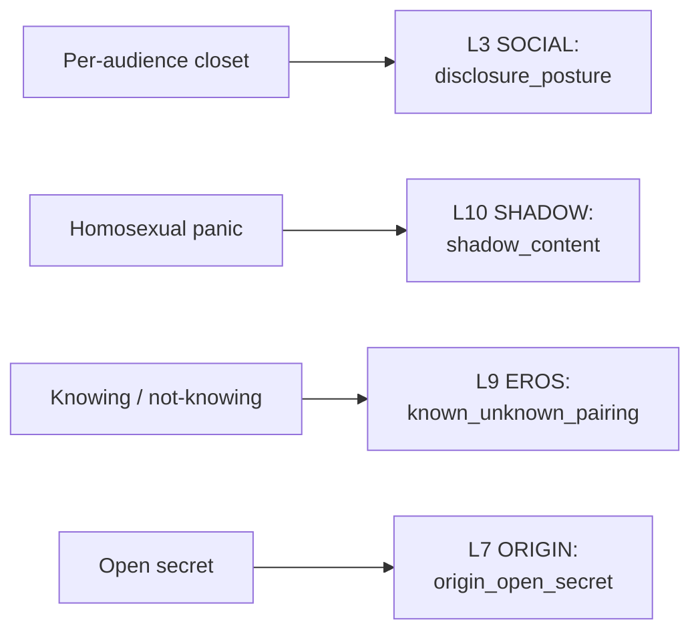

# 🧬 MSX.68 — Epistemology of the Closet — Sedgwick (1990)
### Knowledge Entry — Distill

Sedgwick's 1990 book argues that modern Western culture organizes knowledge itself around the homo/heterosexual binary. It gives the Command a working theory of the closet as a structure of knowing, not a room a character steps out of once.

## TABLE OF CONTENTS
- [Core Thesis](#1-core-thesis)
- [Mind Models](#2-mind-models)
- [Framework](#3-framework--structure)
- [Key Concepts](#4-key-concepts)
- [Heuristics](#5-heuristics--decision-rules)
- [Invariants](#6-invariants)
- [Pitfalls](#7-pitfalls--myths)
- [Application](#8-application)
- [Cross-References](#9-cross-references)
- [Provenance](#10-provenance--confidence)

---

## 1 · CORE THESIS

Since about 1891, Western thought has sorted every person into homo or hetero, and that sorting shapes how culture decides what counts as knowledge. The closet is the defining structure of gay oppression, and it works through managed knowing and not-knowing. Nobody can stand outside it.

---

## 2 · MIND MODELS

**Diagram 1 — the whole argument.**
Caption: *one binary, two contradictory readings of it, and a closet that runs on the gap between knowing and not knowing.*

**Diagram 2 — the central mechanism (the closet as repeated disclosure).**
Caption: *the closet never closes for good: each new audience restarts a cycle of presumption, silence, and the risk of being read.*

**Diagram 3 — the two readings of sexual definition.**
Caption: *the book refuses to pick a winner: the two views contradict each other, and both stay in use.*

**Diagram 4 — mapped onto the 12-layer character stack.**
Caption: *four of Sedgwick's moves land on four layers: audience-by-audience disclosure, panic as shadow, the shared gap as eros, the open secret as origin.*

---

## 3 · FRAMEWORK / STRUCTURE

Sedgwick opens with a long "Axiomatic" introduction, then reads five texts closely.

| Part | Governing move |
|---|---|
| Introduction (pp. 1-63) | Six axioms. She states the two contradictions in modern sexual definition (p. 1). She says the study of sexuality is not the study of gender (Axiom 2, p. 27). |
| Ch. 1, Epistemology of the Closet (p. 67) | Defines the closet as the defining structure for gay oppression this century (p. 71). Ties it to knowledge/ignorance as a sexual pair (p. 73). |
| Ch. 2, Billy Budd: After the Homosexual | Reads Melville's novella as a text of the new homosexual definition. Chapters 2 and 3 were written as one unit. |
| Ch. 3, Wilde, Nietzsche, and the Sentimental Relations of the Male Body (p. 131) | Reads the period between Wilde and Proust as a rush of attempts to name the new kind of person. |
| Ch. 4, The Beast in the Closet | Reads James's story of a man and the secret he never names, through homosexual panic. |
| Ch. 5, Proust and the Spectacle of the Closet (p. 213) | Reads Proust's treatment of secrecy and display. |

---

## 4 · KEY CONCEPTS

| Concept | What it is | Why it matters |
|---|---|---|
| **Minoritizing view** | Homo/hetero definition matters mainly to a small, fixed gay minority (p. 1). | It gives gay people a clear group to defend. It also lets everyone else treat the issue as not theirs. |
| **Universalizing view** | The same definition shapes the lives of people across the whole spectrum of sexualities (p. 1). | It shows why straight identity depends on gay identity. It risks erasing gay people as a group. |
| **The closet** | The defining structure for gay oppression in this century (p. 71). | It names a system of forced disclosure and forced silence, not a private fear. |
| **Speech act of a silence** | Closetedness is a performance begun by a silence that gains meaning against the speech around it (p. 3). | A character can be closeted by what he leaves unsaid at a specific moment. |
| **Open secret** | A thing known and not said. D. A. Miller's idea, cited on p. 67. | The open secret keeps the inside/outside binary alive. It does not break it. |
| **Epistemological privilege of unknowing** | One side may claim not to have noticed, and that claim is protected (pp. 3-5). | Ignorance is a power position. The book's example is a man who can say he did not know what was said. |
| **New walls springing up** | Each new class, boss, landlord or doctor presumes straightness again (p. 68). | Coming out is a recurring task, not a single event. |
| **Homosexual panic** | A legal defense used for gay-bashers, claiming a pathological state brought on by an unwanted advance (pp. 19-21). | It lets a violent man cite his own unsure identity as his excuse. |
| **Gender separatism vs. integration** | Axiom 3: no one can decide in advance whether lesbian and gay male identities belong together (p. 36). | Warns against one template for all queer characters. |
| **Denaturalize the present** | The book's first aim is to make "homosexuality as we know it today" less presumable (p. 48). 1891 is its cross-section year. | Treats modern categories as recent inventions, in line with [[🧬 MSX.36 — The History of Sexuality — Foucault (1978)]]. |

---

## 5 · HEURISTICS & DECISION RULES

| Situation | Do this | Not this |
|---|---|---|
| Writing a character who is "out" | Track who knows, who suspects, and who is told next. Give the next new audience a new risk. | Write coming out as one scene that resolves everything. |
| Writing a household with an unspoken fact | Show everyone's habits of not saying it. Give each person a reason. | Write the fact as hidden from people who obviously know. |
| Writing a character who claims not to know | Ask who benefits from the claim and who pays for it. | Treat ignorance as innocence. |
| Writing a gay-bashing or threat scene | Give the attacker a personal stake in the label he is defending. | Make him a flat villain with no relation to what he attacks. |
| Writing a friendship between men | Let the line between friendship and desire stay unstable and unspoken for both. | Draw a clean line where the book says the culture cannot. |
| Using a gay character as the whole "issue" | Check whether straight characters' identities also depend on the definition (universalizing). | Treat the question as only about the minority. |
| Writing lesbian and gay male characters in one group | Ask what is shared and what is not. Leave the answer open. | Assume the two share one history or one politics. |

---

## 6 · INVARIANTS

1. **Sexual definition affects everyone, not only a minority.** Both views are in use at once, and neither can be proven.
2. **The closet is a structure of knowing.** It involves the one who hides, the one who knows, and the one who claims not to.
3. **Silence is a speech act.** Meaning depends on what is said around it.
4. **Knowledge and sex became inseparable.** In the modern West, knowing a person means knowing their sex (p. 73), and ignorance means sexual ignorance.
5. **The closet is not one door.** New audiences rebuild it (p. 68).
6. **No outside position exists.** The book states it cannot offer a standpoint from which the rival views could be settled (p. 9).
7. **Categories are recent and local.** The modern homo/hetero map dates from roughly the turn of the century (p. 2).

---

## 7 · PITFALLS / MYTHS

- Treating the closet as a historical relic that Stonewall ended. The book says the reign of the telling secret was scarcely overturned (p. 67).
- Reading coming out as a single act of honesty with a clean before and after.
- Reading ignorance as an empty space to be filled with facts. Sedgwick says ignorance should be pluralized and specified (p. 8).
- Taking the book as a simple pro-gay manifesto. It is a theory of how meaning is organized, and it names its own contradictions.
- Using a single "gay history" for every queer character. Axioms 3 and 4 warn against both the shared template and the nature-versus-nurture frame.
- Data caution: the book's evidence is textual and legal, drawn from the 1980s. Its court cases and political examples (Acanfora, Rowland, Bowers v. Hardwick) are dated. Its literary readings are interpretation, not measurement.
- Reading difficulty: the prose is dense and abstract. A distill can lose the nuance of the readings.

---

## 8 · APPLICATION

*Proposed for the Command, not ruled.*

- **Spine level:** L5
- **12-layer character stack:** L3 SOCIAL disclosure_posture (primary); L10 SHADOW shadow_content (primary); L9 EROS known_unknown_pairing (supporting); L7 ORIGIN origin_open_secret (supporting); L4 WILL speech_act_silence (contextual).
- **plot_systems:** a "knowledge map" between characters (who knows what, who knows that they know) is a ready engine for scenes of reveal, near-reveal, and refusal.
- **Setting:** the Delta Coast Ultra School (DCUS) and its earlier lineages can carry an official "everyone knows" culture. The book gives a precise vocabulary for it.

Sedgwick gives a character three things the 12 layers do not yet hold. The first is a disclosure state for each person he meets, not one flag. The second is a record of who may claim not to know, and what that claim costs. The third is an unstable line between friendship and desire that both parties help keep blurred.

For the ORANGE work, the useful move is the knowledge map. Write a relationship as two columns, what each person knows and what each knows the other knows. Scenes then come from changes in those columns. The "homosexual panic" mechanism is also a proposed shadow pattern for an antagonist who polices what he fears in himself. This is a craft note about how such a character reasons, not a claim about real people.

Content that follows from this sits under the standing prose ruling: explicit is allowed, written as fantasy first, with the container as the one-line front-matter disclaimer ("Fantasy, not a how-to: what happens in these pages stays in them. Reader discretion advised.", ruled 10/4).

---

## 9 · CROSS-REFERENCES

| Related entry | Relation |
|---|---|
| [[🧬 MSX.36 — The History of Sexuality — Foucault (1978)]] | Foucault's "the homosexual was now a species" is the premise Sedgwick builds on and cites (p. 8). She asks what the naming does to knowledge. |
| [[🧬 MSX.72 — Homosexual Desire — Hocquenghem (1972)]] | Hocquenghem treats the same fear and shame from a different angle, through desire and the family. |
| [[🧬 MSX.17 — Mating in Captivity — Perel (2006)]] | Perel's secrecy and boundaries in a couple are an ordinary-life cousin of the knowing/not-knowing map. |
| [[🧬 MSX.85 — The Queer Art of Failure — Halberstam (2011)]] | Halberstam treats not-knowing as a resource. Sedgwick treats it as a structure of power. |

---

## 10 · PROVENANCE & CONFIDENCE

Full text, pdftotext extraction of an OCR scan, 135 PDF pages laid out two book pages per sheet. The OCR is rough: words are garbled and columns interleave. Page numbers cited are the printed book pages, read from page headers (printed page is about twice the PDF page minus ten). Where a chapter's start page was not legible, the entry cites the chapter and not a page.

Front matter confirms Eve Kosofsky Sedgwick, Epistemology of the Closet, University of California Press, Berkeley and Los Angeles, copyright 1990.

Read in full or near full: the Axiomatic introduction (Axioms 1 to 4 and 6 in detail, the panic discussion, the two contradictions), and the opening pages of chapter 1 (the Acanfora and Rowland cases, the open secret, knowledge and ignorance as a sexual pair). The contents page was used to place chapters 3 and 5.

Not read: the bodies of chapters 2 through 5 (the Billy Budd, Wilde and Nietzsche, James, and Proust readings), and the notes and index. The chapter summaries above rest on the table of contents and the introduction's own preview, so confidence on those rows is lower. Axiom 5 was not read.

The feeds keying (L3 and L10 primary; L9 and L7 supporting; L4 contextual) is this distill's own synthesis against the Command's 12-layer stack. Sedgwick uses none of that vocabulary. The `spine: [L5]` value follows the assigning brief.

## META
- Template: BVX-LEARN-v4.0
- Source classification: full-text pdftotext of an OCR scan, deep read on the introduction and chapter 1, chapter titles only for the rest
- Created / Updated: 2026-10-04
