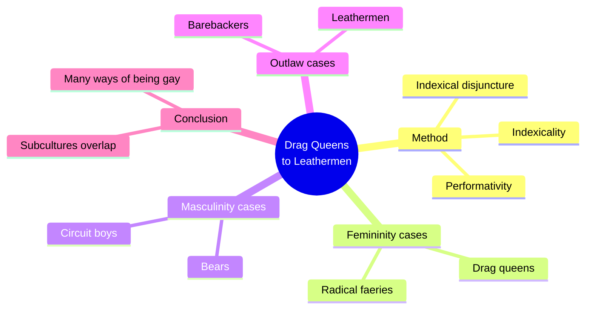
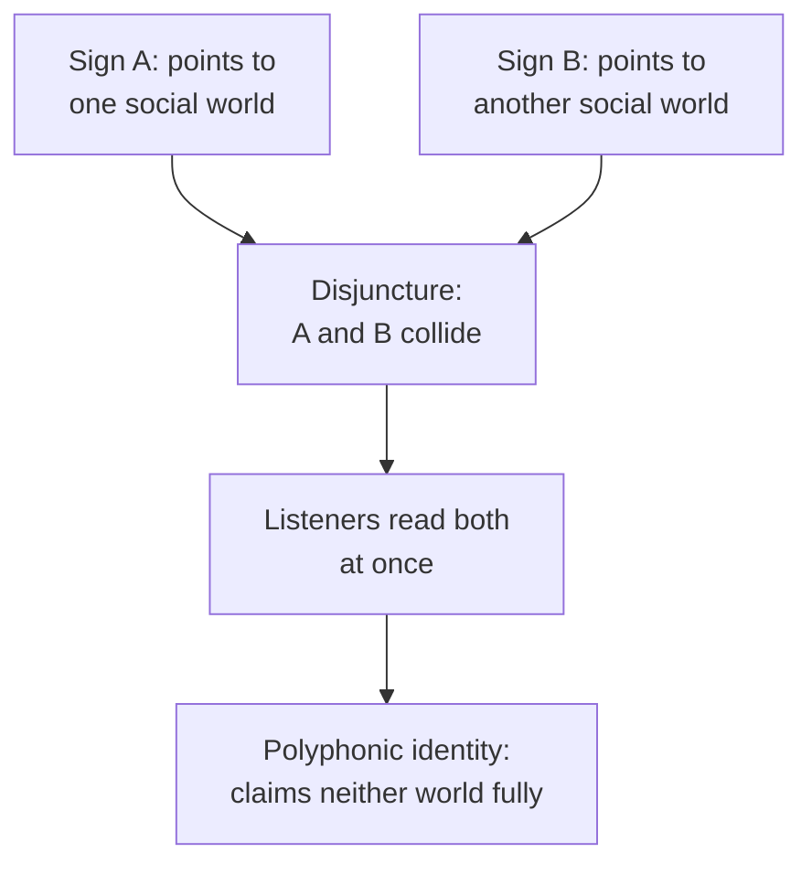
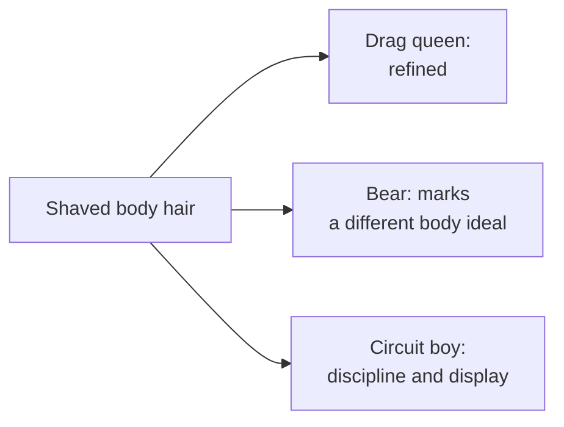
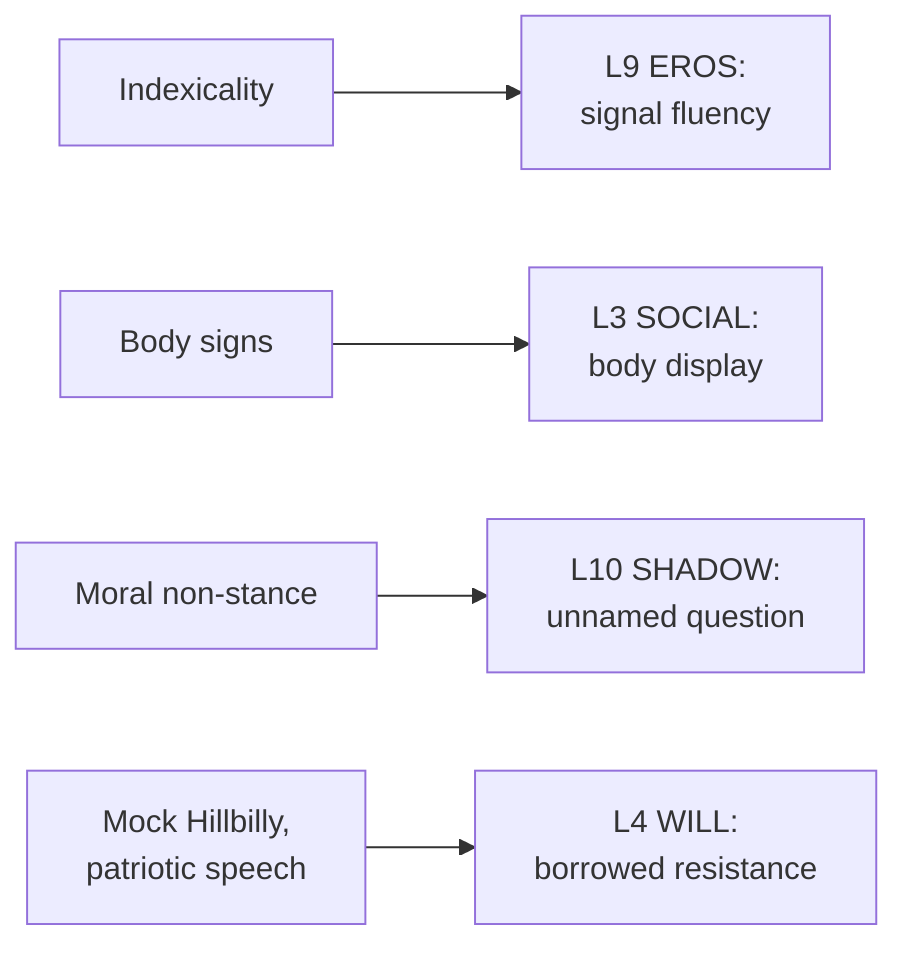

# 🧬 MSX.69 — From Drag Queens to Leathermen — Barrett (2017)
### Knowledge Entry — Distill

Rusty Barrett, a linguist, shows how six gay male subcultures build identity through speech and sign: drag queens, radical faeries, bears, circuit boys, barebackers and leathermen. The library keeps it as a toolkit for writing how a man sounds before he says anything about sex.

## TABLE OF CONTENTS
- [Core Thesis](#1-core-thesis)
- [Mind Models](#2-mind-models)
- [Framework](#3-framework--structure)
- [Key Concepts](#4-key-concepts)
- [Heuristics](#5-heuristics--decision-rules)
- [Invariants](#6-invariants)
- [Pitfalls](#7-pitfalls--myths)
- [Application](#8-application)
- [Cross-References](#9-cross-references)
- [Provenance](#10-provenance--confidence)

---

## 1 · CORE THESIS

Gay identity is not one thing. Each subculture builds its own identity by mixing signs that point to gender, class and sex. The mix is deliberate, and the clash between signs is the style.

---

## 2 · MIND MODELS

**Diagram 1 — the whole argument.**
Caption: *one method, six case studies, and a conclusion that no single "gay identity" survives the comparison.*

**Diagram 2 — the central mechanism (indexical disjuncture).**
Caption: *a speaker joins two signs that do not belong together, and the gap between them is the identity.*

**Diagram 3 — the same sign, different readings.**
Caption: *a sign has no fixed meaning; the subculture's gender ideology sets it.*

**Diagram 4 — mapped onto the 12-layer character stack.**
Caption: *Barrett feeds the outward layers: how a character signals, displays and resists.*

---

## 3 · FRAMEWORK / STRUCTURE

Barrett opens with theory (ch. 1, pp. 1-31). Six case chapters follow, then a conclusion (pp. 213-216).

| Chapter | Data | Claim |
|---|---|---|
| 2. African American drag queens | Bar performances, Texas, 1990s | "White woman" speech is not a wish to be white; it can mock whiteness and assert class |
| 3. Radical faeries | A hymnal of faerie songs | Faeries mix times and places to oppose Christianity |
| 4. Bears | The Bears' Mailing List | Working-class signs make heavy, hairy bodies read as masculine and desirable |
| 5. Circuit boys | Circuit Noize magazine | Camp wit marks the circuit elite as better men than straight men |
| 6. Barebackers | Public sex blogs | Informed consent replaces moral talk; semen becomes a shared kinship object |
| 7. Leathermen | International Mr. Leather speeches | Outlaw sex and patriotic citizenship share one stage |

---

## 4 · KEY CONCEPTS

| Concept | What it is | Why it matters |
|---|---|---|
| **Performativity** | An utterance that changes a social fact, such as "I'm gay" (p. 8) | Identity is done in speech, not only reported |
| **Felicity conditions** | Rules that decide whether a performative works: form, setting, authority, identity (p. 8) | A coming-out or a pickup line can fail on any of the four |
| **Indexicality** | A form of speech that points to a social context (pp. 10-12) | Sound carries class, gender and sexuality at once |
| **Indexical disjuncture** | Two clashing signs in one utterance | The clash builds a layered, polyphonic identity |
| **Societal discourse vs. discourse** | Broad public ideas vs. one real conversation (p. 7) | A character answers public tropes in private talk |
| **Trope** | A repeated public image, such as "gay men are naturally effeminate" (p. 7) | A man can match the trope or dodge it; both choices cite it |
| **Counter-counterpublic** | A group opposed to straight norms and to gay norms (p. 2) | Subcultures push back against gay culture too |
| **Mock Hillbilly** | Bears' eye-dialect, such as "yer" and "wuz" (pp. 112-115) | Signals working-class manhood without claiming the class |
| **Language ideology** | A group's belief about which speech is valuable (ch. 5) | Circuit boys prize camp; bears prize plain rough talk |
| **Stance** | The attitude a speaker takes: epistemic, cooperative, affective (ch. 6, p. 162) | Barebackers sound informed and agreeable, not moral |
| **Sexual script** | A shared outline of how a sex act goes (p. 178) | Scripts spread online and make an identity feel natural |

---

## 5 · HEURISTICS & DECISION RULES

| Situation | Do this | Not this |
|---|---|---|
| Writing how a gay character talks | Mix at least two signs that clash: camp and coarse, polished and rough | Give him one "gay voice" |
| Writing a subculture scene | Pick that group's own gender ideology first | Rate every man on one feminine-to-masculine line |
| Writing a bear | Link body, class and masculinity; let him cook, knit and call friends "girlfriend" (p. 114) | Treat bear as only a body type |
| Writing a drag performer | Let femininity break with masculine speech mid-line | Assume he wants to be a woman or to be white |
| Writing a man who rejects condoms | Give him a reasoned voice of consent and knowledge | Give him a villain's voice, or a self-destruction wish |
| Writing a leather event | Let outlaw sex stand beside flags and service | Treat leather as only transgression |
| Writing a man between groups | Let him combine subcultures: leather faerie, circuit bear (p. 215) | Keep the groups sealed |

---

## 6 · INVARIANTS

1. Speech carries social meaning beyond its literal content (pp. 10-12).
2. A sign's meaning depends on the local gender ideology (p. 216).
3. Identity combines signs from several social worlds (p. 12).
4. Subcultures oppose both straight norms and dominant gay norms (p. 2).
5. Appropriating a dominant voice does not mean accepting it (pp. 53-54).
6. Even "outlaw" subcultures follow strict norms (p. 179).
7. Individuals cross subculture lines (p. 215).

---

## 7 · PITFALLS / MYTHS

- The "secret code" model of gay language. Barrett shows the data is public, and the term "coming out" predates Stonewall (pp. 6-7).
- Reading drag as simply subversive. Barrett says drag can resist racism while leaving sexism untouched (pp. 53-54).
- Reading bears as hillbillies. Many are middle-class and use the signs on purpose (pp. 112-115).
- Treating "authentic" gay speech as a fixed thing. Authenticity is argued over (p. 6).
- Treating Barrett's sample as all gay men. It is mostly white, middle-class and North American (pp. 3-4).
- Data caveat, stated once. Barrett's blog and mailing-list data are public posts from the 1990s and 2000s. The sex blogs may not report real events (p. 161). Treat them as how men chose to present themselves.

---

## 8 · APPLICATION

*Proposed, not ruled.*

- **Spine level:** L5.
- **12-layer character stack:** L9 EROS `signal_fluency` (primary); L3 SOCIAL `body_display` (primary); L10 SHADOW `shadow_content` (supporting); L9 `template_origin` (supporting); L4 WILL `resistance_mode` (contextual).
- **plot_systems:** none.
- **Setting:** contextual. Subcultures at DCUS and after could each carry a speech style and a sign set.

Barrett gives a character a voice before he has a plot. Proposed: give each character a **signature disjuncture**, two clashing sign sets he blends. A bear who writes "yer" and "savoir faire" in one line sounds like himself.

Proposed: record how each character reads other men's signs. Quinn, for example, might misread a sign that his own group means differently. The mistake is a scene.

For the explicit work, this book supports ruling 06.1 by giving fantasy its texture. The same act sounds different from a leatherman, a circuit boy and a bareback blogger. Proposed: write the act in each man's own register. The register carries the scene, and the front-matter disclaimer carries the container.

---

## 9 · CROSS-REFERENCES

| Related entry | Relation |
|---|---|
| [[🧬 MSX.36 — The History of Sexuality — Foucault (1978)]] | Barrett's "societal discourse" is Foucault's discourse. He tracks how men cite it in speech |
| [[🧬 MSX.48 — Gender Trouble — Butler (1990)]] | Barrett adopts Butler's performativity and corrects it with indexicality (p. 216) |
| [[🧬 MSX.49 — Publics and Counterpublics — Warner (2002)]] | Source of the counterpublic idea Barrett extends |
| [[🧬 MSX.62 — Gay Macho — Levine (1998)]] | Levine supplies the clone and hanky-code background to leather |
| [[🧬 MSX.24 — Bareback Porn — Florêncio (2020)]] | A second reading of bareback culture, from porn instead of blogs |

---

## 10 · PROVENANCE & CONFIDENCE

Full-text pdftotext extract of the Oxford University Press 2017 edition. Title page confirms Rusty Barrett, 2017. Read in full: the Introduction (pp. 1-31), the conclusions of chapters 2, 4, 5, 6 and 7, and the book Conclusion (pp. 213-216). Read in part: the bear data in ch. 4 (pp. 112-115) and the bareback-blog framing in ch. 6 (pp. 160-162).

Skipped: the transcribed drag routines of ch. 2, the faerie hymn analysis of ch. 3, the circuit magazine columns of ch. 5, the IML speech transcripts of ch. 7, notes and references.

The `feeds:` keying is this distill's own synthesis. Barrett does not use the 12-layer vocabulary.

## META
- Template: BVX-LEARN-v4.0
- Source classification: full-text pdftotext extraction; introduction, conclusions and two data chapters read
- Created / Updated: 2026-10-04
