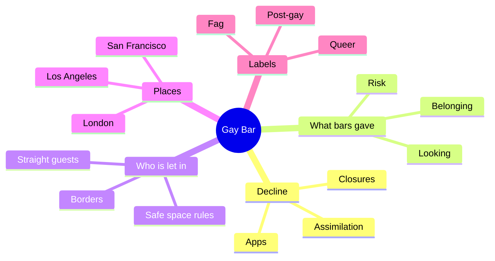
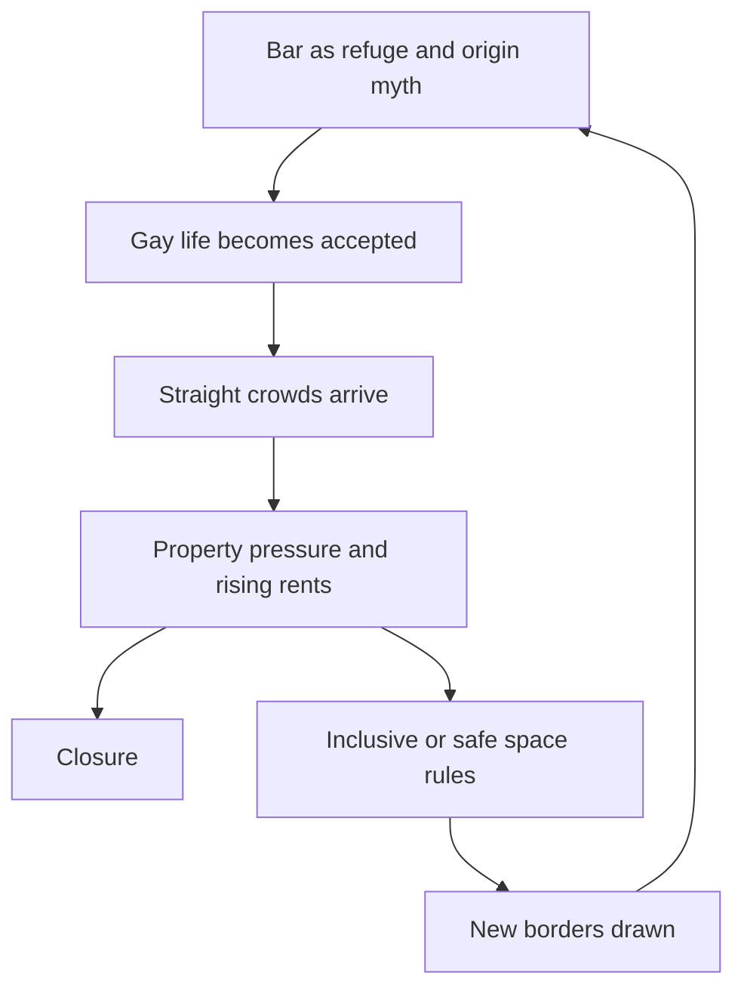
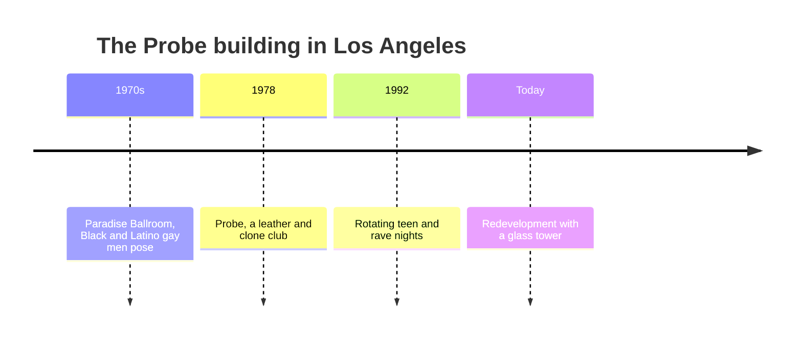

# 🧬 MSX.70 — Gay Bar — Atherton Lin (2021)
### Knowledge Entry — Distill

Fantasy, not a how-to: what happens in these pages stays in them. Reader discretion advised.

Jeremy Atherton Lin's memoir follows gay bars in London, Los Angeles, and San Francisco from the 1990s to 2019. It is the library's main account of why a man walks into a gay bar and what the room does to him.

## TABLE OF CONTENTS
- [Core Thesis](#1-core-thesis)
- [Mind Models](#2-mind-models)
- [Framework](#3-framework--structure)
- [Key Concepts](#4-key-concepts)
- [Heuristics](#5-heuristics--decision-rules)
- [Invariants](#6-invariants)
- [Pitfalls](#7-pitfalls--myths)
- [Application](#8-application)
- [Cross-References](#9-cross-references)
- [Provenance](#10-provenance--confidence)

---

## 1 · CORE THESIS

Gay bars are closing, and Atherton Lin asks what they were for. They gave gay men risk, looking, and a shared past. Each safety, merger, or rule changes who the room admits and what it can offer.

---

## 2 · MIND MODELS

**Diagram 1 — the whole argument.**
Caption: *the book is one question, why did we go out, answered across seven chapters in three cities.*

**Diagram 2 — the central mechanism.**
Caption: *a bar's life runs in a loop: it works as a refuge, outsiders arrive, money presses, and the bar either closes or redraws its borders.*

**Diagram 3 — one venue's layers.**
Caption: *a single building can hold four crowds in turn, so the narrator walks in on a past he cannot see.*

---

## 3 · FRAMEWORK / STRUCTURE

Seven chapters, each named for a place and set in a city. The book mixes memoir, reporting, and quotation.

| Chapter | City and move |
|---|---|
| The Dark Walks | London. A men-only night in a bar under a railway, then the case that bars are doomed. |
| The Factory | Los Angeles. His first bar and the building's earlier lives. |
| The Adelphi | London. The 1990s, post-gay, and cruising as an archaeology of looking. |
| The Windows | San Francisco. The Castro as a parade of types after the AIDS years. |
| The Neighbors | San Francisco. A lesbian bar in denial, and the word fag. |
| The Apprentice | London. Shoreditch gentrifies, and civil partnerships let him settle in the UK. |
| The Borders | London. Safe-space rules, a campaign for the Joiners Arms, Studio One's redevelopment, and the Admiral Duncan. |

---

## 4 · KEY CONCEPTS

| Concept | What it is | Why it matters |
|---|---|---|
| **The bar as origin myth** | Stonewall names gay liberation, though bars were mob-owned dumps (Introduction, p. 16). | Setting can carry a founding story the room never matched. |
| **The sip-in** | Three activists told a bartender they were gay at Julius', and he refused service (p. 16). | A protest can be a polite request. |
| **Prior knowledge** | Gay bars once assumed guests already knew the history (p. 217). | Knowing the code was part of the night. |
| **Cruising as haunting** | Cruising was once called haunting, and the men ghosts (The Adelphi, p. 97). | Looking is a way of reading a place's traces. |
| **Post-gay** | A 1990s British mood: out, but over it (The Adelphi, pp. 80-81). | A character can be out and bored of the label. |
| **Safe space** | A venue's rule set that bars harassment and bias (The Borders, pp. 211-214). | It protects some guests and bars others, which creates a border. |
| **Fag** | A word the narrator adopts after his neighbors do (The Neighbors, p. 131). | A slur reclaimed can serve as belonging. |
| **Layered venue** | One building hosting many gay eras (The Factory, pp. 46-47). | A place can know more than its guests. |

---

## 5 · HEURISTICS & DECISION RULES

| Situation | Do this | Not this |
|---|---|---|
| Writing a first night in a gay bar | Show him reading the room badly and being touched without a say. | Make it a welcome party. |
| Writing a bar scene in a changed city | Show straight guests, birthday groups, and a rule or sign to manage them. | Write the bar as untouched. |
| Writing erotic risk | Let the character want proximity and danger as the spark. | Insert a safety talk into the desire. |
| Writing an old regular | Let him remember the room's past and fail to hand it on. | Make him a ready mentor. |
| Writing a venue with a past | Hide earlier crowds in the walls, signs, and floor plan. | Explain its history in a paragraph. |
| Writing a safe-space rule | Show both who it protects and who it turns away. | Write it as only good or only bad. |

---

## 6 · INVARIANTS

1. A gay bar sits inside a city's property and policing, not outside them.
2. The room's crowd changes faster than its name does.
3. Looking is work, and each person does it differently.
4. Every inclusion rule draws a border.
5. A bar's past is rarely told to the people inside it.
6. The narrator speaks as a participant, not a neutral reporter.

---

## 7 · PITFALLS / MYTHS

- The book is a memoir. Names and details are changed, and some people are composites (copyright page, p. 6).
- London dominates the later chapters, so the argument leans British.
- The decline of bars is the narrator's frame. He also records new queer parties and campaigns (pp. 213-214).
- Anecdotes about crowds are single nights, not surveys.
- The title question has no single answer. The narrator gives several and doubts each.
- The narrator's own wish for risk is one stance, and he says so (p. 215).

---

## 8 · APPLICATION

*Everything here is proposed, never ruled.*

- **Spine level:** L5, as set by the batch brief.
- **12-layer character stack:** L3 SOCIAL (venue_belonging, elder_transmission), L9 EROS (erotic_safety_precondition), L1 CORE (identity_frame), L7 ORIGIN (initiation_rite), L4 WILL (resistance_mode).
- **plot_systems:** a bar scene engine with three beats: arrival, the crowd reads him, and a border appears.
- **Setting:** the venue-layers diagram suits any place the ORANGE work needs to feel inhabited by earlier eras.

The book gives a character a way to go out. He can go for attention, for risk, or for company, and each reason produces a different scene. A bar also becomes a character of its own, with a past, rules, and a landlord. Fantasy comes first in the prose, and explicit scenes are allowed under the standing 06.1 ruling. The disclaimer at the top of the file carries the container.

---

## 9 · CROSS-REFERENCES

| Related entry | Relation |
|---|---|
| [[🧬 MSX.45 — Gay New York — Chauncey (1994)]] | Chauncey gives the 1890 to 1940 world. This book gives the world after Stonewall. |
| [[🧬 MSX.79 — Sexual Politics, Sexual Communities — D'Emilio (1983)]] | D'Emilio explains why bars became the seedbeds of a group identity before the movement. |
| [[🧬 MSX.61 — Times Square Red, Times Square Blue — Delany (1999)]] | A parallel account of contact spaces closing under redevelopment. |
| [[🧬 MSX.33 — The Space of Sex — Waldrep (2021)]] | Waldrep treats a sex space as licensed and bounded, which matches the safe-space question. |

---

## 10 · PROVENANCE & CONFIDENCE

Full-text pdftotext extraction, 242 pdf pages. Title page and copyright page confirm Jeremy Atherton Lin, Little, Brown and Company (Hachette), first ebook edition February 2021. The copyright page notes that some names are changed and some people are composites. Page cites are pdf pages, not printed pages.

Read: the opening scene and Introduction of The Dark Walks (pp. 12-18), the opening of The Factory (pp. 45-47), the opening of The Adelphi (pp. 77-81) and the cruising passage (p. 97), the opening of The Windows (pp. 99-103), the opening of The Neighbors (pp. 127-131), the opening of The Apprentice (pp. 158-162), and the closing third of The Borders (pp. 211-218).

Skipped: the middle of every chapter, the notes, the credits, and the acknowledgments. The reading favors openings and the ending, so the memoir's love story with the partner called Famous is mostly unread. Confidence is medium. The thesis is stated outright, but the memoir's detail is wide and was only sampled. The `feeds:` keying is this distill's own synthesis, and the book uses none of the 12-layer vocabulary.

## META
- Template: BVX-LEARN-v4.0
- Source classification: full-text extraction, targeted read of chapter openings and the closing pages of The Borders
- Created / Updated: 2026-10-04
