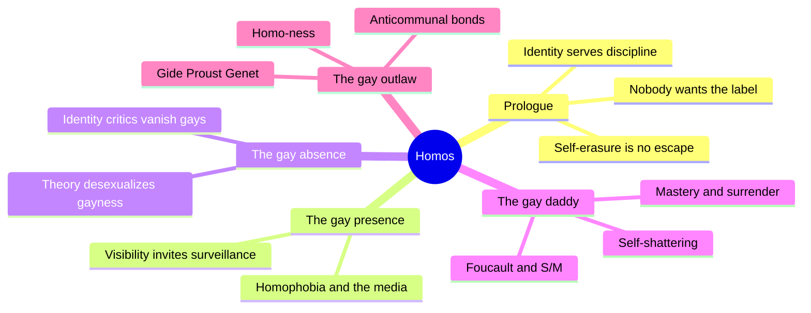
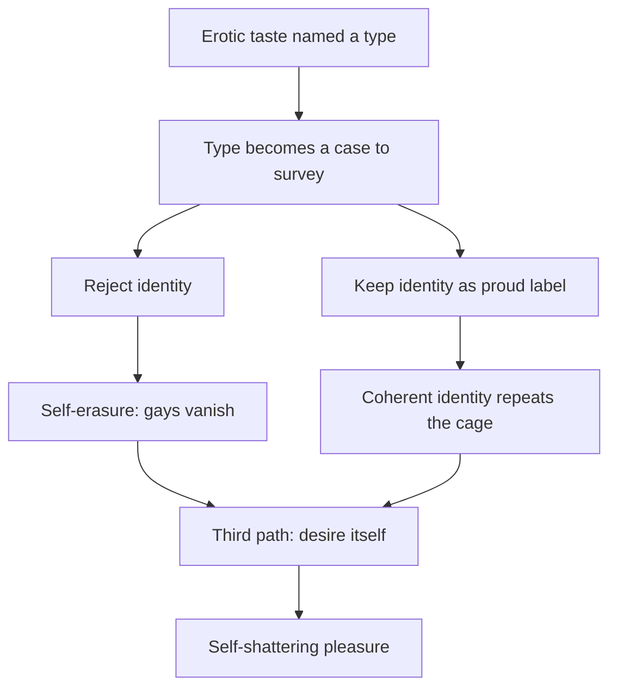
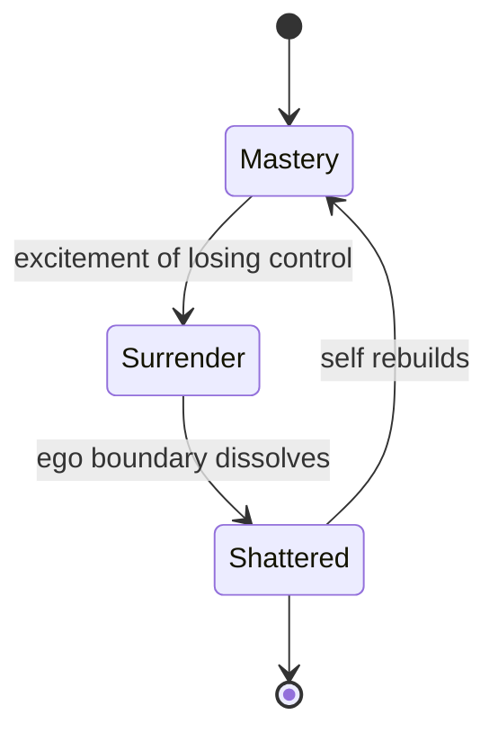
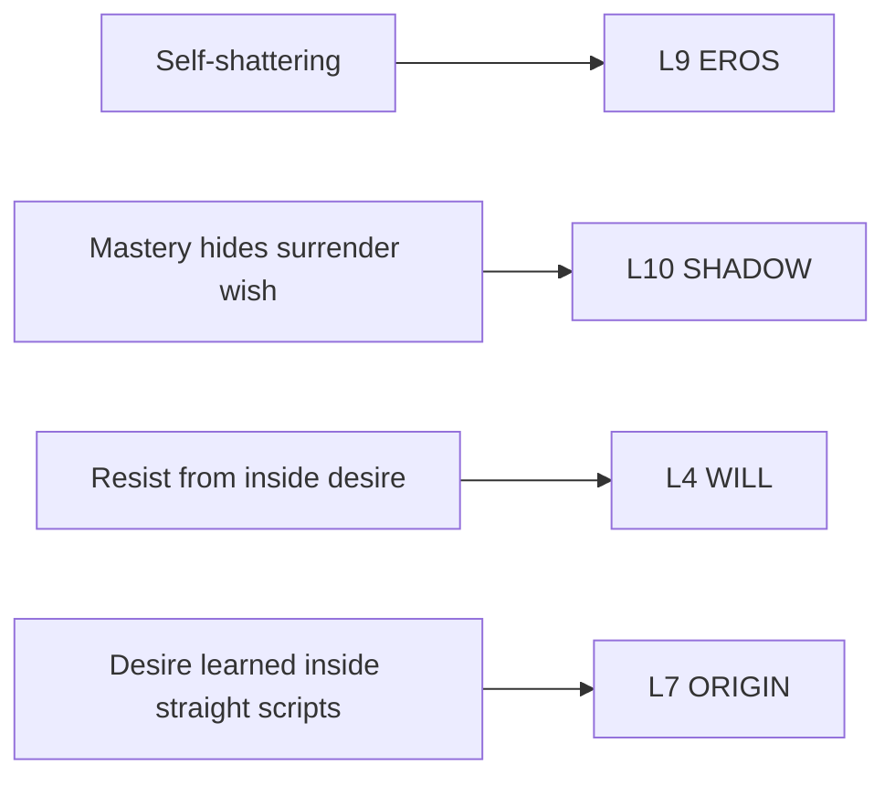

# 🧬 MSX.71 — Homos — Bersani (1995)
### Knowledge Entry — Distill

Leo Bersani's 1995 polemic asks what gay desire can do politically if gay identity is both necessary and suspect. It answers with homo-ness: a desire for sameness that dissolves the self instead of defending it.

## TABLE OF CONTENTS
- [Core Thesis](#1-core-thesis)
- [Mind Models](#2-mind-models)
- [Framework](#3-framework--structure)
- [Key Concepts](#4-key-concepts)
- [Heuristics](#5-heuristics--decision-rules)
- [Invariants](#6-invariants)
- [Pitfalls](#7-pitfalls--myths)
- [Application](#8-application)
- [Cross-References](#9-cross-references)
- [Provenance](#10-provenance--confidence)

---

## 1 · CORE THESIS

Bersani argues that fixed gay identity serves discipline, while dropping it erases gay people. His way out is desire itself. Homo-ness, the pull toward sameness, produces self-shattering pleasure that no category can hold. That makes it an identity that resists identity.

---

## 2 · MIND MODELS

*Required. Minimum two diagrams, maximum five.*

**Diagram 1 — the whole argument.**
Caption: *four chapters, one move: show that identity is a trap, then find the resistance inside desire instead of outside it.*

**Diagram 2 — the central mechanism (the identity trap).**
Caption: *naming gives power a target, erasing the name gives power a victory, and homo-ness is the third path through desire.*

**Diagram 3 — the rhythm of mastery and surrender.**
Caption: *Bersani reads sadomasochism as a rhythm where every push to master carries a pull to drop mastery, and masochism comes first.*

**Diagram 4 — mapped onto the 12-layer character stack.**
Caption: *the book hands EROS a trait, SHADOW a reversal, WILL a resistance style, and ORIGIN a warning about borrowed scripts.*

---

## 3 · FRAMEWORK / STRUCTURE

The book has a prologue and four chapters. Each chapter picks one theory and tests it against gay desire.

| Part (printed pages) | Governing move |
|---|---|
| Prologue "We" (1-10) | States the problem. Queer theory distrusts identity, and the distrust erases gays. Admits the author speaks as a white, prosperous gay man. |
| 1. The Gay Presence (11-30) | Shows gay visibility growing in the US and notes that visibility is also a precondition of surveillance. |
| 2. The Gay Absence (31-76) | Argues that Wittig, Butler, and Warner describe gayness without sex, so the sexual drops out. |
| 3. The Gay Daddy (77-112) | Reads Foucault on S/M, then Freud, and builds self-shattering and a story of gay love through the Wolf Man. |
| 4. The Gay Outlaw (113-183) | Reads Gide's *The Immoralist*, Proust, and Genet's *Funeral Rites* for the anticommunal, self-extending side of homo-ness. |

---

## 4 · KEY CONCEPTS

| Concept | What it is | Why it matters |
|---|---|---|
| **Disciplinary identity** | Turning erotic taste into a "character type" that power can watch and manage (p. 3). | Naming a type is never neutral. A label gives surveillance a target. |
| **Self-erasure** | Gay critics deny identity until nothing is left to defend (pp. 4-5). | Bersani says this accomplishes what homophobia wants. |
| **Desexualizing discourse** | Writing about gay life that leaves out the shared sexual interest in men (pp. 5-6). | The sexual is the one thing a politics of gayness cannot drop. |
| **Homo-ness** | Desire for the same, as a mode of connection to the world (pp. 7, 10). | It is not a preference category. Anyone can feel it. |
| **Self-shattering (jouissance)** | The moment intensity breaks the ego's coherence (p. 101). | It makes the person hard to survey. He is "unfindable as an object of discipline" (p. 99). |
| **Desexualized pleasure** | Foucault's call for a new economy of bodies and pleasures, beyond genital sex (pp. 79-80). | Pleasure that escapes the old sexual categories also escapes interpretation. |
| **Mastery and surrender** | Humans push to control their space and also long to give up control (pp. 98-99). | Dominance and submission are two moves in one rhythm. |
| **Primacy of masochism** | Without a masochistic pull, sadism is only control (p. 95). | The surrender wish sits inside the will to dominate. |
| **S/M as conservative** | S/M copies the dominant culture's master and slave pattern and calls it a challenge (pp. 87-89). | Bersani denies S/M the political praise its defenders give it. |
| **The loving child and the daddy** | A man being fucked offers his own penis as a gift to a frightened partner (p. 112). | A story of gay love that replaces the castrating father with a tender one. |
| **Waste and error (Genet)** | Rimming, waste, and error as fertile, disposable raw material (pp. 178-180). | Genet turns the abject into a creative act without needing community. |

---

## 5 · HEURISTICS & DECISION RULES

| Situation | Do this | Not this |
|---|---|---|
| A character resists a label | Let him keep the appetite and distrust the label at once. | Make him choose between a proud identity and none. |
| A sex scene of surrender | Write the loss of self as a gain: he becomes less findable, not weaker. | Treat submission as only damage or only comedy. |
| A dominant character | Give him a surrender wish he resists and a place where it leaks. | Write dominance as pure control. |
| A kink scene presented as rebellion | Let another character ask what the roles copy from the straight world. | Let the scene's rebellion go unquestioned. |
| Writing visibility (outing, fame, a viral scene) | Show that being seen is also being watched. | Show visibility only as freedom. |
| A tender scene after intensity | Allow tenderness to follow surrender without a hidden trauma behind it. | Add a psychological cause to every kindness. |
| A character who bonds by similarity | Let sameness extend him, not threaten him. | Write difference as the only thing that makes desire. |

---

## 6 · INVARIANTS

1. **A label is a tool of power as well as of pride.** Both statements hold (pp. 3-5).
2. **Erasing the label does not stop the power.** Systems of rule do not need to be natural to rule (p. 4).
3. **Desire stays after identity is deconstructed.** Dropping the story does not drop the habit (p. 6).
4. **Pleasure can undo the self.** Self-shattering is a nonstrategic effect of the body (p. 101).
5. **Power contains its own renunciation.** Mastery and surrender run in one rhythm (pp. 96-99).
6. **Gay politics that drops sex loses its subject.** The shared interest in men is not optional (pp. 5-6).

---

## 7 · PITFALLS / MYTHS

- **Polemic, not data.** The book is an argument. It reports no survey or sample. Read its claims as one scholar's position.
- **Contested psychoanalysis.** The death drive, castration, and the "culture of death" charge against S/M (p. 97) are Freudian commitments, and many scholars reject them.
- **Narrow "we."** The author names himself a white, prosperous gay man (p. 8) and limits the book to gay male desire.
- **Dated frame.** The book predates modern HIV prevention, marriage equality, and apps. Its visibility chapter reads as a 1990s snapshot.
- **S/M reading is not field research.** Bersani reads S/M writers and Foucault interviews. He did not interview practitioners.
- **Literary evidence.** Chapter 4 reads novels as evidence of desire. A novel is a performance, not a case study.
- **Misreading homo-ness.** It does not mean gay men all want the same man or the same sex. It names a way of relating to others as extensions of the self.

---

## 8 · APPLICATION

*Proposed for the ORANGE work, not ruled.*

- **Spine level:** L5.
- **12-layer character stack:** L9 EROS (self_shattering_capacity, primary); L10 SHADOW (shadow_content, primary); L4 WILL (resistance_mode, supporting); L7 ORIGIN (desire_template_origin, supporting); L3 SOCIAL (relationality_style, contextual).
- **plot_systems:** a character who is surveyed (a file, a rumor, a camera) and resists by becoming unfindable.
- **Setting:** an institution that names types, matching the Foucault cluster on this shelf.

Bersani gives the stack its best answer to one problem. A character can reject every label and still carry the desire. The book says the desire is where his freedom lives.

The most useful tool is self-shattering. A writer can ask where a character loses himself and what he does with the minutes after. The answer can be a bed, a floor, a dance, a page, or a cell. The trait fits an explicit scene because it describes what the scene does to the man, not only what the bodies do.

The second tool is the surrender wish inside power. A coach, a daddy figure, or a tough top can carry it. The reader can feel the wish before the character admits it.

Proposed addition: a `self_shattering_profile` field on L9. It records the trigger (which act or setting), the afterstate (calm, silent, tender, raw), and whether the character reads the experience as freedom or loss. Pair it with Wiseman's aftercare practice in [[🧬 MSX.80 — SM 101 — Wiseman (1996)]], which supplies the practical side Bersani leaves out.

The ORANGE prose rulings apply as written. Explicit content is allowed, written as fantasy first, with the one-line container in the front matter. Bersani's own prose is explicit and unhedged, and that does not require a fade.

---

## 9 · CROSS-REFERENCES

| Related entry | Relation |
|---|---|
| [[🧬 MSX.36 — The History of Sexuality — Foucault (1978)]] | Bersani argues with this book's theory of resistance and its call for bodies and pleasures. |
| [[🧬 MSX.80 — SM 101 — Wiseman (1996)]] | Wiseman writes the practice. Bersani reads the politics and the psychology of the same scene. |
| [[🧬 MSX.48 — Gender Trouble — Butler (1990)]] | Bersani's chapter 2 criticizes Butler's resignification as too desexualized. |
| [[🧬 MSX.43 — One Hundred Years of Homosexuality — Halperin (1990)]] | Halperin gives the history of the category that Bersani distrusts. |
| [[🧬 MSX.49 — Publics and Counterpublics — Warner (2002)]] | Warner is one of the identity critics the prologue engages. |

---

## 10 · PROVENANCE & CONFIDENCE

Full text, pdftotext extraction, about 57,000 words, 211 PDF pages. Title page confirms: Leo Bersani, *Homos*, Harvard University Press, Cambridge, 1995 (paperback 1996). Printed page equals PDF page minus 12, and citations use printed pages.

Read in full: Prologue (pp. 1-10), the closing third of chapter 3 including the Wolf Man reading (pp. 95-112), the opening of chapter 4 (pp. 113-115), and the Genet sections near the end (pp. 177-181). Read in part: the Foucault and S/M argument in chapter 3 (pp. 77-100) and the Wittig and Butler passage in chapter 2 (pp. 45-47).

Skipped: chapter 1 beyond its opening page, most of chapter 2, the middle of chapter 4 on Gide and Proust, the notes, and the index. The Gide and Proust claims in this entry come from the prologue's summary and the chapter opening.

Confidence is medium. The mechanism claims are secure, and the literary readings are described, not tested.

## META
- Template: BVX-LEARN-v4.0
- Source classification: full-text pdftotext extraction, deep read on prologue and chapter 3, partial elsewhere
- Created / Updated: 2026-10-04
