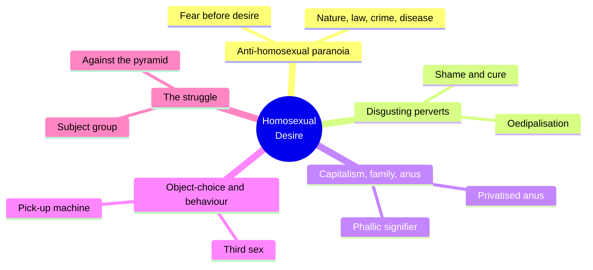
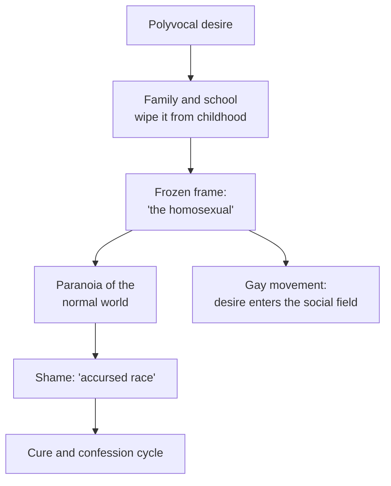
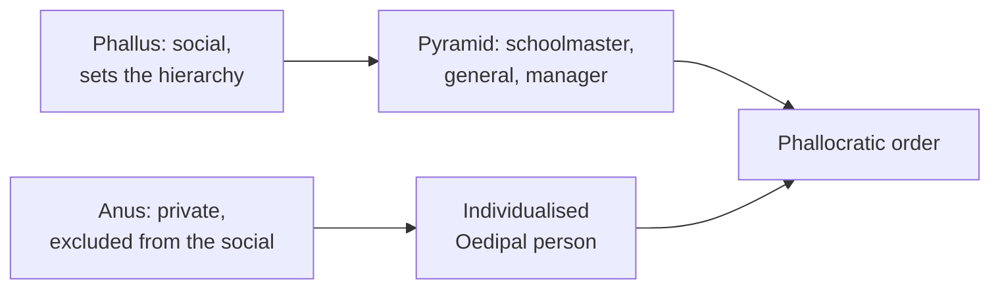
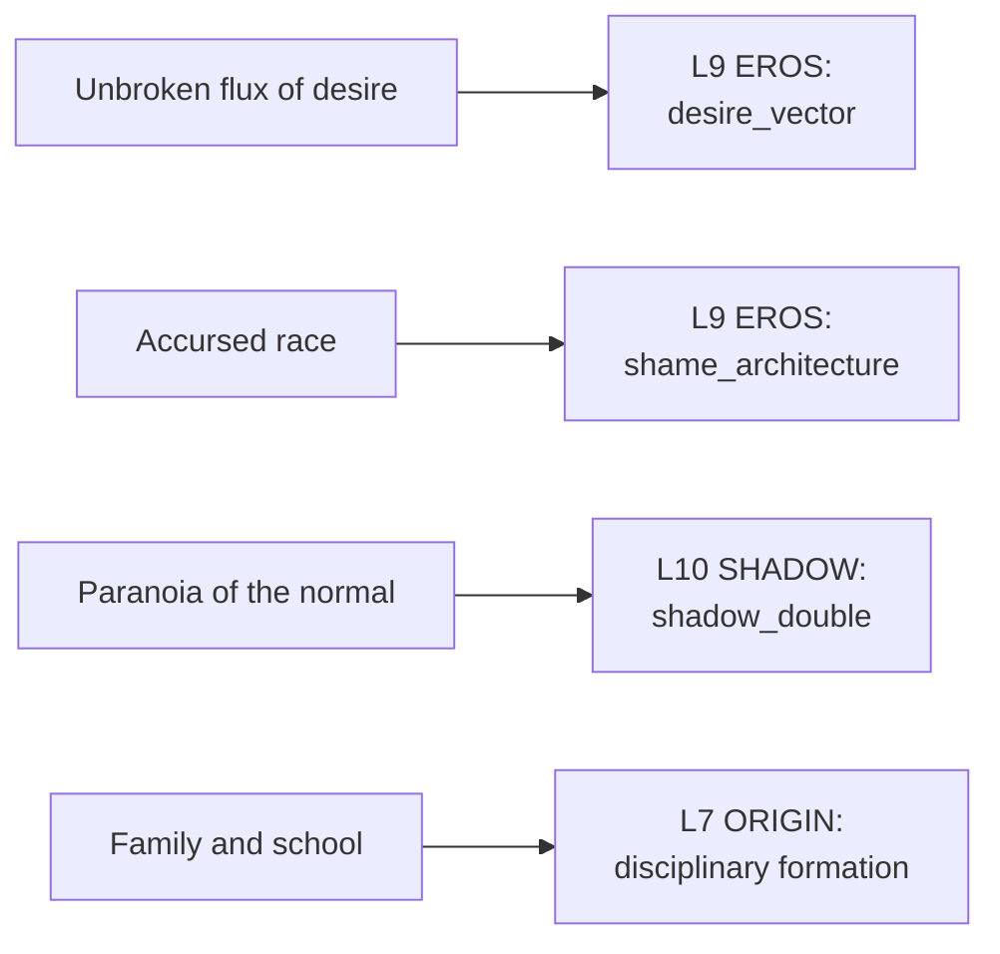

# 🧬 MSX.72 — Homosexual Desire — Hocquenghem (1972)
### Knowledge Entry — Distill

Hocquenghem's 1972 French manifesto, translated by Daniella Dangoor in 1978, treats the fear of homosexuality as the real subject. It reads desire, shame, and the family through Freud, Deleuze and Guattari, and Proust.

## TABLE OF CONTENTS
- [Core Thesis](#1-core-thesis)
- [Mind Models](#2-mind-models)
- [Framework](#3-framework--structure)
- [Key Concepts](#4-key-concepts)
- [Heuristics](#5-heuristics--decision-rules)
- [Invariants](#6-invariants)
- [Pitfalls](#7-pitfalls--myths)
- [Application](#8-application)
- [Cross-References](#9-cross-references)
- [Provenance](#10-provenance--confidence)

---

## 1 · CORE THESIS

The problem is not homosexual desire but the fear of it. Society wipes out desire in childhood, then manufactures "the homosexual" as a figure to hate, the way it manufactures proletarians. Desire itself has no such division, and the gay movement exposes the whole Oedipal system.

---

## 2 · MIND MODELS

**Diagram 1 — the whole argument.**
Caption: *the book starts with the straight world's fear, moves through shame and the family, and ends at a liberated, non-exclusive desire.*

**Diagram 2 — the central mechanism (desire frozen into identity).**
Caption: *one open flow of desire is cut by the family and school, then handed back as a guilty label that the world watches.*

**Diagram 3 — phallus and anus as a social map.**
Caption: *society organizes around one signifying organ, and the anus is privatised so that the pyramid can stand.*

**Diagram 4 — mapped onto the 12-layer character stack.**
Caption: *Hocquenghem's four moves land on EROS twice, SHADOW once, and ORIGIN once.*

---

## 3 · FRAMEWORK / STRUCTURE

Seven short parts, in a clear arc from the straight world's fear to the movement's politics.

| Part | Governing move |
|---|---|
| 1. Introduction (p. 49) | "The problem is not so much homosexual desire as the fear of homosexuality." The book will study the phantasies of the heterosexual world. |
| 2. Anti-Homosexual Paranoia (p. 55) | Nature, law, crime and disease as stages of the fear. The "myth of progress of public morals" is challenged. |
| 3. "Disgusting perverts..." (p. 73) | Oedipalisation, castration and narcissism, the cure cycle, and shame (p. 88). |
| 4. Capitalism, the Family and the Anus (p. 93) | The phallic signifier and the sublimated anus. Society as a pyramid. |
| 5. Homosexual "Object-Choice" and Homosexual "Behaviour" (p. 113) | Third sex, masochism, and the pick-up machine (p. 130). |
| 6. The Homosexual Struggle (p. 133) | Revolution of desire, "why homosexuality?", the perverse trap, against the pyramid. |
| 7. Conclusion (p. 148) | Homosexual desire is heteroclite, and the term "homosexuality" is imaginary unification. |

---

## 4 · KEY CONCEPTS

| Concept | What it is | Why it matters |
|---|---|---|
| **Fear before desire** | The book studies the straight world's reaction first (p. 49). | The shame a character feels is usually on loan from the people watching him. |
| **Power of oblivion** | Social mechanisms erase homosexual desire from childhood, so "this does not concern me" is the instant answer (p. 49). | A character can sincerely feel no desire because the system removed it. |
| **Desire has no sides** | "Desire is no more homosexual than heterosexual" (pp. 49-50). | The labels are frozen frames, not facts about a person's flow. |
| **Capitalism manufactures homosexuals** | Society produces them as it produces proletarians, defining its own limits (p. 50). | The figure is built by the order it threatens. |
| **Accursed race** | Proust's phrase for a figure bound by shame and secrecy (p. 88). | Shows how a label becomes an "ontological standpoint," not a relation of desire. |
| **Mirror and complicity** | Proust's "friends without friendships": bonds held up by a lie (pp. 88-89). | A secret fraternity of signs, visible only to its members. |
| **Phallic signifier** | One organ, the "despotic signifier," sets who has presence and absence (p. 95). | The sexual act with an aim, ending in ejaculation, is the one counted as success (p. 96). |
| **Sublimated anus** | The anus is private and excluded from the social, and its privatisation models other privatisation (p. 96). | Explains why anal desire carries a special load of shame. |
| **Pick-up machine** | The cruising drift where "all encounters become possible" and desire produces no guilt (p. 131). | Scattering is read as a working system, not as a search for one partner. |
| **Subject group vs. subjected group** | A subject group brings desire into the social field. A subjected group obeys institutions (p. 147). | A political reading of a community's mode. |
| **Perverse trap** | A group affirming its perversity can slide back into being subjected (p. 147). | A built-in risk for any identity movement. |

---

## 5 · HEURISTICS & DECISION RULES

| Situation | Do this | Not this |
|---|---|---|
| Writing a straight character's disgust | Make it a fear with a history, with a family and school behind it. | Write it as a simple dislike of a different group. |
| Writing a character's first same-sex desire | Show the system that told him it was nothing, or useless, or temporary. | Write it as a private discovery with no social pressure. |
| Writing shame | Give it an audience: a judge, a doctor, a friend group. | Write it as an internal trait with no source. |
| Writing cruising or casual encounters | Allow the "plugging-in" reading: the encounter has no names and no guilt in the moment. | Write every brief encounter as a failed search for love. |
| Writing a leather-clad father figure or boss | Check the phallic hierarchy: who holds the signifier, who obeys. | Treat authority as neutral. |
| Writing a gay community | Test whether it is a subject group or a subjected group. | Assume visibility alone equals freedom. |
| Writing a character who "cannot be labeled" | Let the label fail locally: each encounter challenges the category. | Force a single identity word onto every scene. |

---

## 6 · INVARIANTS

1. **The fear of homosexuality comes before its supposed object.** The book starts from the straight world's phantasies (p. 49).
2. **Desire is a multiple flow.** Division into types happens afterward, by how people manipulate it (p. 50).
3. **Homosexuality is manufactured by the order it opposes.** Condemnation breeds what it claims to remove (p. 50).
4. **Shame and the label move together.** One exists in the movement of the other (p. 88).
5. **The Oedipal family is the unit of oppression.** It brings oppressed sexual modes together while trying to cut them off (p. 138).
6. **The anus is the private organ, the phallus the social one.** Society is built on that split (p. 96).
7. **Any identity can be turned into a trap.** Affirming one's perversity can re-subject the group (p. 147).

---

## 7 · PITFALLS / MYTHS

- Taking the book as a neutral study. It is a manifesto of 1972 French libertarian Marxism, built on Freud, Deleuze and Guattari, and Proust.
- Treating its generalizations as data. The claims about shame, scattering, and "the homosexual" rest on literary examples (Proust, Musil, Mann, Genet) and not on interviews or surveys.
- Treating its scope as wider than it is. The author says he starts from male homosexuality only and that female homosexuality cannot be handled in terms of male ideology (p. 49).
- Reading its claim that bisexuality is "ideologically suspect" (p. 139) as current. It is a 1972 polemic, and later work disagrees.
- Taking the pick-up reading as the whole truth. It is a theoretical re-reading of a social scene, and the author admits the scene may also be experienced as unhappy (p. 131).
- Reading the political vocabulary ("subject group," "revolution of desire") as a neutral toolkit. It carries a specific theory of history.
- Difficulty: the translation is dense and uses special terms from Deleuze and Guattari.

---

## 8 · APPLICATION

*Proposed for the Command, not ruled.*

- **Spine level:** L5
- **12-layer character stack:** L9 EROS desire_vector (primary); L9 EROS shame_architecture (primary); L10 SHADOW shadow_double (supporting); L7 ORIGIN origin_disciplinary_formation (supporting); L9 EROS erotic_pacing (contextual); L4 WILL resistance_mode (contextual).
- **plot_systems:** the Oedipal pyramid (headmaster, coach, general, manager) is an antagonist structure, and the "subject group" idea gives a way to tell an ally community from a captured one.
- **Setting:** DCUS and its earlier lineages (Inner Spiral, Red Hills/Skeeter Creek) can use the "power of oblivion" as a school-wide habit: no one speaks of it, so it seems not to exist.

Hocquenghem adds a different angle from Foucault. Foucault says power names the category. Hocquenghem says the family and school first wipe the desire out, and then the label arrives with a guilt already installed.

For the ORANGE work, the useful move is a two-step shame model. First, a character's early desire is erased by a household or a school. Second, a label arrives later and brings the guilt with it. The two steps can sit in different scenes and different eras.

The pick-up machine gives a second way to write a character who has many brief encounters. The default reading is a search for a partner. The proposed second reading is a working system with its own logic, where names and sex do not matter and no one is guilty in the moment. A writer can choose either, or let a character move between them. Explicit scenes follow the standing prose ruling: fantasy first, with the container as the one-line front-matter disclaimer (ruled 10/4).

---

## 9 · CROSS-REFERENCES

| Related entry | Relation |
|---|---|
| [[🧬 MSX.36 — The History of Sexuality — Foucault (1978)]] | Foucault shows how naming makes a species. Hocquenghem shows the family and school wiping out the desire first. |
| [[🧬 MSX.68 — Epistemology of the Closet — Sedgwick (1990)]] | Sedgwick's closet is a structure of knowing. Hocquenghem's shame is a structure of watching. |
| [[🧬 MSX.17 — Mating in Captivity — Perel (2006)]] | Perel's account of desire inside a couple is the private-life counterpart to Hocquenghem's social account. |
| [[🧬 MSX.82 — The Leatherman's Handbook — Townsend (1972)]] | Same year, same culture. Townsend writes the practical version of the scene Hocquenghem theorizes. |

---

## 10 · PROVENANCE & CONFIDENCE

Full text, pdftotext extraction, 163 PDF pages. Title page confirms Guy Hocquenghem, Homosexual Desire, translated by Daniella Dangoor, with a 1978 preface by Jeffrey Weeks and a new introduction by Michael Moon, Duke University Press, 1993. The copyright page gives the French original as 1972, Editions Universitaires, and the translation as 1978. The book is dedicated to Gerard Grandmontagne, who died in Fresnes prison on 25 September 1972. Printed page numbers equal the PDF page minus one.

Read in full or near full: the Introduction (pp. 49-52), the opening of chapter 3 and "Homosexuality and shame" (pp. 88-92), "The phallic signifier and the sublimated anus" (pp. 95-97), "The pick-up machine" (pp. 130-132), "Why homosexuality?" (pp. 138-141), the end of chapter 6 (p. 147), and the Conclusion (pp. 148-150).

Not read: the Weeks preface and Moon introduction, most of chapter 2 (paranoia, crime and disease), the middle of chapter 3 (Oedipalisation and cure), chapter 4's competitive-society and grouping sections, and chapter 5's object-choice and third-sex sections. Those rows in the Framework rest on the table of contents.

The feeds keying is this distill's own synthesis against the Command's 12-layer stack. Hocquenghem uses none of that vocabulary. The `spine: [L5]` value follows the assigning brief.

## META
- Template: BVX-LEARN-v4.0
- Source classification: full-text pdftotext, targeted deep read on five sections, table of contents for the rest
- Created / Updated: 2026-10-04
