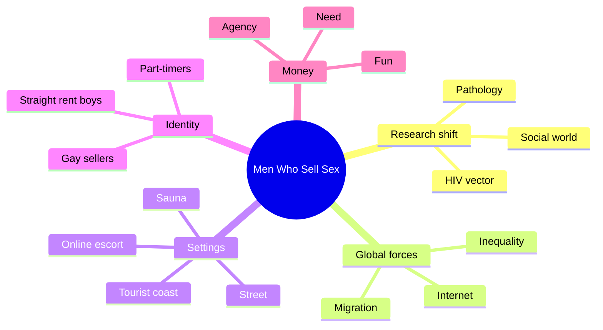
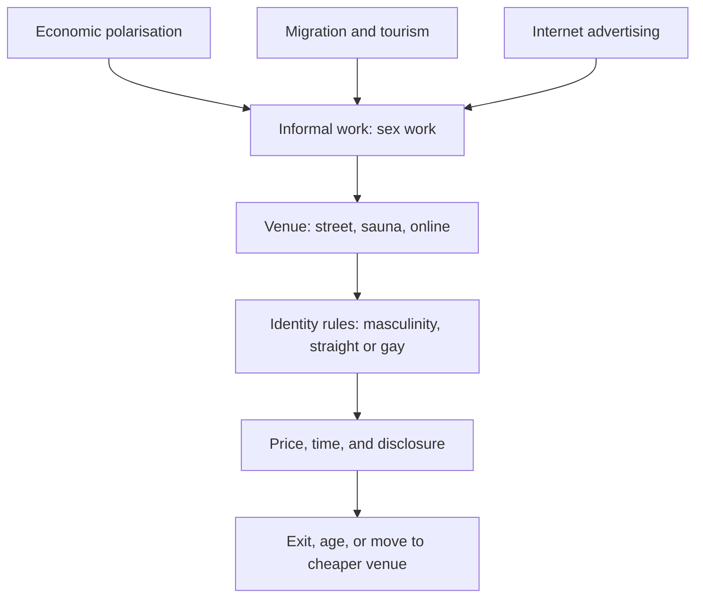

# 🧬 MSX.74 — Men Who Sell Sex — Aggleton & Parker (2015)
### Knowledge Entry — Distill

Fantasy, not a how-to: what happens in these pages stays in them. Reader discretion advised.

Peter Aggleton and Richard Parker edit 18 chapters on male sex work in Europe, the Americas, Africa, and Asia. The book updates a 1998 volume and treats male sex work as a social world, not a pathology.

## TABLE OF CONTENTS
- [Core Thesis](#1-core-thesis)
- [Mind Models](#2-mind-models)
- [Framework](#3-framework--structure)
- [Key Concepts](#4-key-concepts)
- [Heuristics](#5-heuristics--decision-rules)
- [Invariants](#6-invariants)
- [Pitfalls](#7-pitfalls--myths)
- [Application](#8-application)
- [Cross-References](#9-cross-references)
- [Provenance](#10-provenance--confidence)

---

## 1 · CORE THESIS

Men who sell sex are not one type. Poverty, migration, and the Internet shape why they sell and where. Local ideas of masculinity shape what they call themselves. Each setting needs its own script.

---

## 2 · MIND MODELS

**Diagram 1 — the whole argument.**
Caption: *the book moves research from "social problem" to "social world" and then tours that world by setting.*

**Diagram 2 — the central mechanism.**
Caption: *three global forces push men toward sex work, and venue and identity rules then decide how each man sells.*

**Diagram 3 — the Istanbul rent boy's identity cycle.**
Caption: *the rent boy keeps his straight identity by treating the queer night as temporary.*

---

## 3 · FRAMEWORK / STRUCTURE

An edited book. Chapter 1 sets the frame. Chapters 2-18 are country or region case studies, mostly ethnographic.

| Part | Governing move |
|---|---|
| Foreword (Altman) | Accept male sex work as a "predictable and acceptable part" of how sex and intimacy are organised (p. xx). |
| Ch. 1 (Aggleton & Parker) | Research moved from pathology, to HIV, to social construction. Three global forces now shape the field (pp. 4-9). |
| Ch. 2-5 | Europe: Netherlands, Albania and Romania, Macedonia, Istanbul. |
| Ch. 6-8 | The Americas: Brazil, the Dominican Republic, Peru. |
| Ch. 9-13 | Africa and Asia: sexual-economic exchange, Cape Town, South India, Pakistan, Thailand. |
| Ch. 14-18 | Australia, the USA, the UK, Canada, and China. |

---

## 4 · KEY CONCEPTS

| Concept | What it is | Why it matters |
|---|---|---|
| **Pathology to social world** | Earlier research framed male sex work as deviance, then as an HIV risk, then as a social phenomenon (Ch. 1, pp. 4-6). | It tells a writer which old frame to avoid. |
| **Situational, occasional, survival** | Types of involvement, not types of men (Ch. 1, p. 7). | The same man can move across them. |
| **Rent boy** | In Istanbul, a young man from the varos who must not be gay (Ch. 5, p. 57). | His identity work is part of the service. |
| **Nocturnal queer** | A man who is gay only at night and only for money (Ch. 5, p. 57). | It names a split identity. |
| **Garoto** | A Brazilian sauna worker, sold as a masculine man (Ch. 6, p. 70). | The "homem" is a marketed type. |
| **Programa** | A negotiated 40-minute session in a rented cabin (Ch. 6, p. 70). | It shows the unit of sale. |
| **Carne nova** | "Fresh meat," the new worker who earns most (Ch. 6, p. 71). | Value falls with time on the job. |
| **Dorais's four types** | Outcast, Insider, Part-Timer, Liberationist (Ch. 16, p. 203). | Tyler uses them, then says narratives overlap. |

---

## 5 · HEURISTICS & DECISION RULES

| Situation | Do this | Not this |
|---|---|---|
| Writing a man who sells sex | Give him a reason that changes by month: need, fun, or agency. | Give him one motive for life. |
| Writing a straight-identified seller | Let him keep a home life and a ritual for returning to it. | Force him to come out. |
| Writing a gay client | Let him desire working-class masculinity as a fantasy he pays for. | Write the client as a plain predator or plain victim. |
| Writing a sauna or bar scene | Include the price, the time block, and a coloured towel or sign. | Leave the commerce offstage. |
| Writing an aging worker | Show the shift to a cheaper venue and lower price. | Keep him young without cost. |
| Writing secrecy | Show which person knows what, by name. | Make secrecy total or absent. |

---

## 6 · INVARIANTS

1. Male sex work follows local economics and local masculinity.
2. A seller's label often differs from his buyer's label for him.
3. The body loses value over time, and the worker knows it.
4. Money means more than survival for many sellers.
5. Online ads changed who can start and how fast (Ch. 16, p. 209).
6. Pathology framings stigmatise the men they describe (Ch. 1, p. 5).

---

## 7 · PITFALLS / MYTHS

- The book focuses on men who sell to men. Ch. 5 found no men selling to women (p. 55).
- Chapters differ in method and size. Brazil rests on about 40 workers and 40 clients (Ch. 6, p. 69).
- The Istanbul update used eleven men in 2013 (Ch. 5, p. 55).
- Interviews are self-reports, with the usual silences about shame and risk.
- Case studies from one city should not be read as the country's rule.
- Altman doubts that more research of this kind will tell us much new (Foreword, p. xx).

---

## 8 · APPLICATION

*Everything here is proposed, never ruled.*

- **Spine level:** L5, as set by the batch brief.
- **12-layer character stack:** L3 SOCIAL (client_script, disclosure_posture), L1 CORE (identity_frame), L6 DRIVE (money_meaning), L7 ORIGIN (class_origin), L2 VITAL (body_capital).
- **plot_systems:** a transaction scene with a venue, a price, a time block, and a story each man tells himself.
- **Setting:** the venue list (street, sauna, online) gives the ORANGE work a ready menu of places where men meet for pay.

The book hands a writer a split character. A man can sell sex and still say he is straight, and the text treats this as skilled work. Money gives a second axis. One man sells for rent, another for adventure, and the same man changes. Fantasy comes first, and explicit scenes are allowed under the standing 06.1 ruling. The file's one-line disclaimer carries the container.

---

## 9 · CROSS-REFERENCES

| Related entry | Relation |
|---|---|
| [[🧬 MSX.19 — The Routledge Handbook of Male Sex Work — Scott, Grov & Minichiello (2021)]] | A later handbook on the same field. |
| [[🧬 MSX.59 — Economics, Sexuality, and Male Sex Work — Logan (2017)]] | An economics-side study of the same field. |
| [[🧬 MSX.60 — Tearoom Trade — Humphreys (1970)]] | An older study of men who keep a straight public life and have sex in public toilets. |
| [[🧬 MSX.79 — Sexual Politics, Sexual Communities — D'Emilio (1983)]] | Chapter 6 here cites D'Emilio on political economy shaping gay life (p. 69). |

---

## 10 · PROVENANCE & CONFIDENCE

Full-text pdftotext extraction, 268 pdf pages. Title page confirms Routledge, 2015, edited by Peter Aggleton and Richard Parker, with a foreword by Dennis Altman. Printed page equals pdf page minus 20. Page cites are printed pages.

Read: the Foreword (pp. xix-xx), Ch. 1 in full (pp. 1-14, up to the migration section), the opening of Ch. 5 (pp. 54-64), the opening of Ch. 6 (pp. 68-72), the opening of Ch. 16 (pp. 202-204), and the later pages of Ch. 16 on cost, price, and the conclusion (pp. 207-213).

Skipped: Ch. 2-4, Ch. 7-15, Ch. 17-18, and the reference lists. The extraction has small OCR errors and shows the wrong running heads in places. Confidence is medium. The framing chapter is strong. The case studies are sampled from three of 17. The `feeds:` keying is this distill's own synthesis, and the book uses none of the 12-layer vocabulary.

## META
- Template: BVX-LEARN-v4.0
- Source classification: full-text extraction, targeted read of Ch. 1, 5, 6, 16 and the foreword
- Created / Updated: 2026-10-04
