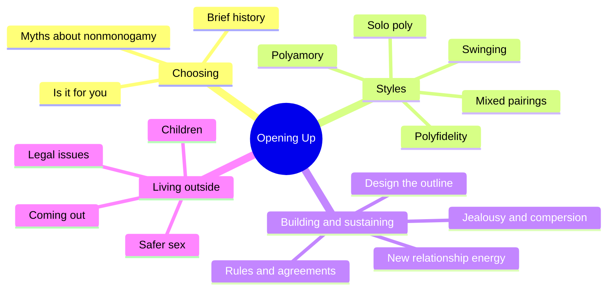
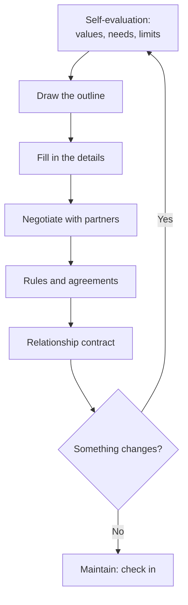
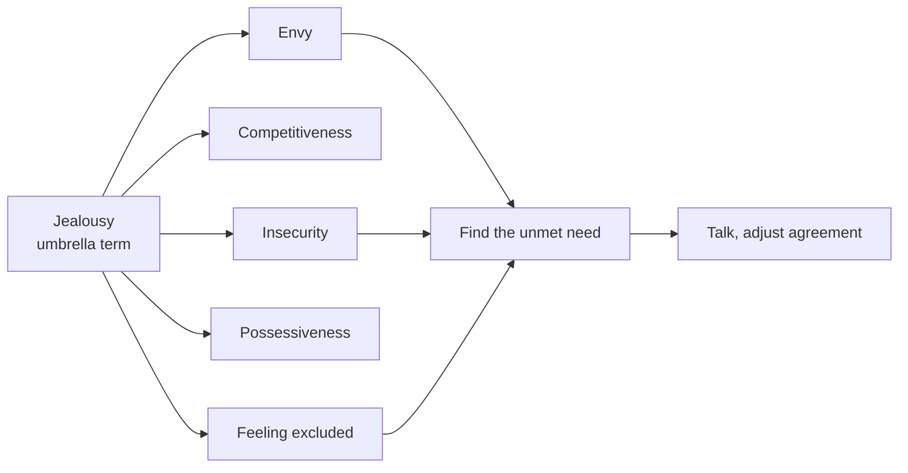
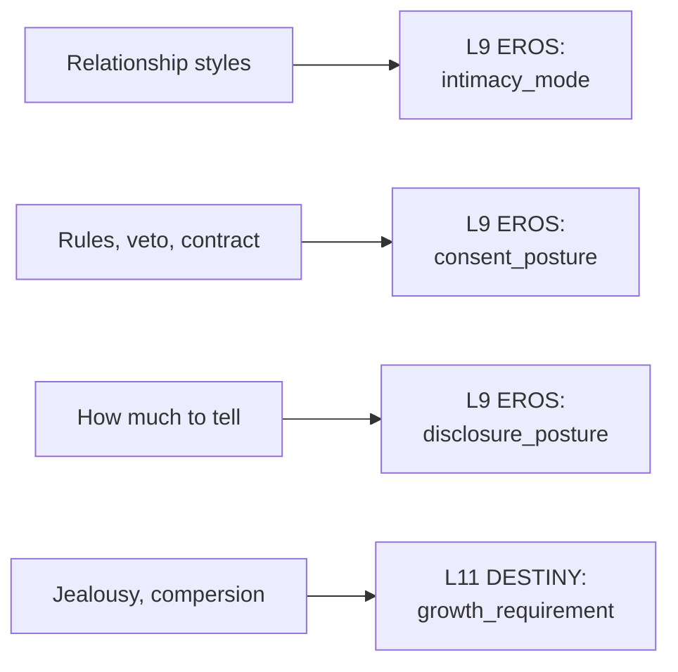

# 🧬 MSX.75 — Opening Up — Taormino (2008)
### Knowledge Entry — Distill

Taormino's guide to consensual nonmonogamy draws on interviews with people in open relationships. It maps the styles, then gives a working method for designing, negotiating, and repairing an open relationship.

## TABLE OF CONTENTS
- [Core Thesis](#1-core-thesis)
- [Mind Models](#2-mind-models)
- [Framework](#3-framework--structure)
- [Key Concepts](#4-key-concepts)
- [Heuristics](#5-heuristics--decision-rules)
- [Invariants](#6-invariants)
- [Pitfalls](#7-pitfalls--myths)
- [Application](#8-application)
- [Cross-References](#9-cross-references)
- [Provenance](#10-provenance--confidence)

---

## 1 · CORE THESIS

An open relationship works when the people in it design it on purpose, fit to their own values. It needs honest agreements, a working relationship with jealousy, and self-awareness first. No single style is correct, and monogamy is a choice as well.

---

## 2 · MIND MODELS

**Diagram 1 — the whole argument.**
Caption: *the book runs in three moves: choose, pick a style, then build and maintain the design.*

**Diagram 2 — the central mechanism (designing an open relationship).**
Caption: *design comes first and negotiation second, and agreements get revisited whenever something changes.*

**Diagram 3 — what jealousy is, according to the interviews.**
Caption: *jealousy is a bundle of feelings that points at a need, and the work is to find the need and not to deny the feeling.*

**Diagram 4 — mapped onto the 12-layer character stack.**
Caption: *the structure menu maps to intimacy mode, the agreements to consent posture, and the emotional work to growth.*

---

## 3 · FRAMEWORK / STRUCTURE

Three sections, twenty chapters, plus a resource guide.

| Part | Governing move |
|---|---|
| Introduction | The decline of marriage and monogamy, monogamy's mythology, nonmonogamy as a choice, and her research method (interviews). |
| Section 1, Choosing (chs. 1-3) | Brief history (ch. 1: swinging, open marriage, multilateral marriage, gay bathhouses and sex clubs, lesbian collectives and the sex wars, polyamory). Myths (ch. 2, p. 13). Self-evaluation (ch. 3, p. 19). |
| Section 2, Styles (chs. 4-10) | Swinging (ch. 6, p. 61), polyamory (ch. 7, p. 71), solo polyamory (ch. 8, p. 87), polyfidelity (ch. 9, p. 95), monogamous/nonmonogamous and mono/poly pairings (ch. 10, p. 111). Each gives a definition and common issues. |
| Section 3, Creating and sustaining (chs. 11-20) | Design (ch. 11, p. 121), jealousy (ch. 12, p. 153), compersion (ch. 13, p. 173), common challenges (ch. 14, p. 183), changes (ch. 15, p. 203), coming out and community (ch. 16, p. 227), children (ch. 17, p. 249), safer sex (ch. 18, p. 263), legal issues (ch. 19, p. 285), the future (ch. 20, p. 295). |

---

## 4 · KEY CONCEPTS

| Concept | What it is | Why it matters |
|---|---|---|
| **Consensual nonmonogamy** | Everyone involved has agreed to the arrangement (ch. 2). | The line between this and cheating is consent and honesty. |
| **Cheating** | Lying, deception, and breaking a commitment previously made (ch. 2). | The same sex act is cheating in one story and consensual in another. |
| **Swinging** | A community-based style with its own etiquette (ch. 6, p. 61). | A defined subculture with customs a character can know. |
| **Hierarchical poly** | One partner is "primary," others are "nonprimary" (ch. 7, p. 71). | A ranking system that creates its own conflicts. |
| **Solo polyamory** | Multiple relationships without merging into a couple (ch. 8, p. 87). | A character can be committed and still independent. |
| **Polyfidelity** | A closed group with sexual loyalty inside it (ch. 9, p. 95). | Shows that "closed" does not mean "two." |
| **Rules vs. agreements** | Rules limit partners. Agreements are negotiated. One interviewee: "everything is negotiable" (ch. 11). | The distinction is a character-level difference in style. |
| **Veto power** | The ability to say no to a potential new partner and have it respected (ch. 11, p. 121 ff.). | Some call it essential. Others call it harmful, and the book records both. |
| **New relationship energy** | The intense early rush of a new partner (ch. 14, p. 183). | A predictable stress point in any open relationship. |
| **Jealousy** | A bundle of feelings: envy, competitiveness, insecurity, possessiveness, feeling excluded (ch. 12). | An interviewee, Owen, calls it "the warning light on your dashboard." |
| **Compersion** | Joy in a partner's joy with someone else, coined by the Kerista Commune (ch. 13, p. 173). | Taormino says a successful open relationship does not need it, and calls it "more complicated." |
| **Erotic compersion** | Arousal from watching or imagining a partner with another (ch. 13). | A distinct desire mode, separate from the emotional kind. |
| **Coming out as nonmonogamous** | A choice with benefits and risks (ch. 16, p. 227). | Parallels coming out as gay. |

---

## 5 · HEURISTICS & DECISION RULES

| Situation | Do this | Not this |
|---|---|---|
| Writing a couple that opens up | Start from what each wants, then negotiate rules. Show the first version failing. | Write one conversation that fixes everything. |
| Writing a rule | Ask who made it, who it protects, and what happens when it breaks. | Treat rules as neutral facts. |
| Writing a veto | Give it a cost: someone used it, and it hurt. | Treat it as a cure or as a sin. |
| Writing jealousy | Treat it as information. Let a character ask what he is short of: time, attention, certainty. | Write it as either "natural, so deal" or "unnatural, so cut." |
| Writing compersion | Separate the erotic kind from the emotional kind. Let one exist without the other. | Make it a sign that a character is "enlightened." |
| Writing a new partner entering | Include new relationship energy: time, attention, and mismatch of excitement. | Let the new relationship be frictionless. |
| Writing how much partners tell | Give each partner a different need: reassurance, arousal, or privacy. | Make full disclosure the only honest option. |
| Writing a break in the agreement | Treat it as a separate harm from the sex itself: the harm is the broken agreement. | Treat the agreement as meaningless because the structure is open. |

---

## 6 · INVARIANTS

1. **Consent and honesty separate nonmonogamy from cheating.** Everyone must tell the truth and respect the agreed rules (ch. 2).
2. **Open relationships need custom design.** The style must fit the people (ch. 11, p. 121).
3. **Self-awareness comes first.** The book calls it a prerequisite for positive nonmonogamous relationships (ch. 12, p. 153).
4. **More partners mean more issues.** Everyone's baggage multiplies (ch. 12).
5. **Jealousy is predictable.** It appears when a new person enters, when a casual partner becomes serious, or when a major change happens (ch. 12).
6. **Agreements need revisiting.** Change in desire, orientation, or partner reopens the design (ch. 15, p. 203).
7. **Nonmonogamy tests skills.** The interviews suggest people in open relationships tend to build communication skills (ch. 2).

---

## 7 · PITFALLS / MYTHS

The book corrects ten myths in chapter 2 (pp. 13-18). A short version:

- That humans are naturally monogamous. The book cites Barash and Lipton's claim that most animal species are not.
- That open relationships are unnatural or immoral. It treats norms as set by institutions and changing over time.
- That polyamory means Mormon polygamy. It separates polygyny from consensual group relationships and notes consent as the key issue.
- That open relationships signal psychological problems. It cites research showing no difference in dysfunction between groups.
- That nonmonogamy dilutes intimacy, or means confusion or promiscuity.
- That open relationships raise disease risk by default. The book says risk comes from unprotected sex with an infected or unknown-status partner.
- That open relationships are cheating, or bad for children.

Data cautions, stated once. The book's evidence is mostly interviews with self-selected people who chose open relationships, and its psychological claims rest on research cited in 2008. It reports success stories and failures but cannot show how common either is. Legal sections (ch. 19) are US-based and dated. Taormino writes as an advocate and says so, calling monogamy mythology and the nuclear family as dysfunctional as any other (ch. 2).

---

## 8 · APPLICATION

*Proposed for the Command, not ruled.*

- **Spine level:** L5
- **12-layer character stack:** L9 EROS intimacy_mode (primary); L9 EROS consent_posture (primary); L9 EROS disclosure_posture (supporting); L11 DESTINY growth_requirement (supporting); L9 EROS desire_vector (contextual); L3 SOCIAL disclosure_posture (contextual).
- **plot_systems:** rule-making and rule-breaking between partners is a ready story engine. A veto, a notification rule, or a "check in first" rule can each carry a three-scene arc.
- **Setting:** the book's history (swinging, bathhouses and sex clubs, lesbian collectives, polyamory) gives era-specific forms for the universe's eras 1 through 4.

Taormino gives the 12 layers a vocabulary for relationship structure. EROS currently holds desire and scripts. It does not yet hold a stated relationship design, a list of agreements, or a record of which agreements have been broken. This book supplies all three.

For the ORANGE work, the proposed addition is an agreements ledger per couple or group: what was agreed, who proposed it, and what happened when it was tested. It lets a story show a structure changing under pressure instead of a fixed label. Gay and bisexual men's relationships can use the same ledger. The book's gay material is thin, so a writer should treat the ledger as a craft tool and not as a claim about any one community.

Explicit content follows the standing prose ruling: fantasy first, with the container as the one-line front-matter disclaimer ("Fantasy, not a how-to: what happens in these pages stays in them. Reader discretion advised.", ruled 10/4).

---

## 9 · CROSS-REFERENCES

| Related entry | Relation |
|---|---|
| [[🧬 PSY.61 — Sex at Dawn — Ryan & Jethá (2010)]] | The popular-science argument that monogamy is not the human default. Taormino cites a similar claim (Barash and Lipton). |
| [[🧬 PSY.03 — Unlimited Intimacy — Dean (2009)]] | A parallel guide on intimacy and risk in gay men's lives. |
| [[🧬 PSY.02 — Understanding Threesomes — Scoats (2020)]] | Research on the three-person form that appears in Taormino's styles. |
| [[🧬 MSX.17 — Mating in Captivity — Perel (2006)]] | Perel argues for desire and security inside one pair. Taormino argues for designing the pair itself. |
| [[🧬 PSY.62 — Tell Me What You Want — Lehmiller (2018)]] | Lehmiller's survey includes a nonmonogamy fantasy theme and the risks of acting on it. |

---

## 10 · PROVENANCE & CONFIDENCE

Full text, pdftotext extraction, 436 PDF pages. The extract has the table of contents and chapter titles but no copyright page, so the year 2008 and the publisher (Cleis Press, named in the acknowledgments) come from outside the extract. Treat the year as unconfirmed against front matter. Chapter start pages are the table of contents' printed pages. In the extract, printed pages sit about 29 to 55 PDF pages behind the PDF count, so page cites are chapter starts.

Read in full or near full: the table of contents, chapter 2 (myths, pp. 13-18), the opening of chapter 11 (the outline, the veto discussion, prior notice, partial detail-sharing), the opening of chapter 12 (jealousy), the start of chapter 13 (compersion and erotic compersion), and the opening of chapter 14.

Not read: the introduction, chapter 1's full history, chapter 3's self-evaluation exercises, chapters 4 through 10 (the style chapters rest on the table of contents), chapters 15 through 20, and the resource guide. The Framework rows for those chapters are table-of-contents summaries.

The feeds keying is this distill's own synthesis against the Command's 12-layer stack. Taormino uses none of that vocabulary. The `spine: [L5]` value follows the assigning brief.

## META
- Template: BVX-LEARN-v4.0
- Source classification: full-text pdftotext, deep read on chapters 2, 11, 12, 13 (openings), table of contents for the rest
- Created / Updated: 2026-10-04
