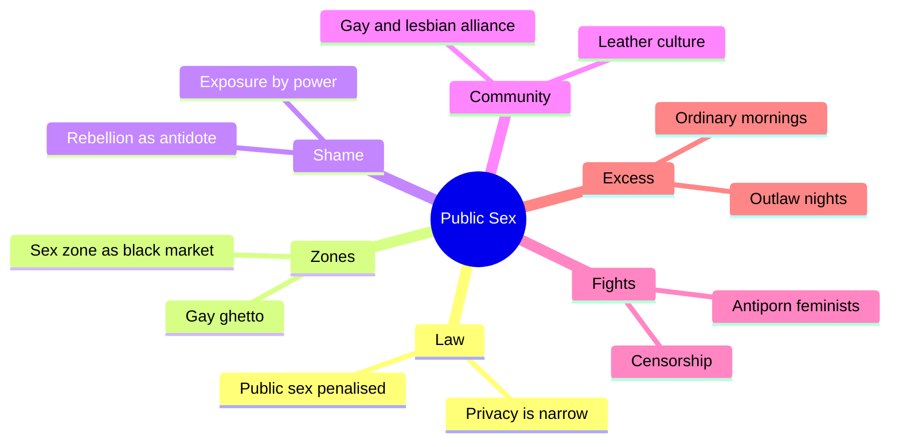
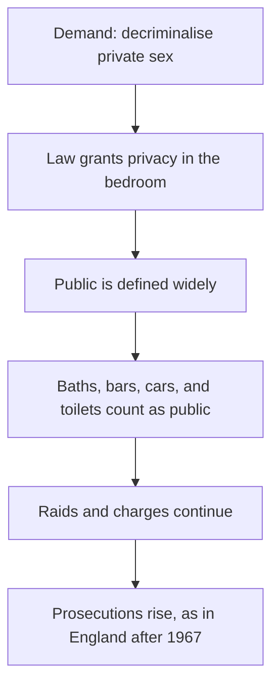
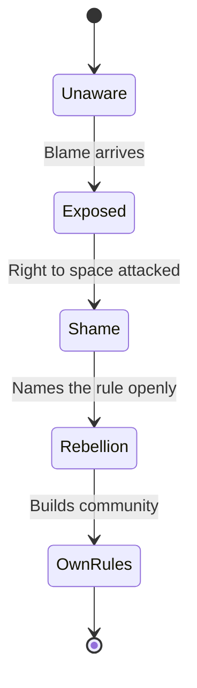

# 🧬 MSX.76 — Public Sex — Califia (2000)
### Knowledge Entry — Distill

Fantasy, not a how-to: what happens in these pages stays in them. Reader discretion advised.

Pat Califia's essay collection, 1979 to 1999, argues for sex between consenting adults in public, kinky, and gay-male spaces. It is the library's main voice from inside leather culture and the sex-radical camp.

## TABLE OF CONTENTS
- [Core Thesis](#1-core-thesis)
- [Mind Models](#2-mind-models)
- [Framework](#3-framework--structure)
- [Key Concepts](#4-key-concepts)
- [Heuristics](#5-heuristics--decision-rules)
- [Invariants](#6-invariants)
- [Pitfalls](#7-pitfalls--myths)
- [Application](#8-application)
- [Cross-References](#9-cross-references)
- [Provenance](#10-provenance--confidence)

---

## 1 · CORE THESIS

Califia argues that "private sex" law is a trap. It narrows where people may have sex and invites more policing of the rest. A sex radical answers by going public, naming her own shame, and building a culture.

---

## 2 · MIND MODELS

**Diagram 1 — the whole argument.**
Caption: *the essays attack one idea from several sides: that a sexual minority should buy safety by hiding.*

**Diagram 2 — the central mechanism.**
Caption: *a law that protects private sex lets police tighten everything outside it, so the zones between bedroom and street get raided.*

**Diagram 3 — shame and its antidote.**
Caption: *shame comes from a more powerful accuser, and open rebellion turns the accuser into the one who must answer.*

---

## 3 · FRAMEWORK / STRUCTURE

The book is a set of reprinted essays, not one argument. The author's 1994 introduction and a set of 1999 pieces frame the earlier work.

| Essay | Governing move |
|---|---|
| Introduction (1994), pp. 14-17 | Defines the "sex radical" as defiant as well as deviant, and tells her path from 1979. |
| Public Sex (1982), pp. 42-46 | Argues that private-sex law narrows where gay men may have sex. |
| Feminism and Sadomasochism (1980), pp. 183-184 | Answers lesbian-feminists who call S/M abuse, and lists what openness cost her. |
| Antidote to Shame (1999), pp. 159-161 | Defines shame as exposure by power and names rebellion as the cure. |
| The City of Desire (1991), pp. 225-228 | Reads the city as a map of desire, with sex zones as black markets. |
| The Necessity of Excess (1999), pp. 273-275 | Looks back at the late-1970s fist-play club scene and argues for chosen excess. |

The other essays, by their titles, cover censorship, the antiporn movement, lesbian S/M, gender play, latex, non-monogamy, and sex work. They were not read.

---

## 4 · KEY CONCEPTS

| Concept | What it is | Why it matters |
|---|---|---|
| **Sex radical** | Someone defiant as well as deviant, who questions how society assigns privilege by sexual morality (p. 14). | The word names an ethic, not a taste. |
| **Privacy trap** | Decriminalising private acts while defining "private" narrowly (Public Sex, pp. 42-45). | It shows how reform can tighten control. |
| **Contested zone** | Motel, bath, bar, bookstore, car, toilet, alley, fought over by police and users (p. 45). | It maps where sex actually happens. |
| **Sex zone** | A district that sells sex, drugs, and contraband, usually after dark (City of Desire, pp. 225-226). | The city itself becomes a desire map. |
| **Gay ghetto** | A sex zone that is also a residential district (p. 228). | Gay men alone built an enclave of this kind. |
| **Shame** | Being exposed by someone more powerful (Antidote to Shame, p. 159). | It links shame to power, not to the act. |
| **Antidote to shame** | Public rebellion that holds the accuser accountable (p. 160). | It is a move a character can make. |
| **Excess** | Chosen extremity, held inside a balance of ordinary life (Necessity of Excess, pp. 274-275). | It lets a character be extreme and stable. |

---

## 5 · HEURISTICS & DECISION RULES

| Situation | Do this | Not this |
|---|---|---|
| Writing a law that "protects" gay men | Show it shrinking where they may be, and a raid just outside the line. | Write it as plain progress. |
| Writing a cruising place | Give it a time of day, a nearby legal business, and a risk of arrest. | Write it as lawless. |
| Writing shame | Trace it to a person with power who looked and judged. | Write it as a feeling the character invented. |
| Writing a kink character with a normal life | Let the extreme night and the ordinary morning both be real. | Make the kink consume him. |
| Writing a split inside a movement | Show allies who dislike the people they share a banner with (p. 160). | Make the movement one voice. |
| Writing a coming-out as strategy | Let the character speak first so rumors lose force. | Make disclosure only a confession. |

---

## 6 · INVARIANTS

1. Law that grants privacy also defines what counts as public.
2. Sex zones sit on poor or empty ground and hide by day.
3. Shame is a relation to power, not only a private feeling.
4. A sexual minority is split by taste, class, and gender.
5. Openness costs something, and Califia lists the costs.
6. Extreme tastes and ordinary routines coexist.

---

## 7 · PITFALLS / MYTHS

- The essays are advocacy. Califia writes as a partisan, and her 1980s claims about opponents are one side of a feud.
- The facts are dated. The law cited runs from the 1960s to the 1990s, and the club world she recalls is the late 1970s and early 1980s.
- She writes as a lesbian leather woman among gay men, so her view of men's scenes is an insider-outsider view.
- The book argues about the sex-radical position. Opponents' views appear only as she reports them.
- The collection is uneven, since some pieces were columns written for deadline.
- Her words on drugs and risk reflect the late 1970s and early 1980s, before later change.

---

## 8 · APPLICATION

*Everything here is proposed, never ruled.*

- **Spine level:** L5, as set by the batch brief.
- **12-layer character stack:** L9 EROS (shame_architecture, erotic_pacing, intimacy_mode), L3 SOCIAL (contested_zone), L4 WILL (resistance_mode), L5 WOUND (cost_of_openness).
- **plot_systems:** a raid-and-line scene engine: a character crosses from private to public, and the law redraws the line behind him.
- **Setting:** the contested-zone list (motel, bath, bar, car, alley) gives the ORANGE work a ready map of places with legal risk.

Califia gives a character a theory of his own shame. He can trace it to who looked at him, then answer by speaking first. The Saturday outlaw and Sunday brunch pairing is a usable rhythm for a character with extreme tastes and a settled life. Fantasy comes first in the prose, and explicit content is allowed under the standing 06.1 ruling. The one-line disclaimer carries the container.

---

## 9 · CROSS-REFERENCES

| Related entry | Relation |
|---|---|
| [[🧬 MSX.46 — Deviations — Rubin (2011)]] | Rubin's sex-radical theory sits beside Califia's practice, and Califia thanks Rubin in the dedication. |
| [[🧬 MSX.36 — The History of Sexuality — Foucault (1978)]] | Foucault says power produces categories. Califia describes the policing and shame that follow. |
| [[🧬 MSX.62 — Gay Macho — Levine (1998)]] | A study of the clone and leather scene Califia writes from the edge of. |
| [[🧬 MSX.61 — Times Square Red, Times Square Blue — Delany (1999)]] | Delany writes about the same kind of sex zone and its removal. |
| [[🧬 MSX.84 — The Pornography Wars — Burke (2023)]] | Burke covers the feminist antiporn fights Califia fought in the 1980s. |

---

## 10 · PROVENANCE & CONFIDENCE

Full-text pdftotext extraction, 282 pdf pages. Title page and copyright page confirm Pat Califia, Cleis Press, second edition, copyright 1994 and 2000. Essays carry original dates from 1979 to 1999. Page cites are pdf pages, not printed pages. The essays use "she" for the author. Califia later came out as a trans man, and this entry follows the 2000 text for those years.

Read: the 1994 introduction (pp. 14-17), the essay "Public Sex" (1982, pp. 42-46), "Antidote to Shame" (1999, pp. 159-161), the opening of "Feminism and Sadomasochism" (1980, pp. 183-184), "The City of Desire" (1991, pp. 225-228), and the opening of "The Necessity of Excess" (1999, pp. 273-275).

Skipped: all other essays, including "Victims Without a Voice," "The Obscene, Disgusting and Vile Meese Commission Report," "Among Us, Against Us," "See No Evil," "When Sex Is a Job," "A Secret Side of Lesbian Sexuality," "Genderbending," "Gay Men, Lesbians, and Sex," "Beyond Leather," "Unmonogamy," "Love and the Perfect Sadist," "Modern Primitives," and "Whoring in Utopia." Confidence is medium. The sampled essays are central, but the collection is wide. The `feeds:` keying is this distill's own synthesis, and the book uses none of the 12-layer vocabulary.

## META
- Template: BVX-LEARN-v4.0
- Source classification: full-text extraction, targeted read of six essays and the 1994 introduction
- Created / Updated: 2026-10-04
