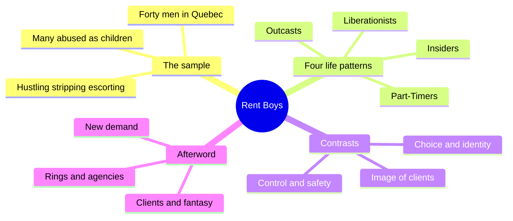
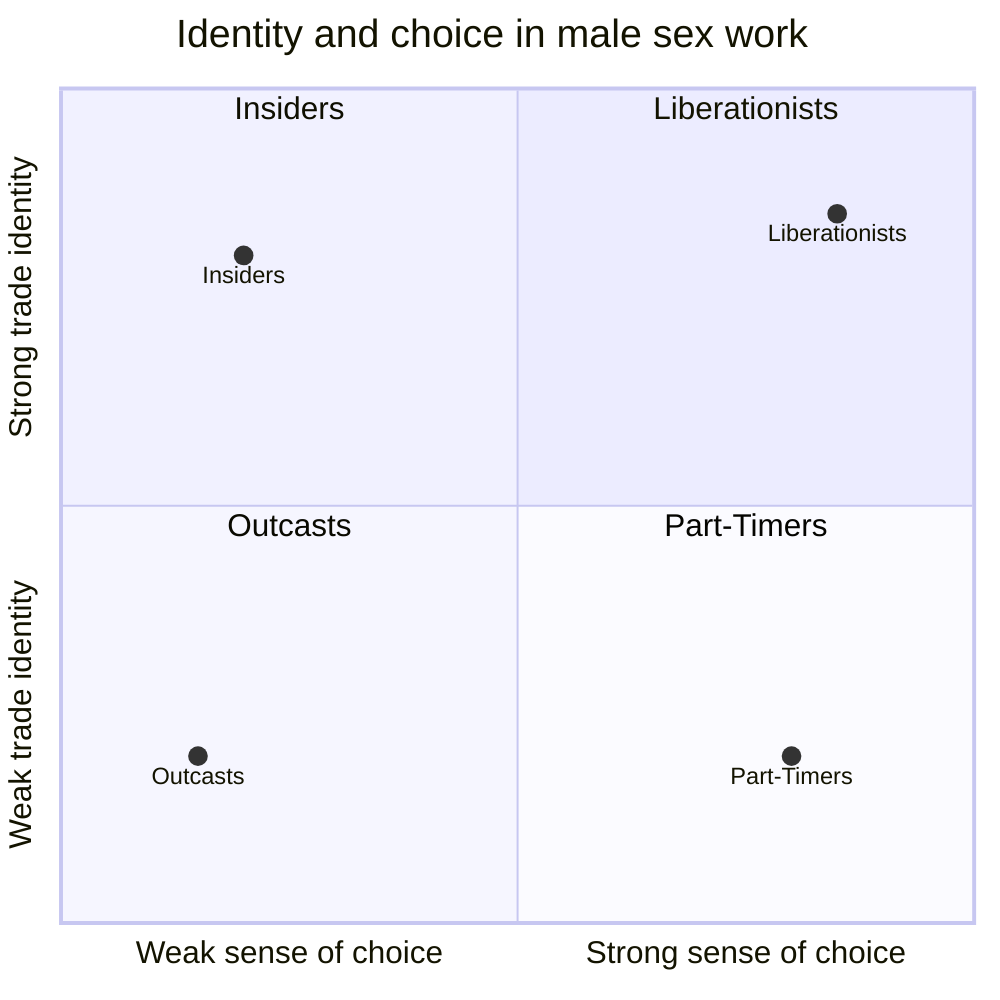
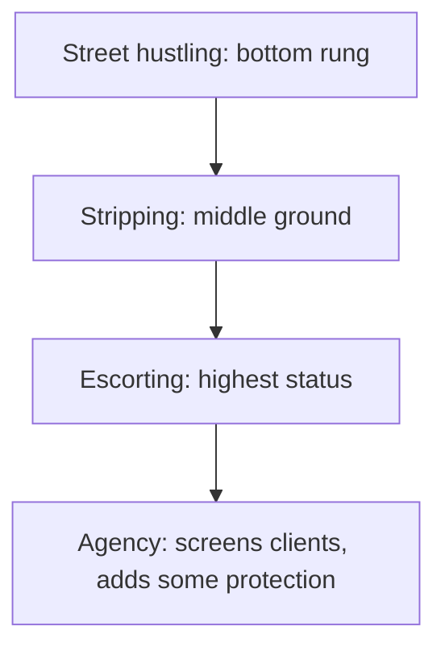
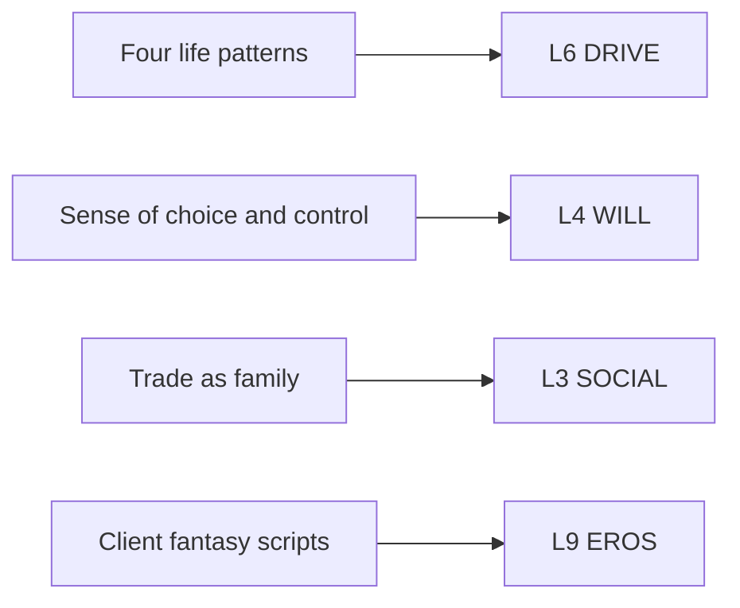

# 🧬 MSX.77 — Rent Boys — Dorais (2005)
### Knowledge Entry — Distill

Fantasy, not a how-to: what happens in these pages stays in them. Reader discretion advised.

Michel Dorais, a Quebec sociologist and former youth social worker, interviewed forty male sex workers and sorted them into four life patterns. The book is short, plain, and the shelf's best source on why men sell sex to men and how they see their clients.

## TABLE OF CONTENTS
- [Core Thesis](#1-core-thesis)
- [Mind Models](#2-mind-models)
- [Framework](#3-framework--structure)
- [Key Concepts](#4-key-concepts)
- [Heuristics](#5-heuristics--decision-rules)
- [Invariants](#6-invariants)
- [Pitfalls](#7-pitfalls--myths)
- [Application](#8-application)
- [Cross-References](#9-cross-references)
- [Provenance](#10-provenance--confidence)

---

## 1 · CORE THESIS

Dorais argues that male sex work is not one thing. Forty workers fall into four patterns, set by how they entered, whether they feel they chose it, and whether they feel in control. The same trade is a survival trap for some, a family for others, and a source of pride for a few.

---

## 2 · MIND MODELS

*Required. Minimum two diagrams, maximum five.*

**Diagram 1 — the whole argument.**
Caption: *the book moves from the sample, through the four patterns, to the risks and the help that workers ask for.*

**Diagram 2 — the central mechanism (the two axes).**
Caption: *two questions, whether the man identifies with the trade and whether he feels he chose it, separate the four patterns cleanly.*

**Diagram 3 — the status ladder of the trade.**
Caption: *workers rank the venues, and moving up the ladder usually means more safety and more screening.*

**Diagram 4 — mapped onto the 12-layer character stack.**
Caption: *each pattern is a different DRIVE, and the felt sense of choice sits on WILL.*

---

## 3 · FRAMEWORK / STRUCTURE

The book has nine short chapters and an afterword. It reads as one study.

| Chapter (printed pages) | Governing move |
|---|---|
| 1 Background (3-8) | Explains the Health Canada study and the author's earlier work with young hustlers. |
| 2 Respondents (9-12) | Describes the forty men: ages, orientation, abuse, health. |
| 3 Male Prostitution Front and Centre (13-25) | Gives history and the public debate. |
| 4 Working Conditions (26-35) | Describes venues, pay, and routine. |
| 5 Four Life Patterns (36-43) | Names Outcasts, Part-Timers, Insiders, Liberationists. |
| 6 Regular Guys (44-57) | Gives one typical case for each pattern. |
| 7 Contrasts and Resemblances (58-66) | Compares the patterns on six questions. |
| 8-9 Risks and Help (67-90) | Covers health risks and when workers need help. |
| Afterword (91-100) | Adds notes on clients, rings, agencies, and new demand. |

---

## 4 · KEY CONCEPTS

| Concept | What it is | Why it matters |
|---|---|---|
| **Outcasts** | 22 of 40. Dire poverty, heavy drug use, low self-esteem, earliest entry (average 18) (pp. 36-38). | The trade and the addiction cannot be told apart. |
| **Part-Timers** | 6 men. Sporadic work to cover debts, sober, discreet, entered late (average about 28) (p. 39). | They do not identify as sex workers. |
| **Insiders** | 6 men. Grew up in or near the trade, entered at about 17, and call it family (pp. 40-41). | "The street is the only place I know where I feel at home." |
| **Liberationists** | 6 men. Mostly gay, higher self-esteem, enter to explore and affirm orientation (pp. 41-43). | They like the work, and some drift into disillusion. |
| **The ladder** | Street at the bottom, stripping in the middle, escorting at the top (p. 46). | Status and safety rise together. |
| **Overtime and extras** | Paid extras beyond the base service (p. 46). | The price list is part of the scene. |
| **Choice and identity axes** | Do they identify with the work, and did they choose it (pp. 58-61). | The same job reads differently on each axis. |
| **Control and clients** | Liberationists feel most control and see clients most warmly. Outcasts feel least and see clients as the cause of their decay (pp. 61-63). | The image of the client is a trait of the worker. |
| **Symbolic exchange** | The trade also trades fantasy: beauty, power, money, youth, seduction (p. 93). | Both sides act roles. |
| **Client secrecy** | Clients guard anonymity. Some are curious straight men or bisexual men with double lives (pp. 92-93). | The client has a closet of his own. |
| **Rings versus agencies** | Rings recruit minors and use drugs to control them. Agencies employ adults and discourage drug use (pp. 94-96). | Dorais separates exploitation from commerce between adults. |

---

## 5 · HEURISTICS & DECISION RULES

| Situation | Do this | Not this |
|---|---|---|
| A character sells sex | Pick one of the four patterns and let the details follow: money use, drugs, self-image. | Use a single "hustler" type. |
| A tender client scene | Let the client be a regular, a protector, or a lover for the Insider or Liberationist. | Make every client a predator or every client a friend. |
| Money in the scene | Show where it goes. Outcasts spend it on drugs and body upkeep. Part-Timers pay debts. | Make the money abstract. |
| A character who is "just doing it for cash" | Keep him unattached to the label and discreet at home. | Give him a pride speech. |
| A found-family scene | Use the trade's shared nights, shared clients, and shared advice. | Show the workers only as isolated. |
| A client's point of view | Give him secrecy, a fantasy script, and a wish to control the length and limits. | Make him a faceless buyer. |
| Writing venue mobility | Let a worker move from street to bar to agency, with each step bringing screening and status. | Treat all venues as one. |

---

## 6 · INVARIANTS

1. **Male sex work is plural.** Motive, entry, and meaning vary as much as the men do (Afterword, p. 91).
2. **Four patterns are tendencies.** Workers can show more than one, and one usually leads (pp. 38-39).
3. **Sense of choice and sense of identity are separate.** Both vary by pattern (pp. 58-61).
4. **The client sets the length and limits.** The relationship is not a normal reciprocal one (p. 93).
5. **Fantasy is part of the price.** The staging of beauty, power, and youth is the product (p. 93).
6. **Venue means status.** The ladder is real to the workers (p. 46).
7. **Hope is possible in every pattern.** Dorais stresses that each account is a snapshot (p. 44).

---

## 7 · PITFALLS / MYTHS

- **Small sample.** Forty volunteers is a small group. Dorais reports that strippers and escorts were hard to recruit and that agencies were unresponsive (p. 9).
- **One region.** The men worked mostly in Quebec and Canadian and US cities, in the early 2000s. The French original dates to 2003.
- **Self-report.** The men told Dorais how they see themselves. He did not observe the encounters.
- **No client sample.** Client claims come from sex workers' accounts, plus letters from a few clients after the French edition (pp. 92-93).
- **Typology is the author's.** The four names are his groupings, not categories the men used.
- **Abuse figure.** The book says abuse was 3.5 to 4 times the estimated rate for North American boys (p. 11). It compares the sample to a general estimate and cannot prove cause.
- **Gender balance.** The book covers men who sell sex to men, plus some work with women and couples. It does not cover women or trans workers.
- **Minor entrants.** Some men began before 16. The book treats these starts as exploitation or flight from home (pp. 10-11, 45).

---

## 8 · APPLICATION

*Proposed for the ORANGE work, not ruled.*

- **Spine level:** L5.
- **12-layer character stack:** L6 DRIVE (work_motive_pattern, primary); L4 WILL (perceived_control, primary); L3 SOCIAL (chosen_family, supporting); L9 EROS (fantasy_exchange, supporting); L5 WOUND (abuse_history_link, supporting).
- **plot_systems:** a worker's movement up the ladder, or a client's double life, can drive a plot.
- **Setting:** street, bar, strip club, and agency are four different rooms with four different rules.

Dorais gives the character system a way to write a worker without a single story. The four patterns are four drives. A writer picks one and the rest follows: how he spends money, how he talks about clients, and who he calls at 3 a.m.

The sharpest tool is the pair of axes. A character can feel he chose the work and yet not identify with it, or feel the work chose him and identify fully. The Part-Timer and the Insider show both cases. A scene can reveal which one he is by how he answers one question, "Is this what you do?"

The second tool is the client as a character. Dorais says clients fear exposure, may be curious straight men or bisexual men with double lives, and want control over the exchange. A writer can build a client with a closet, a script, and a limit.

The third tool is symbolic exchange. The fantasy staging (beauty, power, money, youth) can run a scene. It lets an explicit scene carry two stories at once: what the bodies do, and what the roles are doing.

Proposed addition: an L6 variable `work_motive_pattern` with four values and a free field `felt_choice`. It pairs with an L3 field `trade_family` for Insiders.

This entry proposes the patterns for adult characters. The ORANGE prose rulings apply as written. Explicit content is allowed, written as fantasy first, with the one-line container in the front matter.

---

## 9 · CROSS-REFERENCES

| Related entry | Relation |
|---|---|
| [[🧬 MSX.39 — Working It — Bickers, breshears & Luna, eds. (2023)]] | Workers' own voices, a counterweight to a researcher's typology. |
| [[🧬 MSX.40 — Bodies of Work — Saunders (2020)]] | A later account of sex work as labor. |
| [[🧬 PSY.57 — Cruise Control — Weiss (2013)]] | Weiss lists hiring sex workers as a sign of compulsion and describes the hustler-and-client dynamic from the other chair. |
| [[🧬 MSX.45 — Gay New York — Chauncey (1994)]] | The history of the same trade and its social world in an earlier city. |
| [[🧬 MSX.46 — Deviations — Rubin (2011)]] | Rubin's sex hierarchy places sex work at the outer edge, which explains the stigma Dorais reports. |

---

## 10 · PROVENANCE & CONFIDENCE

Full text, pdftotext extraction, about 26,000 words, 121 PDF pages. Title page confirms: Michel Dorais, *Rent Boys: The World of Male Sex Workers*, translated by Peter Feldstein, McGill-Queen's University Press, 2005 (originally *Travailleurs du sexe*, VLB Éditeur, 2003). Printed page equals PDF page minus 11, and citations use printed pages.

Read in full: Foreword, Chapter 1 opening, Chapter 2 (pp. 9-12), Chapter 5 (pp. 36-43), the first two cases of Chapter 6, Christophe and Billy (pp. 44-49), Chapter 7's six-question comparison (pp. 58-63), and the Afterword (pp. 91-100).

Skipped: Chapter 3 (history), Chapter 4 (working conditions), the second half of Chapter 6, Chapter 8 (risks of the trade), Chapter 9 (when they need help), notes, and bibliography. The health-risk and help-seeking findings are therefore absent from this entry.

Confidence is medium. The patterns are faithfully reported, and the sample is small, regional, and self-reported.

## META
- Template: BVX-LEARN-v4.0
- Source classification: full-text pdftotext extraction, deep read on chapters 2, 5, 7 and the afterword, skipped chapters 3, 4, 8, 9
- Created / Updated: 2026-10-04
