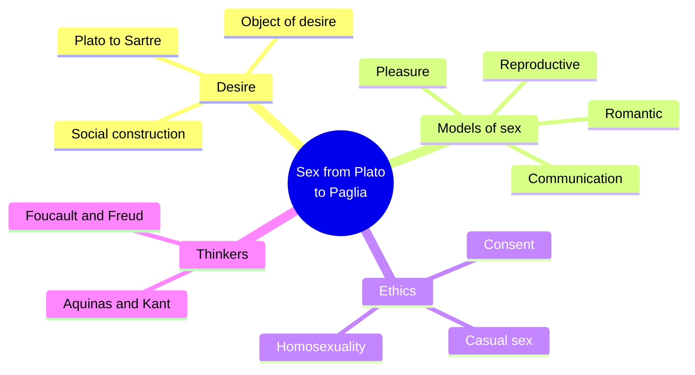
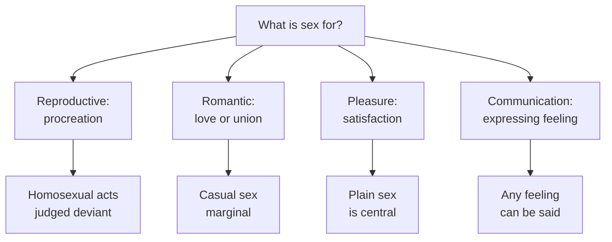
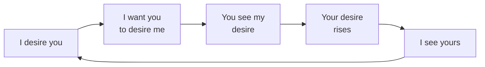
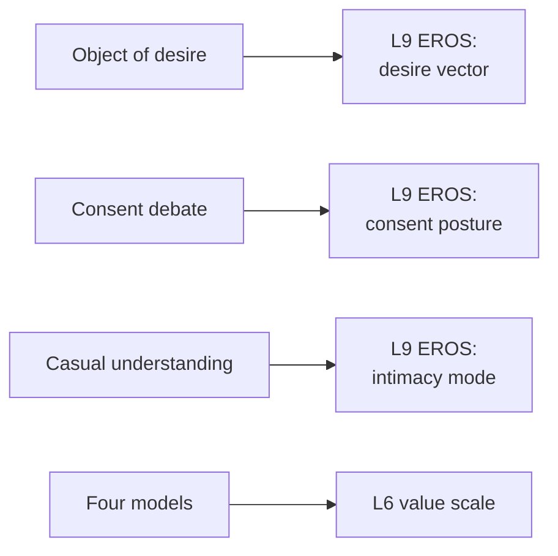

# 🧬 MSX.78 — Sex from Plato to Paglia — Soble (2006)
### Knowledge Entry — Distill

Alan Soble edited this two-volume encyclopedia of Western and some Eastern philosophy of sex, published by Greenwood Press in 2006. The library holds Volume 1 (A to L). It gives the conceptual toolkit: what counts as desire, consent, casual sex and sexual purpose.

## TABLE OF CONTENTS
- [Core Thesis](#1-core-thesis)
- [Mind Models](#2-mind-models)
- [Framework](#3-framework--structure)
- [Key Concepts](#4-key-concepts)
- [Heuristics](#5-heuristics--decision-rules)
- [Invariants](#6-invariants)
- [Pitfalls](#7-pitfalls--myths)
- [Application](#8-application)
- [Cross-References](#9-cross-references)
- [Provenance](#10-provenance--confidence)

---

## 1 · CORE THESIS

Philosophy does not tell us what sex should be. It clarifies what we mean when we say "desire," "consent," "casual" and "natural." Each term hides a theory of what sex is for, and clear thinking shows the hidden theory.

---

## 2 · MIND MODELS

**Diagram 1 — the whole argument.**
Caption: *the encyclopedia is a set of concept tests, grouped by what sex is thought to be.*

**Diagram 2 — the central mechanism (four models of sex).**
Caption: *each model names sex's purpose, and each purpose decides which acts are good, deviant or off the map.*

**Diagram 3 — Nagel's loop of mutual desire.**
Caption: *desire is not only for a body; it is for the other's desire, and each perception feeds the next.*

**Diagram 4 — mapped onto the 12-layer character stack.**
Caption: *the encyclopedia sharpens EROS: its target, its consent rule, its understanding of the encounter.*

---

## 3 · FRAMEWORK / STRUCTURE

The encyclopedia has alphabetical entries, each with a short bibliography (Preface, Introduction pp. xxi-xxiv). Volume 1 runs A to L; Volume 2 holds M to Z, including Plato and Paglia.

| Entry type | Examples in Volume 1 |
|---|---|
| Concepts | Desire, Consent, Casual Sex, Completeness, Fantasy, Flirting, Jealousy |
| Ethics | Ethics, Sexual; Consequentialism; Ethics, Virtue; Homosexuality, Ethics of |
| Thinkers | Augustine, Aquinas, Aristotle, Foucault, Freud, Kant, Hegel |
| Traditions | Buddhism, Hinduism, Chinese Philosophy, Catholicism |
| Topics | Bisexuality, Cybersex, Disability, Heterosexism |

Soble says professional philosophy of sex gives no quick fixes and no consolation (Introduction, p. xxii). He dates the modern field to Thomas Nagel's 1969 essay "Sexual Perversion" (p. xxiii).

---

## 4 · KEY CONCEPTS

| Concept | What it is | Why it matters |
|---|---|---|
| **Constitutive object of desire** | The thing that makes a desire sexual: pleasure or activity (Desire, p. 224) | Forces a writer to say what a man wants |
| **Social constructionism about desire** | Biology becomes sexual desire only after socialization (p. 224) | Nothing universal hides behind the local forms |
| **Sartre's double incarnation** | Desire aims at two consciousnesses entering two bodies (p. 223) | Desire is for a person, and it fails or turns to objectifying |
| **Nagel's mutual perception** | I want you to want me (Communication Model, pp. 174-175) | Arousal runs on being desired |
| **Four models of sex** | Reproductive, romantic, pleasure, communication (p. 174) | Each model carries a moral standard |
| **Plain sex** | The pleasure model's sex without love (p. 174) | A theory a character can hold |
| **Consent as morally transformative** | Consent changes what others may do (Consent, p. 184) | Makes the same act permitted or wrong |
| **Consensual minimalism** | Sex is permissible if and only if both consent (p. 185) | The standard view, then tested |
| **Casual sex** | Sex with the understanding that no commitment follows (Casual Sex, p. 136) | Defined by belief, not by behaviour |
| **Casual vs. promiscuous** | Promiscuity means many partners over time (p. 137) | A man can be casual with one, or promiscuous with intent |
| **Completeness** | Aquinas's term for an act that ends in ejaculation (Completeness, p. 179) | The old natural-law test that ruled out most gay acts |
| **Orientation vs. conduct** | Disposition differs from act (Homosexuality, Ethics of, p. 460) | Arguments against the act do not follow from orientation |

---

## 5 · HEURISTICS & DECISION RULES

| Situation | Do this | Not this |
|---|---|---|
| Writing what a man wants | Name the object: a feeling, an act, or being wanted | Write "he wants sex" |
| A hookup | State what each man understands about the aftermath | Judge it by the acts |
| A man who hopes a hookup leads on | Let him know the other does not; the encounter stays casual (p. 137) | Make hope turn it into commitment |
| Consent in a long couple | Allow low-level contact without a fresh yes, and a stop on request (p. 186) | Make every touch a negotiation |
| A character's sexual creed | Give him one of the four models and let it bind his judgments | Give him no theory |
| A man arguing against gay sex | Give him a harm, nature or divine-command argument (p. 461) | Make him a cartoon |
| A man who is desired | Let the desire rise because he sees it (p. 175) | Treat arousal as a private state |
| Closeted men and risk | Remember that a hostile society shapes the risks (p. 461) | Treat the risk as intrinsic |

---

## 6 · INVARIANTS

1. A desire is classified by its object (p. 224).
2. Behaviour alone does not make sex casual, loving or deviant (p. 136).
3. Each theory of sex's purpose carries a moral standard (p. 174).
4. Consent changes the moral standing of an act (p. 184).
5. Orientation and conduct are separate (p. 460).
6. A group should not be condemned for traits that result from the condemnation (p. 461).
7. Philosophy clarifies; it does not console (Introduction, p. xxii).

---

## 7 · PITFALLS / MYTHS

- Treating one entry as the encyclopedia's view. Entries are written by different authors; the book does not hold a single line.
- Treating consent as the whole of ethics. Soble's entry separates "unworthy," "impermissible" and "illegal" (p. 184).
- Treating "casual" as "loveless." The entry shows that the definition resists neat limits (p. 138).
- Treating Levin's argument as settled. The entry reports it, then lists critics (p. 462).
- Data caveat, stated once. This is a 2006 reference work. The Homosexuality entries predate later legal and social change, and the Casual Sex entry cites older survey claims about men and women. Read them as the state of the debate then.
- Volume 1 only. Volume 2 holds Plato, Paglia, Sartre, Sexual Perversion and Sexual Orientation.

---

## 8 · APPLICATION

*Proposed, not ruled.*

- **Spine level:** L5.
- **12-layer character stack:** L9 EROS `consent_posture` (primary); L9 `desire_vector` (primary); L9 `intimacy_mode` (supporting); L6 `value_scale` (supporting); L10 SHADOW `shadow_content` (contextual).
- **plot_systems:** none.
- **Setting:** contextual. DCUS, as a school, can hold one of the four models as its official creed.

Soble gives the writer words for what a character already believes. Proposed: each lead gets a one-line sexual creed from the four models. Quinn may hold the pleasure model aloud and the romantic one in private. That gap is a character.

Proposed: write consent as a posture, not a gate. Some men give consent in words, some in pacing, some in long habit. The Consent entry shows that real life has more than "yes" and "no."

Proposed: write desire as being wanted. The Nagel loop makes a scene move: each man sees the other's desire, and his own rises.

For the explicit work under 06.1, these tools sit under the fantasy. They say what the man wants in the scene and what he believes it means. The front-matter disclaimer holds the container.

---

## 9 · CROSS-REFERENCES

| Related entry | Relation |
|---|---|
| [[🧬 MSX.36 — The History of Sexuality — Foucault (1978)]] | Soble's Foucault entry (p. 361) and the social-construction view of desire |
| [[🧬 MSX.46 — Deviations — Rubin (2011)]] | Rubin's sex hierarchy against the natural-law tests in these entries |
| [[🧬 MSX.17 — Mating in Captivity — Perel (2006)]] | Perel's desire as distance sits beside Nagel's mutual desire |
| [[🧬 MSX.61 — Times Square Red, Times Square Blue — Delany (1999)]] | Delany's case for casual contact against the romantic model |
| [[🧬 MSX.86 — The Trouble with Normal — Warner (1999)]] | A queer critique of the models this book catalogues |

---

## 10 · PROVENANCE & CONFIDENCE

Full-text pdftotext extract of Volume 1 (A-L) of the Greenwood Press 2006 edition, 657 PDF pages. Copyright page confirms Alan Soble, 2006, Greenwood Press, Westport, Connecticut. Read in full: the Introduction (pp. xxi-xxiv); the entries Desire, Sexual (pp. 222-229); Communication Model (pp. 174-178); Consent (pp. 184-193, first half); Casual Sex (pp. 136-142, first half); Completeness, Sexual (p. 179-180, opening); Homosexuality, Ethics of (pp. 460-463, first half). The contents list was read to map the volume.

Skipped: about 95 percent of the entries, including Foucault, Freud, Kant, Bisexuality, Jealousy, Fantasy, Cybersex and Ethics, Sexual. Volume 2 is not in the library.

Page numbers are printed folios read from the running heads. The `feeds:` keying is this distill's own synthesis.

## META
- Template: BVX-LEARN-v4.0
- Source classification: full-text pdftotext extraction of Volume 1; seven entries and the introduction read
- Created / Updated: 2026-10-04
