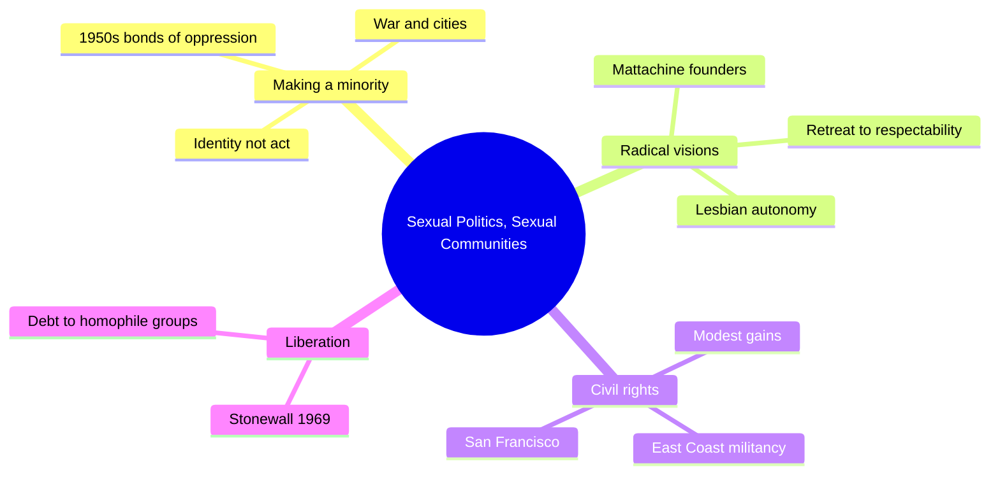
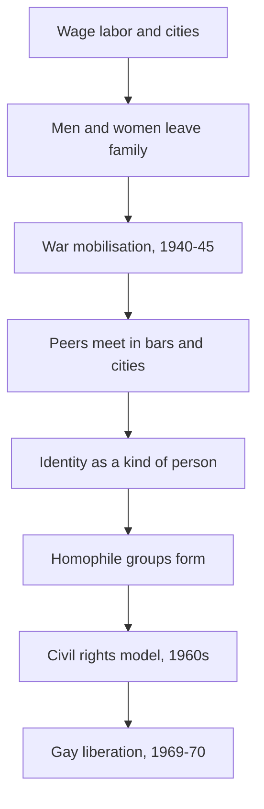
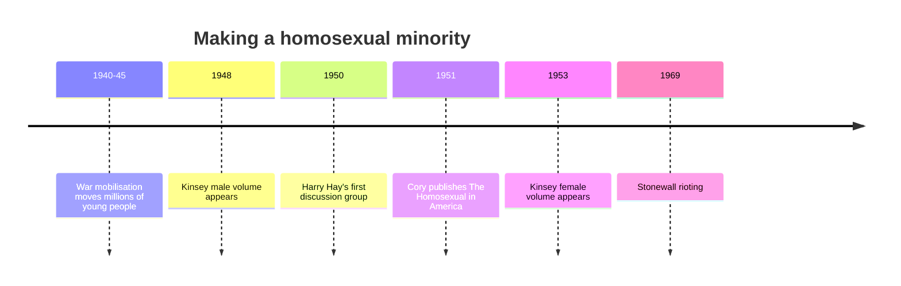

# 🧬 MSX.79 — Sexual Politics, Sexual Communities — D'Emilio (1983)
### Knowledge Entry — Distill

Fantasy, not a how-to: what happens in these pages stays in them. Reader discretion advised.

John D'Emilio's history asks why a gay political movement began in the United States after World War II and not earlier. The library uses it for how a scattered group of people became a minority with a movement.

## TABLE OF CONTENTS
- [Core Thesis](#1-core-thesis)
- [Mind Models](#2-mind-models)
- [Framework](#3-framework--structure)
- [Key Concepts](#4-key-concepts)
- [Heuristics](#5-heuristics--decision-rules)
- [Invariants](#6-invariants)
- [Pitfalls](#7-pitfalls--myths)
- [Application](#8-application)
- [Cross-References](#9-cross-references)
- [Provenance](#10-provenance--confidence)

---

## 1 · CORE THESIS

A gay movement needed a gay minority first. Urban life and World War II let men and women find each other, and the Cold War made the group visible. Homophile groups then built the base that liberation grew on.

---

## 2 · MIND MODELS

**Diagram 1 — the whole argument.**
Caption: *four parts, one chain: a subculture forms, early groups try to make it a movement, the 1960s push harder, and liberation follows.*

**Diagram 2 — the central mechanism.**
Caption: *social change comes first as a change in how people live, and only then as a politics that can name them.*

**Diagram 3 — the dates that carry the argument.**
Caption: *the movement's first quarter-century runs through war, science, and repression before Stonewall.*

---

## 3 · FRAMEWORK / STRUCTURE

Thirteen chapters in four parts. Each part names a phase of the movement.

| Part | Governing move |
|---|---|
| I. Identity, Community, and Oppression (Ch. 1-3) | How eroticism became an identity, how the war built a subculture, how the 1950s tightened the bonds of oppression. |
| II. The 1950s (Ch. 4-7) | Mattachine's radical start, its retreat to respectability, lesbians organising separately, and the quest for legitimacy. |
| III. The 1960s (Ch. 8-11) | Gay life in public view, civil rights and direct action, the movement meeting the San Francisco subculture, modest gains. |
| IV. The Liberation Impulse (Ch. 12-13) | The birth of gay liberation and a conclusion that defends the earlier generation. |

---

## 4 · KEY CONCEPTS

| Concept | What it is | Why it matters |
|---|---|---|
| **Act to identity** | Before the late 1800s, same-sex acts were sins and crimes. Then a person was defined by them (Intro, p. 5). | A character's label has a history. |
| **Create a constituency** | Activists had to produce the group they wanted to mobilise (Intro, pp. 5-6). | Movement work starts with consciousness. |
| **The new erotic situation** | War uprooted millions into sex-segregated settings (Ch. 2, pp. 24-25). | It explains a wave of coming out. |
| **Psychiatric screening** | Induction exams that asked about sexuality (Ch. 2, pp. 25-26). | The state named the thing to hide. |
| **Bars as seedbeds** | Rooms where guests dropped the pretence of heterosexuality (Ch. 2, p. 34). | They made a group out of strangers. |
| **Homophile** | The 1950s movement's word and its moderate strategy (Ch. 5, Conclusion). | It named a cautious, professional-led politics. |
| **Passing** | Appearing heterosexual to avoid penalty (Conclusion, p. 243). | It both protected and isolated people. |
| **Civil rights model** | The 1960s turn to political action as a minority demanding equality (Conclusion, p. 245). | It changed who led the movement. |

---

## 5 · HEURISTICS & DECISION RULES

| Situation | Do this | Not this |
|---|---|---|
| Writing a mid-century character | Give him a private identity, a few contacts, and a risk of exposure. | Give him a movement he can join easily. |
| Writing how a group forms | Start with where people meet, then the shared word, then the first meeting. | Start with a manifesto. |
| Writing an institution that names him | Show an exam, a form, or a file that makes him a case. | Leave the state out. |
| Writing a cautious leader | Let him act as a realist who also accepts his group's lower status. | Make him a coward or a hero. |
| Writing a younger militant | Let him have a clearer sense of worth and fewer years of isolation. | Make him angry for no reason. |
| Writing an older generation | Credit their slow work, which the young may ignore. | Write them as sellouts only. |

---

## 6 · INVARIANTS

1. Sexual categories change with economy and law.
2. A movement needs a group that sees itself as a group.
3. War and migration reshuffle sexual life as well as work.
4. Passing protects the individual and weakens the group.
5. Professionals' authority shapes how a minority speaks about itself.
6. Later movements owe more to earlier ones than they admit (Conclusion, p. 241).

---

## 7 · PITFALLS / MYTHS

- The book covers the United States from 1940 to 1970. It is not a world history.
- Its sources are mostly organisation records, periodicals, and activist papers, which favor people who joined groups.
- Later work, such as Chauncey on New York, finds a more visible gay world before the war than D'Emilio's frame suggests (see [[🧬 MSX.45 — Gay New York — Chauncey (1994)]]).
- The book gives lesbian organising its own chapter, but the movement narrative leans on male-led groups.
- The "act to identity" shift is a thesis he borrows from others, including Foucault and Weeks (Intro, p. 5, note 3).
- Some of the 1983 language, such as "homophile," is period language and the book does not use later terms.

---

## 8 · APPLICATION

*Everything here is proposed, never ruled.*

- **Spine level:** L5, as set by the batch brief.
- **12-layer character stack:** L1 CORE (identity_frame), L3 SOCIAL (chain_network, venue_belonging), L4 WILL (resistance_mode), L7 ORIGIN (origin_disciplinary_formation), L10 SHADOW (passing_cover).
- **plot_systems:** a "group forms" engine: scattered people, a meeting place, a name, and a first act of public risk.
- **Setting:** the war-to-movement chain suits any era in the ORANGE universe where a group first becomes visible to itself.

D'Emilio gives a character a history under his label. A man who calls himself gay is using a word that did not exist for his grandfather. The book also gives the group-formation order: places first, words second, politics third. Fantasy comes first in the prose, and explicit scenes are allowed under the standing 06.1 ruling. The disclaimer line carries the container.

---

## 9 · CROSS-REFERENCES

| Related entry | Relation |
|---|---|
| [[🧬 MSX.36 — The History of Sexuality — Foucault (1978)]] | D'Emilio cites Foucault for the act-to-identity shift (Intro, p. 5, note 3). |
| [[🧬 MSX.45 — Gay New York — Chauncey (1994)]] | Chauncey describes the world that existed before D'Emilio's story begins. |
| [[🧬 MSX.54 — Intimate Matters — D'Emilio & Freedman (2012)]] | The same author's wider history of American sexuality. |
| [[🧬 MSX.70 — Gay Bar — Atherton Lin (2021)]] | Atherton Lin follows the bar after Stonewall. D'Emilio shows why the bar mattered before it. |
| [[🧬 MSX.74 — Men Who Sell Sex — Aggleton & Parker (2015)]] | Ch. 6 there cites D'Emilio on how political economy shapes gay life. |

---

## 10 · PROVENANCE & CONFIDENCE

Full-text pdftotext extraction, 268 pdf pages. Title page and copyright page confirm John D'Emilio, University of Chicago Press, 1983. Printed page equals pdf page minus 9. Page cites are printed pages.

Read: the Introduction (pp. 1-8), the opening of Ch. 1 (pp. 9-11), the opening of Ch. 2 (pp. 23-27) and its bar, Cory, and Kinsey passages (pp. 33-35), and most of the Conclusion (pp. 240-247).

Skipped: the rest of Ch. 1, Ch. 3 to 12 except the Introduction's summaries and the Conclusion's recap, the notes, and the index. The Mattachine, DOB, and 1960s chapters are known here only through the Conclusion. Confidence is medium. The thesis is stated clearly in two places, but the detail was not read. The `feeds:` keying is this distill's own synthesis, and the book uses none of the 12-layer vocabulary.

## META
- Template: BVX-LEARN-v4.0
- Source classification: full-text extraction, targeted read of the Introduction, Ch. 1-2, and the Conclusion
- Created / Updated: 2026-10-04
