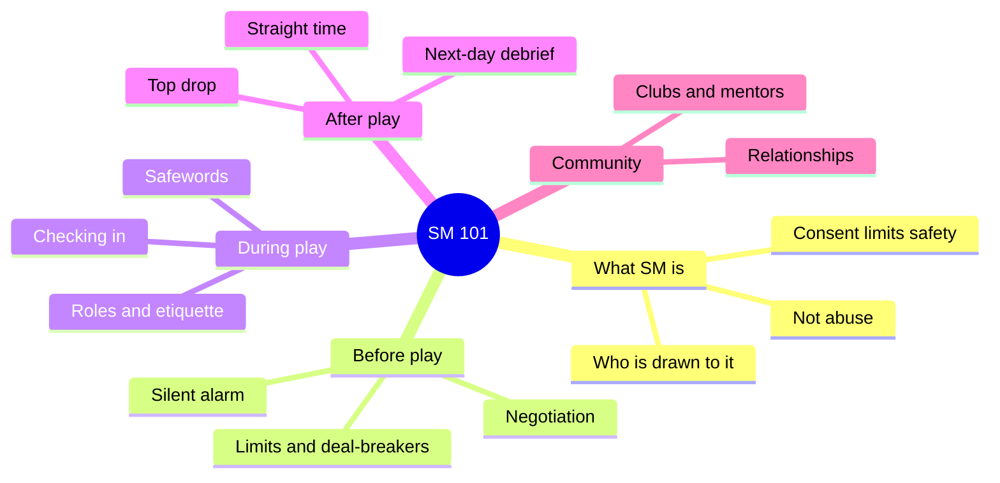
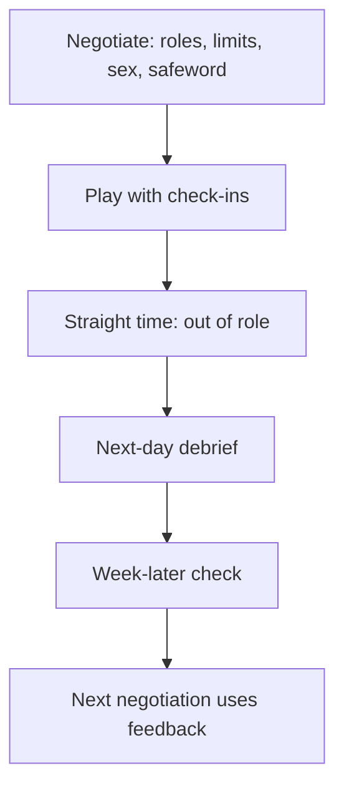
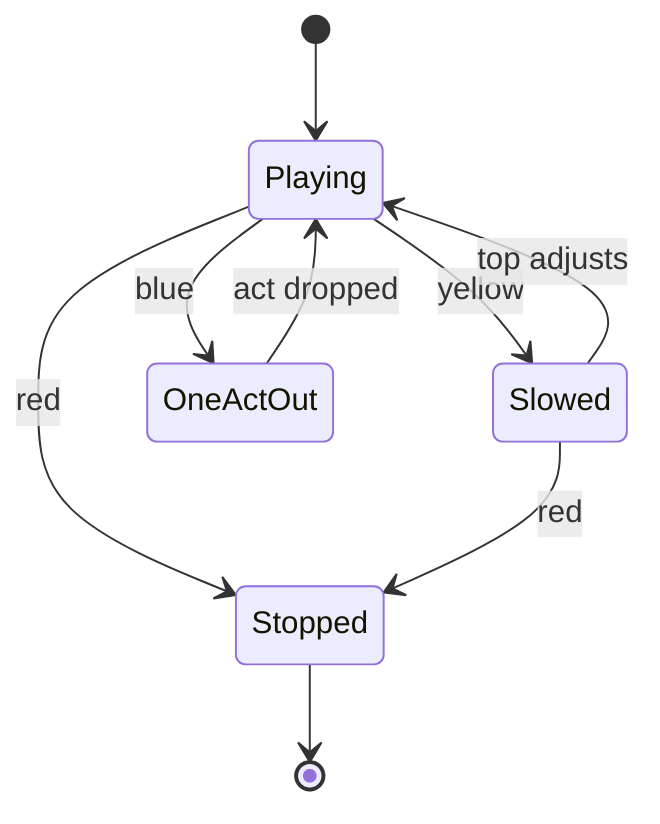
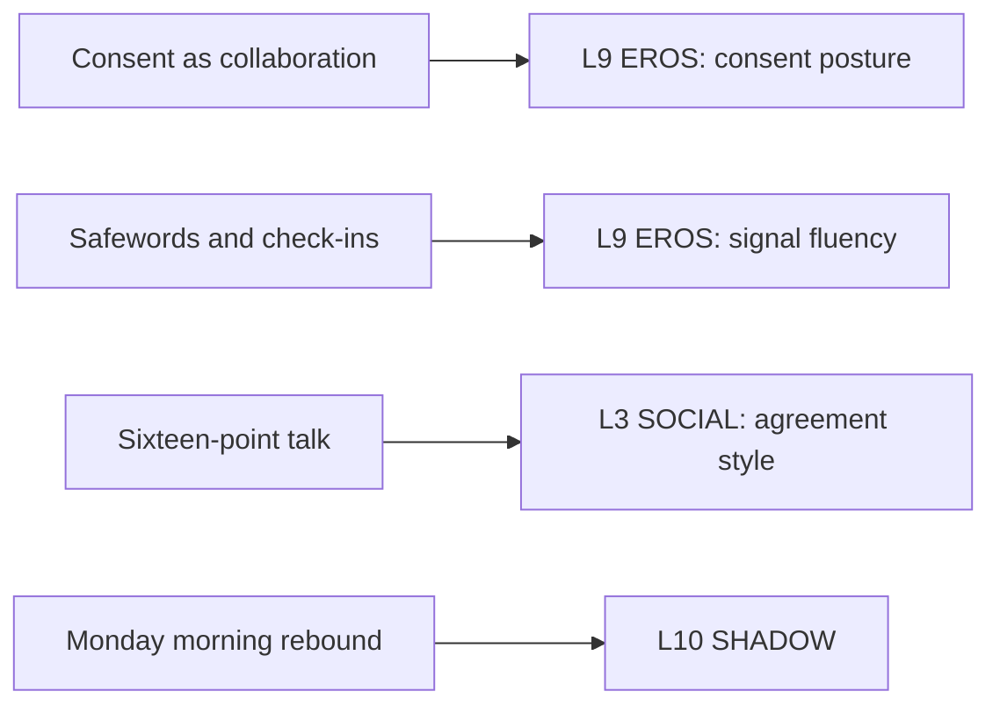

# 🧬 MSX.80 — SM 101 — Wiseman (1996)
### Knowledge Entry — Distill

Fantasy, not a how-to: what happens in these pages stays in them. Reader discretion advised.

Jay Wiseman's 1996 manual is a community insider's introduction to sadomasochism (SM), the use of dominance, bondage, and pain for erotic ends. This shelf keeps it for the negotiation and consent procedures that kink communities built.

## TABLE OF CONTENTS
- [Core Thesis](#1-core-thesis)
- [Mind Models](#2-mind-models)
- [Framework](#3-framework--structure)
- [Key Concepts](#4-key-concepts)
- [Heuristics](#5-heuristics--decision-rules)
- [Invariants](#6-invariants)
- [Pitfalls](#7-pitfalls--myths)
- [Application](#8-application)
- [Cross-References](#9-cross-references)
- [Provenance](#10-provenance--confidence)

---

## 1 · CORE THESIS

Wiseman argues that SM differs from abuse by consent, negotiation, limits, and an agreed way to stop. The skills that make it safe are talk skills: negotiating before play, using signals during, and debriefing after. Negotiation is the single most important one.

---

## 2 · MIND MODELS

*Required. Minimum two diagrams, maximum five.*

**Diagram 1 — the whole argument.**
Caption: *the book moves from what SM is, to the rules that separate it from abuse, to the skills of a scene, to the community around it.*

**Diagram 2 — the central mechanism (the life of a scene).**
Caption: *a scene has five steps with talk on both ends, and the book says most bad scenes fail in the first step.*

**Diagram 3 — the signal ladder.**
Caption: *three words give the bottom a graded way to speak, and a good top acts at yellow so red is rarely used.*

**Diagram 4 — mapped onto the 12-layer character stack.**
Caption: *Wiseman hands EROS two skills, SOCIAL a negotiating style, and SHADOW a way to hide a found desire.*

---

## 3 · FRAMEWORK / STRUCTURE

The book is a college-style course in one volume. Wiseman says he aims at "an introductory college class" level.

| Section (printed pages) | Governing move |
|---|---|
| Preliminaries (1-55) | Purpose, scope, the author's story, the community, and SM versus abuse. |
| Basic Basics (56-90) | Terms, consent, silent alarm, safewords, negotiation, forms. |
| Technique chapters: bondage, pain, flogging, sensory play (91-244) | Equipment and method for each practice. |
| Dominant/Submissive Interactions (245-276) | Roles, etiquette, and ethics for both seats. |
| Relationships and organizations (277-304) | Long-term partnerships and clubs. |
| General Safety Considerations (305-322) | Risk, injury, and emergencies. |
| Back matter (323-392) | Starter sets, resources, help with problems, glossary, sample rules. |

---

## 4 · KEY CONCEPTS

| Concept | What it is | Why it matters |
|---|---|---|
| **SM defined** | "The knowing use of psychological dominance and submission, and/or physical bondage, and/or pain... in a safe, legal, consensual manner" for arousal or personal growth (p. 10). | The definition builds consent and legality into the term. |
| **Upper limit** | The dominant will not do anything that needs a doctor or therapist to heal (pp. 10-11). | A shared ceiling that the whole scene respects. |
| **SM versus abuse** | Twelve contrasts, such as consensual versus not, negotiated versus not, stoppable versus not (pp. 41-42). | Wiseman writes the line a character's friend would use. |
| **Isolation warning** | "If the relationship is going to go bad, it usually goes bad in isolation" (p. 42). | A ready plot signal for an abusive partner. |
| **Silent alarm** | A trusted friend holds the partner's name, address, and a check-in time (pp. 48-52). | The private-play safeguard for a first meeting. |
| **Safeword** | A word that stops or changes play. A dominant must honor it always (pp. 52-54). | "Failure to honor a safeword is serious misconduct" (p. 54). |
| **Checking in** | Two squeezes for yes, and a wait if none returns (p. 57). | A non-verbal way to ask while the bottom is far under. |
| **Negotiation** | Sixteen points, including roles, place, time, limits, sex, intoxicants, and bondage (pp. 58-60). | Wiseman says poor negotiation causes most bad scenes. |
| **Deal-breakers** | Limits raised well before the meeting (p. 64). | Sex is the most common deal-breaker. |
| **Straight time and top drop** | Time out of role afterward. The dominant may feel guilt or low mood (p. 65). | Aftercare includes the top. |
| **Monday Morning Rebound** | A partner who loved a first scene bolts afterward (p. 12). | Fear can follow a real discovery. |
| **Topping from below** | A bottom steers the scene with requests and complaints (p. 249). | A named breach of the role, with its own ethics. |
| **SAM** | A "smart-assed masochist" who misbehaves to be punished (p. 247). | Fine inside a scene, bad outside one. |

---

## 5 · HEURISTICS & DECISION RULES

| Situation | Do this | Not this |
|---|---|---|
| Two characters about to play | Show the negotiation scene, with limits, a safeword, and a laugh. | Skip to the first touch. |
| A character who cannot say what he wants | Give him a list to react to. | Make him recite his fantasies cold. |
| The top changes the plan mid-scene | Make the bottom's silence suspect, and have the top defer to next time. | Present the new act as spontaneous heat. |
| A bottom going deep | Let the top watch breathing and tension and ease off before the word. | Wait for the safeword to act. |
| A first meeting with a stranger | Use the silent alarm: a friend, an address, a time. | Send the character alone with no one told. |
| The scene ends | Move to a coffee shop for straight time. | Cut to the morning with nothing between. |
| A top who feels low afterward | Let the bottom thank him sincerely and stay near. | Treat the top as unaffected. |
| A partner who bolts the next day | Treat it as a rebound, and let the debrief carry the repair. | Treat it as proof the scene was wrong. |

---

## 6 · INVARIANTS

1. **Consent is collaborative.** It is not the absence of a no (p. 8).
2. **The dominant carries the primary responsibility for safety.** The bottom speaks, and the top reads (p. 40).
3. **A safeword is always honored.** Even a manipulative one (p. 54).
4. **Negotiation happens before play, dressed, out of role.** Changes proposed mid-scene "stink of nonconsensuality" (p. 58).
5. **Intoxicants are negotiated or absent.** Introducing one unannounced is serious misconduct (p. 61).
6. **Aftercare includes feedback at three times.** Immediately, next day, and about a week later (pp. 64-66).
7. **SM partners are equals.** Wiseman calls SM relationships "ultimately relationships between equals" (p. 5).

---

## 7 · PITFALLS / MYTHS

- **Dated, by the author's own warning.** The book says SM knowledge changes yearly and some of its content is outdated (Warning and Disclaimer, front matter). It pre-dates apps, modern consent language, and current medical advice.
- **Kinsey's 11 percent.** Wiseman takes the share of people drawn to SM from Kinsey's 1953 volume on women. Kinsey's samples were volunteer and uneven, so treat the figure as folklore with a citation.
- **The one-third rule.** The "one in three discover they like it" figure is Wiseman's own observation from dates and community life. It is not a study.
- **Community view.** The author is a heterosexual man in the Bay Area SM scene (p. 5). The book is gender-neutral by design and has little on gay male culture. See Bersani and Bauer for that.
- **US and California law.** Legal statements describe the 1990s United States.
- **The book disclaims itself.** It is an introduction. Wiseman tells readers to seek other opinions and a club.
- **Not a study of outcomes.** The claim that SM people match "normal" people rests on one small 1986 study from a professional school in San Diego (Miale, p. 14).

---

## 8 · APPLICATION

*Proposed for the ORANGE work, not ruled.*

- **Spine level:** L5.
- **12-layer character stack:** L9 EROS (consent_posture and signal_fluency, primary; aftercare_practice, supporting); L3 SOCIAL (agreement_style, primary); L10 SHADOW (shadow_content, supporting).
- **plot_systems:** a negotiation, a safeword, and a debrief are three scene types a story can reuse, and a breach of any one is a plot turn.
- **Setting:** clubs, play parties, and mentor lines give a community with rules.

Wiseman gives the character system a vocabulary for consent as a skill. A character does not simply consent or fail to. He negotiates well, badly, or by habit. He sends and reads signals with more or less fluency. He debriefs or he vanishes.

The most useful tool is the negotiation scene. It gives two characters a chance to say what they want in plain words, and the reader gets a map of both. It makes an explicit scene richer, because the reader knows what each man agreed to and sees what he does with that.

The second tool is the breach list. A top who changes the plan, ignores a yellow, or jokes about the safeword breaks the book's cardinal rules. A writer can use those breaches as villain markers or as a good character's lapse, and the reader recognizes both.

The third tool is the top's aftermath. The book names the dominant's low mood. A coach, daddy, or tough character who goes quiet afterward gets a reason that is not weakness.

Proposed addition: an L9 field `negotiation_style` with values (checklist, intuitive, avoidant) and a paired field `aftercare_practice` (none, straight time, next-day debrief). It pairs with Bersani's self-shattering in [[🧬 MSX.71 — Homos — Bersani (1995)]], where Wiseman's practice meets Bersani's theory of what the scene does.

The ORANGE prose rulings apply as written. Explicit content is allowed, written as fantasy first, with the one-line container in the front matter. The negotiation can happen on the page and the scene can follow it in full. The book needs no fade.

---

## 9 · CROSS-REFERENCES

| Related entry | Relation |
|---|---|
| [[🧬 MSX.71 — Homos — Bersani (1995)]] | Bersani reads gay S/M as politics and as self-shattering. Wiseman writes the practice. |
| [[🧬 MSX.87 — Understanding Non-Monogamies — Barker & Langdridge, eds. (2010)]] | Bauer's chapter links queer BDSM culture to negotiated non-monogamy. |
| [[🧬 PSY.65 — The Psychology of Sex — Barker (2018)]] | Barker reviews the research that finds kinksters no less healthy than others and treats consent culture as kink's gift. |
| [[🧬 MSX.47 — The Ethical Slut — Easton & Hardy (2017)]] | Easton, whose consent definition Wiseman uses, writes the companion on open relationships. |
| [[🧬 MSX.35 — Sex Pigs — PLWHA NSW (n.d.)]] | A harm-reduction pamphlet with fisting and club-sex entries, in the same practical spirit. |

---

## 10 · PROVENANCE & CONFIDENCE

Full text, pdftotext extraction, about 151,000 words, 403 PDF pages, with two-column layout that garbles some margin cartoons. Title page confirms: Jay Wiseman, *SM 101: A Realistic Introduction*, second edition, revised, updated and expanded, Greenery Press, San Francisco, 1996 (first edition 1992). Printed page equals PDF page minus 10, and citations use printed pages.

Read in full: Introduction and purpose (pp. 3-12), the SM definition and SM-versus-abuse section (pp. 40-43), Basic Terms and Consent (pp. 46-48), Silent Alarm and Safewords (pp. 48-54), and Negotiation with post-session feedback (pp. 57-66). Read in part: Dominant/Submissive Interactions (pp. 246-249).

Skipped: the author's life story (pp. 16-45), the bondage, pain, flogging, and sensory chapters (pp. 91-244), the relationships and organizations chapters, General Safety Considerations, the starter set, resources, glossary, and appendices. The technique chapters are the largest part of the book, and this entry does not cover them.

Confidence is medium. The procedures are quoted from the text. The book's statistics are anecdotal or dated.

## META
- Template: BVX-LEARN-v4.0
- Source classification: full-text pdftotext extraction, deep read on preliminaries, consent, safewords, negotiation, skipped technique chapters
- Created / Updated: 2026-10-04
