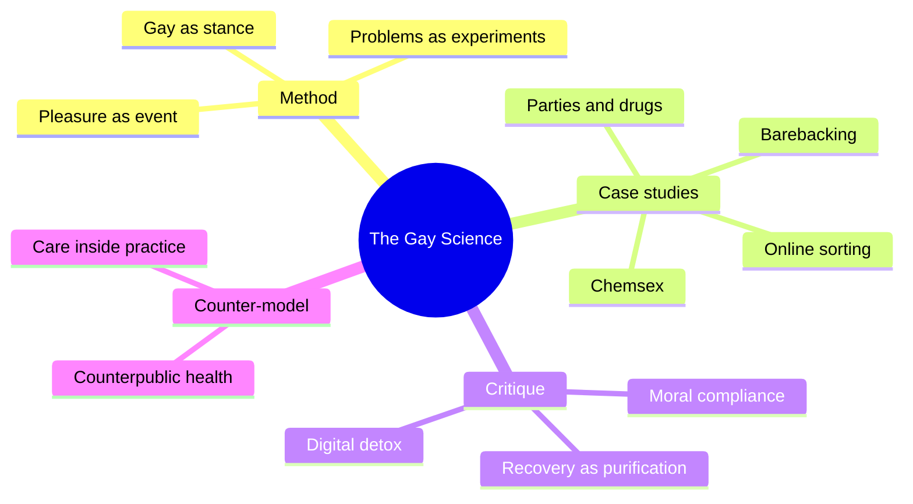
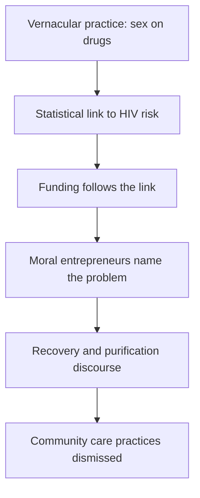
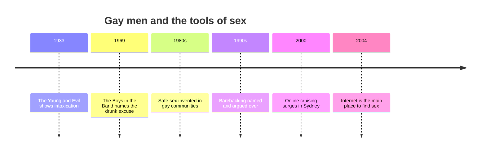
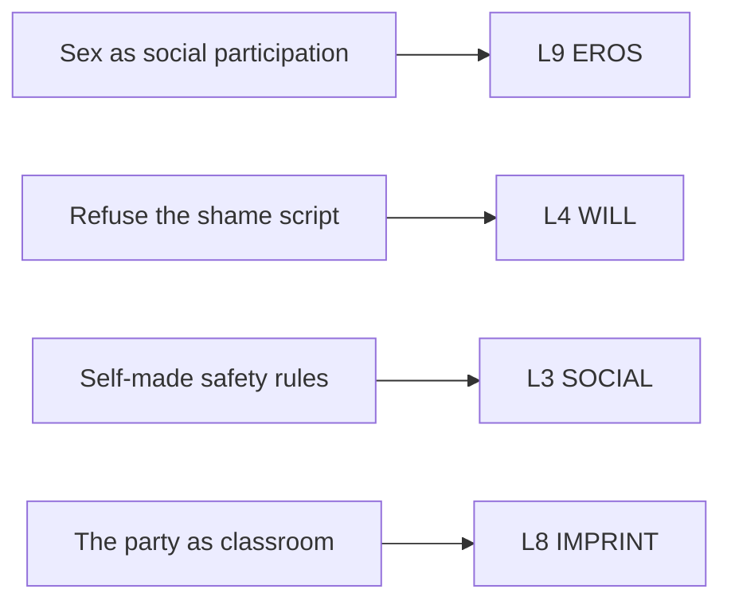

# 🧬 MSX.81 — The Gay Science — Race (2018)
### Knowledge Entry — Distill

Fantasy, not a how-to: what happens in these pages stays in them. Reader discretion advised.

Kane Race, a cultural-studies scholar and HIV researcher, reads gay men's drug and sex practices as experiments that produce knowledge and care. The book is this shelf's counterweight to clinical sex-addiction and meth literature.

## TABLE OF CONTENTS
- [Core Thesis](#1-core-thesis)
- [Mind Models](#2-mind-models)
- [Framework](#3-framework--structure)
- [Key Concepts](#4-key-concepts)
- [Heuristics](#5-heuristics--decision-rules)
- [Invariants](#6-invariants)
- [Pitfalls](#7-pitfalls--myths)
- [Application](#8-application)
- [Cross-References](#9-cross-references)
- [Provenance](#10-provenance--confidence)

---

## 1 · CORE THESIS

Race argues that gay men's sex and drug practices are intimate experiments, and that HIV science helps make them. Pathologizing them shuts down the care that grows inside them. Better public health starts from the practices already working and the pleasure that holds them together.

---

## 2 · MIND MODELS

*Required. Minimum two diagrams, maximum five.*

**Diagram 1 — the whole argument.**
Caption: *the book runs from a method (treat practices as experiments), through four case studies, to a counter-model of public health.*

**Diagram 2 — the central mechanism (how a practice becomes a problem).**
Caption: *a vernacular practice becomes a public-health object once statistics tie it to HIV, and moral entrepreneurs then fix its meaning as a pathology.*

**Diagram 3 — the history of gay prevention and sorting.**
Caption: *each new tool arrived with a new infrastructure, and men adapted it to their own sexual culture before health agencies caught up.*

**Diagram 4 — mapped onto the 12-layer character stack.**
Caption: *Race hands EROS an intimacy style, WILL a resistance style, SOCIAL a set of self-made rules, and IMPRINT a formative room.*

---

## 3 · FRAMEWORK / STRUCTURE

The book has nine chapters. Four are case studies and the rest are method, theory, and a conclusion.

| Chapter (printed pages) | Governing move |
|---|---|
| 1 The gay science (1-24) | Sets the method: pleasure as an event, problems as intimate experiments. |
| 2 Queer chemistry (25-45) | Traces parties and drugs as the chemical infrastructure of gay life. |
| 3 Click here for HIV status (46-68) | Follows the rise of online sorting and serosorting. |
| 4 Making up barebackers (69-88) | Shows how a category of person was constructed. |
| 5 Reluctant objects (89-110) | Treats pre-exposure prophylaxis (PrEP) and the uptake of negative sex. |
| 6 Framing responsibility (111-127) | Accounts for objects, networks, and events. |
| 7 Chemsex (128-150) | Defends analysis of sex on drugs against recovery discourse. |
| 8 Speculative intimacies (151-170) | Looks at smartphone use and sexual community. |
| 9 Conclusion (171-188) | Proposes counterpublic health in digital times. |

---

## 4 · KEY CONCEPTS

| Concept | What it is | Why it matters |
|---|---|---|
| **Pleasure as event** | Foucault's idea of pleasure as something that happens at the edge of or between subjects, outside medical meaning (pp. 3-4). | It escapes the question "what is your desire, and are you sick?" |
| **Intimate experiment** | A sex or drug practice read as an attempt to change the terms of experience (p. 7). | Experiment replaces pathology as the frame. |
| **Problematisation** | A way of making something into an object of thought. Race treats "problem" as a verb: to throw forth (pp. 5-7). | A problem is something people do, not only something that exists. |
| **Gay as stance** | "Gay" as a practical orientation toward delight and chance, not a fixed identity (pp. 8-9). | The word keeps its history and gains a method. |
| **Chemical infrastructure** | Stimulants as one of the supports of gay political identity in the twentieth century (p. 26). | Drugs and parties built the community that built the politics. |
| **Sorting** | Choosing partners by HIV status, now done through online profiles (pp. 48-49). | A community-made risk practice with its own history. |
| **Making up barebackers** | A category of person that was constructed, argued over, and adopted (ch. 4). | A label changes the men it names. |
| **Moral entrepreneur** | A person who frames a practice as a problem and wins funding and authority (p. 132). | Race names David Stuart, a London chemsex clinician, as an example. |
| **Digital detox** | The advice to delete apps and avoid fantasy during sex (pp. 128-129). | Race reads it as a normative prescription of "natural intimacy." |
| **Sexual friendship** | Sex partners who give real support (p. 129). | Cutting off contacts can deepen isolation. |
| **Counterpublic health** | Care that grows from the practices of a stigmatized public (ch. 9). | Race's proposed alternative to compliance-based health. |

---

## 5 · HEURISTICS & DECISION RULES

| Situation | Do this | Not this |
|---|---|---|
| A character drinks or uses before sex | Show it as a planned bridge across shame, with him knowing what he is doing. | Show only loss of control. |
| A character invents his own rules | Give him a history for them: a friend, a scare, a community norm. | Treat his rules as irrational. |
| A party or club scene | Let it teach: manners, friends, a first dance, a first rule. | Use it only as backdrop for the act. |
| A sex-on-drugs scene | Write what the scene gives him: contact, play, being wanted. | Make it only an illustration of damage. |
| A health worker or recovery advocate | Let him be sincere and let his advice also cost something, such as friends and contacts. | Make him a villain or a hero. |
| A man who refuses the shame script | Let him hold care and defiance together, like Scott O'Hara. | Let defiance erase care. |
| A character diagnosed or labeled | Show the label changing his options and his self-picture. | Treat a label as only a description. |

---

## 6 · INVARIANTS

1. **Practices are experiments.** People change their terms of experience through sex and drugs (p. 7).
2. **Gay culture and drugs grew together.** Drugs are part of the infrastructure, not the whole of it (pp. 25-26).
3. **Prevention in this community began from its sexual culture.** Early safe sex rejected abstinence, monogamy, and mandatory testing (pp. 46-47).
4. **A label acts on the people it names.** Categories are made and remade (ch. 4).
5. **Sorting grew as the internet grew.** Disclosure rose in step with online cruising (pp. 48-49).
6. **Pathologizing can cut care.** Abstinence-only advice can add isolation (p. 129).
7. **Pleasure and care sit together.** Race refuses to trade one for the other (ch. 7).

---

## 7 · PITFALLS / MYTHS

- **Advocacy, not a neutral review.** Race argues a position. He discloses that he is HIV positive and began HIV research in 1997 (p. 3).
- **Local data.** The case studies are mostly Sydney, with comparisons to Europe, the USA, and Canada. The surveys cited are community samples, not general populations.
- **Dated figures.** The Sydney survey runs to 2008, and the chemsex figure is about 20 percent who used drugs to enhance sex in six months, with 11 percent for group sex (p. 130). It describes an earlier period.
- **Dense theory.** The book draws on Whitehead, Stengers, and Foucault. The vocabulary can obscure simple claims.
- **Stance.** Race opposes abstinence-first advice. He also says he supports "practical strategies that actually help people" in endangering situations (p. 128).
- **Not read in full.** This entry did not read the PrEP chapters, the responsibility chapter, the smartphone chapter, or the conclusion. Race's main PrEP argument is absent.
- **Pairing note.** Race writes against recovery manuals such as Fawcett's. Read both before choosing a frame.

---

## 8 · APPLICATION

*Proposed for the ORANGE work, not ruled.*

- **Spine level:** L5.
- **12-layer character stack:** L9 EROS (intimacy_mode, primary; exposure_shame, supporting); L4 WILL (resistance_mode, primary); L3 SOCIAL (risk_management_practice, supporting); L8 IMPRINT (formative_scene, contextual).
- **plot_systems:** a health authority, a clinic, or a recovery group that names a practice as a problem is an institutional antagonist with good intentions.
- **Setting:** parties, clubs, and apps are infrastructures with histories.

Race gives the character system a second reading of the same scene. A clinician sees a man on drugs with several partners. Race sees a man making a world: friends, rules, a way to be touched. A writer can hold both readings in one chapter and let the reader decide.

The most useful tool is the planned bridge. A character who drinks to get through a night with a man is not out of control. He is solving a problem he has named. The "Christ-was-I-drunk" line gives a writer a one-sentence way to show that.

The second tool is the self-made rule. A character who sorts partners, keeps a code, or carries a rule from a dead friend has a practice with a history. That is a character fact a scene can use.

The third tool is the label that acts. A label such as "barebacker," "chemsex user," or "addict" gives the man a place to stand and a place to be watched. The label can drive an arc.

Proposed addition: an L9 field `bridge_across_shame` with values (alcohol, drug, ritual, partner, none) and a paired L3 field `self_made_rules`. It records what a character uses to cross into a scene and what rules he built for it. It sits beside the cycle in [[🧬 PSY.57 — Cruise Control — Weiss (2013)]], and the writer chooses which frame a scene uses.

The ORANGE prose rulings apply as written. Explicit content is allowed, written as fantasy first, with the one-line container in the front matter.

---

## 9 · CROSS-REFERENCES

| Related entry | Relation |
|---|---|
| [[🧬 MSX.36 — The History of Sexuality — Foucault (1978)]] | The title and method come from Foucault's late interviews. The shelf's source for "bodies and pleasures." |
| [[🧬 PSY.08 — Lust, Men, and Meth — Fawcett (2015)]] | Race names Fawcett's manual as the model of recovery discourse he criticizes (p. 128). |
| [[🧬 PSY.57 — Cruise Control — Weiss (2013)]] | The clinical frame Race argues against. Weiss and Race describe many of the same men. |
| [[🧬 PSY.59 — Methamphetamine Addiction — Halkitis (2009)]] | The meth, sex, and HIV literature Race reads as problematisation. |
| [[🧬 MSX.35 — Sex Pigs — PLWHA NSW (n.d.)]] | A community harm-reduction text of the kind Race defends. |
| [[🧬 MSX.49 — Publics and Counterpublics — Warner (2002)]] | Berlant and Warner's "public sexual culture" passage anchors Race's chapter 2 (p. 29). |

---

## 10 · PROVENANCE & CONFIDENCE

Full text, pdftotext extraction, about 92,000 words, 206 PDF pages. Title page confirms: Kane Race, *The Gay Science: Intimate Experiments with the Problem of HIV*, Routledge, 2018, Sexuality, Culture and Health series. Printed page equals PDF page minus 13, and citations use printed pages.

Read in full: Chapter 1 opening (pp. 2-9). Read in part: Chapter 2 opening and its drug history (pp. 25-29), Chapter 3 opening and the Sydney survey data (pp. 46-49), the Scott O'Hara opening of Chapter 4 (pp. 69-71), and Chapter 7's first five pages (pp. 128-133).

Skipped: the remainder of Chapters 2 to 4, Chapters 5 and 6, the second half of Chapter 7, Chapter 8, Chapter 9, notes, and index. The chapter table summarizes them from the contents page only.

Confidence is medium. The method and the chemsex critique are quoted from the text. The PrEP and conclusion claims are absent.

## META
- Template: BVX-LEARN-v4.0
- Source classification: full-text pdftotext extraction, deep read on chapter 1 and chapter 7 opening, targeted reads elsewhere
- Created / Updated: 2026-10-04
