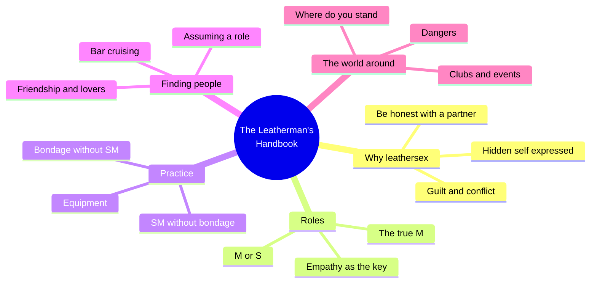
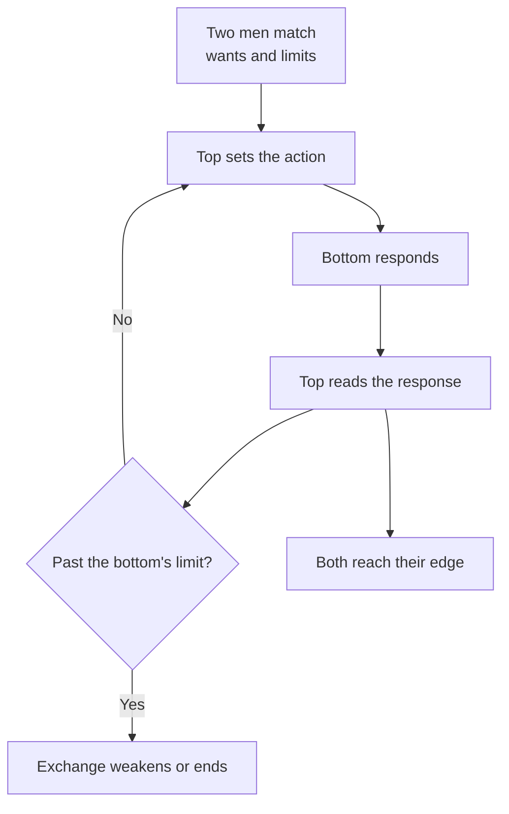
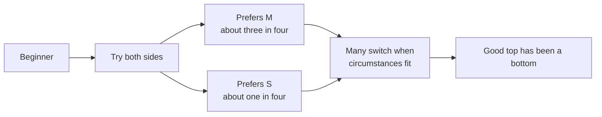
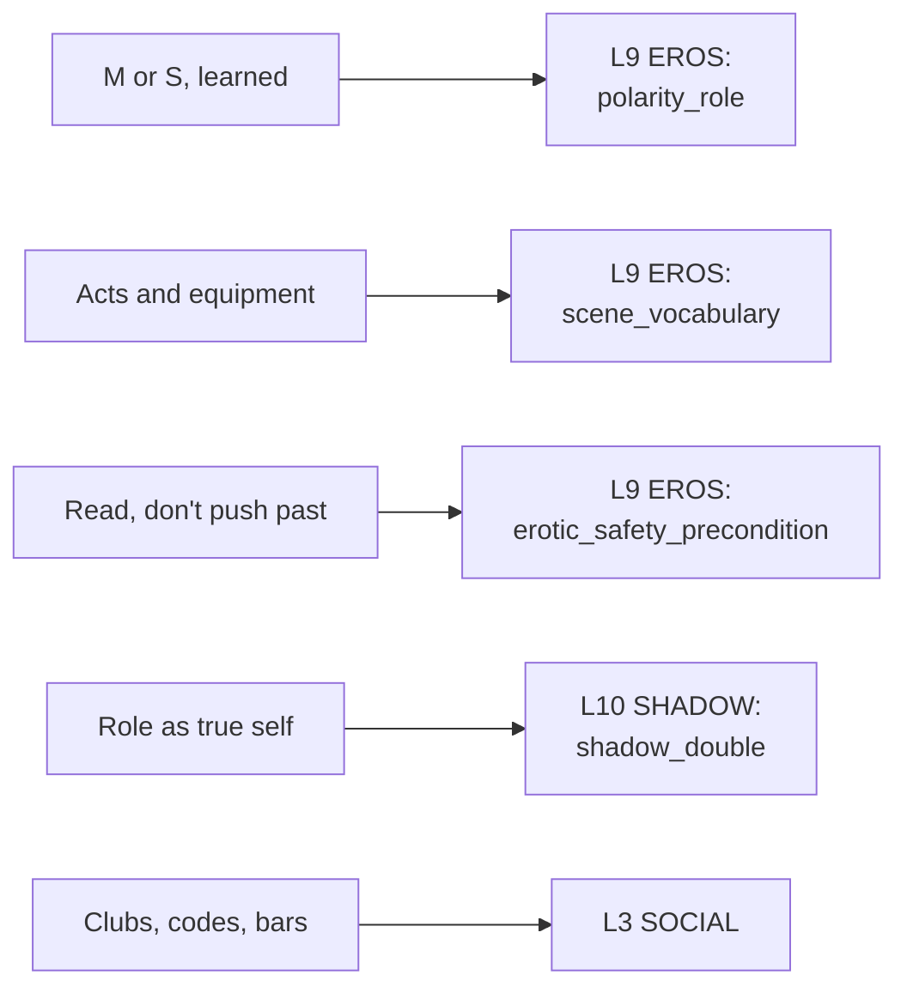

# 🧬 MSX.82 — The Leatherman's Handbook — Townsend (1972)
### Knowledge Entry — Distill

Larry Townsend's guide to gay leather and SM was first published in 1972. This file is the 1997 Silver Jubilee Edition, with the author's updating comments in italics and new introductions by Jack Fritscher, Victor Terry, and John Preston.

## TABLE OF CONTENTS
- [Core Thesis](#1-core-thesis)
- [Mind Models](#2-mind-models)
- [Framework](#3-framework--structure)
- [Key Concepts](#4-key-concepts)
- [Heuristics](#5-heuristics--decision-rules)
- [Invariants](#6-invariants)
- [Pitfalls](#7-pitfalls--myths)
- [Application](#8-application)
- [Cross-References](#9-cross-references)
- [Provenance](#10-provenance--confidence)

---

## 1 · CORE THESIS

Leathersex is a mutual exchange where each man shows the side of himself that society makes him hide. It works through empathy, skill, and honest talk about wants, and the roles of top and bottom are learned and movable. Townsend writes as a participant, not an observer.

---

## 2 · MIND MODELS

**Diagram 1 — the whole argument.**
Caption: *the book runs from why men want leather, to the roles, to the practice, to the social world, to the risks.*

**Diagram 2 — the central mechanism (a scene between two men).**
Caption: *the top decides the action, and the whole thing depends on his reading the bottom and the bottom telling him enough.*

**Diagram 3 — how the roles relate.**
Caption: *the book says the roles are not opposites: each man needs some of the other's experience, and many men move between them.*

**Diagram 4 — mapped onto the 12-layer character stack.**
Caption: *the book feeds the role, the scene vocabulary, the safety rule, the true-self question, and the subculture.*

---

## 3 · FRAMEWORK / STRUCTURE

Eighteen chapters, each pairing explanation with first-person vignettes. Printed pages are from the book's table of contents.

| Part | Governing move |
|---|---|
| Foreword, introductions (pp. 1-34) | Townsend states his stance: no mutually enjoyable, mutually agreeable activity is intrinsically bad (p. 2). The introductions place the book in leather history. |
| 1. Why Leathersex? (p. 35) | History, guilt, and the beginner's conflict (pp. 42-44). |
| 2. The M or the S? (p. 57) | Roles, empathy, and the one-to-three ratio (pp. 59-61). |
| 3. Bondage Without SM (p. 79) and 4. SM Without Bondage (p. 97) | Two ways of separating the elements, with vignettes. |
| 5. Equipment (p. 111) | Gear, with attention to leather, chain, locks, gags, and restraints. |
| 6. Finding a Partner (p. 135) | Bar cruising, age, and geography (pp. 137-139). |
| 7. Assuming a Role (p. 157) | The role versus reality (pp. 159-161). |
| 8. The Bike and Its Owner (p. 175), 9. Booze and Drugs (p. 189) | Motorcycle culture, and the author's view of alcohol and narcotics (p. 191). |
| 10. Of Friendship and Lovers (p. 205) | Long-term pairing (pp. 207-209). |
| 11. The True M (p. 217) | The experienced bottom (p. 219). |
| 12-15 (pp. 235-287) | The gangbang, esoterica and exotica, the sublime and the ultimate, and literature. |
| 16. Dangers (p. 313) | Three kinds: physical, emotional, legal (p. 315). |
| 17. The Social World of Leather (p. 323) | Clubs and events (p. 325). |
| 18. Where Do You Stand? (p. 333) | A questionnaire and statistics. |

---

## 4 · KEY CONCEPTS

| Concept | What it is | Why it matters |
|---|---|---|
| **Leathersex** | A sex style where each partner expresses urges he cannot show elsewhere (p. 42). | Defines the practice as expression, not only pain. |
| **Not "torture"** | Townsend cites a madam: "Torture is something you do to people that they don't like" (p. 42). | The line between SM and harm is that the participants want it. |
| **S and M** | S is the top, the one who sets the action. M is the bottom, the one who receives it (ch. 2). | The two roles with learned skills on each side. |
| **Empathy** | "Whereas the M should know, the S must know" what the other feels (p. 60). | The craft center of the book. |
| **One-to-three ratio** | A guess of one preferring S for every three preferring M among those active (p. 61). | An informal estimate, not a measured one. |
| **Key signal** | Keys on the left mean S, on the right mean M (p. 61). | A coded signal in a bar. Casual people may display left to look prestigious. |
| **Fluff** | A non-leather gay man (Foreword, ch. 1). | The subculture's term for outsiders. |
| **The True M** | An experienced bottom who knows his limits and can communicate them without breaking the dominance frame (p. 219). | Shows the bottom as a skilled, active role. |
| **Switch-hitting** | Moving between S and M when circumstances suit (p. 161). | Most men drift toward a favorite role but are not locked. |
| **Role versus reality** | A question: which is the role, daily life or the leather scene? (p. 159). | Offers the leather self as a candidate for the true self. |
| **Impunity of the M** | The M role can let a man avoid owning what he does ("I'm tied up, it's not my fault") (p. 160). | A mechanism tied to denial of one's own desire. |
| **Dangers** | Physical (medical), emotional, and legal (p. 315). | The book's own risk categories. |
| **Social world** | Clubs, organized events, workman clothing worn threadbare on purpose (p. 325). | A subculture with membership duties and a look. |

---

## 5 · HEURISTICS & DECISION RULES

| Situation | Do this | Not this |
|---|---|---|
| Writing a first leather scene | Let the beginner arrive with guilt and fantasy before skill. | Make him fluent on day one. |
| Writing a top | Give him a bottom's experience, or show the lack of it as a flaw. | Make dominance a personality trait that needs no learning. |
| Writing a bottom | Show him reading his partner and signaling limits. | Write him as passive. |
| Writing a mismatch | Let a partner with big fantasies meet a first command and collapse (p. 138). | Treat desire as proof of capacity. |
| Writing a pickup in a bar | Use the signals: the key side, dress, and what the room knows. | Make the scene random. |
| Writing a long-term couple | Give the pair a wider life than the scene, and let leathersex between them fade as the main bond (p. 208). | Make the scene the whole relationship. |
| Writing a character who "plays a part" | Ask whether the part or the daytime self is nearer his core. | Assume the daily face is the real one. |
| Writing alcohol or drugs in a scene | Let characters disagree. Townsend distrusts narcotics and a rigid abstainer alike (p. 191). | Treat substance use as simply on or off. |
| Writing the social world | Give the group duties: events to attend, others' events to support. | Make the group only a place to meet partners. |

---

## 6 · INVARIANTS

1. **The roles are learned.** Townsend says don't pick before you know what you're doing (p. 57).
2. **Empathy decides the quality.** The S must know what the M feels (p. 60).
3. **The M component exists in every leatherman.** Even a nearly all-S man keeps empathy with it (p. 61).
4. **Wants are best stated.** He urges beginners to say what they want and not hide behind inhibition (p. 45).
5. **No fixed rule for what is wrong.** "It is a matter of taste" (Foreword, p. 2).
6. **Scene and daily life are both partial.** Few times does a man truly act as himself (p. 159).
7. **Exclusive leathersex rarely carries a couple.** Townsend's own observation, over about two years (p. 208).

---

## 7 · PITFALLS / MYTHS

- Treating the book as research. It is a participant's guide, built on Townsend's own experience and on informal opinions from men whose judgment he respects (p. 208). The one-to-three ratio and similar figures are his estimates.
- Treating the era as current. The original is from 1972, when sodomy laws were still on the books in every US state (p. 45, italic note). The Silver Jubilee comments update some points and leave others.
- Treating its geography as universal. His experience is mostly West Coast, and he says the real leather action centers on large cities such as San Francisco, Los Angeles, New York and Chicago (p. 139). He says this is changing.
- Treating its tone about "fluffs," youth, and "pretty boys" as neutral. He holds firm views about who makes a good top (over thirty-five) and a good bottom, and he calls nineteen-year-old surfer types "duds more often than otherwise" (p. 138).
- Treating its psychology as settled. His reading of the M role, of Marines who work as part-time hustlers, and of psychiatry is opinion. He says he has no empirical evidence for many of his deductions (p. 160).
- Reading the dangers chapter as complete medical guidance. It is short, and its medical details date to 1972 and 1997.
- Treating the Chapter 18 questionnaire as a survey. It is a self-selected form, from an author who calls his sources informal.

---

## 8 · APPLICATION

*Proposed for the Command, not ruled.*

- **Spine level:** L5
- **12-layer character stack:** L9 EROS polarity_role (primary); L9 EROS scene_vocabulary (primary); L9 EROS erotic_safety_precondition (supporting); L10 SHADOW shadow_double (supporting); L3 SOCIAL (supporting); L9 EROS intimacy_mode (contextual).
- **plot_systems:** the scene-reading loop (top acts, bottom signals, top reads) is a unit for a scene beat. A character who misreads, or who is read well, changes the exchange.
- **Setting:** leather bars, clubs, and run events are a ready social tier for gay men's lives in the universe's later eras. They carry duties, dress, and a signal code.

Townsend gives the 12 layers a practical vocabulary. EROS holds desire and shame. It does not yet hold position, learned skill, or the set of acts a man knows. This book supplies all three.

For the ORANGE work, the proposed addition is a "role history" field on polarity_role. It records what roles the character has taken, in what order, and who taught him. Townsend's claim that good tops were bottoms first gives a story reason to show a top's earlier life. The "role versus reality" question also works as a SHADOW prompt: which of this man's faces does he regard as true?

Scenes drawn from this book fall under the standing prose ruling: explicit is allowed by default, written as fantasy first, with the container as the one-line front-matter disclaimer ("Fantasy, not a how-to: what happens in these pages stays in them. Reader discretion advised.", ruled 10/4). The distill reports what the book argues and does not recommend any act.

---

## 9 · CROSS-REFERENCES

| Related entry | Relation |
|---|---|
| [[🧬 MSX.72 — Homosexual Desire — Hocquenghem (1972)]] | Same year. Hocquenghem theorizes the shame and the pick-up. Townsend gives the practical scene. |
| [[🧬 MSX.85 — The Queer Art of Failure — Halberstam (2011)]] | Halberstam reads masochism and passivity as political (chapter 4). Townsend treats them as skills. |
| [[🧬 PSY.04 — Women and Kink — Rehor & Schiffman (2021)]] | A research-based counterpart on kink, centered on women. |
| [[🧬 PSY.62 — Tell Me What You Want — Lehmiller (2018)]] | Lehmiller's survey measures the power-and-control theme Townsend practices. |
| [[🧬 PSY.21 — The Sadeian Woman — Carter (1978)]] | A literary reading of power in sex, from a different angle. |

---

## 10 · PROVENANCE & CONFIDENCE

Full text, pdftotext extraction of a scanned copy, 405 PDF pages. Front matter confirms: Larry Townsend, The Leatherman's Handbook, Silver Jubilee Edition, commemorating the twenty-fifth anniversary, with introductions by Jack Fritscher, Victor Terry, and John Preston. Copyright is given as 1972, 1974, 1977, 1993, 1997; first Richard Kasak Book Edition 1997, Masquerade Books, New York. The file name uses 1972, the first publication year. Printed page numbers equal the PDF page minus eight, with the page number printed at each page foot.

Read in full or near full: the Author's Foreword, the opening of chapter 1 (pp. 42-45), the opening of chapter 2 (pp. 59-61), the opening of chapter 6 (pp. 137-139), the opening of chapter 7 (pp. 159-161), the opening of chapter 9, chapter 10's central pages (pp. 207-209), the opening of chapter 11, the opening of chapter 16, and the opening of chapter 17.

Not read: the introductions by Fritscher, Terry and Preston (skimmed for context), the vignettes in chapters 1 through 5, chapters 3, 4 and 5 beyond their openings (the Framework rows rest on the table of contents), chapters 8, 12, 13, 14, 15, and 18's questionnaire. Medical and equipment details were not extracted.

The feeds keying is this distill's synthesis against the Command's 12-layer stack. Townsend uses none of that vocabulary. The `spine: [L5]` value follows the assigning brief.

## META
- Template: BVX-LEARN-v4.0
- Source classification: full-text pdftotext, targeted read on chapter openings across the book, table of contents for the rest
- Created / Updated: 2026-10-04
