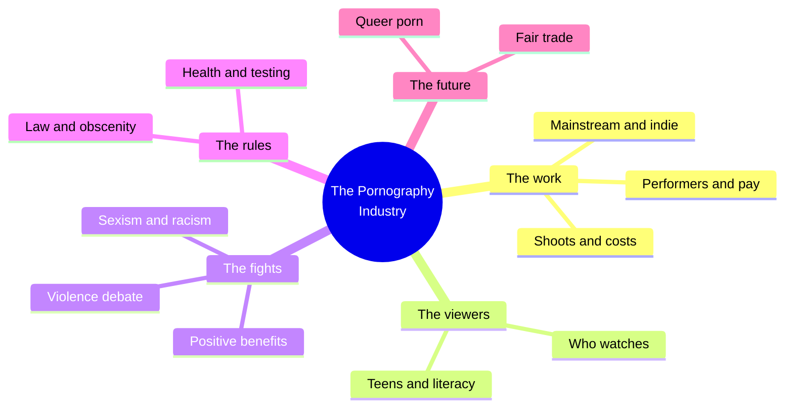
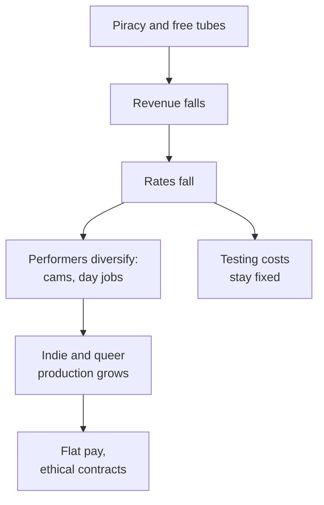
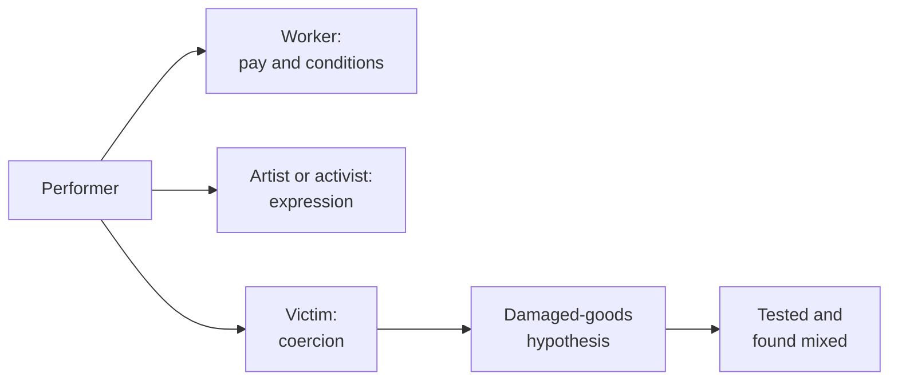
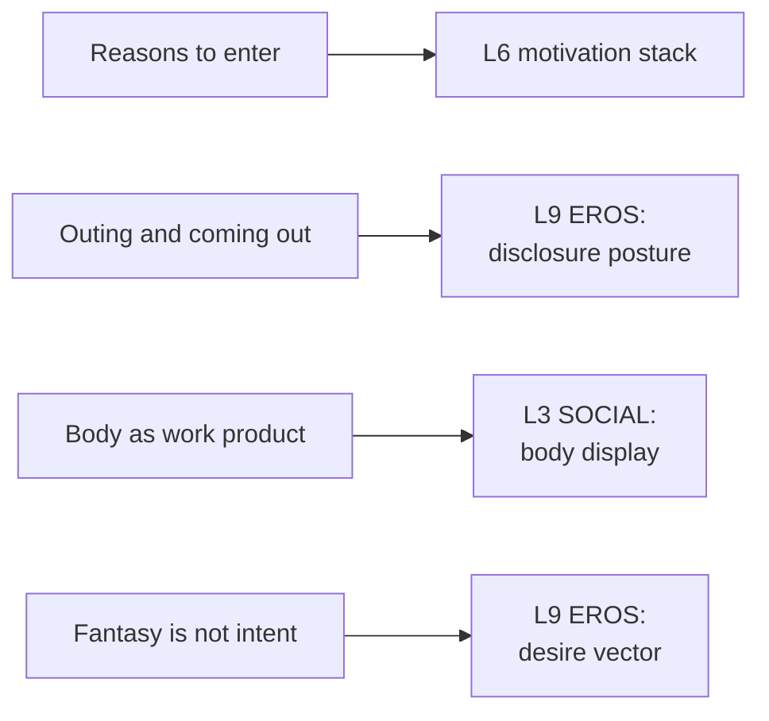

# 🧬 MSX.83 — The Pornography Industry — Tarrant (2016)
### Knowledge Entry — Distill

Shira Tarrant, a gender studies professor, answers a long list of questions about pornography in an even-handed Oxford series. It covers history, business, performers, viewers, law, health and the future. The library keeps it as the plain-language map of the industry that the ORANGE work leans on.

## TABLE OF CONTENTS
- [Core Thesis](#1-core-thesis)
- [Mind Models](#2-mind-models)
- [Framework](#3-framework--structure)
- [Key Concepts](#4-key-concepts)
- [Heuristics](#5-heuristics--decision-rules)
- [Invariants](#6-invariants)
- [Pitfalls](#7-pitfalls--myths)
- [Application](#8-application)
- [Cross-References](#9-cross-references)
- [Provenance](#10-provenance--confidence)

---

## 1 · CORE THESIS

Pornography is a job, a product and a political argument. Tarrant sets out the facts on each, and she shows that "good or bad" does not help. The useful questions concern pay, consent, data and who makes the work.

---

## 2 · MIND MODELS

**Diagram 1 — the whole argument.**
Caption: *ten chapters split into the work, the viewers, the fights, and the rules.*

**Diagram 2 — the central mechanism (the industry's money and pressure).**
Caption: *piracy and free tubes cut revenue, pay falls, performers diversify, and independent ethics models grow in the gap.*

**Diagram 3 — three views of the performer.**
Caption: *the book keeps three accounts side by side and tests the one that claims every performer is damaged.*

**Diagram 4 — mapped onto the 12-layer character stack.**
Caption: *the industry gives a character a job, a stigma and a reason; each lands on a layer.*

---

## 3 · FRAMEWORK / STRUCTURE

| Chapter | Pages | Content |
|---|---|---|
| 1. Overview | 3-9 | Definitions, erotica versus porn, why porn is a "valence issue" |
| 2. Historical questions | 11-27 | Stag films, golden era, video and digital eras |
| 3. The industry | 28-48 | Mainstream versus indie, shoots, cost, revenue, piracy |
| 4. Performers | 49-68 | Pay, cam sites, enjoyment, motives, the "damaged goods" hypothesis |
| 5. Who's watching | 69-87 | Demographics and data problems |
| 6. Pleasure and danger | 88-105 | Violence debate, "we are what we watch," benefits |
| 7. Legal issues | 106-124 | First Amendment, obscenity, cases, Measure B |
| 8. Medical issues | 125-144 | Testing, health, addiction debates |
| 9. Children and teens | 145-161 | Access, effects, porn literacy |
| 10. The future | 162-178 | Fair trade, feminist and queer porn, technology |

Tarrant states her aim: even-handed, research-based, no moral or political judgment (Introduction, p. 2).

---

## 4 · KEY CONCEPTS

| Concept | What it is | Why it matters |
|---|---|---|
| **Pornography** | Visual depictions meant to arouse (ch. 1, p. 3) | The definition shifts with the viewer |
| **Erotica vs. porn** | A soft/hard line with no fixed boundary (p. 4) | "If I like it, it's erotic; if you like it, it's pornographic" |
| **Valence issue** | A topic where nearly everyone starts from a strong feeling (p. 9) | Debate runs on emotion before data |
| **Mainstream vs. indie** | Indie firms stress equitable, ethical pay (ch. 3, pp. 28-29) | A model for a fair studio |
| **Flat rate** | One fee regardless of gender, experience or act (p. 29) | Removes pressure to do more for more money |
| **Pro-am** | Professional adults posing as amateurs (ch. 4, p. 62) | A genre built on fake newness |
| **Damaged-goods hypothesis** | The claim that performers are harmed people (p. 64) | Tarrant tests it |
| **Performance, not intimacy** | The performer's job is to look authentic (p. 61) | The scene is made, not found |
| **Do porn orgasms count?** | As with film stunts, sometimes yes and sometimes no (p. 61) | Fantasy is a craft |
| **Fantasy is not intent** | Viewing does not equal wanting (ch. 6, pp. 94-95) | Cuts the viewer-as-suspect move |
| **Queer porn** | Porn with mixed genders, bodies and abilities, aiming at authentic desire (ch. 10, p. 171) | The independent tradition's own aim |
| **Porn literacy** | Teaching viewers to read porn as a made thing (ch. 9, p. 157) | A response to teen access |

---

## 5 · HEURISTICS & DECISION RULES

| Situation | Do this | Not this |
|---|---|---|
| Writing a performer | Give him a mix of motives: rent, curiosity, politics, pleasure (pp. 61-62) | One tragic or one triumphant reason |
| A shoot scene | Show negotiation, tests, pay and a "no" that works at the professional level (p. 60) | Show a free-for-all |
| Amateur or pro-am work | Show risk where preparation is thin (p. 60) | Treat all porn as equally safe or unsafe |
| A performer's sex on camera | Write it as a job with moments of real pleasure (p. 61) | Make it all fake or all real |
| A viewer's tastes | Let tastes and life differ (pp. 94-95) | Read his viewing as a confession |
| Money | Show falling rates and costs the performer pays (p. 60) | Show easy riches |
| Stigma | Show outing as a risk to school and work (p. 62) | Show it as a plot twist with no cost |
| A fair studio | Give it flat pay and consent talk (p. 29) | Make it a utopia |

---

## 6 · INVARIANTS

1. Pornography is hard to define, and the definition shifts with the viewer (p. 3).
2. Performers' experiences range from love of the work to exploitation (p. 59).
3. Financial need is a common reason for entering the work (p. 62).
4. Porn on camera is performance (p. 61).
5. Revenue figures are unreliable (p. 42).
6. Viewers separate fantasy from life (pp. 94-95).
7. Debates about porn stay stuck on "good or bad" (p. 178).

---

## 7 · PITFALLS / MYTHS

- Treating the industry's dollar figures as facts. Tarrant calls the "$3,000 every second" claim untrue and the real size "a mystery" (pp. 42-43).
- Treating performers as one kind of person. The book sets Belladonna's account beside April Flores's (pp. 59-60).
- Treating viewing as destiny. The book cites studies finding viewers distinguish fantasy and life (pp. 94-95).
- Treating the book as complete on gay male porn. Its performer voices are mostly women and queer people. It treats gay male production lightly.
- Data caveat, stated once. Tarrant's studies are small or self-reported, such as the Swedish and Canadian surveys (p. 104) and the PornResearch.org replies (p. 105). The Pornhub data is a platform's own. The 2016 edition predates later changes in tube-site policy and payment rules. Read the figures as 2015 snapshots.
- The book tackles the US case law and says so (Introduction, p. 2).

---

## 8 · APPLICATION

*Proposed, not ruled.*

- **Spine level:** L5.
- **12-layer character stack:** L6 `motivation_stack` (primary); L9 EROS `disclosure_posture` (primary); L3 SOCIAL `body_display` (supporting); L9 `desire_vector` (supporting); L4 WILL `resistance_mode` (contextual).
- **plot_systems:** none.
- **Setting:** contextual. An in-world porn economy gets rates, tests and piracy from this book.

Tarrant gives a character in the industry a believable week. Proposed: for each performer or producer in the story, write one line for each of his reasons, one for the money, one for the test he pays for. A character with a day job and a testing bill feels real.

Proposed: split the viewer from the viewed. A character can watch one kind of scene and want another. The book gives license to write fantasy without turning it into a diagnosis.

Proposed: use the indie model as an antagonist's mirror. A studio with flat pay and consent talk can sit beside a studio without them.

For the explicit work, the book supports the fantasy-first rule under 06.1. The scene is a made thing with a craft, and the page can say so. The front-matter disclaimer carries the container.

---

## 9 · CROSS-REFERENCES

| Related entry | Relation |
|---|---|
| [[🧬 MSX.18 — Porn Work — Berg (2021)]] | Berg studies the labour of performers in depth |
| [[🧬 MSX.31 — Porn — An Oral History — Barton (2023)]] | Voices of the industry |
| [[🧬 MSX.65 — Gay Pornography — Mercer (2017)]] | The gay male ground Tarrant covers lightly |
| [[🧬 MSX.24 — Bareback Porn — Florêncio (2020)]] | A single genre studied in depth |
| [[🧬 MSX.46 — Deviations — Rubin (2011)]] | Rubin's sex-panic argument frames the "valence issue" |
| [[🧬 MSX.26 — Pornographic Art and the Aesthetics of Pornography — Maes (2013)]] | The aesthetic question Tarrant skips |

---

## 10 · PROVENANCE & CONFIDENCE

Full-text pdftotext extract of the Oxford University Press first edition, 2016. The copyright page confirms Shira Tarrant, 2016. Read: the Introduction (pp. 1-2); Chapter 1's definition and erotica sections (pp. 3-5); Chapter 3's mainstream-versus-indie and revenue sections (pp. 28-29, 42-43); Chapter 4's enjoyment and motive sections (pp. 59-64); Chapter 6's "we are what we watch" and benefits sections (pp. 94-95, 103-105); Chapter 10's queer porn section and conclusion (pp. 170-172, 177-178). The contents list was read to map the book.

Skipped: Chapter 2's history, Chapter 5's demographics, Chapter 7's law, Chapter 8's medical chapter, Chapter 9's teen chapter, the notes and the index.

Page numbers are printed folios from the running heads. The `feeds:` keying is this distill's own synthesis.

## META
- Template: BVX-LEARN-v4.0
- Source classification: full-text pdftotext extraction; industry, performer, debate and future sections read
- Created / Updated: 2026-10-04
