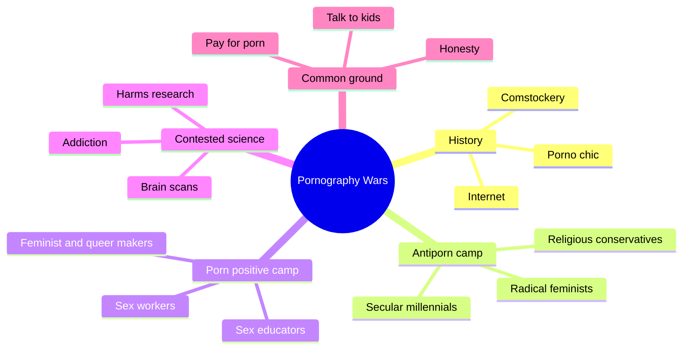
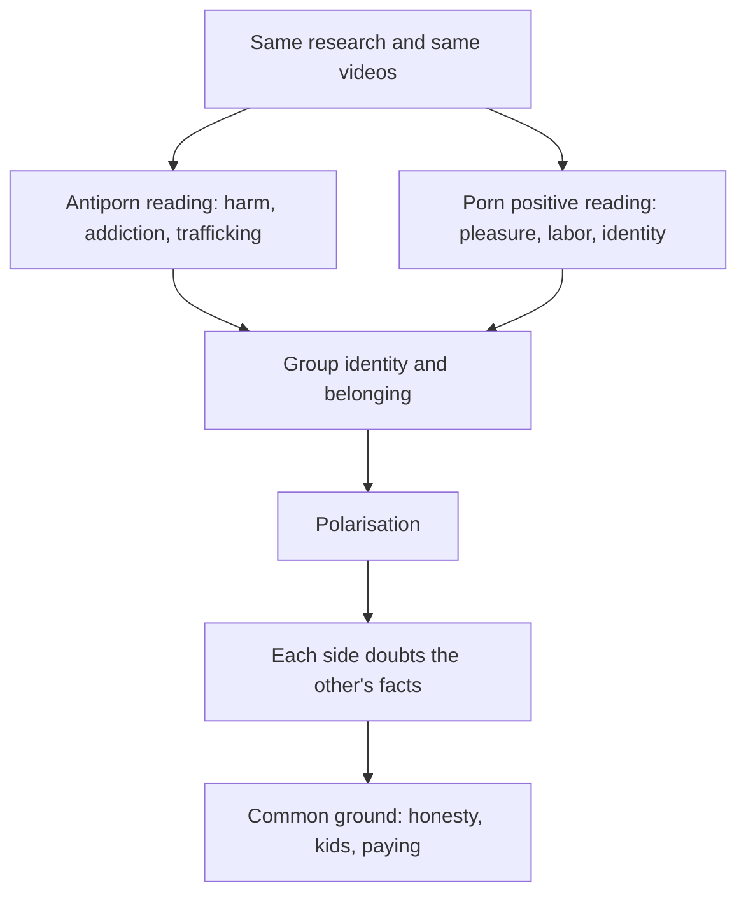
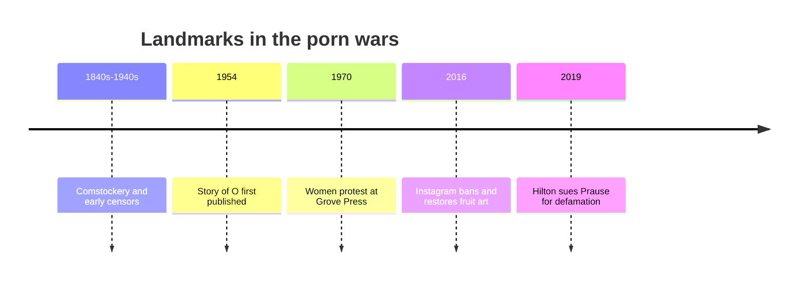

# 🧬 MSX.84 — The Pornography Wars — Burke (2023)
### Knowledge Entry — Distill

Fantasy, not a how-to: what happens in these pages stays in them. Reader discretion advised.

Kelsy Burke, a sociologist, maps the American fight over pornography from the 1800s to now. She interviewed people on both sides. The library uses it to understand why porn means different things to different people, and how that shapes characters.

## TABLE OF CONTENTS
- [Core Thesis](#1-core-thesis)
- [Mind Models](#2-mind-models)
- [Framework](#3-framework--structure)
- [Key Concepts](#4-key-concepts)
- [Heuristics](#5-heuristics--decision-rules)
- [Invariants](#6-invariants)
- [Pitfalls](#7-pitfalls--myths)
- [Application](#8-application)
- [Cross-References](#9-cross-references)
- [Provenance](#10-provenance--confidence)

---

## 1 · CORE THESIS

"Pornography" names an argument, not a thing. Two camps fight over it, each with real evidence. Burke argues that porn's effects depend on who watches it and where they stand in an unequal society, not on porn alone.

---

## 2 · MIND MODELS

**Diagram 1 — the whole argument.**
Caption: *the book treats porn as a political fight with a long history, two camps, and contested science, then looks for common ground.*

**Diagram 2 — the central mechanism.**
Caption: *the same evidence feeds both camps, and each camp's belonging grows as the other side hardens.*

**Diagram 3 — a short timeline of the fight.**
Caption: *each wave of the fight follows a new medium or a new coalition.*

---

## 3 · FRAMEWORK / STRUCTURE

An introduction, 19 chapters in four parts, and notes. The parts are named by what each fight is over.

| Part | Governing move |
|---|---|
| Introduction (pp. 20-25) | Defines pornography as an argument, states Burke's method, and names the two camps. |
| I. The Hundred Years' War (Ch. 1-6) | Comstockery, obscenity files, the Christian right, porno chic, Women Against Pornography, and the internet. |
| II. The Battle over Making Porn (Ch. 7-12) | Trafficking, safer sex work, Hot Girls Wanted, Hustlers, Shades of Grey, and feminist porn (Come as You Are). |
| III. The Battle over Watching Porn (Ch. 13-17) | Health, recovery, brain science, gender, and protecting children. |
| IV. Truce (Ch. 18-19) | The meaning of "real" in sex, and a closing search for common ground. |

---

## 4 · KEY CONCEPTS

| Concept | What it is | Why it matters |
|---|---|---|
| **Pornography as argument** | The word names a dispute, not an object (Intro, p. 21, quoting Kendrick). | It tells a writer that "porn" is a label with a speaker. |
| **Antiporn movement** | An alliance of religious conservatives, feminists, and secular Millennials (Intro, p. 24). | The coalition is strange, so a character may belong to part of it. |
| **Porn positive** | Feminist and queer activists, sex workers, and educators who improve porn, not simply defend it (Intro, p. 24). | The camp is "positive," not "pro-porn." |
| **Feminist and ethical porn** | Porn with real pleasure, diverse performers, consent, and fair pay (Intro, p. 24; Ch. 12). | It shows an alternative production culture. |
| **Moral incongruence** | A gap between what a person believes and does (Ch. 19, p. 278). | The gap, not the act, links to distress. |
| **Optimal distinctiveness** | Feeling unique and belonging at once (Ch. 19, p. 278). | It explains why people hold their side hard. |
| **Passionlessness** | A 19th-century idea that women lack sexual desire (Ch. 16, p. 234). | A source of inherited shame. |
| **Faking it** | Orgasm performed in partnered sex, common in survey data (Ch. 18, p. 264). | It questions what counts as real pleasure. |

---

## 5 · HEURISTICS & DECISION RULES

| Situation | Do this | Not this |
|---|---|---|
| Writing a character's view of porn | Place him in a community and show what that community gains from the view. | Make it a private opinion. |
| Writing a character who feels torn | Show the gap between belief and habit and the secrecy around it. | Make the habit the whole problem. |
| Writing a queer character's first images | Let porn be a place he learns what he is, as the studies report. | Make it only a harm or only a gift. |
| Writing a performer | Let him have work, rules, and a view of his own labor. | Write a victim or a star only. |
| Writing an evangelical or conservative setting | Give it a gender script with a history and a vocabulary of sin and recovery. | Write it as simple repression. |
| Writing a debate between characters | Give each real evidence and a stake in belonging. | Make one a strawman. |

---

## 6 · INVARIANTS

1. "Porn" is a social label, and its meaning shifts by speaker and era.
2. Both camps cite real research, and the research is inconclusive.
3. People experience porn differently depending on identity, experience, and beliefs (Ch. 19, p. 278).
4. Hidden habits and mismatched beliefs track worse outcomes than open ones.
5. Each camp finds belonging in the fight.
6. Common ground exists, including honesty and talking to young people (Ch. 19, p. 278).

---

## 7 · PITFALLS / MYTHS

- The book is American. It does not describe porn debates in other countries.
- It rests on 90 interviews. The 52 antiporn interviewees were mostly white men (Intro, p. 25).
- Burke reports both sides and also states her own sociological lens. The "neutral" tone is a method, not a view from nowhere.
- Research on porn's harms is inconclusive, and Burke says so (Intro, p. 25; Ch. 19, p. 277).
- The Prause and Hilton fight shows that addiction science is itself a feud. Porn addiction is not a formal diagnosis in the DSM or the ICD, and compulsive sexual behavior sits in ICD-11 as an impulse-control disorder (Ch. 15, p. 216).
- Survey figures, such as the faked-orgasm rates, come from small and mostly heterosexual samples.

---

## 8 · APPLICATION

*Everything here is proposed, never ruled.*

- **Spine level:** L5, as set by the batch brief.
- **12-layer character stack:** L10 SHADOW (moral_incongruence), L9 EROS (shame_architecture, authentic_pleasure_standard), L3 SOCIAL (moral_tribe), L1 CORE (identity_frame).
- **plot_systems:** a "two camps" scene engine: both sides cite the same facts, and the scene turns on who belongs where.
- **Setting:** a school or town where the fight over porn sorts students and parents into tribes.

The most usable piece is moral incongruence. A character who does what he thinks is wrong carries a secret that scenes can test. A second use is the camps themselves, with their coalitions and vocabularies, as ready-made social groups. Fantasy comes first in the prose, and explicit scenes are allowed under the standing 06.1 ruling. The disclaimer at the top carries the container, and the book's own debate does not move that ruling.

---

## 9 · CROSS-REFERENCES

| Related entry | Relation |
|---|---|
| [[🧬 PSY.56 — A Billion Wicked Thoughts — Ogas & Gaddam (2011)]] | Ogas and Gaddam count what people search for. Burke shows how such data get used in the fight. |
| [[🧬 MSX.76 — Public Sex — Califia (2000)]] | Califia fought the antiporn feminists in the 1980s. Burke covers the same movement from outside. |
| [[🧬 MSX.18 — Porn Work — Berg (2021)]] | A study of the work of making porn, which this book's performer chapters touch. |
| [[🧬 MSX.31 — Porn — An Oral History — Barton (2023)]] | An industry oral history from the same year as this book. |
| [[🧬 PSY.29 — The Routledge International Handbook of Sexual Addiction — Birchard & Benfield (2018)]] | The clinical side of the addiction claim Burke reports in Ch. 15. |

---

## 10 · PROVENANCE & CONFIDENCE

Full-text pdftotext extraction, 341 pdf pages. The copyright page confirms Kelsy Burke, Bloomsbury Publishing, first published in the United States in 2023. Page cites are pdf pages, not printed pages.

Read: the Introduction (pp. 20-25), the opening of Ch. 1 (p. 30), the opening of Ch. 5 (pp. 78-80), the opening of Ch. 12 (pp. 168-170), the opening of Ch. 15 (pp. 215-217), the opening of Ch. 16 (pp. 232-234), the opening of Ch. 18 (pp. 263-265), and the first half of Ch. 19 (pp. 275-279).

Skipped: Ch. 2 to 4, 6 to 11, 13, 14, and 17, the rest of each read chapter, and the notes. That includes the chapters on trafficking, performers' labor, and children. Confidence is medium. The thesis and the common-ground chapter are clear, but the case chapters were only sampled. The `feeds:` keying is this distill's own synthesis, and the book uses none of the 12-layer vocabulary.

## META
- Template: BVX-LEARN-v4.0
- Source classification: full-text extraction, targeted read of the Introduction and the openings of Ch. 1, 5, 12, 15, 16, 18, 19
- Created / Updated: 2026-10-04
