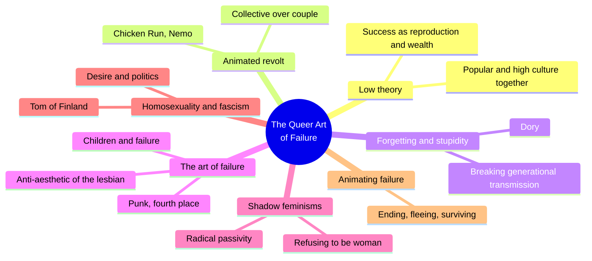
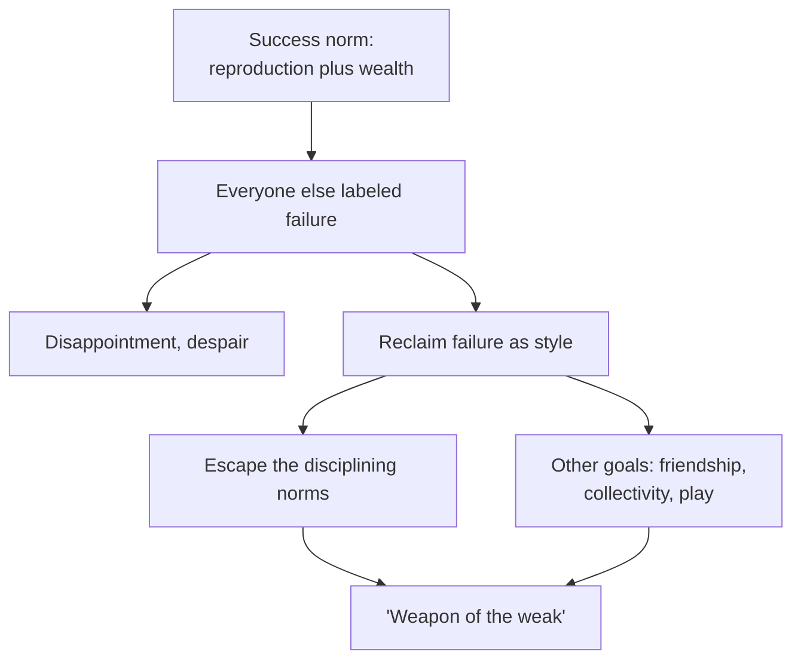
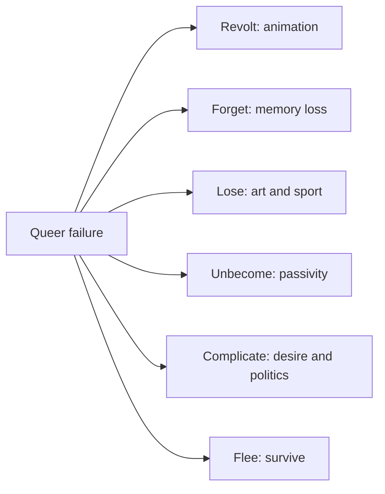
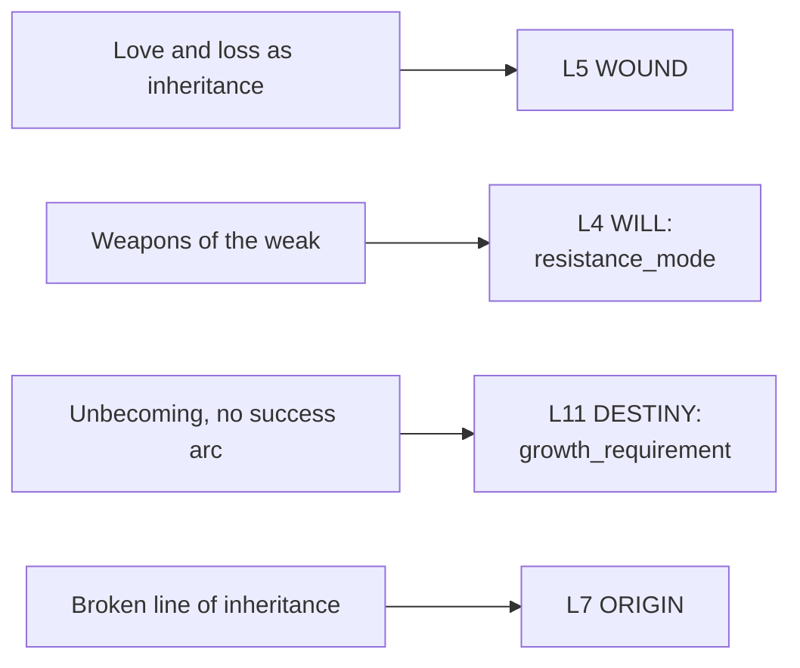

# 🧬 MSX.85 — The Queer Art of Failure — Halberstam (2011)
### Knowledge Entry — Distill

Halberstam's 2011 book argues that failing, forgetting, and refusing can be creative and political acts. It reads children's animation, punk, art, and feminist writing to challenge a model of success built on reproduction and wealth.

## TABLE OF CONTENTS
- [Core Thesis](#1-core-thesis)
- [Mind Models](#2-mind-models)
- [Framework](#3-framework--structure)
- [Key Concepts](#4-key-concepts)
- [Heuristics](#5-heuristics--decision-rules)
- [Invariants](#6-invariants)
- [Pitfalls](#7-pitfalls--myths)
- [Application](#8-application)
- [Cross-References](#9-cross-references)
- [Provenance](#10-provenance--confidence)

---

## 1 · CORE THESIS

Success in a heteronormative, capitalist society means reproduction plus wealth, and everyone who misses it is called a failure. Failing, losing, forgetting, and unbecoming can offer more creative, cooperative, and surprising ways of living. Queers have long done this well.

---

## 2 · MIND MODELS

**Diagram 1 — the whole argument.**
Caption: *six chapters apply one idea, that failure is a style and a politics, to animation, memory, art, feminism, and fascism.*

**Diagram 2 — the central mechanism (how failure becomes a tool).**
Caption: *the system defines success narrowly, calls the rest failure, and the person who accepts the label can use it to step out of the system's discipline.*

**Diagram 3 — the chapters as tools.**
Caption: *each chapter names one way of failing on purpose.*

**Diagram 4 — mapped onto the 12-layer character stack.**
Caption: *the book feeds the wound as inheritance, the will as refusal, and destiny as unbecoming.*

---

## 3 · FRAMEWORK / STRUCTURE

An introduction, six chapters, and an animation theme running through most of them.

| Part | Governing move |
|---|---|
| Introduction, Low Theory (pp. 1-25) | "What's the alternative?", undisciplined knowledge, low theory (adapted from Stuart Hall), pirate cultures, and failure as a way of life. States that success equals reproductive maturity plus wealth (p. 2). |
| Ch. 1, Animating Revolt and Revolting Animation | Reads Chicken Run and other animated films as stories of collective revolt. Penguin love, queer creatures, monstrous animation. |
| Ch. 2, Dude, Where's My Phallus? Forgetting, Losing, Looping | Stupidity and forgetting as ways of interrupting generational transmission. Dory in Finding Nemo is the opening case. |
| Ch. 3, The Queer Art of Failure | Punk failures, fourth place (the art of losing), Google-bombing, the anti-aesthetic of the lesbian, and children and failure. |
| Ch. 4, Shadowy Feminisms: Queer Negativity and Radical Passivity | Refusal to be or become "woman," masochism, cutting, and collage. |
| Ch. 5, "The Killer in Me Is the Killer in You": Homosexuality and Fascism | "Gay Nazis?" and what desire and political imagery owe each other. |
| Ch. 6, Animating Failure: Ending, Fleeing, Surviving | A return to animation, with Fantastic Mr. Fox, and a critique of Zizek's reading. |

---

## 4 · KEY CONCEPTS

| Concept | What it is | Why it matters |
|---|---|---|
| **Low theory** | A term adapted from Stuart Hall. It mixes popular knowledge and high theory to find "in-between spaces" outside binaries (Intro, p. 2). | The book's method: read a cartoon as seriously as a philosopher. |
| **Success as reproduction plus wealth** | The book's definition of success under heteronormative capitalism (Intro, p. 2). | The norm that failure is measured against. |
| **Failure as style or way of life** | Quentin Crisp's phrase "a style" and Foucault's "a way of life" (Intro, pp. 2-3). | Failure is chosen and lived, not only suffered. |
| **Toxic positivity** | After Barbara Ehrenreich's Bright-sided: the belief that success is attitude and failure is personal fault (Intro, p. 3). | Explains why failing is blamed on the failer. |
| **Weapons of the weak** | James C. Scott's phrase for indirect resistance such as working slowly or feigning incompetence (ch. 3). | A set of tactics a character without power can use. |
| **Hidden history of pessimism** | Scott Sandage's phrase for the unrecorded record of failure behind every success story (ch. 3). | Losers leave no records, while winners keep talking. |
| **Art of losing** | Heather Love's phrase: love and loss linked, giving queers insight into love's failures and impossibilities (ch. 3 epigraph). | Loss as a claimed inheritance. |
| **Fourth place** | The athlete who just misses a medal: "almost good," outside the glory and the infamy (ch. 3). | A specific, unglamorous kind of loss. |
| **Forgetting as practice** | Forgetting interrupts generational transmission and normativity (ch. 2). | Memory loss as a different way of knowing, with Dory as the model. |
| **Stupidity** | Not-knowing that "wears down history," after Avital Ronell (ch. 2). | A refusal of the wise, orderly knower. |
| **Radical passivity** | Refusal, negation, silence, and self-destruction as a political position, seen in shadow feminism (ch. 4). | Not-doing as a form of agency. |
| **Anti-Oedipal break** | Refusing to inherit the mother's place, and refusing the "passing down" model (ch. 4). | Challenges lineage as the basis of identity. |
| **Desire and political discomfort** | One can find an erotic archive arousing and still ask what politics it carries (ch. 5). | The book says people resist hearing their desires linked to disturbing politics. |

---

## 5 · HEURISTICS & DECISION RULES

| Situation | Do this | Not this |
|---|---|---|
| Writing a character who "fails" | Ask what he escapes by failing and what else he can then do. | Treat failure as only a loss. |
| Writing an ambitious character | Give the success norm a source: a parent, a school, a market. | Treat ambition as a natural drive. |
| Writing a weak character facing power | Give him the tools of slowness, silence, feigned incompetence, and forgetting. | Give him only open fights he cannot win. |
| Writing memory loss or forgetting | Treat it as a different way of knowing, as with Dory. | Treat it as only a deficit. |
| Writing an inheritance (family, school, lineage) | Let a character break the line on purpose and show the cost and the freedom. | Make passing down the only way a story can honor a past. |
| Writing coupling and domesticity | Let friendship, collectivity, or a group take the place of the couple. | Treat the couple as the default endpoint. |
| Writing a character aroused by an image that carries bad politics | Let him feel the discomfort and keep both facts. | Resolve it with a simple "it's just fantasy" or "it's just wrong." |
| Writing an upbeat self-help voice | Let another character push back with the cost of forced optimism. | Treat positivity as neutral. |

---

## 6 · INVARIANTS

1. **Success is defined by those who win.** In capitalism, winners need losers (ch. 3).
2. **Failure is a category made by the winners.** It is not a fact about the failer (ch. 6).
3. **Positive thinking blames the failer.** It treats structural conditions as attitude (Intro, p. 3).
4. **Losing can be productive.** It can open other goals for life, love, art, and being (ch. 3).
5. **Resistance can look like indifference.** Weapons of the weak are easy to misread as acquiescence (ch. 3).
6. **Generational transmission favors dominant groups.** Interrupting it is a political act (ch. 2).
7. **Desire and politics cannot be fully separated.** Doing so is itself a position (ch. 5).

---

## 7 · PITFALLS / MYTHS

- Treating failure as always good. The book notes that failure comes "accompanied by a host of negative affects, such as disappointment, disillusionment, and despair" (Intro, p. 3).
- Treating the book's film readings as proof. They are interpretations of popular films (Chicken Run, Finding Nemo, Shrek, Fantastic Mr. Fox) offered as examples of queer themes, not as evidence about audiences or creators.
- Treating "queer" as only one kind of person. The book uses it as a wider stance toward norms, and it spans feminism, art, and cultural studies.
- Using the book's argument against fascism and desire as a fixed claim. The author states that the point is the struggle over claims people make about the political rightness of their desires, and that the true political status of Tom of Finland's world is not the issue (ch. 5).
- Reading the author's disagreements as settled. She disagrees with Zizek, Edelman, and Sedgwick on specific points, and these are live debates (chs. 3, 5, 6).
- Treating its political context as current. The opening cites the 2008 financial crisis, bank bailouts and "too big to fail" (ch. 3).
- Difficulty: the prose mixes theory with jokes and pop-culture references. The distill compresses the jokes.
- Name note: the 2011 title page credits Judith Halberstam. The author is also published as Jack Halberstam. This entry uses the surname.

---

## 8 · APPLICATION

*Proposed for the Command, not ruled.*

- **Spine level:** L5
- **12-layer character stack:** L5 WOUND wound (primary); L4 WILL resistance_mode (primary); L11 DESTINY growth_requirement (supporting); L7 ORIGIN origin_generational_script (supporting); L9 EROS desire_vector (contextual); L10 SHADOW shadow_double (contextual).
- **plot_systems:** a character who refuses the success arc is a story engine. Others around him read his refusals as failure, and the story tests whether the refusal buys something else.
- **Setting:** school and institution settings such as DCUS have a success script (grades, couples, careers). The book gives a vocabulary for a character or group who step outside it.

Halberstam gives the 12 layers a different shape for a wound and a destiny. The usual pattern is injury, then healing, then growth. The book offers a pattern where the loss is kept, used, and made part of how a character lives.

For the ORANGE work, the proposed addition is a "success script" field on ORIGIN or DESTINY. It records which version of a good life the character was given (couple, career, children, wealth) and whether he accepts, bends, or refuses it. A second addition is a list of "weapons of the weak" on WILL: the specific small refusals a character uses, such as slowness, silence, or forgetting.

Halberstam also helps with gay and bisexual men whose lives do not follow the couple-and-children route. The book does not say they fail. It says the label comes from the norm.

---

## 9 · CROSS-REFERENCES

| Related entry | Relation |
|---|---|
| [[🧬 MSX.68 — Epistemology of the Closet — Sedgwick (1990)]] | Sedgwick treats ignorance as power. Halberstam treats not-knowing as a resource. Halberstam also challenges one of Sedgwick's claims in chapter 5. |
| [[🧬 MSX.36 — The History of Sexuality — Foucault (1978)]] | Halberstam cites Foucault's "a way of life" and builds on his reverse-discourse idea. |
| [[🧬 MSX.72 — Homosexual Desire — Hocquenghem (1972)]] | Both reject the Oedipal family as the model for queer life. |
| [[🧬 MSX.82 — The Leatherman's Handbook — Townsend (1972)]] | Halberstam reads masochism and passivity as political. Townsend writes them as skills. |
| [[🧬 PSY.21 — The Sadeian Woman — Carter (1978)]] | Another reading of sexual power and refusal in a literary frame. |

---

## 10 · PROVENANCE & CONFIDENCE

Full text, pdftotext extraction, 250 PDF pages. Title page confirms Judith Halberstam, The Queer Art of Failure, Duke University Press, Durham and London, 2011, a John Hope Franklin Center Book. The book is dedicated "For all of history's losers." Pages cited in the Introduction (pp. 2-3) are from the page text. Printed page numbers for the later chapters could not be recovered because the extract carries plates that shift pagination, so those citations are by chapter and section.

Read in full or near full: the Introduction's opening pages (pp. 1-3), the opening of chapter 2 (Dory and forgetting), the opening of chapter 3 (the capitalism and failure passages, weapons of the weak, fourth place), the "Children and Failure" section, the opening of chapter 4 (shadow feminism and anti-Oedipal passivity), the "Gay Nazis?" section of chapter 5, and the opening of chapter 6.

Not read: the rest of the Introduction (undisciplined, pirate cultures), chapter 1 (the table of contents and the epigraph only), the middle of chapter 2 (the interlude and the forgetting section), the punk, Google-bombing, and anti-aesthetic sections of chapter 3, the cutting and collage sections of chapter 4, the second half of chapter 5, and the notes. Chapter 1's Framework row rests on the table of contents.

The feeds keying is this distill's synthesis against the Command's 12-layer stack. Halberstam uses none of that vocabulary. The `spine: [L5]` value follows the assigning brief.

## META
- Template: BVX-LEARN-v4.0
- Source classification: full-text pdftotext, deep read on the introduction and sampled sections of each chapter, table of contents for the rest
- Created / Updated: 2026-10-04
