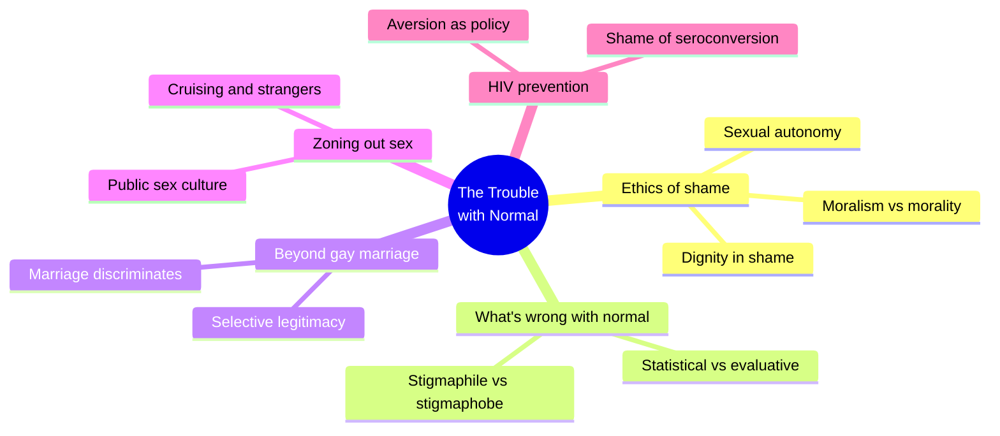
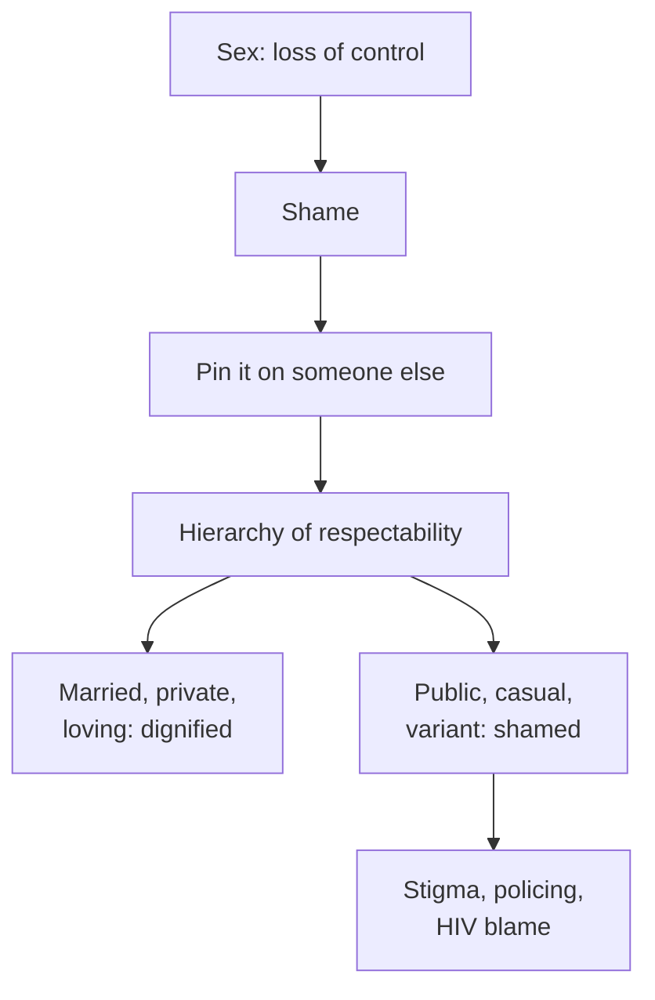
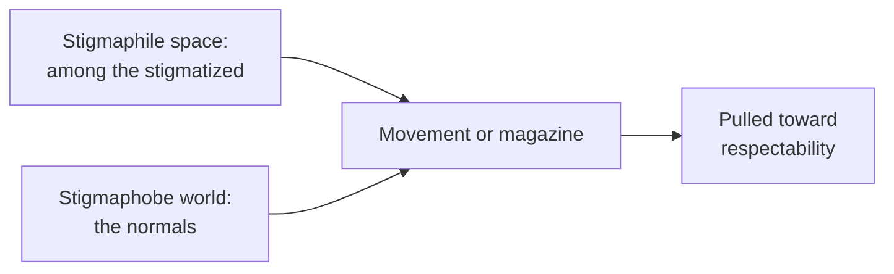
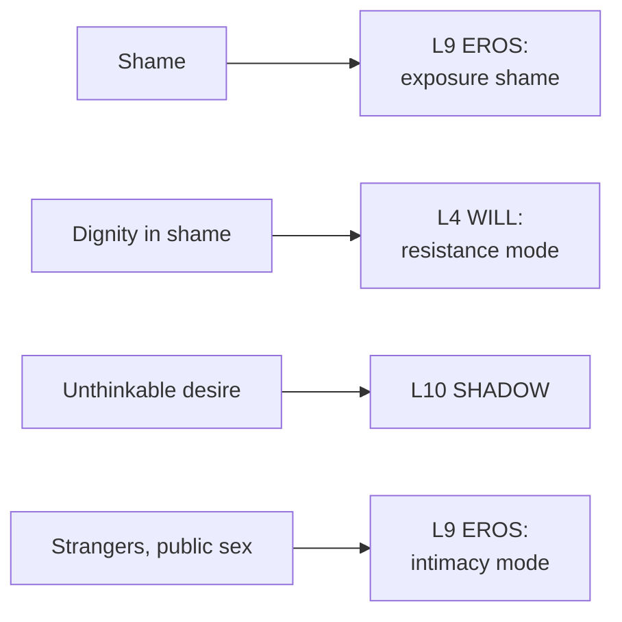

# 🧬 MSX.86 — The Trouble with Normal — Warner (1999)
### Knowledge Entry — Distill

Michael Warner, a literary and queer theorist, argues that sexual shame is a political fact and that mainstream gay politics repeats it. He criticizes the push toward marriage and the zoning-out of public sex culture. The library keeps it as the queer-ethics counterweight on the shelf.

## TABLE OF CONTENTS
- [Core Thesis](#1-core-thesis)
- [Mind Models](#2-mind-models)
- [Framework](#3-framework--structure)
- [Key Concepts](#4-key-concepts)
- [Heuristics](#5-heuristics--decision-rules)
- [Invariants](#6-invariants)
- [Pitfalls](#7-pitfalls--myths)
- [Application](#8-application)
- [Cross-References](#9-cross-references)
- [Provenance](#10-provenance--confidence)

---

## 1 · CORE THESIS

Sexual shame cannot be abolished, so the ethical question is what we do with it. Moralism pins it on others and builds a hierarchy of respectability. Queer culture offers another ethic: share the indignity, and call it dignity.

---

## 2 · MIND MODELS

**Diagram 1 — the whole argument.**
Caption: *one ethical idea, shame, run through three political fights and an epidemic.*

**Diagram 2 — the central mechanism (the hierarchy of shame).**
Caption: *shame moves downward; each group escapes it by pointing at the group below.*

**Diagram 3 — two poles of a stigmatized group.**
Caption: *a movement has to speak to both worlds, and power sits on the normal side.*

**Diagram 4 — mapped onto the 12-layer character stack.**
Caption: *Warner gives the shame layers a politics: where shame goes, how a man answers it, what he cannot name.*

---

## 3 · FRAMEWORK / STRUCTURE

| Part | Pages | Move |
|---|---|---|
| Preface | vii-xii | The book moves from abstract ethics to local politics |
| 1. The Ethics of Sexual Shame | 1-40 | Autonomy, moralism, queer ethic |
| 2. What's Wrong with Normal? | 41-80 | Normal as a statistical and a moral term |
| 3. Beyond Gay Marriage | 81-148 | Why marriage is unethical |
| 4. Zoning Out Sex | 149-194 | New York's zoning law and public sex culture |
| Conclusion | 195-218 | Shame and HIV prevention |

---

## 4 · KEY CONCEPTS

| Concept | What it is | Why it matters |
|---|---|---|
| **Sexual autonomy** | Everyone's sexual freedom, consistent with everyone else's (ch. 1, p. 1) | The book's ethical base |
| **Moralism vs. morality** | Moralism mandates one idealized sex for all (p. 4) | Lets Warner defend ethics without moralism |
| **Burden of proof** | Those who impose a standard should justify it (p. 5) | Flips the usual default |
| **Politics of shame** | Shame as unequal exposure to violence and silence (pp. 3, 7) | Shame is structural, not only private |
| **Unthinkability of desire** | A norm so old it needs no enforcer (pp. 6-7) | A man struggles with his own wish first |
| **Queer ethic of dignity in shame** | Shared abjection as the basis of generosity (pp. 35-37) | The book's positive proposal |
| **Two dignities** | Dignity as rank, and dignity as inherent in the human (p. 36) | Respectability uses the first |
| **Stigmaphile / stigmaphobe** | Goffman's terms for the two worlds of the stigmatized (ch. 2, p. 43) | A movement is pulled between them |
| **Statistical vs. evaluative norm** | Averages do not show what is healthy (p. 56) | Cuts "everyone does it" and "most do it" alike |
| **Selective legitimacy** | Marriage honors some couples by demeaning others (ch. 3, p. 82) | Warner's case against marriage as the goal |
| **Hierarchy of respectability** | Politics built on embarrassment (ch. 1, pp. 48-49) | A cast of "good gays" and "bad gays" |
| **Public sexual culture** | Cruising and porn as a world-making publicness (ch. 4, pp. 176-179) | A place with its own rules and its own privacy |

---

## 5 · HEURISTICS & DECISION RULES

| Situation | Do this | Not this |
|---|---|---|
| A character's shame | Show where he sends it: onto a lover, a rival, a group | Show it as private only |
| A coming-out scene | Show him first facing the unthinkability of his wish (pp. 6-7) | Show an enemy as the only obstacle |
| A respectable gay man | Let his respectability rest on pointing at someone lower (pp. 48-49) | Make him a villain or a saint |
| A queer scene | Give it camaraderie across rank: "Put a wig on before you judge" (p. 35) | Make it a refuge of pure joy |
| A man chasing normality | Show the cost: a hierarchy of shame (pp. 48-49) | Show it as maturity |
| A law against adult shops | Show the chilling effect beyond the closures (p. 150) | Show only the padlocks |
| Cruising | Write it as belonging to a world, not only release (p. 179) | Write it as anonymity |
| A man who seroconverts | Show the shame and the blame he already holds (pp. 196-197) | Show him as a fool |

---

## 6 · INVARIANTS

1. Sexual shame persists; the question is what we do with it (p. 3).
2. Most people answer shame with more shame aimed at others (p. 3).
3. Old norms are taken for granted, which makes them hard to fight (p. 6).
4. Averages do not define health (p. 56).
5. Marriage confers dignity by withholding it from others (p. 82).
6. Public sexual culture is both private and world-making (p. 176).
7. Aversion is a poor public-health method (p. 198).

---

## 7 · PITFALLS / MYTHS

- Reading Warner as against intimacy or love. He says closeness and casualness can coexist (ch. 2, the "you can have both" passage).
- Reading him as against marriage for individuals. His target is marriage as the movement's goal and as a state privilege.
- Treating "queer" as a fixed identity. He uses it for a culture and an ethic.
- Treating Kinsey's figures as sound. Warner himself calls Kinsey's data "admittedly unreliable" and says it is misread as showing the norm (p. 56).
- Data caveat, stated once. This is a polemic of 1999 about New York, with anecdote and policy argument, not survey data. Its HIV discussion predates PrEP and treatment as prevention; Warner points to "new medical advances" without detail (p. 198). Read the argument about shame as durable and the epidemiology as dated.
- The book names a New York scene, so its claims about "queer culture" are local.

---

## 8 · APPLICATION

*Proposed, not ruled.*

- **Spine level:** L5.
- **12-layer character stack:** L9 EROS `exposure_shame` (primary); L4 WILL `resistance_mode` (primary); L10 SHADOW `shadow_content` (supporting); L9 `consent_posture` (supporting); L9 `intimacy_mode` (supporting).
- **plot_systems:** contextual. A hierarchy of respectability gives a social antagonist, a set of men who gain by shaming.
- **Setting:** contextual. A zoning law is a ready setting rule for a town or a campus.

Warner gives shame a direction. Proposed: record for each character where his shame goes. A man who points down the hierarchy is easy to write and easy to read.

Proposed: add a "queer ethic" mode to the resistance layer. The man answers shame with shared indignity. He is generous because he is abject, and he does not pretend otherwise.

Proposed: give DCUS a hierarchy of respectability, with the good boys, the safe boys and the boys no one names. The hierarchy is the setting's shame engine.

For the explicit work under 06.1, Warner argues against sanitizing sex. His point is that sex is not always sunny. The page can let the heat and the embarrassment sit together. The front-matter disclaimer holds the container; nothing here asks for fading or paratext.

---

## 9 · CROSS-REFERENCES

| Related entry | Relation |
|---|---|
| [[🧬 MSX.49 — Publics and Counterpublics — Warner (2002)]] | The public-making theory behind the public sex culture argument |
| [[🧬 MSX.61 — Times Square Red, Times Square Blue — Delany (1999)]] | The same New York clean-up from a novelist's side |
| [[🧬 MSX.36 — The History of Sexuality — Foucault (1978)]] | Warner opens chapter 3 with Foucault and uses the norm idea |
| [[🧬 MSX.46 — Deviations — Rubin (2011)]] | Rubin's charmed circle and the hierarchy of respectability |
| [[🧬 MSX.62 — Gay Macho — Levine (1998)]] | The scene whose public culture Warner defends |
| [[🧬 MSX.69 — From Drag Queens to Leathermen — Barrett (2017)]] | Barrett's "counter-counterpublic" extends Warner's counterpublic |

---

## 10 · PROVENANCE & CONFIDENCE

Full-text pdftotext extract of the Harvard University Press paperback, 2000 (first published by The Free Press, 1999). Copyright page confirms Michael Warner, 1999. Read in full: the Preface and the contents; Chapter 1's opening (pp. 1-7) and its queer-ethic section (pp. 35-37); Chapter 2's opening and its normal-versus-statistical section (pp. 41-57); the opening of Chapter 3 (pp. 81-83); Chapter 4's opening and its public-culture sections (pp. 149-151, 176-180); the Conclusion's first section (pp. 195-198).

Skipped: Chapter 1's middle sections, most of Chapter 2 and Chapter 3's detailed marriage argument, most of Chapter 4's zoning history, the rest of the Conclusion on HIV policy, and the notes.

Page numbers are printed folios from the running heads. The `feeds:` keying is this distill's own synthesis.

## META
- Template: BVX-LEARN-v4.0
- Source classification: full-text pdftotext extraction; ethics, normal, marriage, zoning and HIV sections read
- Created / Updated: 2026-10-04
