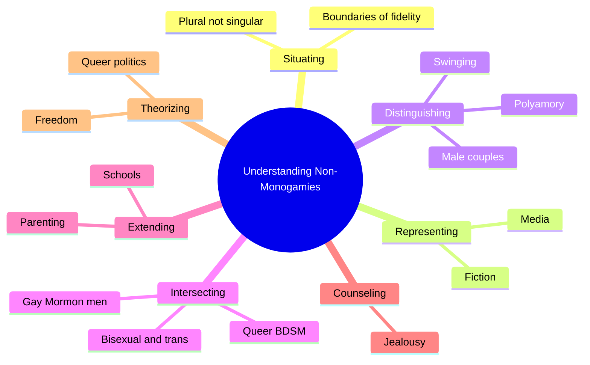
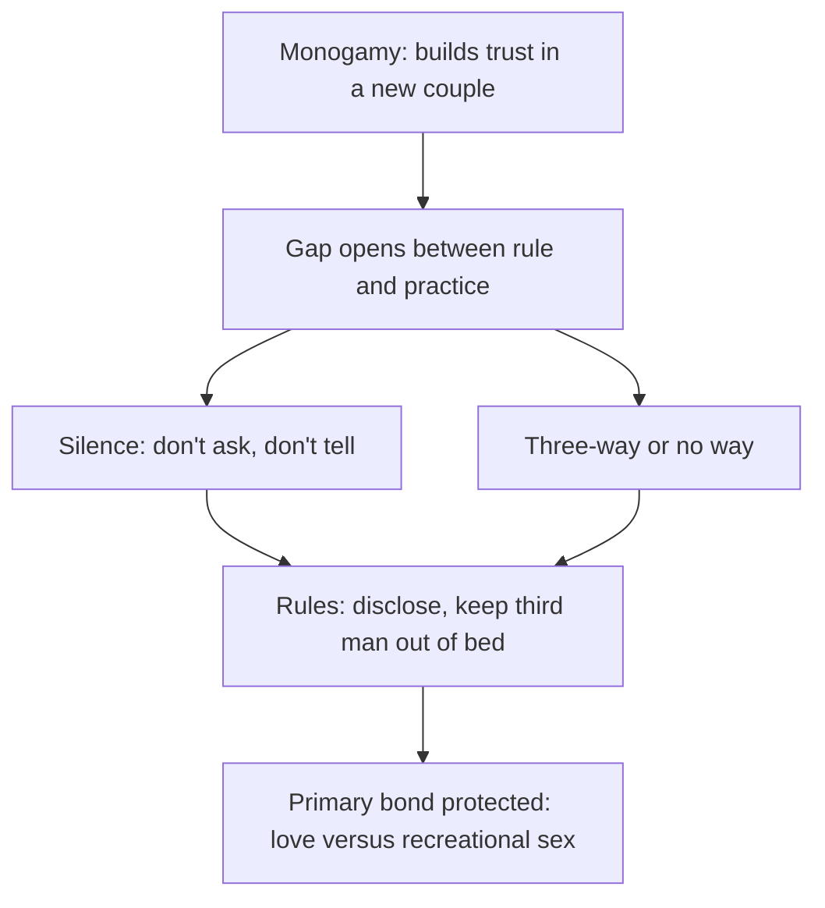
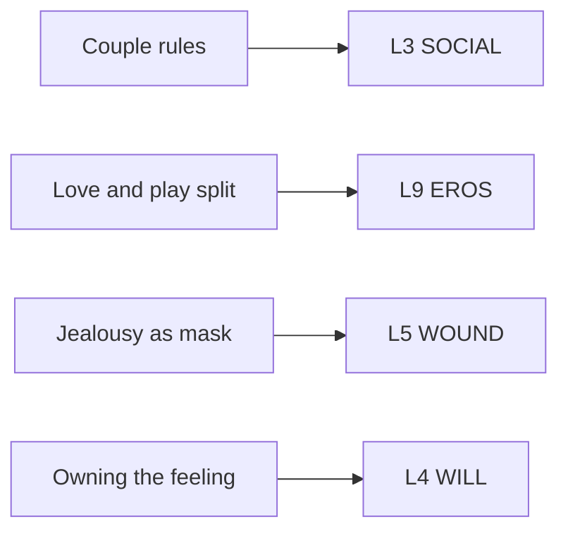

# 🧬 MSX.87 — Understanding Non-Monogamies — Barker & Langdridge, eds. (2010)
### Knowledge Entry — Distill

Fantasy, not a how-to: what happens in these pages stays in them. Reader discretion advised.

Meg Barker and Darren Langdridge edit twenty-six chapters on swinging, polyamory, open gay couples, queer BDSM, and the therapy and theory around them. This shelf keeps it for the gay-male, queer, and jealousy chapters.

## TABLE OF CONTENTS
- [Core Thesis](#1-core-thesis)
- [Mind Models](#2-mind-models)
- [Framework](#3-framework--structure)
- [Key Concepts](#4-key-concepts)
- [Heuristics](#5-heuristics--decision-rules)
- [Invariants](#6-invariants)
- [Pitfalls](#7-pitfalls--myths)
- [Application](#8-application)
- [Cross-References](#9-cross-references)
- [Provenance](#10-provenance--confidence)

---

## 1 · CORE THESIS

The editors argue that "non-monogamies" is plural because no single group, practice, or politics speaks for them all. Open arrangements often copy the couple form, and some stretch it. Gay men's couples show the common pattern: a primary bond plus rules that separate love from recreational sex.

---

## 2 · MIND MODELS

*Required. Minimum two diagrams, maximum five.*

**Diagram 1 — the whole argument.**
Caption: *seven parts run from situating and representing non-monogamies to the people, families, therapy, and theory around them.*

**Diagram 2 — the central mechanism (how male couples build rules).**
Caption: *monogamy usually comes first as a trust-builder, a gap between rule and practice follows, and couples then invent rules that protect the primary bond.*

**Diagram 3 — working with jealousy.**
Caption: *Easton's therapy moves jealousy from the partner back to the person who feels it, then builds comfort and boundaries.*

**Diagram 4 — mapped onto the 12-layer character stack.**
Caption: *the volume gives SOCIAL a rule set, EROS a love and play split, WOUND a mask, and WILL an owner for the fear.*

---

## 3 · FRAMEWORK / STRUCTURE

The book has seven parts and 26 chapters. The parts below are the ones this entry uses.

| Part and chapter (printed pages) | Governing move |
|---|---|
| I.1 Introduction (3-8) | Argues for the plural title, gives critical and celebratory views, and warns against speaking for everyone. |
| I.2 Frank and DeLamater (9-20) | Compares how married couples draw the line of fidelity, across monogamy and non-monogamy. |
| II Representing (23-52) | Looks at fiction, poly literature, and media. |
| III.6 Adam, male couples (55-69) | Interviews 70 men in same-sex couples about sex outside the relationship. |
| III.7-10 Swinging, Bay Area poly, young women (70-106) | Covers other forms. |
| IV.13 Montenegro (134-141) | Gay and bisexual Mormon men's views. |
| IV.14 Bauer (142-153) | Non-monogamy in queer BDSM communities. |
| V Extending (169-199) | Parenting, schools, foster care. |
| VI.21 Easton (207-211) | Therapy with jealousy. |
| VII Theorizing (225-266) | Freedom, privilege, queer politics, state. |

---

## 4 · KEY CONCEPTS

| Concept | What it is | Why it matters |
|---|---|---|
| **Non-monogamies, plural** | One group's story cannot stand for all (pp. 5-6). | Multiple meanings sit between and within groups. |
| **Mono-normativity** | The taken-for-granted idea that exclusive couples are the natural form (ch. 14, p. 145). | It shapes research and relationships. |
| **Boundaries of fidelity** | Couples draw the line by touch, by feeling, by imagination, or by secrecy (ch. 2, pp. 9-10). | Fidelity means different things to different couples. |
| **Open but dyadic** | Many open arrangements keep the couple as the center (p. 5). | Openness often protects the pair. |
| **Don't ask, don't tell** | A silence rule for outside sex (ch. 6, p. 60). | A common way to manage the gap between ideal and practice. |
| **Three-way or no way** | Outside sex only together (p. 63). | Keeps it above board. |
| **Love versus recreation** | Outside sex is play, and the partner is love (p. 64). | A male discourse separating sex-as-play from sex-as-love. |
| **Semiotic snare** | A "no cheating" rule can hide leaks, which raises HIV risk (p. 61). | A rule meant to protect can leave a partner exposed. |
| **Emotional monogamy** | Sexual or BDSM openness with emotional exclusivity (ch. 14, p. 146). | The most common queer BDSM model in Bauer's sample. |
| **Jealousy as stimulus** | Jealousy names a trigger, not one feeling (ch. 21, p. 208). | Each person's jealousy is its own mix. |
| **Making friends with jealousy** | Take care of it instead of eliminating it (p. 209). | The goal is comfort, not erasure. |
| **Vanguardism** | Elite writers deciding the correct form for others (p. 5). | The editors warn against it. |

---

## 5 · HEURISTICS & DECISION RULES

| Situation | Do this | Not this |
|---|---|---|
| A gay couple in a new relationship | Let them start monogamous, as a refuge from the scene's ephemerality (ch. 6, p. 58). | Give every gay couple an open arrangement at the start. |
| A couple with a gap between rule and practice | Show a silence rule, a slip, and a tense confession (p. 60). | Have the break come from a clear villain. |
| Opening the relationship | Use a three-way first, with a rule like three-way or no way (p. 62). | Jump to separate lovers. |
| A character who says "it's just sex" | Let him mean it and let his partner doubt it (p. 64). | Treat the claim as only a lie. |
| A jealous partner | Let the jealousy hide an older wound, then let him own it (ch. 21, pp. 209-210). | Make jealousy proof of love or proof of weakness. |
| A queer BDSM community scene | Let non-monogamy be the default and the monogamous pair feel pressured (ch. 14, p. 143). | Reverse the norm without noting the new pressure. |
| A man raised in a strict faith | Show the sex-negative messages absorbed from childhood (ch. 13, p. 135). | Give him no inherited script. |
| A young gay man | Let him want a boyfriend and casual sex "as if it is the central problem of their lives" (ch. 6, p. 57). | Settle the two wants early. |

---

## 6 · INVARIANTS

1. **Non-monogamies are plural.** No single practice or politics speaks for all (p. 6).
2. **Open does not mean unbounded.** Gay couples build rules, and every couple in Adam's sample had a primary bond with tacit or explicit understandings (ch. 6, p. 64).
3. **A plan matters more than which plan.** Consistent mutual understanding tracks satisfaction better than openness itself (ch. 6, pp. 56 and 64).
4. **Non-monogamy is not failure.** Open and closed gay couples show equal intimacy, security, and commitment in the studies Adam cites (p. 56).
5. **Monogamy is often an accomplishment.** Men present it as built, provisional, and revisited (ch. 6, p. 59).
6. **Jealousy is learned, and it can be unlearned.** Easton treats it as a path to change (ch. 21, p. 209).
7. **Fidelity is defined by each couple.** Definitions differ inside the same marriage (ch. 2, p. 20).

---

## 7 · PITFALLS / MYTHS

- **Edited collection.** Twenty-six chapters differ in method and quality. This entry read four and the introduction.
- **Small, local samples.** Adam interviewed 70 men in Ontario, recruited from the gay press and clubs. He says the numbers "cannot be generalized to gay men as a whole" (p. 57). Bauer interviewed 50 dyke+ and trans BDSM people, mostly white, and warns that people of color are underrepresented (ch. 14, pp. 144-145).
- **Dated statistics.** The 82 percent figure for male couples comes from Blumstein and Schwartz's 1983 study, from before the AIDS epidemic (ch. 6, p. 56).
- **Married straight couples.** Frank and DeLamater included only legally married couples, so no same-sex couples (ch. 2, p. 10).
- **Bauer is not about gay men.** The queer BDSM chapter covers dyke, trans, and queer communities. Its gay-male history is a brief origin story of the Old Guard (p. 143).
- **Optimism and skepticism both appear.** The editors note that research finds many open relationships copy the couple, and they challenge claims that non-monogamy is radical (pp. 4-5).
- **Not read.** Chapters on swinging, polyamorous families, bisexual and trans non-monogamy, and the theory chapters are absent from this entry.

---

## 8 · APPLICATION

*Proposed for the ORANGE work, not ruled.*

- **Spine level:** L5.
- **12-layer character stack:** L3 SOCIAL (agreement_style, primary); L9 EROS (intimacy_mode, primary); L5 WOUND (jealousy_mask, primary); L4 WILL (emotion_ownership, supporting); L7 ORIGIN (monogamy_norm_origin, contextual).
- **plot_systems:** a couple's rule and the day someone breaks or tests it drive a relationship plot.
- **Setting:** a scene where open arrangements are the default has its own pressures on a monogamous pair.

The volume gives the character system a way to write a couple. Every couple has an agreement, spoken or tacit. A writer can name it: don't ask, three-way only, disclose in 24 hours, no one in our bed. Each rule creates a scene that tests it.

The most useful tool is the love and play split. A man says the sauna is only sex and his partner is love. The reader can believe him and still feel the strain. That tension carries an explicit scene because the sex is not the whole subject.

The second tool is the jealousy mask. A character who explodes at an outside partner often hides an old fear. Easton's exercise of asking the jealousy for a letter gives a writer a tidy device: the character writes what the feeling wants.

The third tool is the gap between rule and practice. Adam's men begin with a rule, slip, and hide the slip. The hiding often hurts more than the act.

Proposed addition: an L3 field `couple_rules` (list of agreed rules plus whether each is spoken or tacit), paired with an L9 field `love_play_split` (clear, blurred, or none). Both give a writer a way to test a couple's bond with one broken rule.

This pairs with Weiss's cycle in [[🧬 PSY.57 — Cruise Control — Weiss (2013)]], which treats some of the same behaviors as compulsion. A writer can decide whether a scene reads as a negotiated arrangement or a hidden pattern, and the difference is whether the partner knows.

The ORANGE prose rulings apply as written. Explicit content is allowed, written as fantasy first, with the one-line container in the front matter.

---

## 9 · CROSS-REFERENCES

| Related entry | Relation |
|---|---|
| [[🧬 MSX.47 — The Ethical Slut — Easton & Hardy (2017)]] | Easton's chapter 21 here and the guide share the jealousy method and the consent definition. |
| [[🧬 PSY.65 — The Psychology of Sex — Barker (2018)]] | Barker's later short book summarizes non-monogamy and mononormativity for a general reader. |
| [[🧬 MSX.80 — SM 101 — Wiseman (1996)]] | The practice of negotiation that Bauer's queer BDSM community adapts to relationships. |
| [[🧬 PSY.57 — Cruise Control — Weiss (2013)]] | Weiss treats secret outside sex and double lives as compulsion, where Adam treats open couples as a working arrangement. |
| [[🧬 MSX.45 — Gay New York — Chauncey (1994)]] | The history of the urban gay world that Adam's men inherit. |

---

## 10 · PROVENANCE & CONFIDENCE

Full text, pdftotext extraction, about 126,000 words, 311 PDF pages. Title page confirms: Meg Barker and Darren Langdridge, eds., *Understanding Non-Monogamies*, Routledge Research in Gender and Society 23, Routledge, New York, 2010. Printed page equals PDF page minus 13, and citations use printed pages.

Read in full: Chapter 1 (pp. 3-8), the opening and conclusion of Chapter 2 (pp. 9-10 and 20), Chapter 6 by Barry Adam on male couples (pp. 55-65, roughly the first two thirds), the first five pages of Chapter 14 by Robin Bauer (pp. 142-146), and the first four pages of Chapter 21 by Dossie Easton (pp. 207-211). Read in part: the first two pages of Chapter 13 by José Miguel Montenegro (pp. 134-135).

Skipped: Chapters 3 to 5, 7 to 12, 15 to 20, 22 to 26, the reference list, and the index. The contents page and the editors' introduction supply the structure table.

Confidence is medium. The Adam, Bauer, and Easton material is quoted from the text. The rest of the volume is not covered.

## META
- Template: BVX-LEARN-v4.0
- Source classification: full-text pdftotext extraction, deep read on chapters 1, 6, 14 (opening), 21, short reads elsewhere
- Created / Updated: 2026-10-04
