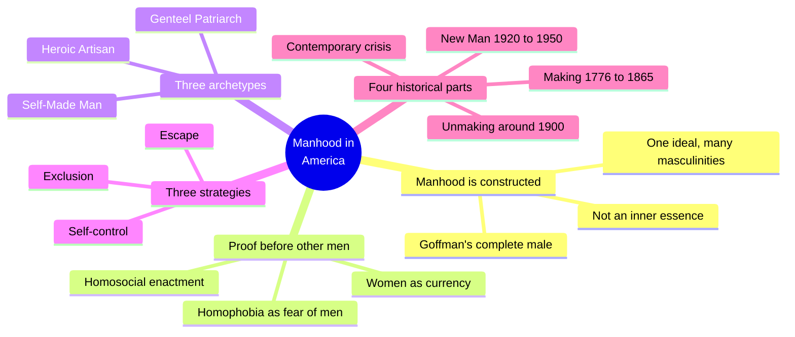
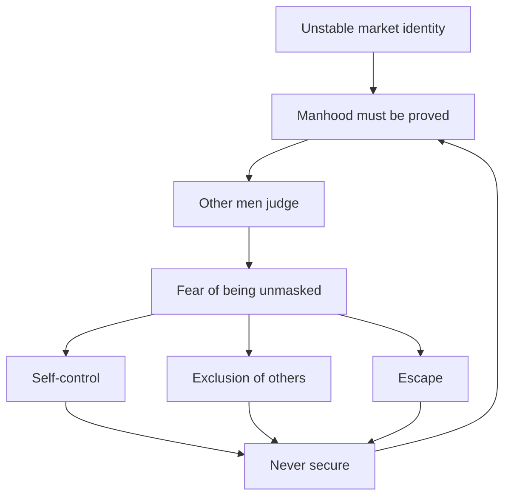
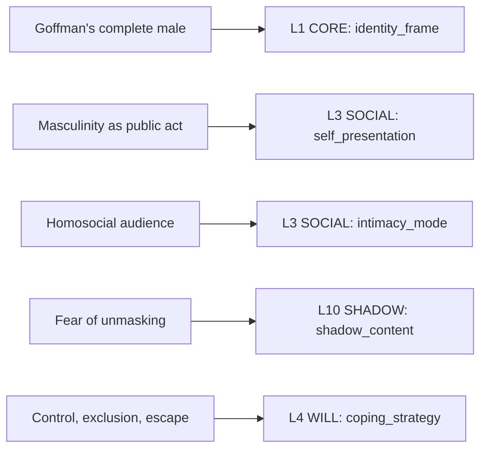

# 🧬 MSX.88 — Manhood in America — Kimmel (2006)
### Knowledge Entry — Distill

Michael Kimmel's cultural history of American masculinity, second edition (Oxford University Press, 2006), argues that American men spend their lives proving manhood to other men. The Command holds it for the history behind the "complete male," the homosocial audience, and the point where sexuality became a test of rank.

## TABLE OF CONTENTS
- [Core Thesis](#1-core-thesis)
- [Mind Models](#2-mind-models)
- [Framework](#3-framework--structure)
- [Key Concepts](#4-key-concepts)
- [Heuristics](#5-heuristics--decision-rules)
- [Invariants](#6-invariants)
- [Pitfalls](#7-pitfalls--myths)
- [Application](#8-application)
- [Cross-References](#9-cross-references)
- [Provenance](#10-provenance--confidence)

---

## 1 · CORE THESIS

Manhood is not an inner essence. It is a changing set of meanings, and since the early 1800s American men have had to prove it again and again, mostly in front of other men. The drive behind it is fear of being dominated or unmasked, not a wish to dominate.

---

## 2 · MIND MODELS

*Required. Minimum two diagrams, maximum five.*

**Diagram 1 — the whole argument.**
Caption: *the book's four parts follow one figure, the Self-Made Man, from his birth to his present anger; read the three themes as what he does when he feels unsafe.*

**Diagram 2 — the central mechanism (the proof cycle).**
Caption: *because the market never confirms a man for good, the test restarts every day; the three strategies are what he tries, and their failure is why the cycle repeats.*

**Diagram 3 — how sexuality entered the test.**
Caption: *around 1900 heterosexuality became a proof of rank; once it counted, effeminacy turned from a harmless difference into a threat.*

**Diagram 4 — mapped onto the Command's 12-layer character stack.**
Caption: *the book's weight falls on the social and shadow layers: the ideal sets IDENTITY, the audience of men sets SOCIAL, the fear of unmasking fills SHADOW.*

---

## 3 · FRAMEWORK / STRUCTURE

Kimmel gives two histories at once: the changing ideal, and the competing versions that live beside it (p. 4). He covers the ideal that Goffman calls "complete" and says outright that the book tells "only one version," the dominant one (p. 4).

| Part | Pages and span | What it argues |
|---|---|---|
| Introduction | pp. 1-7 | Men have "no history of themselves as men"; manhood is a social product; homosociality and fear drive it |
| One: Making of the Self-Made Man | ch. 1-2, 1776-1865 | The market frees men and unsettles them; the Self-Made Man defeats the other two archetypes |
| Two: Unmaking | ch. 3-5, c. 1865-1920 | Work gets crowded and precarious; sport and male-only rooms take over as proof |
| Three: The New Man | ch. 6-7, 1920-1960 | Manhood becomes a measurable test; suburban conformity follows |
| Four: Contemporary crisis | ch. 8-10 | Backlash, "angry white men," and the present |
| Epilogue | pp. 254-257 | Kimmel asks for "democratic manhood" |

---

## 4 · KEY CONCEPTS

| Concept | What it is | Why it matters |
|---|---|---|
| **Gender as constructed** | "The sets of cultural meanings and prescriptions that each culture attaches to one's biological sex" (p. 2) | Manhood changes by era, class and race; a character's version is dated |
| **Hegemonic masculinity** | The single model all men measure against, while many masculinities coexist (p. 4) | Explains why every man feels short at some moment |
| **Genteel Patriarch** | Land, manners, benevolent authority (p. 13) | The inherited standard of the old gentry |
| **Heroic Artisan** | Independent craftsman, loyal to male comrades, formal with women (p. 13) | The inherited standard of the working man |
| **Self-Made Man** | Identity "entirely from a man's activities in the public sphere," measured by wealth and mobility (p. 13) | The type that wins; "born anxious and insecure" (p. 6) |
| **Homosociality** | Masculinity enacted for other men's approval (p. 5) | Makes male friendship and male rivalry the same stage |
| **Homophobia (Kimmel's sense)** | "The fear of other men," that they will unmask us (p. 5) | Separates fear of men from fear of gay desire |
| **Effeminacy as a signal** | For fairies, effeminacy was "a behavioral strategy to signal other homosexual men" (p. 68, citing Chauncey) | Shows how a gay man could be seen as no threat to a straight man's rank |
| **Sexuality as proof** | Heterosexuality became "one of the hallmarks of a real man" (p. 69) | Moves sex from private act to public test |
| **The M-F test** | Terman and Miles's 456-item scale scoring masculinity against femininity (p. 137) | Turns manhood into a score and homosexuality into a "warning" |
| **Self-control, exclusion, escape** | The three recurring strategies (p. 6) | Gives a writer three default moves for a stressed man |

---

## 5 · HEURISTICS & DECISION RULES

| Situation | Do this | Not this |
|---|---|---|
| Writing a man's anxiety | Name the men who judge him: father, boss, rival, team | Write his anxiety as about women alone (p. 5) |
| Writing a man's aggression | Ask what he fears being seen as | Treat it as a plain wish to dominate (p. 4) |
| Writing a closeted or hiding man | Give him an audience of men to hide from (p. 5) | Give him only private guilt |
| Writing a gay man before 1930 | Let a visible subculture and open effeminacy exist (p. 68) | Assume a closet everywhere in history |
| Writing a straight man's rank | Show sexual conquest or exclusive desire as a public credential (p. 69) | Treat desire as only private |
| Writing a boy's training | Include a school, a coach, or an advice book that scores him (pp. 134-139) | Treat manhood as arriving unaided |
| Writing a failing strategy | Let control, exclusion or escape break down on the page (pp. 6, 256) | Reward the strategy permanently |

---

## 6 · INVARIANTS

1. Manhood is made by relationships and eras, not by anatomy (p. 3).
2. Men prove manhood mostly to other men (pp. 5, 19).
3. The proof never finishes, because the market never settles identity (p. 17).
4. One ideal standard sits over many real masculinities (p. 4).
5. Fear of being dominated explains men's behavior better than a wish to dominate (p. 4).
6. A group set up as "not manly" serves as a screen for the dominant group's fears (p. 4).
7. After about 1900 an exclusive desire for women counts as a credential (p. 69).

---

## 7 · PITFALLS / MYTHS

- **The book covers prescriptions, not practice.** Kimmel says it is "less about what boys and men actually did than about what they were told" (p. 7). Do not read it as a survey of behavior.
- **It describes the dominant version only.** Straight, white, middle-class, native-born men are the subject. The book says it does not tell the "others'" story "from their point of view nor in their own voices" (p. 4).
- **The gay-history material is borrowed.** The turn-of-century section leans on George Chauncey's *Gay New York* (p. 68). It is a secondary source here; read MSX.45 for the primary account.
- **The gender-test science is dated.** The M-F scale and the "strong mother makes a gay son" idea were taken as fact into the 1970s (p. 139); Kimmel reports them as history, not as findings to use.
- **The epilogue is advocacy.** The call for "democratic manhood" (p. 254) is the author's view, not a result.
- **Era limits.** The book stops in 2004. The 2006 edition adds a chapter on the 1990s onward that this distill did not read.

---

## 8 · APPLICATION

*Proposed for the ORANGE work and the 12-layer stack. Nothing here is ruled.*

- **Spine level:** L5, as assigned.
- **12-layer character stack:** L1 CORE (identity_frame primary) · L3 SOCIAL (self_presentation primary; intimacy_mode supporting) · L10 SHADOW (shadow_content primary) · L6 DRIVE (drive_texture primary; motivation_stack supporting) · L5 WOUND (triggers supporting) · L4 WILL (coping_strategy supporting) · L7 ORIGIN (origin_class supporting; origin_disciplinary_formation contextual) · L9 EROS (charmed_circle_position contextual).
- **plot_systems:** contextual. A fear of being unmasked in front of men gives any male ensemble a built-in engine: a locker room, a bar, a crew, a school.
- **Setting:** contextual. For the DCUS era and its sibling settings, a school's sport culture, dress code and advice literature are the "disciplinary" machinery that scores boys.

Kimmel's use for a writer is to move a man's anxiety off women and onto his male audience. A character who fears women's judgment writes one way. A character who fears men's judgment writes another, and the second is closer to the book.

Two proposed additions use names the stack already has. First, `coping_strategy` takes three starting values from p. 6: self-control, exclusion, escape. Second, `motivation_stack` gains an `audience` entry per motive, listing which men's approval each motive serves. Of the two, `audience` is the strongest proposed addition: it turns the book's central claim, men judge men, into a field a scene can read.

---

## 9 · CROSS-REFERENCES

| Related entry | Relation |
|---|---|
| [[🧬 MSX.45 — Gay New York — Chauncey (1994)]] | Kimmel's turn-of-century gay material comes from Chauncey; read the primary for the subculture |
| [[🧬 MSX.44 — Between Men — Sedgwick (1985)]] | Sedgwick's homosocial desire theory is the literary-critical twin of Kimmel's homosocial enactment |
| [[🧬 MSX.68 — Epistemology of the Closet — Sedgwick (1990)]] | The closet Kimmel dates to the 1930s (p. 135) is Sedgwick's subject |
| [[🧬 MSX.36 — The History of Sexuality — Foucault (1978)]] | Foucault's naming of the "homosexual species" is the discourse behind the sexuality-as-proof turn |
| [[🧬 PSY.50 — Sexual Behavior in the Human Male — Kinsey (1948)]] | The measurement culture the M-F test belongs to |
| [[BVX.1273]] | Masters and Johnson found male fear of failure targets erection; Kimmel supplies the audience |

---

## 10 · PROVENANCE & CONFIDENCE

The text is OCR of the Oxford University Press second edition (2006). The OCR has scanning errors, so every quote was checked against surrounding text; a few page numbers are inferred from the running heads. The title page and copyright page confirm Michael S. Kimmel and the 2006 date; the Preface says the first edition's argument stands and a new chapter covers 1994 to 2004.

Read in full or near-full: the Introduction (pp. 1-7); Chapter 1, "The Birth of the Self-Made Man," through the three archetypes, the market revolution and the cult of the Self-Made Man (pp. 11-21); the turn-of-century homosexuality passage in Chapter 3 (pp. 67-69); Chapter 6's sections on parental fear and the M-F test (pp. 134-139); the Epilogue (pp. 254-256).

Skipped: Chapter 1 from p. 22 on; Chapter 2 ("Born to Run"); the rest of Chapter 3; Chapters 4 and 5 (sport, male-only rooms); Chapter 6 outside the passages above; Chapters 7 to 10; the notes and index. Chapters 8 to 10 carry the contemporary material and are the largest gap.

The `feeds:` keying is this distill's own synthesis against the stack as of v2.5.0. Kimmel uses none of the stack's vocabulary. No new variable is coined: each name is an existing field or a read alias in the schema pass table. Confidence is medium: the argument is clear and well sourced, and the read is partial.

## META
- Template: BVX-LEARN-v4.0
- Source classification: full-text OCR extraction, deep read on the Introduction, Chapters 1, 3 and 6 (partial) and the Epilogue
- Created / Updated: 2026-10-04
