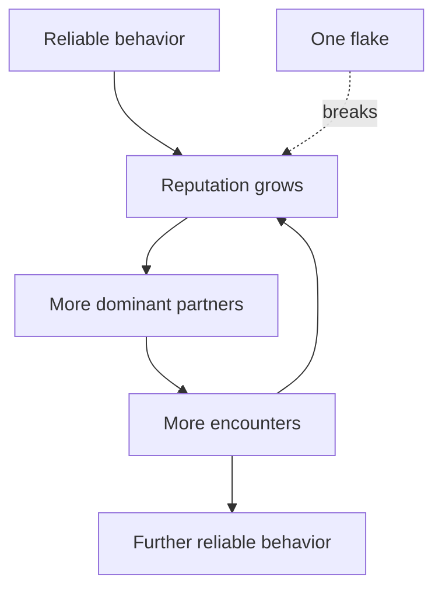
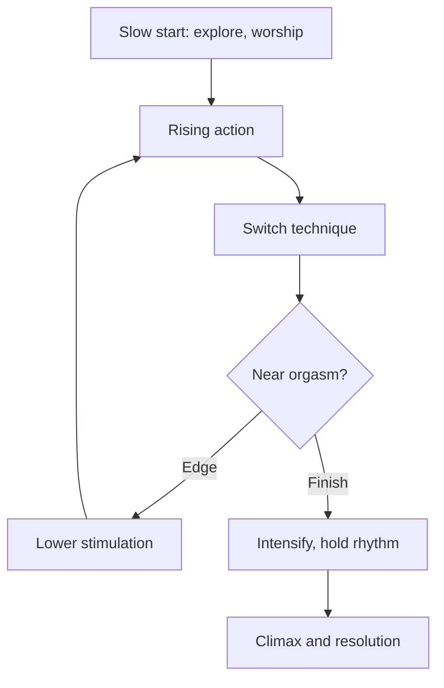
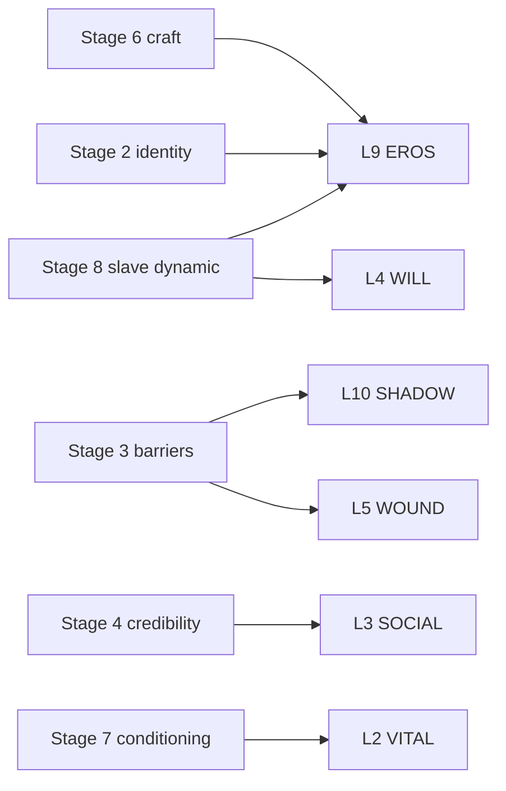

# 🧬 MSX.SET.01 — The FagMasterPDX Progression — FagMasterPDX (2017–2018)
### Knowledge Entry — Synthesis of three distills

This entry combines three distills by one author into one path: the frame (MSX.13), the identity (MSX.12), and the craft (MSX.11).

## TABLE OF CONTENTS
- [1 · The progression at a glance](#1--the-progression-at-a-glance)
- [2 · The stages](#2--the-stages)
- [3 · Where the books disagree or shift](#3--where-the-books-disagree-or-shift)
- [4 · Feeds the 12-layer character system](#4--feeds-the-12-layer-character-system)
- [5 · Correlation with the ORANGE work](#5--correlation-with-the-orange-work)
- [6 · Provenance](#6--provenance)

---

## 1 · THE PROGRESSION AT A GLANCE

**Why this order.** MSX.13 gives the frame, so it opens the path. MSX.13 itself says the order of study: first become a functioning "faggot" (MSX.12), then develop skills (MSX.11), then pursue slavery. The progression follows that stated order. The frame comes first for the reader because MSX.12 and MSX.11 both assume a dominant counterpart.

**Citation note.** The source distills carry no page numbers. Each claim cites the distill id and the section it comes from, such as "MSX.12 Invariant 4." Page numbers would need a fresh read of the PDFs.

**The path.**

1. **Stage 1, the frame.** Source: MSX.13, Core Thesis, Invariants 1–2, Core Concepts 1–2.
2. **Stage 2, the identity.** Source: MSX.12, Core Thesis, Core Concepts 1–3, Invariants 1–3.
3. **Stage 3, the barriers and the life around it.** Source: MSX.12, Core Concepts 6–7, and MSX.13, Invariant 6.
4. **Stage 4, credibility and conduct.** Source: MSX.12, Core Concepts 4–5 and 8, and MSX.13, Invariant 4.
5. **Stage 5, the mind in the act.** Source: MSX.11, Core Concepts 1 and 5, and MSX.12, Invariant 6.
6. **Stage 6, the craft.** Source: MSX.11, Core Concepts 2–4 and 7–8.
7. **Stage 7, conditioning and practice.** Source: MSX.11, Core Concept 6, and MSX.12, Invariant 7.
8. **Stage 8, the slave dynamic.** Source: MSX.13, Core Concepts 3–8.

**Diagram 1. The path from frame to slave dynamic.** Read it left to right: each stage is a prerequisite of the next, and the last returns to the first book.

---

## 2 · THE STAGES

### Stage 1 — The frame (MSX.13)

**Core idea.** The author describes a hierarchy of dominant ("Alpha") and submissive ("Beta") males (MSX.13 Core Concept 1). The dominant actualizes the submissive's latent identity through control. The book names this an architecture of total power exchange (MSX.13 Core Thesis). The book presents the hierarchy as innate. The distill notes that it works as consensual role-play in the language of essentialism.

**The rules.**
- The master imposes and the slave disposes. All authority flows one way (MSX.13 Invariant 2).
- Mastery and slavery are co-dependent. The relationship is the unit, not either person (MSX.13 Invariant 1; MSX.12 Invariant 3).
- Role integrity holds during engagement. The dominant does not slip into friendship, equality, or guilt (MSX.13 Invariant 4).
- Mastery is a gift to the submissive. The dominant's attention is the scarce resource (MSX.13 Invariant 3).
- Domination spans three domains: physical, mental, and financial (MSX.13 Core Concept 2).

**The practice.** The dominant keeps several social identities and switches cleanly between them (MSX.13 Core Concept 5). The master role is one committed mode among several. The dominant checks readiness first: channeled aggression, comfort with power, no guilt, and role stability (MSX.13 Heuristics).

### Stage 2 — The identity (MSX.12)

**Core idea.** The author calls an innate orientation toward sexual submission "faggot nature" (MSX.12 Core Concept 1). The book says it is unchosen and can only be acknowledged or suppressed. Suppression causes misery, and surrender produces freedom (MSX.12 Invariant 1).

**The paradox.** The submissive finds fulfillment by giving up the pursuit of its own fulfillment (MSX.12 Core Concept 2). The distill compares this to mystical self-emptying. The book's line is "A faggot's pleasure exists in surrendering all thought of its own pleasure."

**The rules.**
- Identity is performed, not declared. The submissive is what it does (MSX.12 Invariant 2).
- The submissive does not exist apart from the dominant (MSX.12 Invariant 3).
- A "made faggot" is activated through encounters with dominants, not through self-declaration (MSX.12 Key Vocabulary).
- The "fantasy faggot" desires the life but never acts. The book uses this as a term of contempt (MSX.12 Key Vocabulary).

**The practice.** The reader reads the Ten Faggot Commandments as the behavioral minimum (MSX.12 Core Concept 4). They include serving without discrimination, never refusing, hygiene, never flaking, deference, and presenting oneself as an object for service. The reader treats the Ideal Faggot as a north star. The book says no one reaches it (MSX.12 Core Concept 3).

### Stage 3 — The barriers and the life around it (MSX.12, MSX.13)

**Core idea.** The book says fear is the main obstacle, not lack of skill or opportunity (MSX.12 Invariant 5). It lists the barriers: disease fear, poor self-image, guilt and shame, exposure fear, relationship constraints, and daily obligations (MSX.12 Core Concept 6).

**The rules.**
- The barrier is mental, and action dissolves it (MSX.12 Core Concept 6).
- Resistance signals a growth opportunity. The reader leans toward it (MSX.12 Heuristics).
- Hard limits mean safety. Comfort-zone limits mean fear or ego. The reader respects the first and pushes on the second (MSX.12 Heuristics; MSX.13 Heuristics).
- Post-encounter guilt is residual conditioning. It should not start a suppress-and-binge cycle (MSX.12 Heuristics).
- Inside the frame, conventional morality is suspended. Outside it, normal social codes apply (MSX.13 Invariant 6).

**The practice.** The reader compartmentalizes. The ordinary life is infrastructure for the sexual life, and both selves are real (MSX.12 Core Concept 7). The book calls this the "Normal/Whoremal Balance." The wall between compartments must not leak in either direction. MSX.13 states the same rule for the dominant (MSX.13 Heuristics).

### Stage 4 — Credibility and conduct (MSX.12, MSX.13)

**Core idea.** Credibility is earned through consistency and never claimed (MSX.12 Invariant 4). The book calls this reputation "fag cred."

**The rules.**
- The reader shows up reliably and never flakes. One flake can destroy months of cred (MSX.12 Invariant 4).
- The reader does not fabricate experience or exaggerate credentials (MSX.12 Heuristics).
- The dominant verifies a track record before investing mastery (MSX.13 Heuristics). Self-declarations are not enough.

**The practice.**
- The "slut-cred cycle" is a loop. Activity builds reputation, reputation attracts partners, and partners provide encounters (MSX.12 Core Concept 8).
- "Faggot magnetism" is the same loop described as karma (MSX.12 Core Concept 5). The distill explains it with reputation, visibility, word of mouth, and availability.
- The reader widens availability windows, uses several platforms, and trains physically (MSX.12 Heuristics).
- The reader keeps a "slut journal" to track encounters and growth (MSX.12 Key Vocabulary).
- The reader shows deference to a new dominant through body language first (MSX.12 Heuristics).

**Diagram 2. The credibility loop.** Read it as a cycle: reliable behavior feeds it, and one flake breaks it.

### Stage 5 — The mind in the act (MSX.11, MSX.12)

**Core idea.** MSX.11 says elite oral sex is 70% psychological orientation and 30% technique (MSX.11 Core Thesis). MSX.12 agrees that the mental dimension outweighs the physical (MSX.12 Invariant 6). A device can copy the sensation. It cannot copy visible desire, devotion, and ego-dissolution (MSX.11 Invariant 2; MSX.12 Invariant 6).

**The rules.**
- Mindset governs performance (MSX.11 Invariant 1).
- The receiver's pleasure is physical and psychological. The performer serves both (MSX.11 Invariant 2).
- The performer prepares mentally before contact, not distracted or rushed (MSX.11 Heuristics; MSX.12 Heuristics).

**The practice.**
- The performer aims for "the zone." This is a flow state where self-consciousness dissolves (MSX.11 Core Concept 1; MSX.12 Key Vocabulary). The books use one name for the same state.
- The performer cannot force the zone. The performer facilitates it through preparation (MSX.11 Core Concept 1).
- The mental-prep protocol offers two methods. One is a repeated mantra. The other is "first time" visualization (MSX.11 Core Concept 5).
- MSX.12 adds the "fleshlight mindset." The performer thinks of itself as an object existing for the dominant's use (MSX.12 Key Vocabulary).
- MSX.12 adds physical prep: hygiene, lube, and logistics (MSX.12 Heuristics).
- The performer who feels pain breathes through it. The book treats pain as temporary and threshold-based (MSX.12 Heuristics).

### Stage 6 — The craft (MSX.11)

**Core idea.** Tension before release sets the intensity of the climax (MSX.11 Invariant 3). The book's line is "In orgasm as with stories, the greater the built-up tension, the more powerful the climax."

**The rules.**
- Variety prevents habituation. The performer alternates technique, tempo, pressure, and focus (MSX.11 Invariant 4).
- Reading nonverbal feedback is the highest-order skill (MSX.11 Invariant 6).
- The performer does not stop until told to stop or physically separated (MSX.11 Heuristics).
- The performer never uses teeth (MSX.11 What Doesn't Work).
- The performer treats partners' anatomy as different (MSX.11 What Doesn't Work).
- Advanced techniques wait until baseline competence exists (MSX.11 What Doesn't Work).

**The practice.**
- **The story arc.** The session runs from inciting incident to rising action, then technique switches, building tension, climax, and resolution (MSX.11 Core Concept 2). A straight line produces a weaker climax.
- **Start slow.** The performer reveals the best techniques progressively (MSX.11 Heuristics).
- **Edging.** The performer brings the receiver to the brink, then shifts to lower stimulation and rebuilds (MSX.11 Core Concept 3). The book counts an accidental climax as still positive. The performer does not stop all contact, because that kills the arc.
- **Hand-tube.** The hands grip the shaft flush against the lips and move with the head (MSX.11 Core Concept 4). It extends depth and eases jaw fatigue. It slightly reduces suction.
- **Fatigue.** The performer shifts to hand-integrated technique or to shaft and ball attention (MSX.11 Heuristics).
- **Reading feedback.** The cues are shaft hardness, hip movement, hand pressure on the head, breathing, pre-ejaculate flow, and testicular retraction (MSX.11 Core Concept 7). The book recommends gloryhole practice as training, because only cock-transmitted feedback is available there.
- **Uncut partners.** The performer starts with the inner foreskin, never forces it back, and moves to the glans afterward (MSX.11 Core Concept 8).
- **Named techniques.** Head sucking, crossada, abaniko, and corpus spongiosum massage appear in the vocabulary (MSX.11 Key Vocabulary).
- **Prostate tickle.** The book presents it as high reward and requires explicit consent (MSX.11 Key Vocabulary).

**Diagram 3. The session arc with edging.** Read it as a loop: the performer rebuilds after each retreat before the release.

### Stage 7 — Conditioning and practice (MSX.11, MSX.12)

**Core idea.** Endurance is a trainable physical skill (MSX.11 Invariant 5). Jaw fatigue, gag reflex, and neck strain are fitness problems, not talent problems.

**The rules.**
- Practice must be consistent and deliberate. Occasional practice produces haphazard gains (MSX.11 Invariant 7).
- Pain is a threshold, not a wall. Progressive conditioning turns pain from a stop signal into a transition marker (MSX.12 Invariant 7).
- The performer neglects neither jaw nor throat conditioning (MSX.11 What Doesn't Work; MSX.12 What Doesn't Work).

**The practice.**
- The solo regimen covers jaw endurance, gag-reflex suppression, and neck and tongue conditioning (MSX.11 Core Concept 6).
- Jaw work uses mouth-gag training for sustained open-mouth stamina.
- Gag work uses graduated depth: toothbrush, then dildo, then fuck machine.
- On a gag trigger, the performer breathes through the nose, relaxes the throat, and approaches depth progressively (MSX.11 Heuristics). Holding breath and tensing worsens the reflex.
- The book calls these measurable fitness metrics that need progressive overload (MSX.11 Core Concept 6).
- Solo training runs between live encounters (MSX.11 Quick Self-check).

**Risk flag, carried once.** MSX.12 and MSX.11 both tell the reader to push through discomfort. MSX.12 lists fear of disease among the barriers and counters it with action (MSX.12 Core Concept 6). The distills record no medical qualification for these claims.

### Stage 8 — The slave dynamic (MSX.13)

**Core idea.** The book treats slavery as the last stage. The submissive must first complete the foundation: identity acceptance (MSX.12), skill (MSX.11), and consistency (MSX.13 Core Concept 3).

**The rules.**
- The worthy slave shows obsessive desire for service, acceptance of inferior status, tolerance for pain and degradation, and willingness to surrender resources. It shows total obedience and consistency over time (MSX.13 Core Concept 3).
- The dominant accepts no untested submissive who has only fantasized (MSX.13 Heuristics).
- The dominant starts with clear, simple commands. Obedience on small things comes before demands on extreme things (MSX.13 Heuristics).
- Escalation is progressive. Stasis is decay (MSX.13 Invariant 5).
- Reward is more service, not equality. Punishment is proportional and pedagogical (MSX.13 Core Concept 7).
- Inconsistent reinforcement produces confused slaves (MSX.13 Core Concept 7).
- Generosity flows laterally among dominants. The master shares the slave's service and does not hoard (MSX.13 Invariant 7).

**The practice.**
- **Taxonomy.** The book lists seven types of slave: cocksucker, cumdump, tribute slave, sissy, urinal, house slave, and total slave (MSX.13 Core Concept 4). The master finds the natural orientation and expands from it.
- **Contracts.** The parties write terms, scope, protocols, finances, duration, and exit conditions (MSX.13 Core Concept 8). The contract is not legal but is psychologically strong. The book recommends short terms first.
- **Financial domain.** Tribute is payment from slave to master (MSX.13 Key Vocabulary).
- **Breeding.** The book defines it as sexual use by the master or other dominants (MSX.13 Key Vocabulary).

**Risk flag, carried once.** MSX.13 treats the financial domain as "tribute, exploitation, economic control." The distill marks the hierarchy as role-play in essentialist language. The dynamic is described as consensual, and the distill gives no safeguards beyond contract exit terms.

---

## 3 · WHERE THE BOOKS DISAGREE OR SHIFT

- **Scope.** MSX.13 addresses the dominant. MSX.12 and MSX.11 address the submissive or performer.
- **Who holds the voice.** MSX.12 treats the identity as the submissive's own. MSX.13 treats it as actualized by the dominant.
- **Limits.** MSX.12 and MSX.13 both separate hard limits from comfort-zone limits. MSX.12 also says to push on the second without a safety test beyond fear versus ego.
- **Pace.** MSX.11 says start slow and baseline first. MSX.12 says act consistently and widen availability.
- **Verbal stop.** MSX.12 tells the submissive not to say stop once the encounter begins. MSX.11 tells the performer to stop only on a clear signal. MSX.11 also requires explicit consent for the prostate tickle.
- **Equality.** MSX.12 describes negotiating as equals as a mistake with a new dominant. MSX.13 recommends contracts, which are negotiated.
- **Framing.** MSX.13 frames the hierarchy as innate. Its own distill calls it consensual role-play. MSX.12 frames the orientation as innate and unsuppressible.
- **Ethics.** MSX.13 suspends morality inside the frame. MSX.11 gives a neutral craft account with no such suspension, and calls tension a universal principle.

---

## 4 · FEEDS THE 12-LAYER CHARACTER SYSTEM

None of the three source distills declared `feeds:`. This merged map is proposed, and Chief confirms it. Layer names follow BVX.0075.

| Layer | Variable | Strength | From |
|---|---|---|---|
| L1 CORE | belief: surrender produces freedom, or imposition is right | contextual | MSX.12 Invariant 1; MSX.13 Invariant 2 |
| L2 VITAL | endurance, jaw, throat, conditioning level | contextual | MSX.11 Invariant 5; MSX.12 Invariant 7 |
| L3 SOCIAL | compartments, reputation (fag cred), deference signals | supporting | MSX.12 Core Concepts 7–8; MSX.13 Core Concept 5 |
| L4 WILL | surrender or command; role integrity | supporting | MSX.13 Invariants 2 and 4; MSX.12 Invariant 3 |
| L5 WOUND | guilt and shame conditioning, fear as the barrier | supporting | MSX.12 Core Concept 6, Heuristics |
| L6 DRIVE | service as the want; escalation as the engine | contextual | MSX.12 Core Concept 2; MSX.13 Invariant 5 |
| L7 ORIGIN | "unchosen" orientation as the character's own origin story | contextual | MSX.12 Core Concept 1 |
| L8 IMPRINT | the first-time intensity; encounter history, slut journal | contextual | MSX.11 Core Concept 5; MSX.12 Key Vocabulary |
| L9 EROS | desire role pole, taxonomy type, craft, preferences | primary | MSX.13 Core Concept 4; MSX.11 Core Concepts 2–8 |
| L10 SHADOW | the gap between the public self and the hidden compartment | supporting | MSX.12 Core Concept 7 |
| L11 DESTINY | the trajectory: faggot, then skilled, then slave | contextual | MSX.13 Core Concept 3 |
| L12 FUNCTION | the role a character plays for others: dominant, tribute, shared partner | contextual | MSX.13 Core Concept 4, Invariant 7 |

**Diagram 4. Source terms mapped to layers.** Read it as the stage-to-layer wiring: stages 2, 6, and 8 land on L9.

The `spine: [L5]` key is the story-spine scale. It is a separate axis from the L1–L12 character stack above.

---

## 5 · CORRELATION WITH THE ORANGE WORK

These are proposed links. Chief confirms or strikes each one.

- **BOLO 24, the studio launch.** Proposed: stages 4 and 6 supply the conduct and craft vocabulary for any studio-facing character work.
- **BOLO 27, ULTRA DARK.** Proposed: stages 1 and 8 supply the hierarchy and taxonomy vocabulary for the ULTRA DARK tree.
- **BOLO 88, the sexuality shelf.** Proposed: this entry sits on the shelf as the MSX set entry covering the three books in order.
- **The character system's L9 EROS.** Proposed: section 4's L9 row is the first draft of an EROS field list.

---

## 6 · PROVENANCE

- **Sources.** MSX.13 (ALPHA-BETA, 2017), MSX.12 (The Faggot Bible, 2018), and MSX.11 (How to Suck Cock Like a Pro, 2018). All three are BVX-LEARN v2 one-sheets dated 2026-04-04.
- **Method.** This is a combination of distills, not a fresh read of the PDFs. Every claim traces to a section of a source distill.
- **Page citations.** None are available, because the source distills carry no page numbers.
- **Overlaps merged.** The zone (MSX.11 and MSX.12), the mental dimension over the physical (MSX.11 Invariant 2 and MSX.12 Invariant 6), compartmentalization (MSX.12 and MSX.13), and the hard-limit versus comfort-zone split (MSX.12 and MSX.13).
- **Confidence.** Medium. The order and the section 4 layer wiring are the synthesizer's proposals.

## META
- Template: BVX-LEARN-v4.0 shape, adapted for a synthesis
- Source classification: three distills, one author
- Created: 2026-10-04
