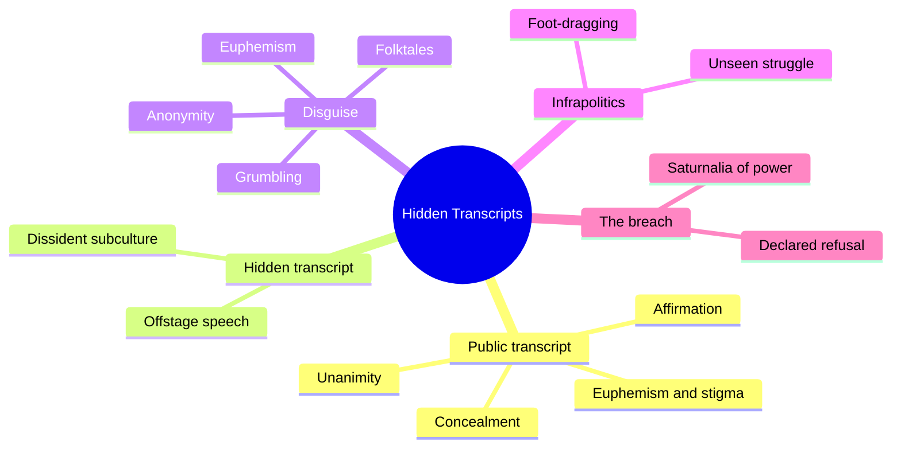
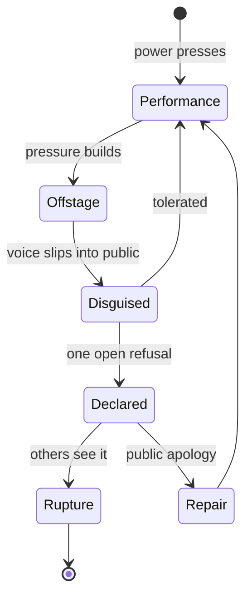
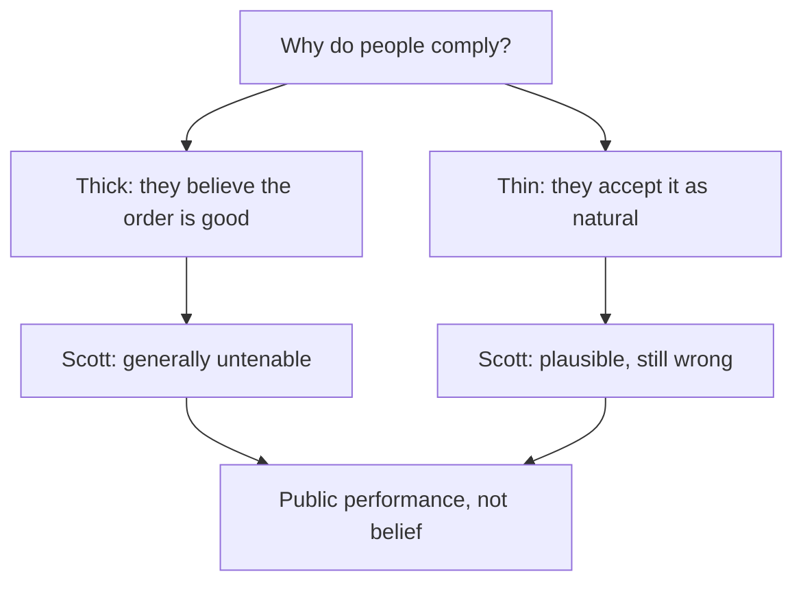
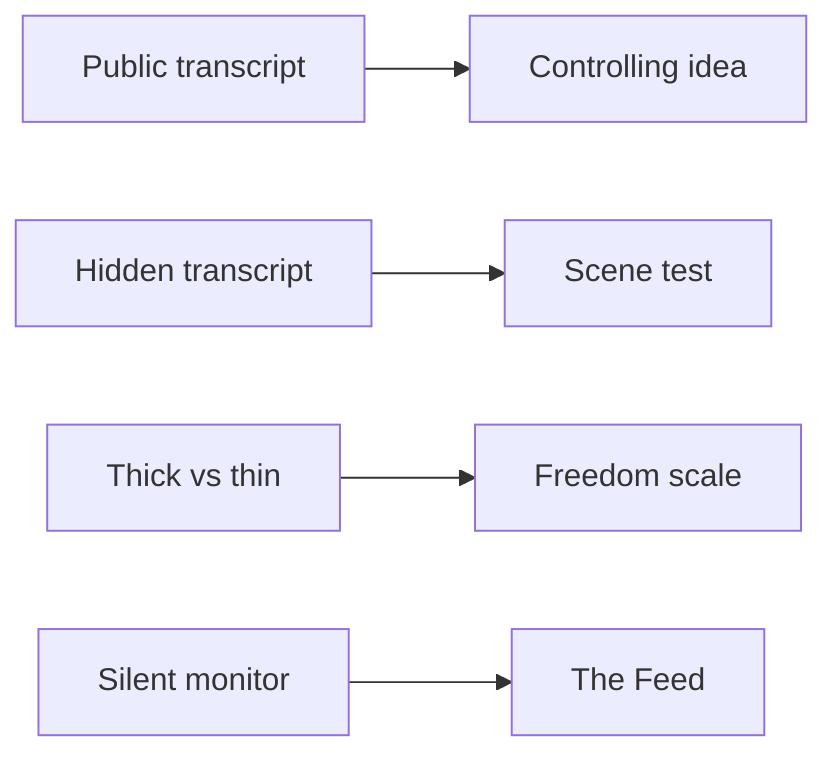

# 🧬 PHI.03 — Domination and the Arts of Resistance — Scott (1990)
### Knowledge Entry — Distill

A political anthropologist's study of what people say to power and what they say behind its back. It is in the library because the theme system needs a precise account of how a system gets consent without belief.

## TABLE OF CONTENTS
- [Core Thesis](#1-core-thesis)
- [Mind Models](#2-mind-models)
- [Framework](#3-framework--structure)
- [Key Concepts](#4-key-concepts)
- [Heuristics](#5-heuristics--decision-rules)
- [Invariants](#6-invariants)
- [Pitfalls](#7-pitfalls--myths)
- [Application](#8-application)
- [Cross-References](#9-cross-references)
- [Provenance](#10-provenance--confidence)

---

## 1 · CORE THESIS

Scott says people under domination keep two scripts. They perform deference for the powerful and speak plainly offstage. A reader who sees only the public script mistakes compliance for consent. Open refusal breaks that surface, so power punishes it most.

---

## 2 · MIND MODELS

**Diagram 1 — the whole argument.**
Caption: *one idea runs through eight chapters: the public script, the hidden script, the disguises between them, and the moment they collide.*

**Diagram 2 — the central mechanism (the two scripts under pressure).**
Caption: *the harder the power presses, the thicker the mask and the more pressure builds offstage, until one declared act breaks the surface.*

**Diagram 3 — the two theories of consent.**
Caption: *Scott says the strong claim (they believe) fails, and the weak claim (they resign themselves) is easier to defend but still misreads quiet.*

**Diagram 4 — mapped onto the Command's theme layer.**
Caption: *Scott's two scripts become a per-scene test, and his thin and thick theories refine the top gauge step.*

---

## 3 · FRAMEWORK / STRUCTURE

The book has eight chapters (Contents, p. viii).

| Ch. | Title | Job | Pages |
|---|---|---|---|
| 1 | Behind the Official Story | Defines the public and hidden transcripts | pp. 1-16 |
| 2 | Domination, Acting, and Fantasy | Links power, role-playing, and revenge fantasy | pp. 17-44 |
| 3 | The Public Transcript as a Respectable Performance | What the public script does for the powerful | pp. 45-69 |
| 4 | False Consciousness or Laying It on Thick? | Tests the hegemony theories | pp. 70-107 |
| 5 | Making Social Space for a Dissident Subculture | How the hidden script gets a home | pp. 108-135 |
| 6 | Voice under Domination | The disguises voice takes in public | pp. 136-182 |
| 7 | The Infrapolitics of Subordinate Groups | Quiet resistance as real politics | pp. 183-201 |
| 8 | A Saturnalia of Power | What happens when the hidden script goes public | pp. 202-227 |

---

## 4 · KEY CONCEPTS

| Concept | What it is | Why it matters |
|---|---|---|
| **Public transcript** | The open interaction between those who dominate and those who are dominated (p. 2). | What a scene shows when a superior is watching. |
| **Hidden transcript** | Speech, gesture, and practice offstage that confirm, contradict, or inflect the public one (pp. 4-5). | What a scene shows when the superior leaves. |
| **Thicker mask** | The more menacing and arbitrary the power, the more stereotyped and ritual the public script (p. 3). | A dial for how much a scene's surface can be trusted. |
| **Disguise and surveillance** | Subordinates read the powerful while hiding their own reading ("Play fool, to catch wise") (pp. 3-4). | Names a two-way watching that the Feed's world already has. |
| **Public script skews to the libretto** | Barring a crisis, public action follows the dominant side's script (p. 4). | Explains why surface evidence always seems to support consent. |
| **Euphemism and stigma** | The powerful sanitize coercion in words, and brand challengers as bandits or "deviant" (pp. 53-55). | Plain words for how a system names its own violence. |
| **Appearance of unanimity** | Elites hide discord and show subordinates as consenting (pp. 55-58). | Why a visible dissenter does so much damage. |
| **Public apology as symbolic tax** | An apology repairs the public script, not the truth. Sincerity is beside the point (pp. 57-58). | A device for the rivalry's contest over whose account stands. |
| **Thick and thin false consciousness** | Thick: subordinates endorse the order. Thin: they take it as natural and inevitable (p. 72). | Splits the top Freedom step. |
| **Naturalization of arbitrariness** | Bourdieu: every established order tends to make its own arbitrariness look natural (p. 75). | The world rail's claim, in a sentence. |
| **Practical failure vs. declared refusal** | Not complying in practice may pass unseen. A declared refusal almost always breaches the order (p. 203). | A precise definition of a refusal that costs something. |
| **Infrapolitics** | The low-profile daily struggle of subordinate groups, invisible by design (p. 183). | Names resistance that is not a revolt. |
| **Disguised voice** | Messages and messengers can be disguised: anonymity, euphemism, grumbling, folktales (pp. 138-139). | Tools for characters who cannot speak openly. |

---

## 5 · HEURISTICS & DECISION RULES

| Situation | Do this | Not this |
|---|---|---|
| A scene shows quiet compliance | Ask whose script it is and who is watching (pp. 3-4) | Read the surface as belief |
| A powerful figure is present | Thicken the mask: more ritual, less candor (p. 3) | Let subordinates speak plainly in front of power |
| A character wants to speak truth | Find the safe offstage audience first (pp. 5-6) | Have the truth appear with no cost |
| A character defies a norm | Decide if it is a practical lapse or a declared refusal (p. 203) | Treat every lapse as rebellion |
| A system must look fair | Show its euphemisms and who is branded for questioning them (pp. 53-55) | Show the system as openly cruel |
| The system must look united | Show elites hiding their disputes (pp. 55-57) | Show elites fighting in public |
| A refusal lands | Show the symbolic repair attempt, such as an apology (pp. 57-58) | Let the system ignore the breach |

---

## 6 · INVARIANTS

1. Relations of domination are also relations of resistance. Domination needs constant upkeep (p. 45).
2. The public script is not the whole story (p. 3).
3. The hidden script is made for a different audience under different constraints, so it is not simply "the truth" (p. 5).
4. Elites make a steady effort to keep disputes about their power out of public view (p. 56).
5. One open act of insubordination calls into question every other act of deference (p. 205).

---

## 7 · PITFALLS / MYTHS

- Reading silence as consent. Scott's cases show the hidden script is often at "complete odds" with the public one (p. 5).
- Assuming a hidden script is always honest. It also has its own audience and limits (p. 5).
- Treating offstage venting as harmless. Scott argues safety-valve theories fit the evidence poorly (pp. 185-186).
- Over-reading the mask theory. Scott cites it, then says there is ample reason to reject it (n. 20, p. 77).
- Reading this entry as the whole book. Several chapters were sampled (see Provenance).

---

## 8 · APPLICATION

*Everything in this section is proposed, never ruled.*

- **Spine level:** L6.
- **Controlling idea.** Scott shows why the sentence feels true to anyone who watches only the surface. The public script follows the powerful side's lines (p. 4). Proposed rider: the sentence claims compliance, not belief. Scott says the belief claim is "generally untenable" (p. 72).
- **Value scale.** The ruled top step of Freedom reads *"The cage feels like home."* That is the thick theory. Scott says it fails (p. 72). Proposed rider: a scene that plays this step must show the offstage seam, or it overclaims. A thin variant, *"It's just how things are,"* may sit beside it. The ruled words stay as they are.
- **Rails.** Bourdieu's line, that an order naturalizes its own arbitrariness (p. 75), is the world rail: *they already know how you'll turn out*. Scott's apology device (pp. 57-58) suits the rivalry rail: whose account stands is a question about the public script.
- **Motifs.** Owen's "silent monitor" is a near twin of the Feed. Each worker wore a four-color block showing yesterday's judgment, and a "book of character" kept the record (pp. 46-47). The uniform and the mirror gain a rival reading. Scott rejects the claim that a wearer becomes the mask (p. 77, n. 20). The mirror motif can show the wearer who knows it is a mask.
- **The Stop.** Proposed: Tori's refusal reads strongest as a *declared* refusal, not a practical failure (p. 203). A declared refusal "almost always" breaches the order. A quiet lapse often does not.
- **Civilization gauges.** The Power Line could echo Scott's electric fence. Sheep kept clear of a fence whose power was off (p. 48, n. 6). That suggests a shield that works by memory.
- **Strongest single addition (proposed).** A two-transcripts test on every scene card. The card names whether the scene plays on the public script or the hidden one, and shows what changes between them.

---

## 9 · CROSS-REFERENCES

| Related entry | Relation |
|---|---|
| [[BVX.1203]] | Stangneth: a perpetrator who staged a public script (the cautious bureaucrat) over a hidden one |
| [[BVX.1200]] | Burke: the scene-act claim that the public script makes look true |
| [[BVX.1201]] | Thematics: a stated formula that can cover a latent theme |
| [[MSX.36]] | Foucault: the mechanism line; Scott cites the medicalizing of stigma (p. 55) |
| [[BVX.0236]] | Coyne: the value spectrum these riders refine |

---

## 10 · PROVENANCE & CONFIDENCE

Source: a pdftotext extract of the 1990 Yale edition. Printed folios were read from the running heads and checked against the PDF.

**Read in full:** chapter 1, pp. 1-6 (both transcripts defined, plus the Aggy case); chapter 3, pp. 45-59 (affirmation through the parade versus crowd section's start); chapter 4, pp. 70-77 (the thick and thin theories); chapter 8, pp. 202-205. **Read in part:** chapter 6, pp. 136-139 only; chapter 7, pp. 183-186 only; the Preface. Chapter 1, pp. 7-16, was not read.

**Not read:** chapter 2; chapter 5; the rest of chapter 3 (pp. 60-69); the rest of chapter 4 (pp. 78-107); the rest of chapter 6 (folk tales, carnival, pp. 140-182); the rest of chapter 7 (pp. 187-201); the rest of chapter 8 (pp. 206-227); the bibliography. Claims here do not cover those pages.

Confidence is medium. The two-script model and the thin and thick theories are page-checked. The application to OXO is this entry's own proposal.

## META
- Template: BVX-LEARN-v4.0
- Source classification: full-text book, sampled extraction
- Created / Updated: 2026-10-04
