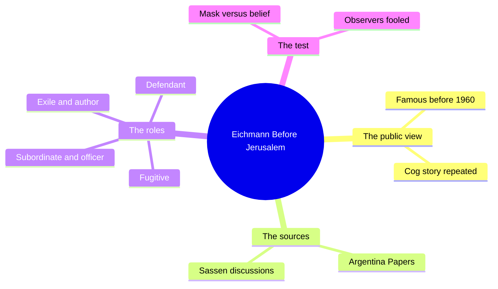
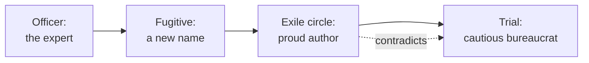
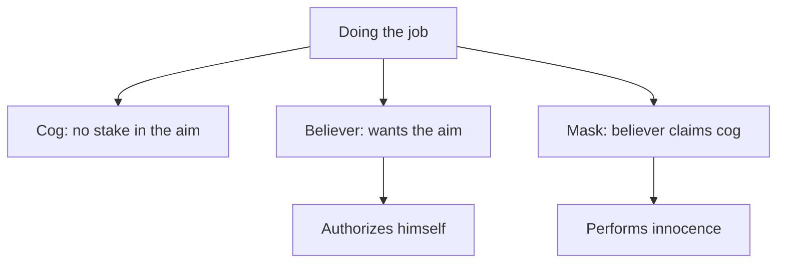
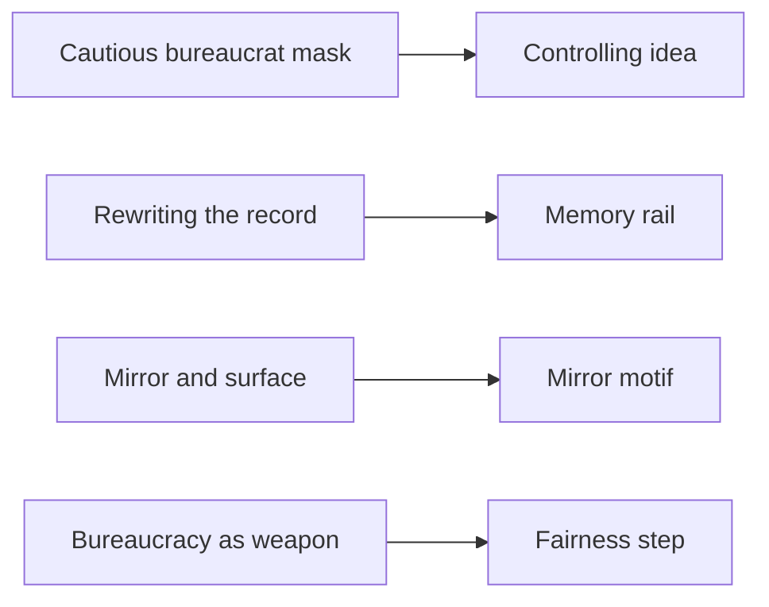

# 🧬 PHI.04 — Eichmann Before Jerusalem — Stangneth (2014)
### Knowledge Entry — Distill

A historian's study of Adolf Eichmann's postwar writing and recorded talk, set against the story he told at his 1961 trial. It is in the library because it tests the claim "I only did my job" against a man who made it.

The German edition appeared in 2011. This entry uses the 2014 English translation named on the copyright page (PDF p. 1).

## TABLE OF CONTENTS
- [Core Thesis](#1-core-thesis)
- [Mind Models](#2-mind-models)
- [Framework](#3-framework--structure)
- [Key Concepts](#4-key-concepts)
- [Heuristics](#5-heuristics--decision-rules)
- [Invariants](#6-invariants)
- [Pitfalls](#7-pitfalls--myths)
- [Application](#8-application)
- [Cross-References](#9-cross-references)
- [Provenance](#10-provenance--confidence)

---

## 1 · CORE THESIS

Stangneth shows that Eichmann played a new role for each audience. At trial he played the cautious bureaucrat, a small cog. In private he was a committed believer who had authorized himself. Observers who took the trial role at face value took the mask for the man.

---

## 2 · MIND MODELS

**Diagram 1 — the whole argument.**
Caption: *the book follows one man through the roles he wore, and the sources that expose the gap between role and belief.*

**Diagram 2 — the central mechanism (one man, one role per audience).**
Caption: *the cog story belongs to the last audience only, and it contradicts what he told his friends.*

**Diagram 3 — three kinds of job-doer.**
Caption: *the same outward act, "I did my job," can come from three different people, and only the second and third need a mask.*

**Diagram 4 — mapped onto the Command's theme layer.**
Caption: *the book hardens the controlling idea, feeds the memory rail, and reads the mirror motif.*

---

## 3 · FRAMEWORK / STRUCTURE

The book groups its chapters under headed parts (Contents, PDF pp. 6-7).

| Part | Content | PDF pages |
|---|---|---|
| Introduction | The question: who knew Eichmann before Jerusalem, and how he shaped his image | pp. 13-23 |
| "My Name Became a Symbol" | His wartime fame and postwar vanishing | pp. 24-115 |
| Interlude, "A False Trail" | The Middle East rumors | pp. 116-123 |
| Eichmann in Argentina | Life, family, and escape in exile | pp. 124-203 |
| The So-Called Sassen Interviews | His writing and talk in Argentina | pp. 204-330 |
| A False Sense of Security | The path to his capture | pp. 331-379 |
| A Change of Role: Eichmann in Jerusalem | The trial role | pp. 380-385 |
| Aftermath | How the sources were hidden and found | pp. 386 onward |

The page ranges are PDF page numbers. Chapter boundaries inside each part were not mapped.

---

## 4 · KEY CONCEPTS

| Concept | What it is | Why it matters |
|---|---|---|
| **The cog claim** | Eichmann called himself "just a small cog" in the killing machine, and later authors repeated it (PDF p. 13). | The cover story the controlling idea must not copy. |
| **Role for every audience** | He played subordinate, superior, fugitive, exile, and defendant, and tracked his impact each time (PDF p. 15). | The mask is a skill, not a slip. |
| **Claimant plus believers** | Rousseau: an injustice always involves the one who claims and the others who believe him (PDF p. 15). | Names the cooperation a system needs from its people. |
| **Cautious bureaucrat** | His trial role: a helpless minute taker, a "pencil-pusher" who "did not overstep his responsibilities" (PDF p. 382). | A mask built from the job. |
| **Fanatical warrior** | In 1957 he told his circle the cautious bureaucrat "was attended" by a fanatical warrior (PDF p. 324). | The same man named both halves himself. |
| **Excuse as "cheap hokum"** | He told his circle that claiming a crisis of conscience, or acting only on orders, was an excuse (PDF p. 238). | The excuse was for outsiders. |
| **Self-authorization** | He wanted his authorization "to come from within," from a system of thought (PDF p. 242). | A believer needs no order. |
| **Ideology above orders** | Fundamentalist thought has more power than an order, since it holds after superiors are gone (PDF p. 242). | Splits obedience from conviction. |
| **Bureaucracy as weapon** | Bureaucracy can be used as a weapon against those who believe in it (PDF p. 382). | A plain image for a rigged process. |
| **The desire to understand** | People who want to understand can be led over a bridge the speaker builds (PDF pp. 383-384). | A lever that a smooth talker pulls. |
| **Mirror and surface** | Study the reflective surface, not your own reflection (PDF p. 384). | A method: watch how the role works. |
| **Control of the record** | He claimed to be the only insider who could set down the "path of truth" and edited dates to suit himself (PDF pp. 225-227). | Whoever writes the account holds power over it. |

---

## 5 · HEURISTICS & DECISION RULES

| Situation | Do this | Not this |
|---|---|---|
| A character says "I only did my job" | Ask who the audience is and what the claim buys (PDF pp. 15, 382) | Take the claim as a fact |
| Showing a believer inside a system | Give them their own authorization and their private talk (PDF p. 242) | Let an order explain everything |
| Showing a cog | Give them no stake in the aim and show their relief at the excuse | Make every job-doer secretly a zealot |
| A smooth speaker appeals to the listener's wish to understand | Show the listener checking against a second source (PDF pp. 21, 384) | Let the listener reason only from the speech |
| A character defends their past | Show who controls the record and what they changed (PDF pp. 226-227) | Treat the defense as a neutral account |
| A system process looks fair | Show someone using the process as a weapon against believers (PDF p. 382) | Show the process failing by accident |

---

## 6 · INVARIANTS

1. A person can wear a different role for each audience (PDF p. 15).
2. A role built from a job can hide conviction (PDF pp. 382-383).
3. A stated defense is a performance until a second source checks it (PDF pp. 21, 242).
4. Ideology can authorize action without any order (PDF p. 242).
5. Observers often take the mask at face value because they want to understand (PDF pp. 21, 384).

---

## 7 · PITFALLS / MYTHS

- Believing the cog story because it fits a tidy theory. The book says the earlier literature "dutifully parroted" it (PDF p. 13).
- Treating a famous thinker's reading of a trial as the last word. Stangneth says Arendt read the trial closely and fell into the mask, because she lacked the Argentina sources (PDF pp. 21-22).
- Reading this entry as a verdict on all system-made harm. Stangneth accepts that systems shape people (PDF p. 14). She argues only that this man does not fit the thoughtless-cog picture.
- Reading the book as one man's story only. Its subject is also the people who helped him and later denied it (PDF p. 18).

---

## 8 · APPLICATION

*Everything in this section is proposed, never ruled.*

- **Spine level:** L6.
- **Controlling idea.** The sentence says nobody *has to* be evil. Stangneth shows what the sentence must not slide into: *nobody is.* The system supplies the cover. Some people use it, and some believe in it. Proposed rider: the sentence names what the system allows, not what each person is. Anna, who does her job perfectly, is then a live question, not an answer. Is she a cog, or a believer, or wearing the cog as a mask?
- **Rails.** Stangneth gives the memory rail a hostile form. A perpetrator edits dates and claims the only true account (PDF pp. 225-227). Proposed: a rivalry scene where one side controls the written record. Rousseau's line (PDF p. 15) suits the world rail: a forecast works only if people believe it.
- **Gauges.** Proposed plain words for the Fairness bottom step: *"They use your rules against you and grade you for believing in them."* This borrows his weaponized bureaucracy (PDF p. 382). The ruled words stay as they are.
- **Motifs.** Proposed reading of the mirror motif: the viewer who looks only at their own reflection learns nothing, and the viewer who watches the surface learns how the role works (PDF p. 384). The book also notes photos of him are often printed reversed, out of a wish not to look too closely (PDF p. 384).
- **Three kinds of job-doer.** Diagram 3 gives a character-design tool: cog, believer, mask. The theme system has no field for it today.
- **Strongest single addition (proposed).** A role test for any scene where someone says "I only did my job." The test asks whether the speaker is a cog, a believer, or wearing the cog as a mask. It keeps the ruled sentence from excusing everyone.
- **Care.** The subject is real mass murder. Treat the book as a caution against excuse, never as raw material for a villain to admire.

---

## 9 · CROSS-REFERENCES

| Related entry | Relation |
|---|---|
| [[BVX.1202]] | Scott: the public script of deference; Eichmann's trial role is a public script of innocence |
| [[BVX.1200]] | Burke: the scene-act claim Eichmann used as his defense |
| [[BVX.1201]] | Thematics: a stated formula that can cover a latent theme |
| [[MSX.36]] | Foucault: the mechanism line; this book argues the mechanism does not erase choice |
| [[BVX.0089]] | Dramatica: the storyform this entry's riders must fit |

---

## 10 · PROVENANCE & CONFIDENCE

Source: a pdftotext extract of the 2014 Knopf translation. The extract has no printed page numbers, so every cite is a PDF page.

**Read in full:** the Introduction (PDF pp. 13-23); the cast list (PDF pp. 8-12); "Eichmann the Author," PDF pp. 225-227 and 236-243; the "untimely peroration" of 1957 (PDF pp. 323-325); the opening of "Eichmann in Jerusalem" (PDF pp. 381-384). **Read in part:** the early role-playing material (PDF pp. 46-47); the Aftermath material on the sources (PDF pp. 391-393 and 416-418).

**Not read:** about 90 percent of the book. That includes all of the wartime chapters, the Middle East interlude, the Argentina chapters on his escape and family, most of the Sassen chapters, the capture and the trial narrative after PDF p. 384, and the notes. The claim that he held ideology above orders rests on the PDF pp. 236-243 section and the 1957 speech, not on the whole record.

Confidence is medium. The mask-versus-belief argument is page-checked in the sections read. The application to OXO is this entry's own proposal.

## META
- Template: BVX-LEARN-v4.0
- Source classification: full-text book, sampled extraction of key passages
- Created / Updated: 2026-10-04
