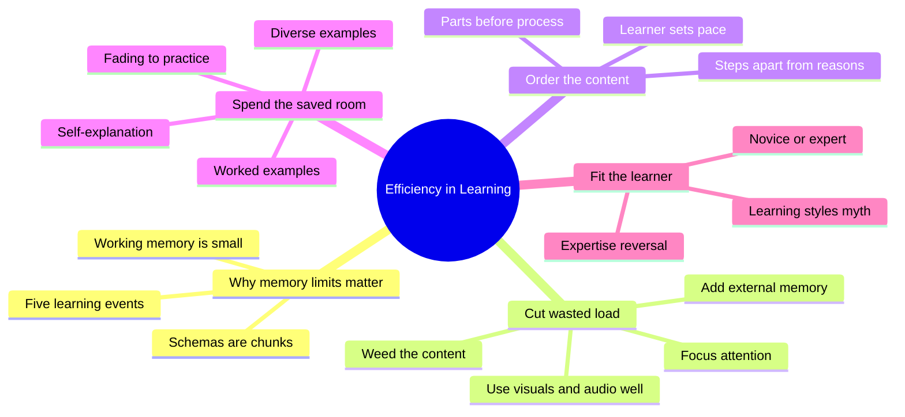
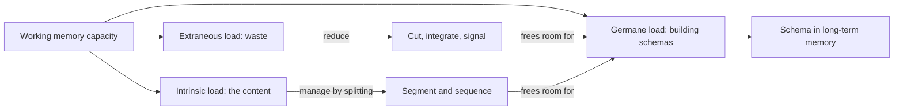
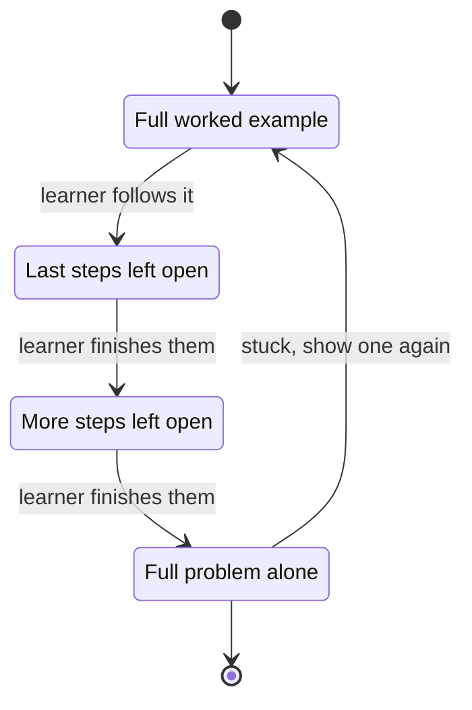
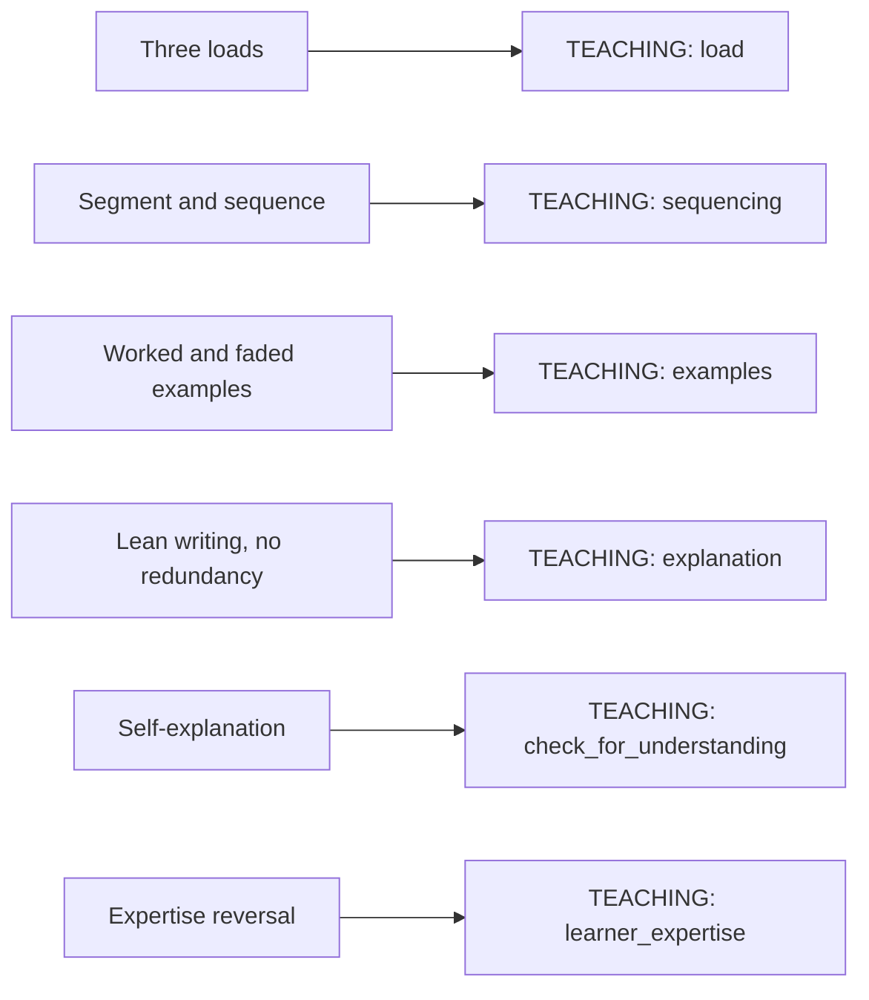

# 🧬 PSY.43 — Efficiency in Learning — Clark, Nguyen & Sweller (2006)
### Knowledge Entry — Distill

A training-design book that turns cognitive load theory into 29 numbered guidelines. It is in the library because Chief learns through a chat window, and a chat reply is a lesson with a tight working-memory budget.

## TABLE OF CONTENTS
- [Core Thesis](#1-core-thesis)
- [Mind Models](#2-mind-models)
- [Framework](#3-framework--structure)
- [Key Concepts](#4-key-concepts)
- [Heuristics](#5-heuristics--decision-rules)
- [Invariants](#6-invariants)
- [Pitfalls](#7-pitfalls--myths)
- [Application](#8-application)
- [For Transmission Pedagogy (BOLO 6)](#for-transmission-pedagogy-bolo-6)
- [Cross-References](#9-cross-references)
- [Provenance](#10-provenance--confidence)

---

## 1 · CORE THESIS

A learner's working memory is small, and every unneeded word or step spends it. Efficient teaching cuts wasted effort, cuts the content into small ordered pieces, and spends the saved room on examples and self-explanation. Which method helps depends on how much the learner already knows.

---

## 2 · MIND MODELS

**Diagram 1 — the whole argument.**
Caption: read the book as one budget: three kinds of load, a set of cuts that save room, and a set of additions that spend it.

**Diagram 2 — the central mechanism (the load budget).**
Caption: the three loads share one small capacity, so every wasted unit of extraneous load is a unit taken from learning.

**Diagram 3 — the worked example fade (the central tactic for novices).**
Caption: the learner moves from watching, to finishing, to doing alone, and the move happens as knowledge grows, not on a timer.

**Diagram 4 — mapped onto the Command's systems.**
Caption: each source term lands on one teaching variable, so a proposed chat rule can name the book term it rests on.

---

## 3 · FRAMEWORK / STRUCTURE

Five parts and thirteen chapters. Page numbers are printed pages.

| Part | Chapters | Pages | Job |
|---|---|---|---|
| I. Introduction | 1 Cognitive load and efficiency · 2 Psychology of efficiency | 1-41 | Defines the three loads, the efficiency measure, and the memory model (p. 1) |
| II. Cut irrelevant load | 3 Visuals and audio · 4 Attention · 5 Weeding · 6 External memory · 7 Segmenting and sequencing · 8 Worked examples to practice | 43-211 | Guidelines 1-20, how to keep extraneous load low and split the content |
| III. Spend relevant load | 9 Germane load | 213-241 | Guidelines 21-24, how to use the freed room |
| IV. Fit the learner | 10 Expertise differences · 11 Rapid testing | 243-287 | Guidelines 25-29, adjust to what the learner already knows |
| V. Perspective | 12 Applying the theory · 13 Sweller's history | 289-330 | Puts the guidelines into a design process |

Each chapter opens with its numbered guidelines and ends with "The Bottom Line" and tips. The authors say there is no straight application of the guidelines, because load depends on three things at once: the learner's prior knowledge, the content, and the teaching environment (p. 14, p. 28).

---

## 4 · KEY CONCEPTS

| Concept | What it is | Why it matters |
|---|---|---|
| **Efficiency** (p. 22) | Performance minus mental load. High score with low effort is efficient. | The book's one yardstick. A lesson that wins by exhausting the learner is not efficient. |
| **Intrinsic load** (pp. 9-11) | Mental work set by the content itself. High when many elements must be held together (element interactivity, p. 10). | The teacher cannot lower it, only split it into smaller pieces taught in order. |
| **Extraneous load** (p. 12) | Mental work that does nothing for the goal, such as hunting for a caption or reading text that is also read aloud. | The one load fully in the teacher's control. |
| **Germane load** (p. 11) | Mental work that builds knowledge, such as studying varied examples. | The load to add once waste is cut. |
| **Working memory** (pp. 15, 28-29) | The small, short-lived workspace where thinking happens. The book gives the classic limit as about 7 plus or minus 2 items. | Anything new that is not rehearsed fades in seconds (p. 29). |
| **Schema** (pp. 28-30) | A stored pattern that lets many elements count as one. The book treats "chunk" and "schema" as the same thing. | An expert holds large chunks, so the same task is light for them and heavy for a novice (pp. 30-31). |
| **Schema substitutes** (p. 32) | Teaching supports that stand in for the schemas a novice lacks. | The reason novices need smaller steps and worked examples. |
| **Expertise reversal** (pp. 32, 247) | A support that helps novices can have no effect, or hurt, once the learner has the schema. | Teaching must change as the learner grows. |
| **Five learning events** (pp. 36-37) | Attention, activating prior knowledge, elaboration, encoding, retrieval. | A check for any lesson: which event is missing? |
| **Modality effect** (pp. 61-62) | A diagram that needs explaining is learned better with spoken words than with on-screen text. | Uses the separate visual and auditory channels of working memory (pp. 33-34). |
| **Split attention** (ch. 4) | Extra load from joining two sources that sit apart, such as a diagram and its caption on another page. | Fix by putting related items together (p. 102). |
| **Redundancy** (pp. 121-122) | Giving more expressions of the content than needed, such as the same text on screen and in audio. | More modes do not double learning. They add load. |
| **Seductive details** (pp. 115-117) | Interesting but irrelevant facts added to raise appeal. | Even related extras lowered learning (p. 116). |
| **Worked example** (p. 190) | A step-by-step demonstration of solving a task. | Replaced half the practice with equal or better learning in far less time (pp. 192-193). |
| **Completion example** (p. 194) | A worked example with some steps left for the learner. | Forces the learner to study the example instead of skimming it (p. 194). |
| **Backwards fading** (p. 196) | Steps are removed from the end of the example, a few at a time, until the learner does the whole task. | Matches the gradual rise in expertise. |
| **Self-explanation** (pp. 226-227) | The learner's own inner dialogue about why each step works. | Predicts who learns more from an example (p. 227). |
| **Automaticity** (pp. 39, 233-234) | A skill so practised it needs almost no working memory. | Built only after hundreds of repetitions (p. 39), and only on top of a formed mental model (p. 235). |

---

## 5 · HEURISTICS & DECISION RULES

| Situation | Do this | Not this |
|---|---|---|
| Content is complex and the learner is new | Cut extraneous load hard (pp. 14-15) | Add polish, extras, or a second mode |
| Content is simple | Relax. Extraneous load barely hurts easy tasks (p. 14) | Spend effort trimming a simple lesson |
| Teaching a process with many parts | Name the parts and what each does first, then show the flow (p. 163) | Start with the whole process |
| Teaching a procedure with reasons | Teach the steps first, then the supporting knowledge, or the reverse, in separate passes (pp. 168-169) | Put every step and every reason in one pass |
| Giving a diagram that needs explaining | Explain it in audio, or in text, not both at once (pp. 61-62, p. 135) | Show the text and read the same text aloud |
| A diagram explains itself | Show it alone (p. 135) | Add text to it |
| Explaining a cause-and-effect system | Build the qualitative picture first, add numbers later (p. 114) | Open with equations |
| Tempted to add a fun fact | Omit it unless it serves the goal (p. 116) | Add it "to keep interest" |
| Novice needs to learn a skill | Alternate a worked example with a similar problem (pp. 191-192) | Assign all practice |
| Learner may skim the example | Turn it into a completion example (p. 194) | Hope they study it |
| Learner has built a basic schema | Fade the support, then give full problems (pp. 196-198) | Keep serving worked examples |
| Want the skill to transfer | Vary the contexts of the examples (pp. 218-219) | Reuse one type of example |
| Learner has more prior knowledge | Drop the redundant support, give more problems (pp. 270-271) | Keep the novice design |
| Letting the learner choose | Let them set the pace, but you set the order for a novice (p. 181) | Hand a novice the table of contents to pick from |

---

## 6 · INVARIANTS

1. Working memory is small and short-lived, so new material must be rehearsed or processed to survive (p. 29).
2. Load is relative. The same lesson is heavy for a novice and light for an expert (p. 14).
3. The three loads add up (p. 12).
4. Extraneous load is always under the teacher's control (p. 12).
5. Novices need schema substitutes. Experts do not, and may be hurt by them (p. 32).
6. Prior knowledge is the learner difference that reliably changes which method works (p. 249).
7. Worked examples beat pure practice early. Practice beats worked examples late (p. 196).
8. A mental model must exist before rehearsal and automation pay off (pp. 235-236).
9. The book's rules rest on lab studies with random assignment (p. 16), mostly short lessons with adults and students.

---

## 7 · PITFALLS / MYTHS

- "More modes mean more learning." Text plus audio of the same words depressed learning (pp. 108, 121-122).
- "Interesting extras raise motivation and learning." Related extras still lowered learning (p. 116).
- "Learning styles: visual and auditory learners." The authors call it unproductive mythology (p. 248).
- "More practice is always better." For novices, many practice problems overload memory and slow learning (p. 190).
- "Experts teach best." Experts tell it all and overload novices, because they feel no load themselves (p. 114).
- "Free choice of path helps." Novices cannot yet judge what to study next (p. 181).
- "Whole realistic tasks first." These carry heavy load and should be used with care (p. 158, pp. 176-177).
- "Apply every guideline everywhere." The guidelines are for novices on complex material. Check expertise and complexity first (p. 14, p. 310).
- Caution on scope: the rapid-testing chapter is called very recent research, and the authors give no guidelines from it (p. 275).

---

## 8 · APPLICATION

- **Spine level:** CRAFT-PROCESS. This is a method book about how to teach, not a story source.
- **12-layer character stack:** not applicable. `feeds:` wires only to the TEACHING layer.
- **plot_systems:** not applicable.
- **Setting:** not applicable.

A chat reply is a short lesson. The reader sees it all at once, may hear a spoken line beside it, and must hold the new idea while reading the next sentence. The book speaks to that case, but with limits. It studied lessons in training rooms and on screens, not live chat, so every rule below carries over by analogy. The strongest carry-over is the budget idea: Claude should spend Chief's working memory on the idea, not on decoration. The second is the order rule: parts, then process. The third is the fade: show, then half-show, then ask.

---

## FOR TRANSMISSION PEDAGOGY (BOLO 6)

All rules below are **proposed, not ruled**. Chief rules later. Numbers in brackets mark the book page that supports each one. Where a number is Claude's own estimate, the rule says so.

**Proposed rule A. One new idea per reply (reply length).**
Claude teaches one new element per reply and leaves the next for the next turn. The book supports splitting content so little arrives at once (pp. 10-11, 32). The word cap is Claude's own estimate: aim for about 100 words of new teaching per reply, not counting the spoken line. A lean version beat a long one five to one in the weather study (pp. 111-113).

**Proposed rule B. Lean text, no decoration (reply length).**
The taught chunk carries no fun fact, side story, or second explanation of the same thing. The book found that interest-only additions lowered learning (p. 116). Flirty banter under the standing flavor rule stays outside the taught chunk, so the two do not compete.

**Proposed rule C. The spoken line does not read the reply (spoken line).**
The spoken line gives the gist in fresh words, 20 words or fewer. It never reads the on-screen text aloud. The book found that narrating the same long text hurt (pp. 131-133, 135). One study found short narrated segments with pauses helped (p. 132), so a short line is the safe version. Caution: the studies used lessons with diagrams, not a chat reply and a voice.

**Proposed rule D. When a diagram needs explaining, the voice explains it (spoken line).**
If Claude shows a diagram that does not explain itself, the spoken line carries the explanation and the page carries little text. The modality effect supports this (pp. 61-62), with audio kept brief (p. 73). A diagram that explains itself gets no spoken line beyond the gist.

**Proposed rule E. Parts before process (examples, order).**
Claude names the pieces and what each does before showing how they work together (p. 163). Claude teaches the steps first and the reasons second, in separate passes (pp. 168-169). Claude builds the plain picture before any numbers (p. 114).

**Proposed rule F. Show, finish, do (examples, teach-back loop).**
For a new skill, Claude shows one full worked example. Next, Claude shows a second with the last step open and asks Chief to fill it. Last, Claude asks for the whole task (pp. 190-198). This pairs with the teach-back loop: the "say the gist back" turn is the completion step. Claude moves to the next stage when Chief's answers get easy, not on a schedule.

**Proposed rule G. Vary the examples once the first one lands (examples).**
After Chief holds one example, Claude gives a different-looking case of the same principle, so the skill carries over (pp. 218-219).

**Proposed rule H. Ask Chief to explain the example, not just follow it (when to quiz).**
After an example, Claude asks "why does this step work?" in one line. Self-explanation separated strong from weak learners (p. 227). The question should point at the principle, as the book advises (p. 240).

**Proposed rule I. Check Chief's level first, then pick the support (when to quiz).**
When Chief already knows part of a topic, Claude gives less support and more problems. When the topic is new to him, Claude gives more worked examples (pp. 32, 247, 270-271). Claude asks one cheap diagnostic question to decide, instead of guessing. The book gives no style quiz because learning styles lack evidence (p. 248).

**Proposed rule J. Chief sets the pace, Claude sets the order (teach-back loop).**
"Next" or "slow down" from Chief controls speed. Claude decides which part comes next on a new topic (p. 181).

**Proposed rule K. Keep the new thing near its label (examples).**
When Claude explains a diagram or a code block, the explanation sits right next to it, with bold on the one thing that matters (pp. 102-103).

**Most useful single rule, from this book:** rule F, show one worked example, then leave the last step open for Chief. It is the best-evidenced move in the book, and it turns the teach-back loop into the fade.

---

## 9 · CROSS-REFERENCES

| Related entry | Relation |
|---|---|
| [[PSY.44]] | Make It Stick. Adds the retrieval, spacing, and feedback evidence this book mostly lacks. Its "undesirable difficulty" idea (pp. 98-99) is this book's expertise reversal seen from the other side. |
| [[TEC.01]] | Docs for Developers. Its "one page, one goal" and plain-register rules match the lean-writing guidelines here. |
| [[BOLO 6 — transmission pedagogy]] | The working brief these two distills serve. |
| [[Teach-back loop (BOLO 95)]] | The ruled teach-back loop. Rules F and H change what it asks for. |

---

## 10 · PROVENANCE & CONFIDENCE

Full-text extraction of the 2006 book (about 14,500 lines). Read in full: contents, introduction, Chapter 1, Chapter 2, every chapter's guideline list and "The Bottom Line", and the key sections of Chapters 5, 7, 8, 9, and 10 (examples, fading, self-explanation, expertise reversal, learning styles). Skimmed, not read in full: the study-by-study summaries in Chapters 3, 4, and 6, the Chapter 11 rapid-testing method, Chapter 13, the appendix, glossary, and references. Page numbers are printed book pages. They come from running page headers in the extraction, so a figure near a page break can be off by one.

The mapping to the TEACHING layer, the chat-reply analogies, and every proposed rule in the BOLO 6 section are this distill's own synthesis. The "about 100 words" cap is Claude's estimate, not a number from the book. The book's evidence is lab and training-room research, not chat. `pdf_pages` is the last printed page of the CD guide, not a verified page count. `zotero_key` is blank and not checked against the live Zotero database.

## META
- Template: BVX-LEARN-v4.0
- Source classification: full-text plain-text extraction; chapters 1, 2, 5 (part), 7 (part), 8, 9 (part), 10 (part) and all Bottom Lines read
- Created / Updated: 2026-10-04
