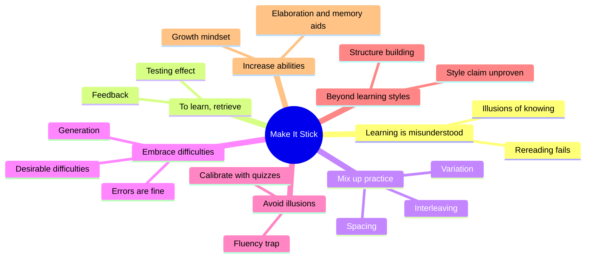
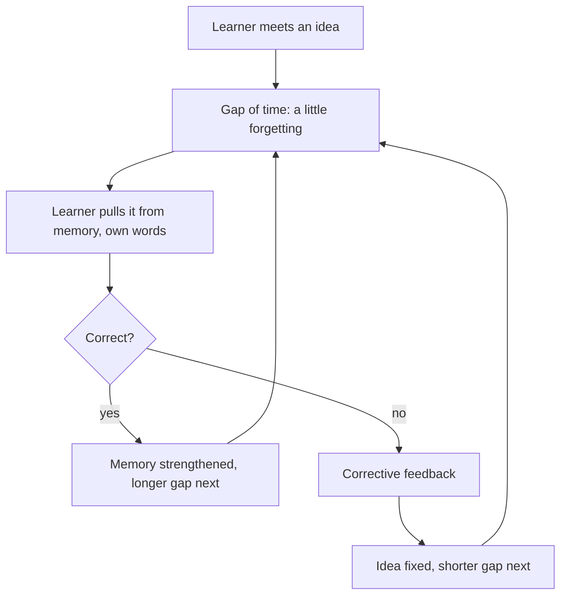
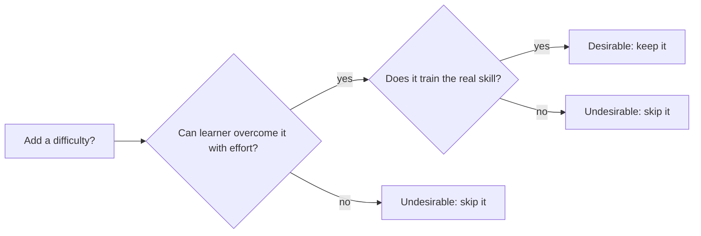
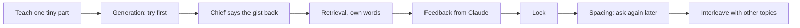

# 🧬 PSY.44 — Make It Stick — Brown, Roediger & McDaniel (2014)
### Knowledge Entry — Distill

A readable account of the learning research that two cognitive scientists and a novelist condensed into a handful of strategies. It is in the library because Chief learns by saying things back, and this book explains why that works and when to do it again.

## TABLE OF CONTENTS
- [Core Thesis](#1-core-thesis)
- [Mind Models](#2-mind-models)
- [Framework](#3-framework--structure)
- [Key Concepts](#4-key-concepts)
- [Heuristics](#5-heuristics--decision-rules)
- [Invariants](#6-invariants)
- [Pitfalls](#7-pitfalls--myths)
- [Application](#8-application)
- [For Transmission Pedagogy (BOLO 6)](#for-transmission-pedagogy-bolo-6)
- [Cross-References](#9-cross-references)
- [Provenance](#10-provenance--confidence)

---

## 1 · CORE THESIS

Learning sticks when it takes effort. Pulling an idea out of memory, spacing the practice, mixing the problems, and trying before being shown all feel harder and work better than rereading. Feeling fluent is a poor sign of knowing, so learners need self-checks that do not rely on feeling.

---

## 2 · MIND MODELS

**Diagram 1 — the whole argument.**
Caption: the book is one claim, that effortful practice beats easy review, with each chapter adding one way to make the effort useful.

**Diagram 2 — the central mechanism (the retrieval loop).**
Caption: each pass through the loop needs a little forgetting first, and feedback closes it, so the loop beats rereading.

**Diagram 3 — the difficulty test.**
Caption: a difficulty is worth adding only if the learner can overcome it with effort, so check the learner before adding it.

**Diagram 4 — mapped onto the Command's systems.**
Caption: the book's strategies map to the teach-back loop at three points, which is where the proposed rules attach.

---

## 3 · FRAMEWORK / STRUCTURE

Eight chapters. The first seven give the research with stories. Chapter 8 turns it into advice. Page numbers are printed pages.

| Ch. | Pages | Move | Claim |
|---|---|---|---|
| 1. Learning is misunderstood | 1-21 | Clear away myths | Rereading and repetition do little. Retrieval helps (pp. 14-15, 19-20) |
| 2. To learn, retrieve | 23-45 | Retrieval | Testing is a learning tool, not only a measuring stick (p. 19) |
| 3. Mix up your practice | 46-66 | Schedule | Spaced, interleaved, varied practice builds lasting skill (p. 47) |
| 4. Embrace difficulties | 67-101 | Challenge | Some difficulties strengthen learning (p. 68) |
| 5. Avoid illusions of knowing | 102-130 | Calibrate | Feeling and fact differ. Check with quizzes (pp. 116, 125-126) |
| 6. Get beyond learning styles | 131-161 | Individualize | Style matching lacks evidence. Prior structure matters (pp. 145-146) |
| 7. Increase your abilities | 162-199 | Mindset and aids | Effort changes the brain. Memory aids help organize (pp. 198-199) |
| 8. Make it stick | 200-256 | Apply | Tips for students, lifelong learners, teachers, trainers (p. 200) |

The preface says the research is 125 years old, that most people study in the wrong ways, and that the best strategies are not intuitive (p. ix).

---

## 4 · KEY CONCEPTS

| Concept | What it is | Why it matters |
|---|---|---|
| **Testing effect** (pp. 19-20, 30) | Pulling knowledge from memory strengthens it. The authors call it "retrieval practice" and say "testing" only for the act, not for grading. | Quizzing taught more than restudying (p. 35). |
| **Illusion of knowing** (pp. 15-17) | A feeling of mastery caused by familiarity or smooth reading. | Rereading makes it, and it hides what the learner does not know. |
| **Fluency illusion** (p. 116) | Mistaking ease of reading for knowing the content. | A clear explanation can make a hard idea look easy. |
| **Curse of knowledge** (p. 115) | The teacher underestimates how long it takes a newcomer. | The teacher's own ease misleads the teacher too. |
| **Massed vs spaced practice** (p. 47) | Cramming in one block, or splitting practice into separate sessions. | Massed gives quick gains and quick forgetting (p. 47). |
| **Momentary vs habit strength** (p. 63) | Performance during practice, versus durable skill. | The methods that build habit strength slow visible progress. |
| **Interleaving** (p. 65) | Switching between topics before any one practice set is done. | Helps the learner tell problem types apart (p. 65). |
| **Varied practice** (p. 65) | Practising the same skill under changing conditions. | Builds a broader schema. |
| **Desirable difficulty** (p. 68) | A short-term obstacle that makes learning stronger. Named by Elizabeth and Robert Bjork (p. 69). | Gives a name to why effort helps. |
| **Undesirable difficulty** (pp. 98-99) | An obstacle the learner lacks the background to overcome. | The guard against turning the book's advice into cruelty. |
| **Generation** (pp. 87-88) | Trying to answer or solve before being given the answer. | Even a wrong try prepares the mind for the right answer (p. 88). |
| **Reflection and write to learn** (pp. 88-90) | Asking what the key ideas were and putting them in your own words. | Own-words summaries beat copying by about half a letter grade (p. 90). |
| **Errorless learning** (p. 90) | Skinner's idea of giving tiny steps so errors never happen. The book rejects it. | Errors followed by feedback are not learned (pp. 90-91). |
| **Calibration** (pp. 125-126) | Matching your sense of what you know to what you can do. | Quizzing and explaining are the tools. |
| **Dunning-Kruger effect** (p. 121) | Low skill makes people overrate their skill. | Weak learners cannot see their own gaps. |
| **Dynamic testing** (p. 151) | Using tests to find weak areas and refocus learning, not to rate a fixed ability. | Treats a weakness as fixable. |
| **Elaboration** (p. 207) | Adding meaning: link it to prior knowledge, explain it, find a metaphor. | Multiplies the cues for later recall. |
| **Structure building** (pp. 160-161) | Pulling out the rules and organizing ideas into a frame. | The book's answer to "example learner" versus "rule learner" differences. |

---

## 5 · HEURISTICS & DECISION RULES

| Situation | Do this | Not this |
|---|---|---|
| Learner just read or heard it | Ask for it back in own words, without looking (pp. 201-202) | Ask "does that make sense?" |
| Learner answers wrong | Give corrective feedback right after the try (p. 44, p. 202) | Leave the error standing |
| Learner answers right | Ask again later, with a longer gap (p. 64) | Drop it from review (p. 125) |
| Planning practice | Leave at least a day between rounds, enough for some forgetting (pp. 63-64) | Practise in one block |
| Several related topics | Interleave them (pp. 49-50, 65) | Cluster by topic |
| New problem, learner has some background | Let the learner try first, then show (pp. 88, 91) | Show the solution first |
| Learner lacks the background | Do not add the difficulty yet (pp. 98-99) | Make the task harder because "difficulty helps" |
| Judging understanding | Ask the learner to explain it (p. 126) | Trust a nod or a quick right answer (p. 126) |
| Learner feels slow or anxious | Say plainly that effortful learning is normal and errors are not failure (pp. 91-92, 227-228) | Hide the difficulty |
| Learner wants their "style" | Match the mode to the content (p. 146) | Sort people into styles |
| Wanting extra retrieval prompts | Prefer supplying the answer over picking from options, but options still help (pp. 40-41) | Think any one format is useless |

---

## 6 · INVARIANTS

1. Rereading in close succession gives negligible benefit (p. 15).
2. Retrieval strengthens memory, and harder successful retrieval strengthens it more (p. 43).
3. After a first test, a delayed second retrieval is more potent than an immediate one (p. 43).
4. Spacing needs enough forgetting to take effort, but not so much that it becomes relearning (p. 63).
5. Corrective feedback stops errors from being learned (pp. 44, 90-91).
6. Difficulty helps only if the learner can overcome it (p. 99).
7. Knowing a thing and feeling you know it are different (pp. 116, 126).
8. Learning that feels easy is often shallow (p. 226).
9. Prior knowledge is the base all new learning connects to (p. 100).

---

## 7 · PITFALLS / MYTHS

- "Repeat it until it sticks." The 1960s Tulving study found six prior readings gave no help later (p. 13).
- "Highlight and reread." Students use these most, and they work least (p. 15).
- "Cram, then pass." Cramming scores higher right away and forgets faster (pp. 31, 47).
- "Learners should avoid errors." Errors followed by feedback are not learned (p. 91).
- "Testing is only a dipstick." It is a learning tool (p. 19).
- "I felt it click, so I have it." Fluency is a misleading signal (p. 116).
- "Practice one thing until it is perfect." Interleaving beat clustering, even when learners preferred clustering (pp. 49-50, 54).
- "Teach to the learner's style." The 2008 review found no adequate supporting evidence (p. 145).
- "Instant feedback is always best." Delayed feedback gave better later retention in several studies (pp. 39-40).
- Caution on scope: the book is a popular account and the authors admit some of the nuance is still open (pp. 99, 146).

---

## 8 · APPLICATION

- **Spine level:** CRAFT-PROCESS. A method book about how people learn, not a story source.
- **12-layer character stack:** not applicable. `feeds:` wires only to the TEACHING layer.
- **plot_systems:** not applicable.
- **Setting:** not applicable.

The Command already has a teach-back loop: Claude teaches one tiny part, Chief says the gist back, and it locks. This book says the "say it back" turn is the most valuable part of the loop, because pulling an idea from memory is what builds it (pp. 19-20). It also says one pass is not a lock. A lock needs the idea pulled again after a gap (pp. 63-64). The book's caution fits the Command too: a reply that reads smoothly can feel like understanding without being understanding (p. 116).

There is a real tension with PSY.43. That book says novices learn best from worked examples and low load. This book says to try first and embrace difficulty. The two meet in one idea. A difficulty is desirable only if the learner can overcome it with effort (p. 99). So Claude should give a new topic a worked example first and make Chief generate only once he holds part of it.

---

## FOR TRANSMISSION PEDAGOGY (BOLO 6)

All rules below are **proposed, not ruled**. Chief rules later. Page numbers mark the support. Where a number is Claude's estimate, the rule says so.

**Proposed rule 1. A part locks after two recalls, not one (teach-back loop).**
Chief's gist-back today counts as the first recall. Claude asks for the same gist cold in a later session, at least a day on (pp. 63-64), and then the part is locked. Until then it is "taught", not "locked". The one-day figure is the book's own minimum for a gap (p. 64). A second ask after a longer gap strengthens it further (p. 43).

**Proposed rule 2. Ask for the gist before the answer is on screen (teach-back loop).**
Claude asks the teach-back question before giving the next part, and Chief answers without scrolling up. The book contrasts an open-book test with one taken without the text, and found delayed corrective feedback kept more later (p. 40). The reply stays on screen in chat, so this is a habit for Chief, and Claude says so once.

**Proposed rule 3. Ask for the gist, not "got it?" (when to quiz).**
Claude never asks "does that make sense?" as the check. Nods and "yes" feel like knowing and are not (pp. 115-116, 126). Claude asks "say the gist in your words" and judges that.

**Proposed rule 4. Correct the gist right after, in one line (feedback).**
When Chief's gist is off, Claude gives the fix in the next reply, in one or two sentences. The book says feedback keeps errors from being learned (pp. 44, 90-91). Claude says what was right first, then the fix.

**Proposed rule 5. Try-first on topics Chief already half knows (when to quiz, examples).**
When Chief has some background, Claude asks "what do you think happens?" before explaining. The attempt helps even when wrong, if feedback follows (pp. 88, 91). For a topic new to him, Claude shows a worked example first (see PSY.43) so the difficulty stays one he can beat (pp. 98-99).

**Proposed rule 6. Open each session with one question from last time (when to quiz, spacing).**
The first reply of a session asks one gist from an earlier part, picked from what is "taught" but not "locked". This is spaced retrieval with no extra tooling beyond the notes Claude already keeps (pp. 32, 47). Claude picks one question, not a quiz (reply length).

**Proposed rule 7. Mix topics in review (examples, when to quiz).**
When two or more related topics are open, Claude asks about them in mixed order, not one topic at a time (pp. 49-50, 65). Claude warns once that it will feel slower, because that is the expected cost (p. 47).

**Proposed rule 8. Vary the example once Chief holds the first (examples).**
After a gist locks, Claude offers a case that looks different but follows the same rule, so Chief learns to tell which rule fits (p. 65, p. 160).

**Proposed rule 9. The spoken line is a retrieval cue, not a summary of the reply (spoken line).**
Sometimes the spoken line can be a question: "Say back what a schema is." The page then holds the content, and the voice holds the prompt. This follows from retrieval and generation being the active ingredients (pp. 20, 87-88). The 20-word cap in the plain register stands. This one is the book's logic applied by Claude, with no study behind the chat setting.

**Proposed rule 10. Say once why the effort is good (reply length, teach-back loop).**
Claude tells Chief once, near the start of a topic, that saying it back should feel hard and that slips are fine (pp. 91-92, 227-228). Then Claude stops repeating it. The book's anxiety study shows that worry about errors uses up memory (pp. 91-92).

**Proposed rule 11. No learning-style questions (when to quiz).**
Claude does not ask Chief how he learns best, and does not sort him into a style (pp. 145-146). Claude picks the mode from the content: a diagram for structure, a short line for a rule (p. 146).

**Most useful single rule, from this book:** rule 1, a part counts as locked only after Chief says it back twice, once now and once cold at least a day later. It keeps the teach-back loop and adds the one thing the book says a single recall cannot do.

---

## 9 · CROSS-REFERENCES

| Related entry | Relation |
|---|---|
| [[PSY.43]] | Efficiency in Learning. Supplies the load budget and the worked example fade. It warns against difficulty for novices, and this book answers with "desirable only if overcome" (p. 99). |
| [[TEC.01]] | Docs for Developers. Its advice to test a concept by asking a reader to explain it back (p. 31) is the same move as the teach-back loop. |
| [[BOLO 6 — transmission pedagogy]] | The working brief these two distills serve. |
| [[Teach-back loop (BOLO 95)]] | The ruled loop. Rules 1, 2, and 6 add a second recall and a spacing step. |

---

## 10 · PROVENANCE & CONFIDENCE

Full-text extraction of the 2014 book (about 11,500 lines). Read in full: front matter, Chapter 1, the second half of Chapter 2, every chapter's "Takeaway", and the key sections of Chapters 3 (spacing and interleaving), 4 (desirable difficulties, generation, errorless learning, fear of failure), 5 (illusions, calibration tools), 6 (learning styles, dynamic testing, takeaway), and 8 (tips for students, teachers, trainers). Skimmed, not read in full: the profiles and stories, Chapter 7 beyond its takeaway and the elaboration section, the notes, and the index. Page numbers are printed book pages taken from the running headers, so a page break can shift a cite by one.

The mapping to the TEACHING layer, the tension with PSY.43, the diagrams that name the Command's loop, and every proposed rule in the BOLO 6 section are this distill's own synthesis. The book was written for students and teachers, not for chat, so each rule carries over by analogy. The "at least a day" gap is the book's number (p. 64). `zotero_key` is blank and not checked against the live Zotero database. `pdf_pages` is omitted because the page count was not confirmed.

## META
- Template: BVX-LEARN-v4.0
- Source classification: full-text plain-text extraction; chapters 1, 2, 4, 6 and all Takeaways read; others sampled
- Created / Updated: 2026-10-04
