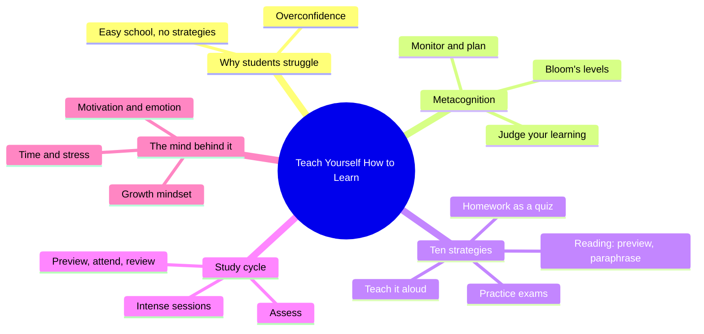
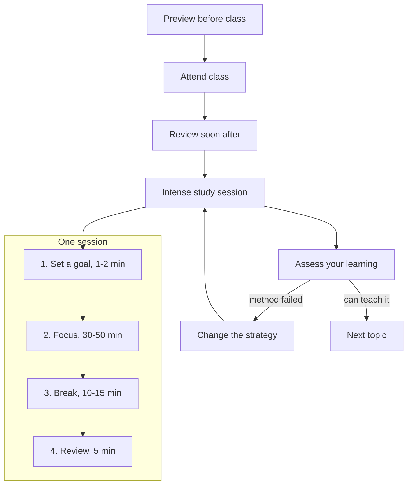
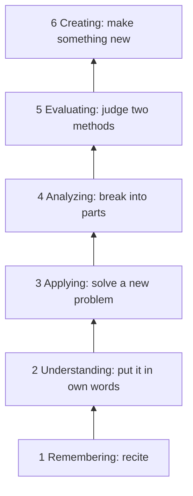
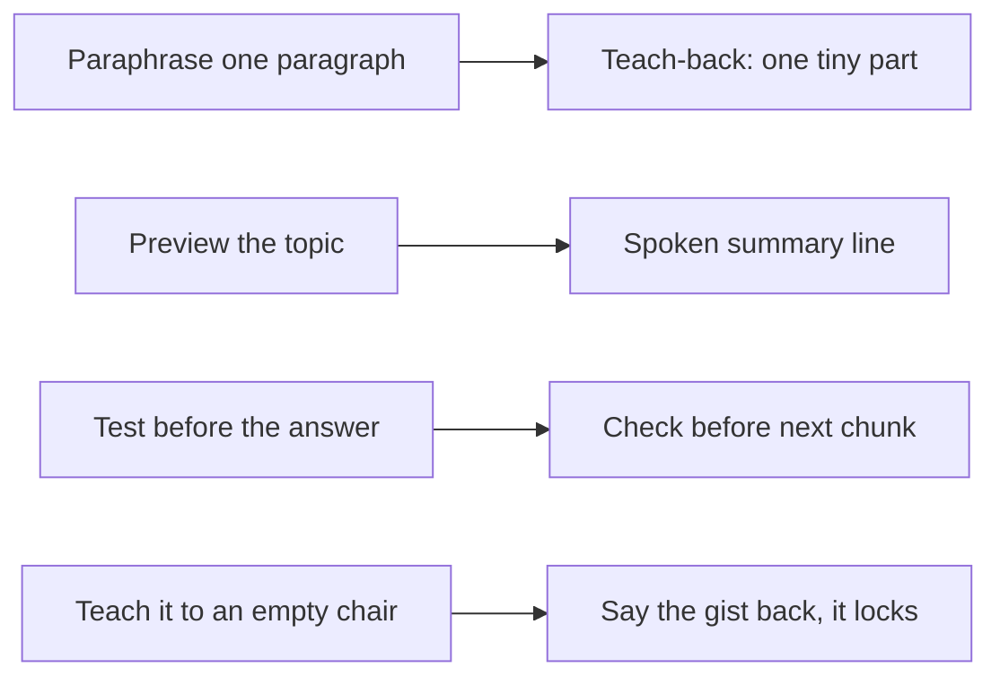

# 🧬 PSY.45 — Teach Yourself How to Learn — McGuire (2018)
### Knowledge Entry — Distill

A student-facing guide to metacognition (thinking about your own thinking), written by a chemistry educator who ran a university learning center. It is in the library for BOLO 6, transmission pedagogy: how Claude teaches Chief in a chat window.

## TABLE OF CONTENTS
- [Core Thesis](#1-core-thesis)
- [Mind Models](#2-mind-models)
- [Framework](#3-framework--structure)
- [Key Concepts](#4-key-concepts)
- [Heuristics](#5-heuristics--decision-rules)
- [Invariants](#6-invariants)
- [Pitfalls](#7-pitfalls--myths)
- [Application](#8-application)
- [Cross-References](#9-cross-references)
- [Provenance](#10-provenance--confidence)

---

## 1 · CORE THESIS

Students often fail because they were never taught how to learn, not because they lack ability. One habit, metacognition (watching your own thinking), fixes this fast. The habit is concrete: set a goal, preview, paraphrase small chunks, test yourself before checking answers, and explain the material aloud to find gaps.

---

## 2 · MIND MODELS

**Diagram 1 — the whole argument.**
Caption: read the book as one claim (learning is a skill you can be taught) held up by four supports.

**Diagram 2 — the central mechanism (the study cycle and the intense study session inside it).**
Caption: the last step of every loop is a self-check, and a weak check sends you back to change the method, not to repeat it.

**Diagram 3 — Bloom's ladder, with the level a student must reach.**
Caption: school usually asks for the bottom two steps, but exams that apply ideas to new cases sit at step three and above.

**Diagram 4 — mapped onto the Command's systems.**
Caption: the book's three loops line up with the teach-back loop, the spoken line, and the check that closes a chunk.

---

## 3 · FRAMEWORK / STRUCTURE

Ten short chapters plus six appendices. The author says readers can pick one chapter or read all, and need not use every strategy (ch. 5, p. 41). The structure moves from belief to method to upkeep.

| Ch. | Pages | Move | Governing question |
|---|---|---|---|
| 1-2. Journey; why students don't know how | 3-8 | Diagnose | Why did good grades never require learning skills? |
| 3. Metacognition | 9-22 | Name the skill | What is it, and what changed in the vowel exercise? |
| 4. Bloom's and the study cycle | 23-38 | Give the map | What depth do I need, and what routine gets me there? |
| 5. Ten strategies | 40-58 | Give the tools | Which concrete acts changed grades? |
| 6. Mindset | 59-72 | Remove the block | Do I believe effort changes results? |
| 7-8. Emotions, motivation | 73-88 | Fuel it | What keeps me going, and what stops me? |
| 9. Time, tests, stress | 89-99 | Schedule it | When do I do this, and how do I test it? |
| 10. Try and have fun | 100-104 | Commit | Which strategies will I try for three weeks? |

The author's test for a strategy is practical: try it for three weeks and look at the grades (Introduction, p. 2; ch. 10, p. 101).

---

## 4 · KEY CONCEPTS

| Concept | What it is | Why it matters |
|---|---|---|
| **Metacognition** (ch. 3, p. 10) | Thinking about your own thinking, coined by John Flavell (1976). Four parts: think about thinking, see yourself as a problem solver, monitor and control, judge your learning (Fig. 3.2, p. 11). | Turns a passive student into one who asks "do I understand this or only remember it?" |
| **Count the Vowels** (pp. 14-20) | A memory list scores about 20% when you do not know the goal and about 80% once you know the goal and the organizing system. | Two things changed the score: a known goal, and a system tied to something familiar (pp. 19-20). |
| **Study vs learn mode** (pp. 24-27) | Studying is going over what you think class already taught. Learning is asking how, why, and what if. | Students who "study" the night before believe class already taught them (p. 25). |
| **Teach-the-material mode** (pp. 27-29) | Students say they would work harder to teach the class than to earn an A. | Teaching forces you to expect questions from many angles and shows gaps early. |
| **Bloom's Taxonomy** (pp. 29-33) | Six levels: remembering, understanding, applying, analyzing, evaluating, creating (revised version). | Names the depth an exam demands. The author keeps the ladder shape so students see facts come first (note, pp. 38-39). |
| **Study cycle** (pp. 34-35) | Preview, attend, review, study, assess. | One routine for every course. |
| **Intense study session** (p. 37) | Goal, focused work, break, review. Length 15-90 minutes; even 10 minutes works (p. 38). | Breaks work into chunks a person can start. |
| **Previewing** (pp. 42-44) | Skim headings, bold words, charts before reading. The laundry passage is unreadable until you know the topic. | A known topic lets the brain place each detail. |
| **Question before reading** (pp. 44-45) | Write the questions you want the text to answer. | Gives you a reason to read and keeps attention. |
| **Cumulative paraphrase** (p. 45) | Read one paragraph, put it in your own words, then fold it into the next paraphrase. | You only move forward, so the whole task is faster. |
| **C_T problem** (pp. 46-47) | Lecture notes are the "C_T" version. An expert fills in "CAT"; a novice cannot. | Why the textbook matters even when it is "optional." |
| **Homework as a quiz** (pp. 51-54) | Work examples without the solution, check only the final answer, investigate misses. | The single change most low-scoring students credit (p. 51). |
| **Practice testing** (pp. 55-56) | Students who took a practice test remembered more a week later than students who studied twice. | Testing is learning, not only measuring. |
| **Fixed vs growth mindset** (ch. 6, pp. 59-61) | Belief that intelligence is fixed or can grow, from Carol Dweck. | Beliefs change effort, and effort changes results. |
| **Learned helplessness** (p. 70) | Students given two impossible anagrams then failed a solvable one. | Why sink-or-swim hurts. Start easy. |
| **Three motivation levers** (pp. 74-75) | Value, supportive environment, belief you can succeed. | Each can be raised on purpose. |
| **Exam wrapper** (p. 98) | After a test, write how you prepared, what you missed and why, and how you will prepare next time. | Closes the loop from result back to method. |

---

## 5 · HEURISTICS & DECISION RULES

| Situation | Do this | Not this |
|---|---|---|
| A vague task such as "read chapter 5" | Break it into parts: apply the reading strategy per section, review notes, teach it, make a quiz (p. 20) | Skim it while doing something else |
| Starting a reading | Preview, then write questions, then read (pp. 42-45) | Dive in and reread when attention drifts |
| Reading a hard passage | One paragraph at a time, paraphrase, fold into the next (p. 45) | Reread the whole page again |
| Stuck on a homework problem | Spend five minutes in the notes. Still stuck? Look only at step one of the worked example, then continue (p. 52) | Copy the full solution |
| Got a problem wrong | Find where and why before looking at the solution (p. 53) | Call it a careless mistake |
| Choosing problem order | Easy first, then hard (pp. 53-54, 70) | Start with the hardest |
| Testing your grasp | Explain it to a person, a pet, or an empty chair (pp. 29, 54) | Reread and feel familiar |
| Studying in groups | Both discuss and solve problems, and each person covers all the material (p. 55 and note p. 58) | "Divide and conquer" by topic |
| Giving feedback | Pair criticism with a statement of high standards and belief in the learner (p. 63) | Criticism alone |
| Explaining a bad result | Name the actions you will change (p. 84) | Blame the teacher, luck, or ability |
| A strategy is not working | Change the method, try again for a few weeks, refine (pp. 100-101) | Repeat it harder |

---

## 6 · INVARIANTS

1. **A poor grade reflects behavior, not intelligence.** Behavior can change (p. 14, p. 71).
2. **Know the goal before you start.** The vowel exercise shows the same person scoring 20% and 80% with a different goal (pp. 19-20).
3. **New information sticks when tied to something already known** (p. 20).
4. **You can only think critically with facts already stored in your head.** Looking up is not the same as knowing (note, p. 39).
5. **Mistakes made during practice cost nothing; mistakes made on the test cost points** (p. 53).
6. **Teaching exposes what you do not know** (p. 29).
7. **Early success builds confidence and early failure builds helplessness** (p. 70).
8. **Beliefs about ability set effort, and effort sets results** (p. 61).

---

## 7 · PITFALLS / MYTHS

- "I just need to work harder." More of the same method usually does not help (ch. 3, p. 12).
- "Studying is going over what class taught." Class is not learning (p. 25).
- "Lecture notes are enough." Notes are the C_T version for a novice (p. 47).
- "That was a careless mistake." Mistakes look careless only afterward, and they must be made somewhere (p. 53).
- "Some students are smart and some are slow." The author found students with strategies and students without (p. 65).
- "Give practice tests without answers." Students then take them to a tutor and ask for the steps, which skips the learning (p. 19).
- "Split the material in a study group." Each person learns only their part well (note, p. 58).
- Limit of the book itself: most evidence is the author's own cases and workshop surveys, not controlled studies. Controlled results come from sources the book cites (Roediger and Karpicke 2006, p. 55; Nixon 2007, p. 70). Treat the strength of the claims as medium.

---

## 8 · APPLICATION

- **Spine level:** CRAFT-PROCESS. This is a method for learning, not a story-structure source.
- **12-layer character stack:** not applicable. `feeds:` wires to the `TEACHING` layer only.
- **plot_systems:** not applicable.
- **Setting:** not applicable.

The book is written for college students with a semester of reading and exams. Chief learns in a chat window in short sessions, so every item below is an extrapolation by this distill, not something McGuire says. **All of these are proposed rules. Chief has not ruled on any of them.**

**Proposed rules for how Claude teaches Chief in chat:**

1. **Reply length (proposed).** A teaching reply carries one tiny part, then stops. Source: paraphrase one paragraph at a time (p. 45) and the author's view that a big task breaks into manageable chunks (p. 20). A reply that teaches two parts is two replies.
2. **The spoken line (proposed).** The line Chief hears states the goal of this chunk and the one question he will answer. Source: previewing turns an unreadable passage into a readable one (pp. 42-44), and a known goal changed the vowel score (pp. 19-20). The spoken line is the preview.
3. **The teach-back loop (proposed).** Claude teaches one tiny part, Chief says the gist back in his own words, and it locks only when the gist matches. This is McGuire's teach-the-material mode (pp. 27-29, 54) with Claude as the audience. The book adds one thing the loop does not yet have: each new teach-back folds in the earlier locked parts, as cumulative paraphrase does (p. 45).
4. **Attempt before answer (proposed).** When Chief is drilling, Claude asks the question and waits for his try before showing the answer. If he is stuck, Claude gives only the first step, as in the five-minute rule (p. 52). When Chief asks for an explanation, Claude just explains.
5. **Which question to ask (proposed).** First ask for his own words (understanding level). Once that locks, ask him to use it on a new case (applying level). Source: Bloom's ladder (pp. 29-33).
6. **When to check understanding (proposed).** After every chunk and before the next one, never at the very end. Open the next session with one question about an earlier locked piece. Source: practice testing beats re-study (p. 55).
7. **When Chief's gist is off (proposed).** Claude says what part is missing and that it is fixable, and does not call it a failure. Source: the feedback note raised revision from 39% to 80% (p. 63) and mistakes are the useful part (p. 53).
8. **Order (proposed).** Start with the easy case, then the hard one (pp. 68, 70).
9. **Do not hand over lists of methods (proposed).** The author tells readers they need not use all ten strategies (p. 41). Claude teaches content, and names a method only when it is the one in use.

**Hold back on:** college habits such as time-management calendars (ch. 9) and class etiquette (ch. 7). They do not map to a chat.

---

## 9 · CROSS-REFERENCES

| Related entry | Relation |
|---|---|
| [[TEC.04]] The Minto Pyramid Principle | The other half of BOLO 6. McGuire covers how a learner builds understanding. Minto covers how a writer orders ideas so a reader can follow. Use McGuire for the loop, Minto for the shape of each reply |
| [[TEC.01]] Docs for Developers | Its concept-doc test (ask a reader to explain it back, p. 31) is the same move as teach-back |
| [[BOLO 6 — transmission pedagogy]] | The working order this distill serves |
| [[Teach-back loop (BOLO 95)]] | The standing ruling that this book supports |
| [[SOP §7]] | Format rules for replies. The proposals above would extend it, not replace it |

---

## 10 · PROVENANCE & CONFIDENCE

Source is a pdftotext extraction of the full book (about 5,600 lines). Read in full: front matter, chapters 1-6, chapters 7-8 (including Sydnie's story), chapter 9 and chapter 10. Not read: appendices A-F (strategy list, book list, inventory, student feedback, study tools), the references, and the index. Page numbers are printed folios. In this extraction the folio sits at the end of its page, so each page cite points to the text just above the number. Several figures (Bloom's definitions, mindset chart, calendars) came through as scrambled text, and their content is taken from the surrounding prose. The Application section is this distill's own synthesis for a chat setting. `feeds:` wiring to `TEACHING` is this distill's own keying. `zotero_key` is blank and not checked against the live Zotero database. Confidence is medium because the book's evidence is mostly the author's cases.

## META
- Template: BVX-LEARN-v4.0
- Source classification: full-text plain-text extraction; chapters 1-10 read, appendices and index not read
- Created / Updated: 2026-10-04
