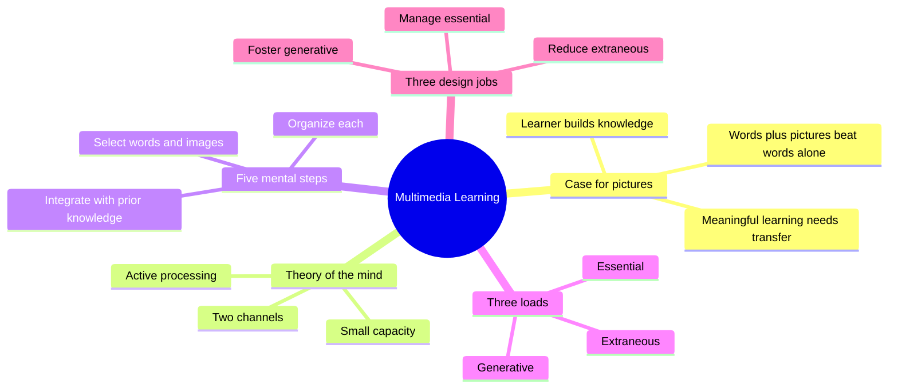
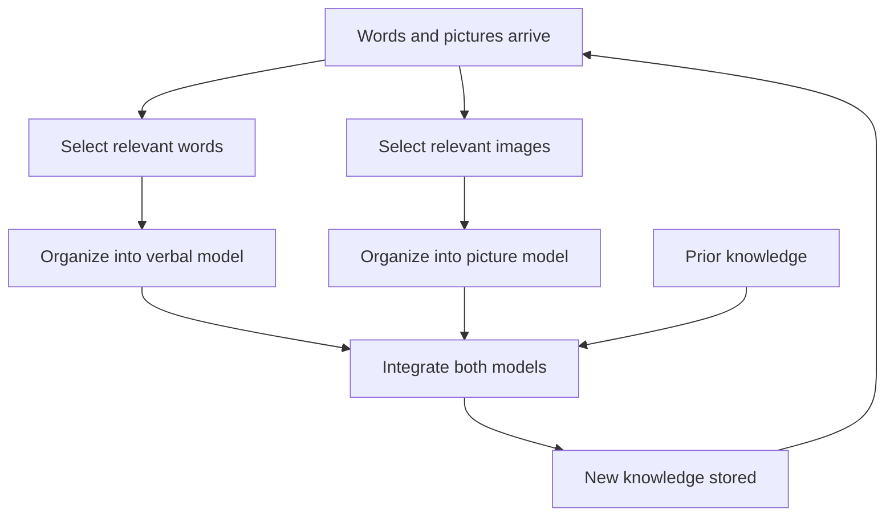
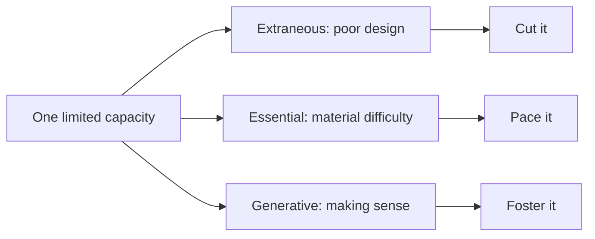
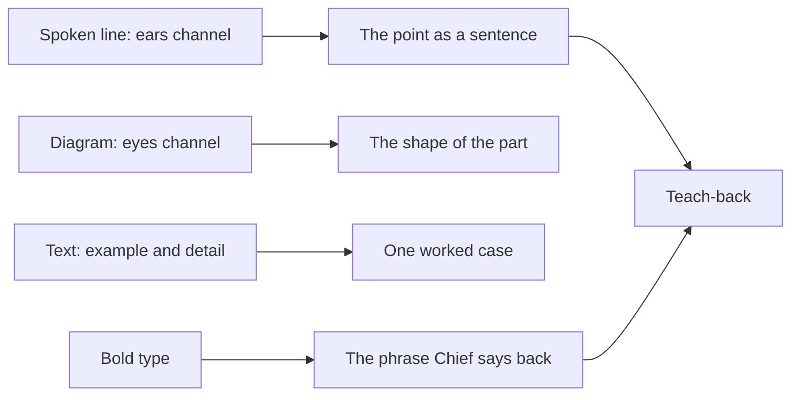

# 🧬 PSY.46 — Multimedia Learning — Mayer (2021)
### Knowledge Entry — Distill

A research summary of how people learn from words plus pictures, by the lead researcher in the field. It is in the library because Claude teaches Chief in a chat window that carries both text and a spoken line, and this book says how to split the work between words, pictures and the voice.

**Page note.** The text extract carries no printed page numbers. Every cite is "x." plus the page position inside the extract (x.37 is the opening of chapter 1). The extract holds only the preface and chapters 1 and 2. The 15 principle chapters (5 to 19) are not in it.

## TABLE OF CONTENTS
- [Core Thesis](#1-core-thesis)
- [Mind Models](#2-mind-models)
- [Framework](#3-framework--structure)
- [Key Concepts](#4-key-concepts)
- [Heuristics](#5-heuristics--decision-rules)
- [Invariants](#6-invariants)
- [Pitfalls](#7-pitfalls--myths)
- [Application](#8-application)
- [For Transmission Pedagogy (BOLO 6)](#for-transmission-pedagogy-bolo-6)
- [Cross-References](#9-cross-references)
- [Provenance](#10-provenance--confidence)

---

## 1 · CORE THESIS

People learn better from words and pictures than from words alone, because understanding happens when the learner connects the two. The mind has two channels, each with small capacity, so a lesson must cut waste, pace the load, and push the learner to make sense of it.

---

## 2 · MIND MODELS

**Diagram 1 — the whole argument.**
Caption: the book is one claim (words plus pictures) built on one theory of the mind, then split into three design jobs.

**Diagram 2 — the central mechanism (the five steps).**
Caption: the learner repeats five steps on each small segment, and the last step, integrating, is the one a lesson must help most.

**Diagram 3 — the three loads.**
Caption: the three loads add up to one fixed capacity, so every unit spent on waste is a unit lost to understanding.

**Diagram 4 — mapped onto the Command's systems.**
Caption: each chat tool has a job, so the spoken line, the diagram and the bold type should not repeat each other.

---

## 3 · FRAMEWORK / STRUCTURE

Five sections, twenty chapters. This extract covers the opening two sections of the front half.

| Part | Chapters | Move |
|---|---|---|
| 1. Introduction | 1 to 5 | Define the field, give the theory, the tests, the measures, then the first principle (words plus pictures) (x.31-33) |
| 2. Reduce extraneous processing | 6 to 10 | Coherence, signaling, redundancy, spatial contiguity, temporal contiguity (x.133) |
| 3. Manage essential processing | 11 to 13 | Segmenting, pre-training, modality (x.133) |
| 4. Foster generative processing | 14 to 19 | Personalization, voice, image, embodiment, immersion, generative activity (x.135) |
| 5. Conclusion | 20 | The principles in one table |

The book grows by edition. Principles went from 7 to 12 to 15, and tests from 45 to 93 to 201 (preface, x.17-18). Each principle has a stated boundary condition, meaning a limit on when it applies (x.18).

---

## 4 · KEY CONCEPTS

| Concept | What it is | Why it matters |
|---|---|---|
| **Multimedia principle** (x.37) | People learn better from words and graphics than from words alone. | The starting claim. Words and pictures are the two formats. |
| **Qualitative rationale** (x.41) | Words and pictures are different tools. Understanding comes when the learner links them. | It rejects "more channels, more exposure". |
| **Knowledge construction** (x.53) | Learning is sense-making. The teacher guides the learner's processing. | Replaces the "empty vessel" view (x.52). |
| **Retention vs transfer** (x.55) | Recall of what was shown, versus use of it on a new problem. | Rote learning passes the first and fails the second (x.56). |
| **Cognitive activity vs behavioral activity** (x.58-59) | Thinking during the lesson, versus clicking or typing during it. | A fill-in-the-blank task can leave the mind idle. |
| **Dual channels** (x.95-97) | One channel handles visual material and one handles auditory material. Spoken words enter by ears, printed words and pictures by eyes. | Words and pictures can split the load. |
| **Limited capacity** (x.98-99) | A few items per channel at once. Span is about 5 to 7 chunks. | A lesson must not hand over too much at once. |
| **Select, organize, integrate** (x.103) | Pick relevant material, arrange it, connect it to prior knowledge. | The learner's work. The lesson can help or hinder each. |
| **Five knowledge structures** (x.101-102) | Process, comparison, enumeration, classification, generalization, each with a picture shape. | Tells the teacher which picture fits which content. |
| **Extraneous load** (x.128) | Processing that does not serve the goal, caused by poor design. | Example: captions far from the picture force the eye to scan. |
| **Essential load** (x.130) | Processing needed to hold the material, set by its complexity. | Alone, it yields rote learning. |
| **Generative load** (x.130) | Deep processing, caused by the learner's motivation. | Without it, understanding does not form. |
| **Boundary condition** (x.18) | A limit on when a principle works, such as beginner versus expert. | Stops a good rule from being over-applied. |

---

## 5 · HEURISTICS & DECISION RULES

| Situation | Do this | Not this |
|---|---|---|
| Content is a process | Show a flowchart beside the words (x.101) | Describe the chain in prose only |
| Content compares two things | Show a matrix (x.101-102) | Two paragraphs of contrast |
| Content is a hierarchy | Show a hierarchy (x.101) | A long list |
| Lesson has a screen with a picture | Put the words next to the part they describe (x.128-129) | Put captions far from the picture |
| Learner may be overloaded | Remove what does not serve the goal (x.128-129) | Add decoration to "keep interest" |
| The material is hard | Cut it into segments the learner can take one at a time (x.119, 133) | One long block |
| Checking what was learned | Ask for use on a new case (x.55) | Ask only for recall |
| Wanting active learners | Prompt thinking such as a summary or a map (x.59) | Prompt busywork such as typing words |
| Learner is new to the topic | Give more help (x.131-132) | Assume the lesson fits everyone |

---

## 6 · INVARIANTS

1. Learning is a change in what the learner knows, caused by experience (x.88).
2. Understanding is built by the learner, not delivered by the teacher (x.53).
3. Channel capacity is small and fixed (x.98-99).
4. Extraneous plus essential plus generative load cannot exceed capacity (x.132).
5. The five mental steps run on small segments, not on the whole message at once (x.119).
6. The same lesson can overload one learner and not another (x.132).
7. Active learning means active thinking, not active hands (x.58-59).

---

## 7 · PITFALLS / MYTHS

- "More technology means more learning." Film, radio, TV and computers each promised a revolution and fell short, because the designs began with the machine (x.46-48).
- "Presenting information is teaching." The empty-vessel view fits only isolated facts (x.52).
- "Picture plus words is twice the exposure." Mayer rejects this quantitative reading (x.41).
- "Hands-on means minds-on." Alan filled in blanks and learned little, Brian just listened and self-explained (x.58).
- "One lesson fits all." Prior knowledge changes what overloads a learner (x.131-132).
- Scope caution. Most of the research uses short lab tests with college students (x.20), and Mayer's tests mostly explain how a system works (x.64). Chat teaching is a stretch.
- Scope caution. The extract has no chapter on any single principle, so signaling, redundancy and coherence are known here by name and definition only (x.133).

---

## 8 · APPLICATION

- **Spine level:** CRAFT-PROCESS. A method book, not a story source.
- **12-layer character stack:** not applicable. `feeds:` wires only to the TEACHING layer.
- **plot_systems:** not applicable.
- **Setting:** not applicable.

The Command already has a chat window with two outputs: a text reply and a spoken line. Mayer's theory says these use different channels (x.95-97), so each should carry a different job. The theory also says the biggest risk is not too little material but waste that uses up capacity before understanding starts (x.128-129). The Command's rules 13 to 16 already cut the load per reply and make Chief generate the gist. This book adds three things: pick a picture shape for the content, keep the voice and the screen from repeating each other, and cut everything that does not serve the one point.

One caution. The book's strongest evidence is for narrated animations and illustrated lessons, delivered to college students in short sessions (x.20). Chat text and a diagram are close cousins, not the same thing.

---

## FOR TRANSMISSION PEDAGOGY (BOLO 6)

All rules below are **proposed, not ruled**. Chief rules later. They sit beyond rules 13 to 16 and do not restate them.

**Proposed rule 1. Pick the diagram by the shape of the part, and put it next to its words.**
When the part is a process, a comparison, a hierarchy or a main-idea-with-details, Claude adds one small diagram of the matching shape (flowchart, table, tree). Claude puts the labels on the diagram, not in a key below (x.101-102, 128-129). This is the book's lead claim (x.37), applied to chat. Evidence for it in this extract is the claim and its rationale (x.41-42). The tests behind it are in chapter 5, which is not in the extract.

**Proposed rule 2. The voice and the screen carry different jobs, and the screen does not repeat the voice.**
The spoken line gives the point (rule 14). The screen gives the diagram and one example. Claude does not paste the spoken line again as a heading. The reason is capacity: duplicate material takes processing that does not serve the goal (x.128-129). Redundancy is listed as a design principle (x.133), but its chapter is not in the extract, so this rule is Claude's inference.

**Proposed rule 3. Cut every extra, and cap a diagram or list at five items.**
Claude removes any sentence, aside, emoji or decoration that does not serve the one point of the part (x.128-129). A diagram or list holds at most five items, which sits at the low end of the book's span of 5 to 7 chunks (x.99). The number five is Claude's margin, not the book's.

**Proposed rule 4. Bold only the phrase Chief will say back.**
Inside the teaching paragraph, Claude bolds the one phrase that carries the gist. That tells Chief what to select (x.112, 53). Signaling is named as a principle (x.133), but its evidence is not in the extract. This conflicts mildly with the Command's use of bold signposts, so Chief decides whether the two uses can share.

**Strongest single rule from this book:** rule 1. It is the book's central claim, it costs one small diagram, and it gives the visual channel a job it cannot do in the voice.

---

## 9 · CROSS-REFERENCES

| Related entry | Relation |
|---|---|
| [[PSY.43]] | Efficiency in Learning. Shares the limited-capacity base. Mayer's three loads are the same split as intrinsic, extraneous and germane load (x.129-131). |
| [[PSY.44]] | Make It Stick. Mayer says active learning is thinking (x.58), and PSY.44 says pulling from memory is the thinking that sticks. |
| [[PSY.47]] | First Principles of Instruction. Merrill sets the order of a lesson, Mayer sets what goes on each screen. |
| [[BOLO 6 — transmission pedagogy]] | The working brief these distills serve. |
| [[Teach-back loop (BOLO 95)]] | Rule 4 ties the bold type to the say-back phrase. |

---

## 10 · PROVENANCE & CONFIDENCE

Source is a plain-text extraction of the 2021 Cambridge University Press third edition (about 3,250 lines). It holds the front matter, preface, section 1 opener, chapter 1 and chapter 2, with references. Chapters 3 to 20 are not in the extract, so the 15 design principles are known only from the contents list, the preface and Table 2.9 (x.133). Read in full: preface, chapter 1, chapter 2. Year is 2021 (edition page, copyright 2021; the catalog record says 2020).

Page cites are extract positions, not printed pages, so they will not match a paper copy. The mapping to chat, the diagram shapes in Diagram 4, and all four proposed rules are this distill's own synthesis. Rules 2 and 4 rely on principles the extract names but does not explain, so confidence is medium and the status is draft. A fuller pass needs chapters 6 to 7 and 11 to 13 of the book. `zotero_key` is blank and `pdf_pages` is omitted because neither was checked.

## META
- Template: BVX-LEARN-v4.0
- Source classification: full-text plain-text extraction, partial (preface, chapters 1 and 2)
- Created / Updated: 2026-10-04
