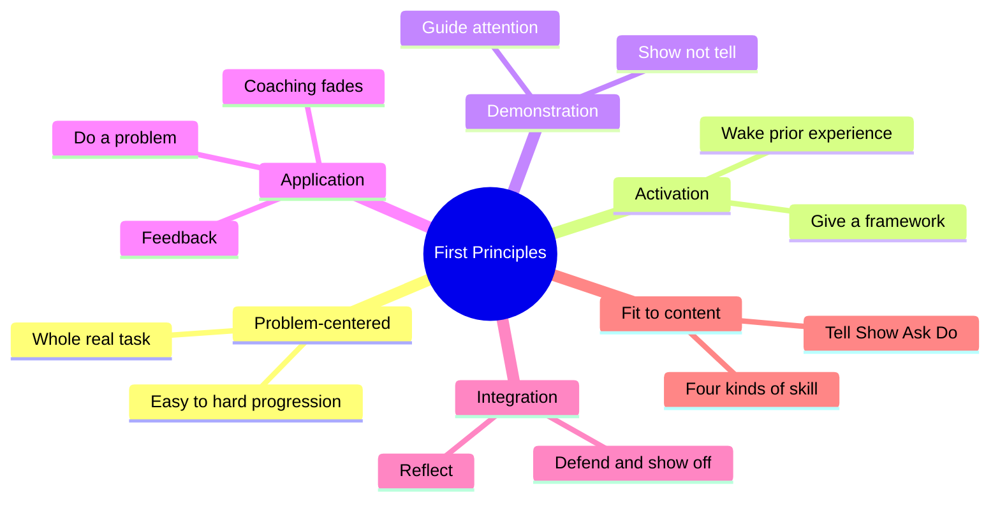
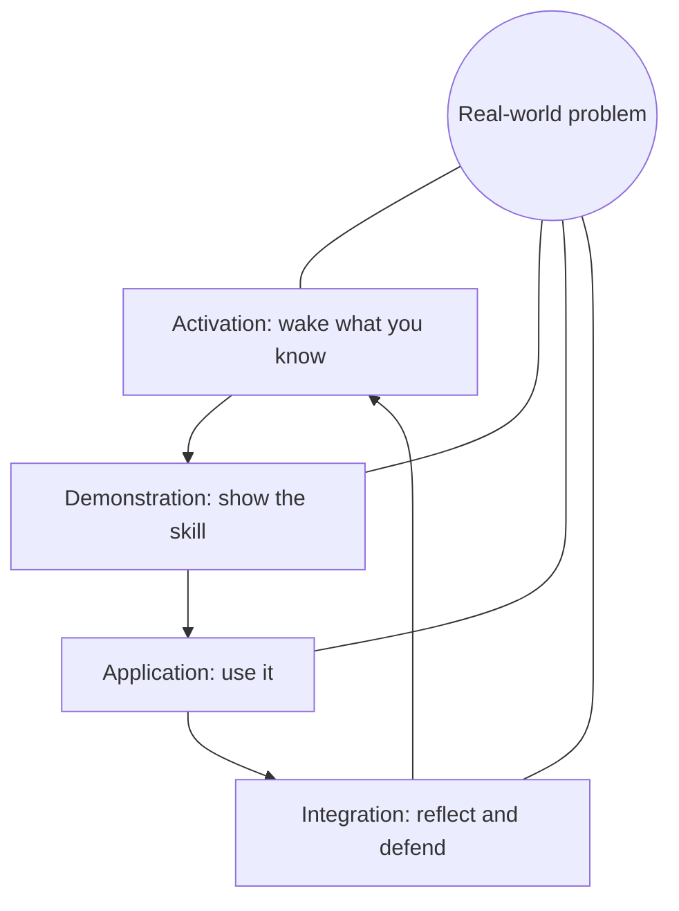
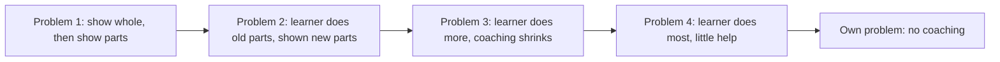
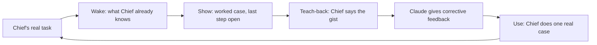

# 🧬 PSY.47 — First Principles of Instruction — Merrill (2013)
### Knowledge Entry — Distill

A design book that boils the field's teaching models down to five principles and checks courses against them. It is in the library because it gives one order for teaching any skill (whole task, wake, show, try, use for real), and Claude teaches Chief one skill at a time.

## TABLE OF CONTENTS
- [Core Thesis](#1-core-thesis)
- [Mind Models](#2-mind-models)
- [Framework](#3-framework--structure)
- [Key Concepts](#4-key-concepts)
- [Heuristics](#5-heuristics--decision-rules)
- [Invariants](#6-invariants)
- [Pitfalls](#7-pitfalls--myths)
- [Application](#8-application)
- [For Transmission Pedagogy (BOLO 6)](#for-transmission-pedagogy-bolo-6)
- [Cross-References](#9-cross-references)
- [Provenance](#10-provenance--confidence)

---

## 1 · CORE THESIS

Learning is promoted when learners work on whole real-world problems, and each problem runs a four-step cycle: wake what they know, be shown the skill, use it, then defend and apply it. Information alone is not instruction. The demonstration and the practice must fit the kind of skill.

---

## 2 · MIND MODELS

**Diagram 1 — the whole argument.**
Caption: the book is one cycle around one task, plus a vocabulary for making each step fit the content.

**Diagram 2 — the central mechanism (the cycle).**
Caption: read clockwise from activation, with the real task in the middle of every turn, so no step stands alone.

**Diagram 3 — the fade across a problem progression.**
Caption: each part is shown once, tried next, then done alone, with new parts arriving as the problems grow.

**Diagram 4 — mapped onto the Command's systems.**
Caption: Merrill's cycle wraps the teach-back loop, which is the application step, so the other three steps are the new parts.

---

## 3 · FRAMEWORK / STRUCTURE

Twenty-two chapters in three parts. Printed page numbers are used throughout (contents, pp. v-vi).

| Part | Chapters | Pages | Move |
|---|---|---|---|
| I. Identifying e3 instruction | 1 to 10 | 1-247 | Define the problem with instruction, the five principles, the vocabulary, the strategies, and a course checklist |
| II. Designing e3 instruction | 11 to 19 | 249-392 | A design method (Pebble-in-the-Pond) and a checklist |
| III. Support | 20 to 22 | 393-450 | Indirect research, direct research, the future |

"e3" means effective, efficient and engaging (preface, p. xix). The five principles, each stated with a few corollaries (pp. 19-29, 44):

| Principle | One-line claim | Corollaries |
|---|---|---|
| Problem-centered | Learn the skill inside real-world problems | Progression from simple to complex whole problems |
| Activation | Wake the prior mental model | Structure: recall or give a framework |
| Demonstration | Observe the skill | Consistent with content type · guidance · media with a purpose |
| Application | Use the new skill | Consistent · feedback · coaching, then withdrawn |
| Integration | Reflect, discuss, defend | Peer collaboration and peer critique |

Levels of strategy (pp. 22-27): level 0 information-only, level 1 plus demonstration, level 2 plus application, level 3 problem-centered. Activation and integration add more on top (p. 22).

---

## 4 · KEY CONCEPTS

| Concept | What it is | Why it matters |
|---|---|---|
| **Principle** (p. 19) | A relationship that is true under the right conditions, whatever method is used. | A check on any lesson, not one recipe. |
| **Component skill** (p. 47) | A piece of knowledge plus skill needed for a whole task. | The parts that get taught inside the task. |
| **Information vs portrayal** (pp. 54-55) | General statement of a class, versus one specific case of it. | Teaching with only the first leaves the learner unable to apply it. |
| **Four kinds of skill** (pp. 48, 49) | Part-of (name and place), kind-of (a concept), how-to (a procedure), what-happens (a cause and its result). | Each needs its own demonstration and its own practice. |
| **Tell, Show, Ask, Do** (p. 71) | Four modes. Tell gives information. Show gives a case. Ask asks for recall. Do asks for application. | A vocabulary for sorting what a lesson really does. |
| **Tell-and-Ask** (p. 72) | Tell the information, then ask for recall. | The most common form, and one of the least effective (p. 72). |
| **Attention-focusing guidance** (p. 78) | Highlight the part of an example that matters. | Learners often miss it unaided. |
| **Matching guidance** (pp. 79-80) | An example paired with a near non-example that differs only on the key property. | Teaches the learner to tell a kind apart from a neighbor. |
| **Divergent guidance** (p. 80) | Examples that differ widely yet share the key property. | Prevents learners from adding a false rule, such as "adverbs end in -ly". |
| **Coaching** (pp. 25-26, 83) | Help during a Do step, withdrawn over later steps. | Too much blocks learning. |
| **Corrective vs intrinsic feedback** (p. 84) | Corrective gives the right answer and why. Intrinsic shows the consequence. | Right-wrong alone is not enough (p. 25). |
| **Topic-centered vs problem-centered** (pp. 150-151) | Teach each topic in turn with one final project, versus teach parts inside a progression of tasks. | The book's main structural claim. |
| **Structural framework** (pp. 172-173) | A mnemonic, metaphor or checklist given early and reused. | Gives the learner a frame to hang the new material on. |
| **Peer-telling** (p. 172) | Learners present information to each other. | The book calls it ineffective. |

---

## 5 · HEURISTICS & DECISION RULES

| Situation | Do this | Not this |
|---|---|---|
| Starting a new skill | Show a whole real task first, at a coarse level (p. 152) | State abstract objectives (p. 152) |
| Learner thinks they know some | Let them show what they know (p. 27) | Hand them a pretest (p. 27) |
| Learner has no related experience | Give a real or simulated experience, or a framework (pp. 27-28) | Start with abstractions (p. 27) |
| Skill is how-to | Show each step and its consequence (p. 23) | Describe the steps only |
| Skill is kind-of | Pair an example with a matched non-example, then vary examples widely (pp. 79-81) | Show one example |
| Skill is what-happens | Show conditions and the result, then have the learner predict (pp. 24, 77) | Define it and ask for recall |
| Learner tries and errs | Give the right response and why (p. 84) | Say only "wrong" (p. 25) |
| Skill is how-to or what-happens and a consequence is visible | Let the consequence be the feedback (p. 84) | Explain what went wrong first |
| First try on a new problem | Coach (pp. 25-26, 83) | Leave the learner alone |
| Later tries | Withdraw the hints, problem by problem (p. 26) | Keep coaching (p. 83) |
| New problem for practice | Stretch the model, do not break it (p. 25) | Repeat a demonstrated problem (p. 25) |
| End of a topic | Have the learner reflect, explain, defend, show the result (p. 29) | Only recap |

---

## 6 · INVARIANTS

1. Teaching in the context of whole problems is the common core of the theories the book reviewed (pp. 20-21).
2. Information alone is not instruction (p. 8).
3. Demonstration and application must match the type of skill (pp. 23, 25).
4. Application without feedback does little (p. 25).
5. Coaching must fade (p. 26).
6. A single problem teaches less than a progression of problems (p. 27).
7. The learner's basic learning mechanisms are the same as a generation ago (p. 8).

---

## 7 · PITFALLS / MYTHS

- "Information is instruction." Online text with recall questions is the most common failure (p. 8).
- "Demonstration is optional." Too much instruction tells and does not show (p. 23).
- "A few multiple-choice questions are practice." Recall is not application (p. 24).
- "Add media for engagement." Media with no instructional job distracts (pp. 24, 82).
- "Motivation is a design feature." It is an outcome of learning, and the strongest motivator is being able to do something new (p. 29).
- "Teach to learning styles." The book says strategy follows content type, not style (p. 7).
- Evidence caution. The principles come from the author's reading of existing theories. He admits he assumed them valid "perhaps without sufficient justification" (p. 20).
- Evidence caution. Chapter 21 says "more carefully controlled research ... is needed" (p. 435). The Entrepreneur course's problem-by-problem comparison "has not yet been conducted" (p. 157).

---

## 8 · APPLICATION

- **Spine level:** CRAFT-PROCESS. A method book, not a story source.
- **12-layer character stack:** not applicable. `feeds:` wires only to the TEACHING layer.
- **plot_systems:** not applicable.
- **Setting:** not applicable.

The Command's teach-back loop is the application step in miniature: Chief says the gist, Claude gives feedback. Merrill adds the other three steps and the frame around them. The strongest piece of direct evidence is one study. In it, 128 volunteers were randomly assigned to a problem-centered Excel course, the vendor's topic-by-topic course, or no training. On three new Excel tasks the groups scored 89, 68 and 34 percent, and the first two groups took 29 and 49 minutes (p. 425). The author supervised the new course (p. 418), and the course did not test the activation or integration steps (p. 425). So the study supports the problem-centered step, and only that.

Rule 16 already borrows Merrill's fade (a worked example with the last step open). The proposals below work at the level of the whole topic, and they extend fitting the move to the kind of content beyond procedures.

---

## FOR TRANSMISSION PEDAGOGY (BOLO 6)

All rules below are **proposed, not ruled**. Chief rules later. They sit beyond rules 13 to 16 and do not restate them.

**Proposed rule 1. Start each new topic from one real task of Chief's, shown whole.**
Before the first part, Claude names one concrete task Chief actually does and shows it done at a rough level (pp. 26, 151-152). Then Claude teaches the parts that task needs, one per reply (rule 13), each tied back to that task. This ends "you will not see why this matters yet" (pp. 26, 151). The task is chosen from what Chief has said, not from a list Claude invents.

**Proposed rule 2. Open a topic by waking what Chief already holds, then give one frame.**
Claude asks one open question about a related thing Chief has done, not a recall question (p. 27). If Chief has nothing related, Claude gives a small real example or one frame: a metaphor, a short mnemonic, or a three-line checklist (pp. 27-28, 172-173). Claude then reuses that frame in the show step, the hint and the close (p. 28). Chief can reject the frame if it does not fit, because a wrong woken model hurts (p. 28). This is a topic opener, so it differs from the cold re-check question of rule 15, which opens a session.

**Proposed rule 3. Name the kind of skill, then pick the teaching move for that kind.**
Claude sorts each part as part-of, kind-of, how-to or what-happens (pp. 48-49). For a kind-of part, Claude shows one example and one matched non-example, then a very different example (pp. 79-81). For a what-happens part, Claude gives the conditions and asks Chief to predict the result before showing it (pp. 24, 77). How-to parts follow rule 16. Claude does not ask for recall of a definition as the practice step (p. 24).

**Proposed rule 4. End each topic with one real use by Chief, with no coaching, not a recap.**
Claude hands Chief the next harder case from his own task and withdraws the hints that were used for the earlier cases (pp. 26, 83, 152-153). Chief does it, explains his choices, and Claude gives corrective feedback with the why (pp. 29, 84). This is the integration step. The book's version is peer critique (p. 29). With one learner, Claude acts as the critic, which is Claude's stretch and not the book's design.

**Strongest single rule from this book:** rule 1. It is the book's main structural claim, it has the only direct experiment (p. 425), and it fits the loop without adding turns: the task is named once and every part after that points back to it.

---

## 9 · CROSS-REFERENCES

| Related entry | Relation |
|---|---|
| [[PSY.43]] | Efficiency in Learning. Source of the worked-example fade that rule 16 uses. Merrill's coaching withdrawal is the same idea at problem level (p. 26). |
| [[PSY.44]] | Make It Stick. Merrill's feedback and application match its retrieval and feedback. Merrill adds the whole-task frame, and PSY.44 adds the spacing. |
| [[PSY.46]] | Multimedia Learning. Merrill sets the order, Mayer sets what goes on each screen. Merrill also says media must implement an instructional event (p. 24). |
| [[BOLO 6 — transmission pedagogy]] | The working brief these distills serve. |
| [[Teach-back loop (BOLO 95)]] | The loop is the application step. Rules 1 to 4 add the steps around it. |

---

## 10 · PROVENANCE & CONFIDENCE

Full-text extraction of the 2013 Pfeiffer (Wiley) first edition, about 25,500 lines. Read in full: front matter, chapter 1 (pp. 7-9 and the mistakes list), chapter 2, chapter 4 (all), chapter 7 (to p. 158), chapter 8 (opening and the mnemonic and metaphor sections), and the Excel study and summary in chapter 21. Read by search only: chapters 3 and 5, and the research studies of Flash programming and student evaluations in chapter 21. Not read: chapters 6, 9 to 20 and 22, the design method, and the appendix. Page numbers are printed pages, calculated as the extract position minus 28 and checked against running headers. Year is 2013 (copyright page).

The four proposed rules, the chat mapping in Diagram 4 and the cross-references are this distill's own synthesis. The book targets course designers working on lessons and online courses, so each rule carries over by analogy. Confidence is medium because the book states its own evidence is thin (pp. 20, 435). `zotero_key` is blank and `pdf_pages` is omitted because neither was checked.

## META
- Template: BVX-LEARN-v4.0
- Source classification: full-text plain-text extraction; chapters 1, 2, 4, 7 read, others sampled
- Created / Updated: 2026-10-04
