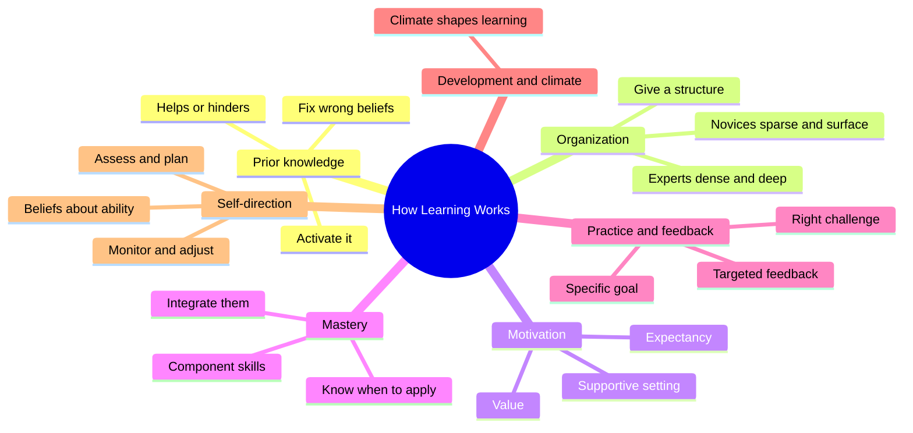
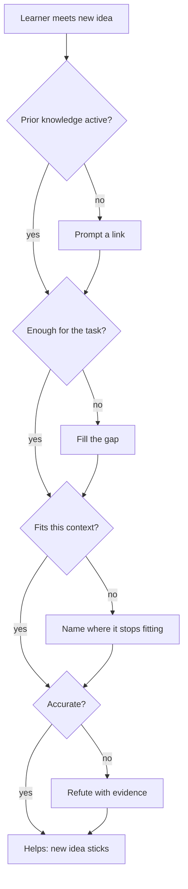
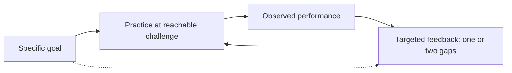
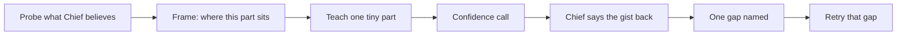

# 🧬 PSY.48 — How Learning Works — Ambrose et al. (2010)
### Knowledge Entry — Distill

A university teaching book from Carnegie Mellon's Eberly Center. Five authors turn a large body of learning research into seven principles, each with a story, the evidence, and classroom strategies. It is in the library because it names what a tutor must check before and after teaching: what the learner already believes, how he files it, why he cares, what he practises, and whether he can judge his own grasp.

## TABLE OF CONTENTS
- [Core Thesis](#1-core-thesis)
- [Mind Models](#2-mind-models)
- [Framework](#3-framework--structure)
- [Key Concepts](#4-key-concepts)
- [Heuristics](#5-heuristics--decision-rules)
- [Invariants](#6-invariants)
- [Pitfalls](#7-pitfalls--myths)
- [Application](#8-application)
- [For Transmission Pedagogy (BOLO 6)](#for-transmission-pedagogy-bolo-6)
- [Cross-References](#9-cross-references)
- [Provenance](#10-provenance--confidence)

---

## 1 · CORE THESIS

Teaching works when the teacher sees what the learner brings and what the learner does. Prior knowledge, knowledge structure, motivation, practice with feedback, and self-monitoring each decide what sticks. The seven principles act together, so a teacher who fixes one and ignores the rest still loses learners (p. 4).

---

## 2 · MIND MODELS

**Diagram 1 — the whole argument.**
Caption: seven principles, and the first five are the ones a one-to-one tutor controls reply by reply.

**Diagram 2 — the central mechanism (the prior-knowledge gate).**
Caption: prior knowledge only helps when it passes all four tests, so a teacher checks each one and fixes the one that fails.

**Diagram 3 — the practice and feedback cycle.**
Caption: practice and feedback only work as a loop, so every round of feedback needs a next round of practice to land in.

**Diagram 4 — mapped onto the Command's systems.**
Caption: the book adds a check before the teach-back loop and two after it, and the proposed rules attach at those points.

---

## 3 · FRAMEWORK / STRUCTURE

An introduction, seven chapters, a conclusion, and four appendices. Each chapter opens with two teacher stories, states one principle, reviews research, lists strategies, and ends with a summary. Page numbers are printed pages.

| Ch. | Pages | Principle | Claim |
|---|---|---|---|
| 1 | 10-39 | Prior knowledge | It can help or hinder learning (p. 13) |
| 2 | 40-65 | Knowledge organization | How pieces connect decides how well they are used (pp. 44-46) |
| 3 | 66-90 | Motivation | Value, expectancy, and environment steer effort (pp. 69-70) |
| 4 | 91-120 | Mastery | Component skills, integration, and knowing when to apply (pp. 95-96) |
| 5 | 121-152 | Practice and feedback | Goal-directed practice with targeted feedback (pp. 125-126) |
| 6 | 153-187 | Development and climate | Climate and developmental level shape learning (p. 6) |
| 7 | 188-216 | Self-direction | Learners must assess, plan, monitor, and adjust (p. 191) |

The authors say the principles are "functionally inseparable" in real teaching (p. 4).

---

## 4 · KEY CONCEPTS

| Concept | What it is | Why it matters |
|---|---|---|
| **Four faults of prior knowledge** (pp. 13-14) | Knowledge that is inactive, insufficient, inappropriate, or inaccurate. | Each needs a different repair. |
| **Declarative vs procedural knowledge** (pp. 18-19) | Knowing what, versus knowing how and when. | A learner can state a rule and still fail to use it. |
| **Elaborative interrogation** (pp. 16-17) | Asking "why" questions that force a link to prior knowledge. | Raised learning and retention. |
| **Misconception** (pp. 24-25) | A deeply embedded wrong model. | Refuting one fact does not dislodge it. |
| **Knowledge organization** (pp. 44-46) | How pieces of knowledge are arranged and linked. | Retrieval and use depend on it. |
| **Advance organizer** (p. 53) | A structure given before the new material. | Learners given one learn more than those left to infer it. |
| **Deep features** (pp. 54-55) | The principle in a problem, versus its surface look. | Novices sort by looks, experts by principle. |
| **Contrasting and boundary cases** (pp. 61-62) | Near twins that differ at the key point, and odd cases at the edge. | They show the learner where the category's edges are. |
| **Value, expectancy, environment** (pp. 69-70) | The three levers of motivation. | If any one is low, effort drops. |
| **Efficacy expectancy** (p. 77) | Belief that I can do the work. | Belief that effort pays is not enough. |
| **Attribution** (pp. 78-79) | The cause a learner gives for a result. | "I lack ability" kills effort. "I under-prepared" keeps it. |
| **Expert blind spot** (pp. 97-99) | An expert cannot see the steps he skips. | The teacher misjudges difficulty and time. |
| **Deliberate practice** (pp. 126, 130-131) | Work toward a reachable, specific goal. | It predicts growth better than time spent. |
| **Formative feedback** (p. 139) | Feedback that guides the next move. | A grade or a "good job" does not. |
| **Metacognitive cycle** (pp. 191-193) | Assess, evaluate, plan, apply, reflect. | Learners skip steps unless prompted. |
| **Fixed vs incremental belief** (pp. 200-201) | Whether ability is seen as fixed or buildable. | It changes how much effort a learner spends. |

---

## 5 · HEURISTICS & DECISION RULES

| Situation | Do this | Not this |
|---|---|---|
| New topic starts | Ask what the learner thinks or already knows about it (pp. 15-17, 28-30) | Assume a blank slate (p. 13) |
| Learner knows a word from daily life | Check the everyday meaning is not distorting the technical one (p. 20) | Trust the shared word |
| You use an analogy | Say where it breaks (pp. 20-21, 22) | Let it stretch past its limit |
| Learner holds an isolated wrong belief | Confront it with the contradicting evidence (p. 24) | Skip it and hope |
| Learner holds a deep misconception | Expect repeated work over time (pp. 24-25) | Count one correction as done |
| New material has many parts | Show the frame first, with headings that name the points (pp. 60-61) | A generic agenda such as "Introduction, Lecture, Recap" (p. 61) |
| Teaching a concept | Give two near cases that differ at the key point (pp. 61-62) | One example alone |
| Learner seems unmotivated | Check value, expectancy, and support, one at a time (pp. 79-80) | Raise pressure (p. 77) |
| Result is good | Credit effort and strategy (pp. 78-79) | Credit luck or "talent" |
| Result is poor | Name a fixable cause (p. 79) | Imply fixed ability |
| Task is complex | Isolate the weak component, drill it, then recombine (pp. 99-102) | Drill the whole task blindly |
| Giving feedback | Name one or two top gaps against the target (pp. 140-141) | A pile of comments |
| Goal is self-repair | Hold the feedback until the learner shows he missed the error (p. 143) | Fix every slip at once |
| Learner rates himself | Compare his guess to his result (p. 195) | Trust the self-rating |

---

## 6 · INVARIANTS

1. New knowledge must connect to old knowledge to be learned (p. 15).
2. Learners seldom activate relevant prior knowledge on their own (p. 16).
3. Having some knowledge makes teacher and learner both overrate readiness (p. 18).
4. Experts organize by principle, novices by surface (pp. 54-55).
5. Providing a structure beats leaving the learner to infer one (pp. 53-54).
6. Motivation needs value, expectancy, and support together (pp. 79-80).
7. The expert teacher underestimates the novice's task (pp. 98-99).
8. Quantity of practice matters even when quality is high (p. 133).
9. Feedback without a next practice round is wasted (p. 141).
10. The weakest learners judge themselves worst (p. 195).

---

## 7 · PITFALLS / MYTHS

- "Students come in blank." They come in with a mix of right, partial, and wrong beliefs (p. 13).
- "Fix a wrong idea by telling the right one." Deep misconceptions survive telling (pp. 24-25).
- "The expert explains best." The expert skips steps without noticing (p. 98).
- "A student who knows the rule can use it." Knowing what is not knowing how or when (pp. 18-19).
- "More feedback is better feedback." Too much hides the priority (pp. 140-141).
- "Instant feedback is best." When the goal is self-repair, delay won (p. 143).
- "Pressure fires students up." A warning that a third would fail made hard workers doubt effort pays (p. 77).
- "I felt ready." Weak learners overestimate before and after a test (p. 195).
- Scope caution: the book is written for college teachers and rests on classroom and lab studies, not one-to-one chat.

---

## 8 · APPLICATION

- **Spine level:** CRAFT-PROCESS. A teaching-method book, not a story source.
- **12-layer character stack:** not applicable. `feeds:` wires to the TEACHING layer only.
- **plot_systems:** not applicable.
- **Setting:** not applicable.

The Command already has a loop that teaches one tiny part and asks for the gist back. This book adds three checks around that loop. Before the part, find out what Chief already believes, because wrong or borrowed ideas bend new ones (pp. 13-14, 20). Around the part, show where it sits in the whole, because learners file facts better when someone hands them the frame (p. 53). After the part, name one gap and let Chief retry it, because feedback with no second round of practice does not land (p. 141).

The book also warns Claude about itself. Claude plays the expert here. An expert skips steps without noticing and misjudges how long a task takes a newcomer (pp. 97-99). The teach-back reply is the one place Claude can see the real gap.

---

## FOR TRANSMISSION PEDAGOGY (BOLO 6)

All rules below are **proposed, not ruled**. Chief rules later. They sit beside ruled rules 13 to 16 and repeat none of them. Pages mark the support. This book studies college classes, so every rule carries over by analogy.

**Proposed rule 1. Open each new part with a bridge, and name where it stops fitting (prior knowledge).**
Before the part, Claude names one thing Chief already knows that the part links to, or asks him one short question to find it. Where the link is an analogy, Claude says where the analogy ends. This builds on pp. 15-17 and 20-22. The 80% result shows a small prompt is enough (p. 16). Claude keeps this to one sentence, so rule 13 holds.

**Proposed rule 2. Show the frame before the part (organization).**
Each part carries a one-line frame that says where it sits in the whole, such as "part 2 of 4 in the layer system". The heading names the point, not the topic. Source: p. 53 for the 60 to 350 percent gain and p. 61 for the heading example. When two ideas are easy to confuse, Claude pairs them as a contrast case (pp. 61-62).

**Proposed rule 3. Feedback names one gap, then Chief retries it (practice and feedback).**
When Chief's gist is off, Claude names the single biggest gap against the point, in one sentence, and asks him to say that piece again. Claude does not list every flaw (pp. 140-141). The retry is the round that lets the feedback land (p. 141). When Claude praises, it credits what Chief did, such as "you separated the two cases", and when Chief misses, it names a fixable cause, never ability (pp. 78-79). This is the motivation lever folded into the feedback line.

**Proposed rule 4. Chief calls his confidence before the gist (metacognition).**
Before saying the gist back, Chief gives one word: sure, half, or lost. Claude compares the word with the gist and says once when they differ. Weak learners overrate themselves most and improve slowly (p. 195), and prompted self-checking raised learning (pp. 198-199). Learners will not self-check unprompted (p. 202). Claude records the pair in the session note so rule 15's cold re-check can pick the parts where the word and the result disagreed. This is Claude's own link, not the book's.

**Strongest single rule from this book:** rule 1. It costs one sentence per part and catches the failure the book calls the worst, a wrong or borrowed idea that bends the new part without anyone noticing (pp. 20-25).

---

## 9 · CROSS-REFERENCES

| Related entry | Relation |
|---|---|
| [[PSY.44]] | Make It Stick. Gives retrieval and spacing. This book adds what to check before and after the recall. |
| [[PSY.43]] | Efficiency in Learning. Its worked example and load budget back this book's scaffolding and component-skill advice (pp. 105-106). |
| [[PSY.45]] | Teach Yourself How to Learn. A learner-side view of the same metacognitive cycle (ch. 7). |
| [[TEC.05]] | Minimalism Beyond the Nurnberg Funnel. Carroll's learner-acts-first view pulls against this book's "frame first". The BOLO 6 note on TEC.05 resolves it. |
| [[TEC.01]] | Docs for Developers. Its audience-first method matches the prior-knowledge check. |
| [[BOLO 6 — transmission pedagogy]] | The working brief these distills serve. |
| [[Teach-back loop (BOLO 95)]] | The ruled loop. Rules 1 and 4 add a step before and a step inside it. |

---

## 10 · PROVENANCE & CONFIDENCE

Full-text extraction of the 2010 book (about 85,000 words). Title, authors, publisher, and year were confirmed from the front matter (Jossey-Bass, a Wiley imprint). Read in full or near full: the introduction's principle summaries, Chapter 1 (research, strategy list start, summary), Chapter 2 (research and the first strategies), Chapter 3 (the value, expectancy, and environment model and its summary), Chapter 4 (expertise, component skills, integration, and the start of transfer), Chapter 5 (practice and feedback research and implications), and Chapter 7 (the metacognitive cycle and implications). Not read: Chapter 6 on development and climate beyond its principle statement, the strategy lists in Chapters 3 to 5 and 7, the appendices on self-assessment, concept maps, rubrics, and objectives, and the conclusion. The Chapter 6 principle appears in the feeds only by the introduction's summary.

Page numbers are printed pages taken from the page-number lines in the extract. A page break can shift a cite by one. The mapping to the TEACHING layer, the four-diagram mapping, the rule proposals, and the claim that rule 1 is strongest are this distill's own synthesis. `zotero_key` is blank and unchecked. `confidence` is medium because several chapters were sampled and the book targets classroom teaching, not chat.

## META
- Template: BVX-LEARN-v4.0
- Source classification: full-text plain-text extraction; chapters 1, 2, 3, 4, 5, 7 read in part, 6 and appendices unread
- Created / Updated: 2026-10-04
