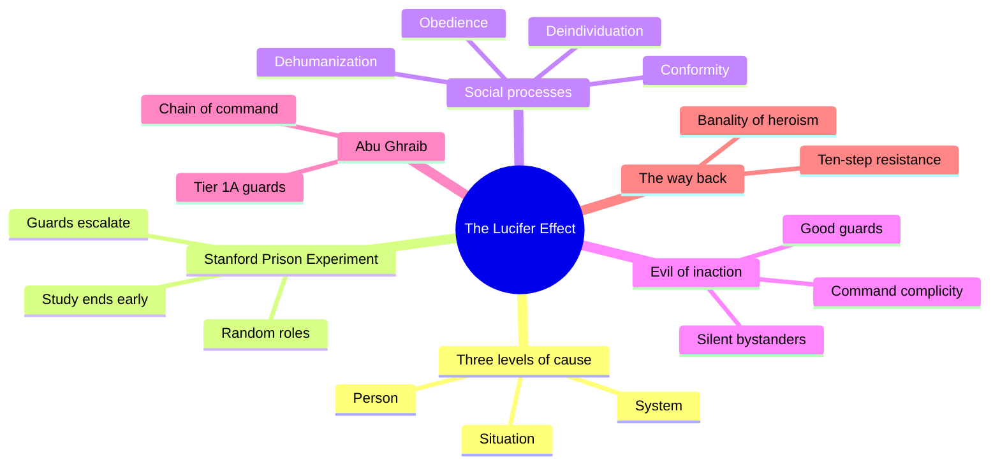
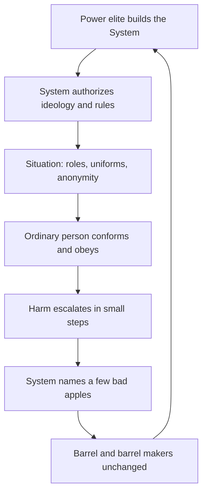
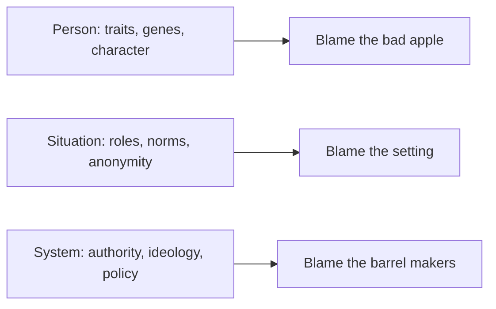
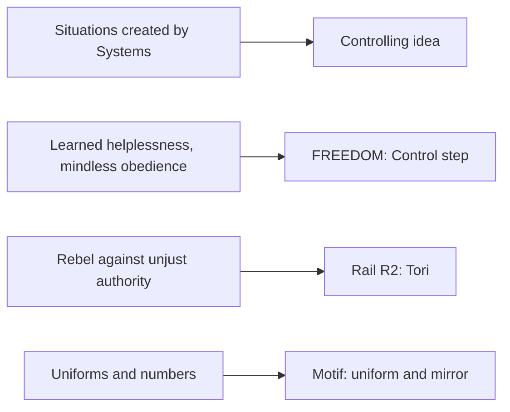

# PSY.49 — The Lucifer Effect — Philip Zimbardo (2007)
### Knowledge Entry — Distill

A social psychologist's book-length case that ordinary people do evil under pressure from situations and systems, built on his 1971 Stanford Prison Experiment and the Abu Ghraib abuses. Held here as an argument, not as settled science.

## TABLE OF CONTENTS
- [Core Thesis](#1-core-thesis)
- [Mind Models](#2-mind-models)
- [Framework](#3-framework--structure)
- [Key Concepts](#4-key-concepts)
- [Heuristics](#5-heuristics--decision-rules)
- [Invariants](#6-invariants)
- [Pitfalls](#7-pitfalls--myths)
- [Application](#8-application)
- [Cross-References](#9-cross-references)
- [Provenance](#10-provenance--confidence)

---

## 1 · CORE THESIS

Good people do evil when a powerful situation, backed by a system, rewards it. Zimbardo asks who built the barrel, not which apple is bad. His proof is the Stanford Prison Experiment, whose methods critics contest.

---

## 2 · MIND MODELS

**Diagram 1 — the whole argument.**
Caption: *the book moves cause from the person, to the situation, to the system, then offers a way back through resistance and heroism.*

**Diagram 2 — the central mechanism (who builds the barrel).**
Caption: *the system sets the rules, the situation shapes the person, harm escalates in small steps, and the system then blames a few bad apples.*

**Diagram 3 — three levels of cause.**
Caption: *the same act can be explained at three levels, and each level points blame at a different group.*

**Diagram 4 — mapped onto the theme system.**
Caption: *Zimbardo's terms land on the controlling idea, FREEDOM, rail R2 and a motif, and the contested study caps how far each can be trusted.*

---

## 3 · FRAMEWORK / STRUCTURE

The book has sixteen chapters in three blocks. The text has no print page numbers, so cites use chapter and "seg." (the page of the text extract).

| Block | Chapters | What it does |
|---|---|---|
| The thesis | 1 The Psychology of Evil | States the three levels of cause and the definition of evil. |
| The SPE | 2 to 9 (day by day, Sunday to Friday) · 10 Meaning and Messages · 11 Ethics and Extensions | Narrates the 1971 study, then draws lessons and answers critics. |
| The wider evidence | 12 Power, Conformity, Obedience · 13 Deindividuation, Dehumanization, Evil of Inaction | Brings in Milgram, Asch and bystander research. |
| Abu Ghraib | 14 Abuses and Tortures · 15 Putting the System on Trial | Applies the thesis and charges the chain of command. |
| The way back | 16 Resisting Situational Influences and Celebrating Heroism | Offers the resistance program and the banality of heroism. |

---

## 4 · KEY CONCEPTS

| Concept | What it is | Why it matters |
|---|---|---|
| **Evil (Zimbardo's definition)** | Intentionally behaving in ways that harm, abuse, demean, dehumanize or destroy innocent others, or using authority to get others to do so. "Knowing better but doing worse" (ch.1, seg.22). | Sets the bar. By this definition, intent matters. See Application. |
| **Dispositional, situational, systemic** | Three levels of explanation: inner traits, the setting, and the power that builds the setting (ch.1, seg.24-28). | The structure of the whole book. |
| **Bad apples, bad barrel** | The "few bad apples" story blames individuals. A systems view studies the "barrel makers" (ch.1, seg.28). | The book's most quotable frame. |
| **System power** | Authorization or institutional permission to act in set ways, usually cloaked in ideology (ch.10, seg.339). | Explains why a rule-following person can do harm. |
| **Ideology as "Big Kahuna"** | A slogan that legitimizes any means to a goal and is not questioned (ch.10, seg.339). | The system's cover story. |
| **Learned helplessness** | Passive resignation after arbitrary, repeated punishment (ch.10, seg.297). | The prisoners' syndrome in the SPE. |
| **Deindividuation and dehumanization** | Anonymity and loss of identity make harm easier, then labels remove the victim's humanity (ch.1, seg.30; ch.16, seg.663). | The props of the SPE: uniforms, numbers, shaved heads (ch.3, seg.91). |
| **Diffusion of responsibility** | When many share the act, no one owns it (ch.16, seg.663). | The mechanism behind "everyone was doing it." |
| **Evil of inaction** | Observers who know and do nothing enable the harm (ch.13, seg.466). | Covers the "good" guards, the good bishops, the good workers at Enron. |
| **Inner Ring** | The wish to be inside the group, and the terror of being left outside (C. S. Lewis, quoted in ch.12, seg.384-385). | The pull that moves people across the line. |
| **Banality of evil and of heroism** | Evil and heroism both come from ordinary people at a decisive moment (ch.16, seg.704-707). | Makes the controlling idea cut both ways. |
| **Heroic imagination** | A society teaches that every person is "a hero in waiting" (ch.16, seg.708). | The book's remedy. |

---

## 5 · HEURISTICS & DECISION RULES

| Situation | Do this | Not this |
|---|---|---|
| Explaining a cruel act | Ask what the situation and the system rewarded (ch.1, seg.25). | Ask only who is rotten. |
| Showing a rank-and-file abuser | Give them an order that was never spoken, only implied (ch.13, seg.468). | Give them a written command to be cruel. |
| Showing the system after exposure | Have leaders name a few bad apples and keep the barrel (ch.1, seg.28). | Have leaders admit the design. |
| Showing the people who watched | Include the good guard who never speaks up (ch.13, seg.466). | Divide the cast into abusers and victims. |
| Showing small steps | Let the harm start low and escalate (ch.14, seg.519). | Open with the worst act. |
| Showing someone who refuses | Give them one decisive moment and ordinary words ("I did what had to be done," ch.16, seg.704). | Give them a speech or a special gift. |
| Showing why a rule-follower falls | Let their authority be real and their orders vague (ch.12, seg.407-410). | Make the authority a fake. |

---

## 6 · INVARIANTS

1. **Situations have builders.** Zimbardo says the rarely asked question is "Who or what made it happen that way?" (ch.10, seg.339).
2. **Small steps start the slope.** Gradual escalation from minimal to extreme is on Fiske's list of ordinary social processes (ch.14, seg.519).
3. **Inaction counts.** Knowing and staying silent enables the harm (ch.13, seg.466).
4. **Ordinary people fill the roles.** Torturers, he reports, are made by training, not born ("Anybody's son will do," ch.16, seg.707).
5. **Authority can be real and still wrong.** Milgram's obedience, nurses and doctors, and airline cockpits all show it (ch.12, seg.401-410).
6. **Blame flows downhill.** The system isolates the lowest actor and shields the barrel makers (ch.1, seg.28; ch.15, seg.607).

---

## 7 · PITFALLS / MYTHS

**The Stanford Prison Experiment is contested. Use this book for its argument about situations, not as settled science.**

- **The method.** Zimbardo's own text says the study had a small sample, selective recordings, no control group, and uncertain causal direction. He calls it "a demonstration" of a phenomenon, not an experiment to establish causes (ch.10, seg.299).
- **The guard briefing.** Zimbardo told the guards that the staff could create boredom, fear and "a notion of the arbitrariness that governs their lives" (ch.3, seg.91). He writes he "worried that I might have given too much direction to them" (ch.3, seg.90). That is the point critics press, because guards may have been following direction, not drifting.
- **The critics.** Thibault Le Texier (a 2018 French book, and a 2019 article in *American Psychologist*) argues from the Stanford archive that the guards were coached and that the study does not show what it claims. I did not read Le Texier. Check the originals before citing them.
- **The BBC study.** The book calls the BBC's repeat a "pseudoexperiment" and says its guards were "increasingly paranoid" (ch.11, seg.375-376). The book gives only Zimbardo's side. I did not read the original report.
- **Timing.** The 2007 book predates Le Texier. It cannot answer him.
- **Contradiction with Vaughan.** In chapter 10 Zimbardo says NASA's "top guns insisted on the launch" despite doubts (seg.341). Vaughan found the managers followed the rules and that the decision was conformity (see [[BVX.1204]]). Where the two disagree, Vaughan has the archive, and Zimbardo does not.
- **The evidence beyond the SPE.** Milgram's 65 percent (ch.12, seg.401) and the nurse study (seg.409-410) are also used here. I did not check their own critics.
- **A thin finding.** The ten-prisoner correlation (r = .90, ch.10, seg.300) rests on ten men. Do not build on it.

---

## 8 · APPLICATION

*Everything below is proposed for BOLO 80, marked provisional, never ruled.*

- **Spine level:** L6. It supplies vocabulary for the controlling idea, FREEDOM and R2.
- **12-layer character stack:** none directly. It could inform how a guard or a bystander character shifts under pressure.
- **plot_systems:** the small-steps slope is a ready escalation order for a repeated scene sequence.
- **Setting:** none beyond the props in Diagram 4.

**What the book adds to the ruled controlling idea.** Zimbardo supplies the people the other two books leave out, the ones who watch. Vaughan's people did not know. O'Neil's people could not see. Zimbardo's include people who knew and said nothing. That shows the idea's edge: nobody *has to* be evil, but many choose silence.

**What it tests.** The ruled idea says "nobody has to be evil." Zimbardo defines evil as "knowing better but doing worse" (ch.1, seg.22). By his definition, people who follow the rules in ignorance are not evil, and people who stay silent knowingly are. A story should decide which kind it shows. The sentence holds fully only for the first kind.

**PROPOSED additions to the theme system.**

1. **A knowledge gradient (scene tag).** Mark each system scene as *did not know* (Vaughan), *could not see* (O'Neil) or *knew and stayed silent* (Zimbardo). It shows where the controlling idea holds and where it bends.
2. **The bystander as a rail voice.** A fifth voice in R1 and R2 scenes: the character who sees and does not act (ch.13, seg.466). It argues the Conformity step from the inside.
3. **R2 as a short list of refusals.** Tori's Growth (Stop) could be staged as Zimbardo's resisting moves: admit the error, own the choice, rebel against unjust authority (ch.16, seg.661-664).
4. **Anna as the model prisoner.** If the story wants Anna's ascent to read as adjustment, the book's finding that conformers lasted longest (ch.10, seg.300) is a flavor, not a proof. Use it as color only.
5. **Motif caution.** The uniform and the mirror already carry the SPE's props (ch.3, seg.91). Add nothing new.

**Touchstone check.** None of these touches TS 1:1.

---

## 9 · CROSS-REFERENCES

| Related entry | Relation |
|---|---|
| [[BVX.1204]] | Vaughan, *The Challenger Launch Decision*. A stronger, archive-based case for the same argument. Zimbardo misreads it in ch.10. |
| [[BVX.1205]] | O'Neil, *Weapons of Math Destruction*. The system claim in scoring models. |
| [[MSX.36]] | Foucault on biopower. Zimbardo's "system power" and "ideology" echo it in plain words. |
| [[BVX.0054]] | Lyons, moral blind spot. A person-level cause that Zimbardo argues against. |
| [[BVX.0236]] | Coyne, the value spectrum behind FREEDOM and FAIRNESS. |

---

## 10 · PROVENANCE & CONFIDENCE

Source: full text of the 2007 Random House edition, from an ebook extract with no print pagination. Quotes were checked against the text. Cites give chapter and "seg." (page of the extract), and chapter numbers are firm while seg. numbers are approximate to a page.

**Read in full or near full:** Chapter 1 (the three levels, the definition of evil, the bad barrel); Chapter 10's summary and its candid statement of the study's limits; Chapter 10's "Why Systems Matter the Most"; Chapter 11's debriefing and replications section; Chapter 12's opening and the Milgram and nurse sections; Chapter 13's evil of inaction; Chapter 15's opening and the "barrel makers" section; Chapter 16's ten-step program and its banality of evil and heroism; the guard orientation in Chapter 3.

**Not read:** the day-by-day SPE narrative in Chapters 2 to 9 beyond the orientation and the closing debrief; most of Chapter 14's Abu Ghraib detail; most of Chapter 15's four-officer prosecution; the notes and the companion website. Claims about those parts are not made here.

**Outside the book, not read:** Le Texier (2018, 2019) and the original BBC Prison Study report. They are named only to flag the dispute. The summaries of their claims are from general knowledge, not from texts read in this pass.

**Inference:** section 8 and the `feeds:` entries are this distill's own wiring to ssot_07. Zimbardo has no theme vocabulary.

**Confidence:** medium. The argument's structure is read fully, but the study it leans on is contested, and the Abu Ghraib half was sampled.

## META
- Template: BVX-LEARN-v4.0
- Source classification: full-text book, deep extraction on 6 of 16 chapters, sampled elsewhere
- Created / Updated: 2026-10-04
