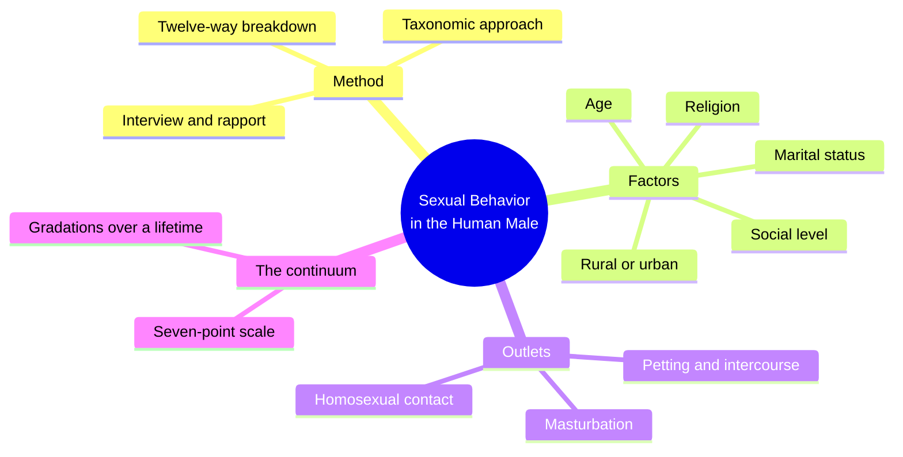
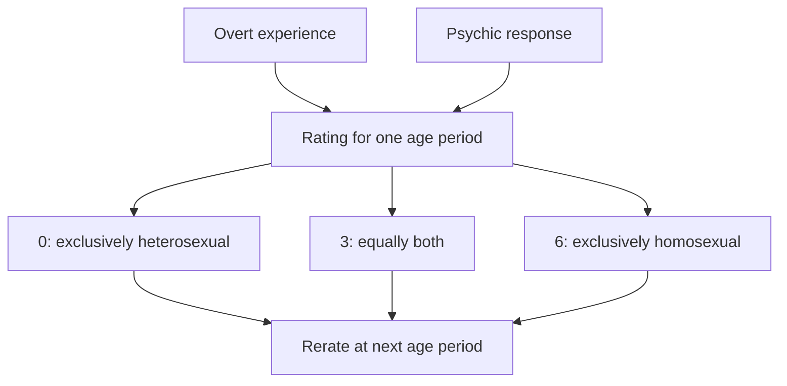
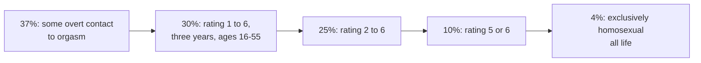
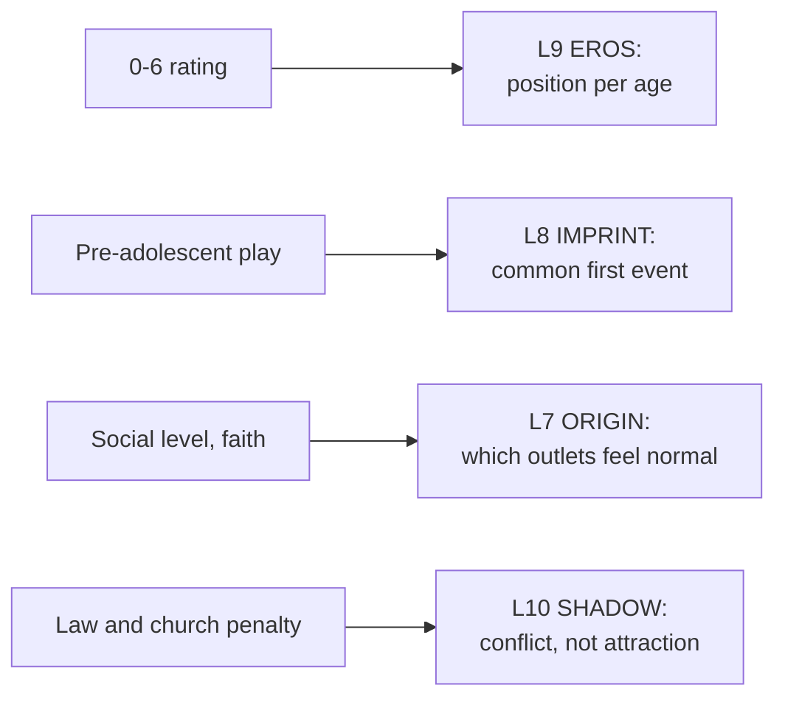

# 🧬 PSY.50 — Sexual Behavior in the Human Male — Kinsey (1948)
### Knowledge Entry — Distill

Kinsey's team at Indiana University published this survey in 1948 from 5,300 male histories. It is the origin of the 0-to-6 orientation scale and of "one in three" style numbers.

> *Fantasy, not a how-to: what happens in these pages stays in them. Reader discretion advised.*

## TABLE OF CONTENTS
- [Core Thesis](#1-core-thesis)
- [Mind Models](#2-mind-models)
- [Framework](#3-framework--structure)
- [Key Concepts](#4-key-concepts)
- [Heuristics](#5-heuristics--decision-rules)
- [Invariants](#6-invariants)
- [Pitfalls](#7-pitfalls--myths)
- [Application](#8-application)
- [Cross-References](#9-cross-references)
- [Provenance](#10-provenance--confidence)

---

## 1 · CORE THESIS

Men do not split into two kinds, heterosexual and homosexual. Behavior runs along a continuum, and the categories are a habit of the human mind. A man's position can change across his life.

---

## 2 · MIND MODELS

**Diagram 1 — the whole argument.**
Caption: *the book measures first and explains later; the orientation chapter turns the data into one claim, a continuum.*

**Diagram 2 — the central mechanism (the 0 to 6 rating).**
Caption: *a rating weighs overt experience and psychic response together, and an age period gets its own rating.*

**Diagram 3 — the headline figures, as the book words them.**
Caption: *the numbers fall as the bar is raised; the same men are counted differently by each definition.*

**Diagram 4 — mapped onto the Command's 12-layer stack.**
Caption: *Kinsey gives L9 a measurable position, L8 a common first event, and L7 a class-and-faith prediction.*

---

## 3 · FRAMEWORK / STRUCTURE

The book has three parts and a clinical appendix.

| Part | What it does |
|---|---|
| I. History and Method (Ch. 1-4) | Kinsey defends a biologist's survey. He moves a taxonomist's method from gall wasps to people, then tests interviewing, sampling and validity |
| II. Factors Affecting Sexual Outlet (Ch. 5-13) | Early growth, total outlet, age, marital status, adolescence, social level, stability across generations, rural-urban background, religion |
| III. Sources of Sexual Outlet (Ch. 14-22) | Masturbation, nocturnal emissions, petting, premarital, marital and extramarital intercourse, prostitutes, homosexual outlet, animal contacts |
| Ch. 23 and tables | Clinical tables and the bibliography |

Chapter 21 is the one that matters most here. It opens with definitions, estimates, frequencies, then the balance, bisexuality and the implications.

---

## 4 · KEY CONCEPTS

| Concept | What it is | Why it matters |
|---|---|---|
| **Taxonomic approach** | Kinsey treats people as a variable population and samples them as a biologist samples insects (Ch. 1, PDF p. 30-31) | It explains why he wants thousands of histories and not a handful of case studies |
| **Total outlet** | Every orgasm counted by source: solitary, heterosexual, homosexual | In the whole sample, homosexual contact gives 6.3 per cent of orgasms (Ch. 21, PDF p. 702) |
| **Individual variation** | One man had one ejaculation in thirty years; a lawyer averaged over thirty a week (Ch. 6, PDF p. 238-239) | The gap is about 45,000 times, so a character's drive cannot be guessed from an average |
| **Pre-adolescent sex play** | Sex play between boys before puberty, mostly ages eight to thirteen (Ch. 5, PDF p. 208) | Kinsey reports it as common, and he reads its limit as cultural restraint |
| **Inversion vs. homosexuality** | Inversion means taking the other sex's role. Homosexuality means the sex of the partner (Ch. 21, PDF p. 707-708) | Kinsey says the two are "not always correlated"; many men stay masculine in same-sex relations |
| **The 0-6 scale** | Seven points from exclusively heterosexual to exclusively homosexual, rated per age period (PDF p. 736-740) | It replaces the two bins with a gradient, and it allows change |
| **Active vs. accumulative incidence** | Active counts people involved in a period. Accumulative counts people who were ever involved (Ch. 3-4) | A writer needs both: who is doing it now, and who ever has |
| **"Sheep and goats"** | Kinsey's line that nature rarely deals in discrete categories and only the mind invents them (PDF p. 737) | It is the book's compressed argument against a typology of men |
| **Rapport and the confidence of the record** | Subjects talked because the interviewer accepted every fact, and the record was never betrayed (Ch. 2, PDF p. 72) | The method trades coercive checks for trust |

---

## 5 · HEURISTICS & DECISION RULES

| Situation | Do this | Not this |
|---|---|---|
| Placing a character's orientation | Give an age-stamped number and note psychic response apart from overt acts | Label him with one word for life |
| A character with no same-sex contact but real attraction | Treat him as a rating 1 to 3 on response alone (PDF p. 739) | Count only acts |
| A man who is masculine and has male partners | Keep his demeanor unrelated to his partner choice (PDF p. 708) | Pair same-sex desire with effeminacy by default |
| A teenage friend group in a rough school | Make same-sex contact common at the high-school level (PDF p. 733) | Treat it as rare or hidden from everyone |
| A churchgoing character | Lower his frequency, not his capacity, if he is active in church (PDF p. 733) | Assume faith removes the attraction |
| A character who ages | Raise the share of his remaining orgasms from his main outlet (PDF p. 733) | Keep frequencies flat across decades |

---

## 6 · INVARIANTS

1. Males do not form two discrete populations (PDF p. 737).
2. A rating belongs to an age period, not to a whole life.
3. Experience and response are different measures, and a rating weighs both.
4. Inversion and homosexuality are separate patterns.
5. The count depends on the definition. The same men are 37, 30, 25, 10 or 4 per cent depending on the bar (PDF p. 748-749).
6. Individual variation in outlet is larger than variation in any physical trait (PDF p. 239).

---

## 7 · PITFALLS / MYTHS

- Read the figures as 1948 data from a white male sample, not as a census of today.
- The sample is partly volunteers. Kinsey says first volunteers tend toward the extrovert and the sexually active (Ch. 3, PDF p. 140). Later critics contest the sampling and the "one in ten" figure, and this entry reports both facts once, plainly.
- The book counts overt acts to orgasm. It does not measure identity, community or love.
- Kinsey says a sample under a hundred histories can show most of the range. The 0-to-6 scale is a descriptive tool, not a diagnosis.
- He promised a later volume on causes. This volume says causes cannot be fixed until the extent is known (PDF p. 703).
- The "10 per cent" figure is a rating of 5 or 6 for at least three years between ages 16 and 55. It is not a lifelong share.

---

## 8 · APPLICATION

*Proposed, not ruled.*

- **Spine level:** L5.
- **12-layer character stack:** L9 EROS (primary: position per age, desire apart from act); L8 IMPRINT (supporting: common first event); L7 ORIGIN (supporting: class and church predict outlets); L10 SHADOW (contextual: penalty as the source of distress); L5 WOUND (contextual: the hidden record).
- **plot_systems:** a character's rating is a plot variable. A scene can move him from a 1 to a 3 without any identity speech.
- **Setting:** a school or town can carry its own incidence by social level, a Kinsey-style table for DCUS.

Kinsey gives the ORANGE work a number a writer can hold and a way to make it move. A character does not "come out as" a type. He has a position in each year. A reader sees him drift, hold or jump. Because the scale needs two inputs, a character can also be a 2 on response and a 0 on acts, and the story can let him know it before anyone else does. The book makes no claim that a man's bearing, voice or job reveals his rating. It says the opposite (PDF p. 708, 734-735).

---

## 9 · CROSS-REFERENCES

| Related entry | Relation |
|---|---|
| [[🧬 MSX.36 — The History of Sexuality — Foucault (1978)]] | Foucault says the homosexual became a species in 1870. Kinsey argues in 1948 that the species is a pigeonhole |
| [[🧬 PSY.53 — The Social Organization of Sexuality — Laumann et al. (1994)]] | Laumann et al. rerun the question with a probability sample and three separate dimensions |
| [[🧬 MSX.60 — Tearoom Trade — Humphreys (1970)]] | Humphreys studies men whose conduct and self-label differ |
| [[🧬 MSX.56 — Coming Out — Weeks (1977)]] | Weeks gives the political history around the same data |

---

## 10 · PROVENANCE & CONFIDENCE

Full text, pdftotext extraction, 951 PDF pages. The extract has no printed page numbers, so every page cite here is a PDF page (the book's own index gives the rating scale at printed pp. 638-641). Title page and imprint: Kinsey, Pomeroy and Martin, Indiana University Press edition of the 1948 W. B. Saunders volume, with a preface by Alan Gregg.

Read: the preface, Ch. 1 (the taxonomic approach), part of Ch. 2 (rapport, confidence of the record), Ch. 3 on volunteers, the closing of Ch. 4, Ch. 5 on pre-adolescent play, Ch. 6 on individual variation, and Ch. 21 in its main parts (definition, balance, the rating scale, the summary percentages, the implications).

Skipped: Ch. 7 to 13 detail tables, Ch. 14 to 20, 22, 23 and the appendices. The source data are dated and the sampling is contested. The sample is white, mostly college-linked, and partly volunteer. The `feeds:` keying is this distill's own work, and Kinsey uses none of the 12-layer vocabulary.

## META
- Template: BVX-LEARN-v4.0
- Source classification: full-text pdftotext extraction, targeted read of Ch. 1, 2, 5, 6 and 21
- Created / Updated: 2026-10-04
