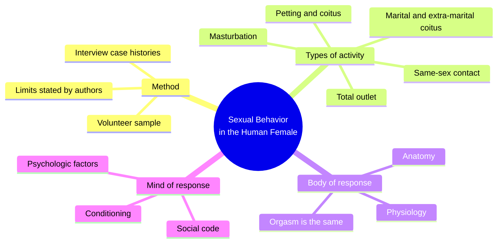
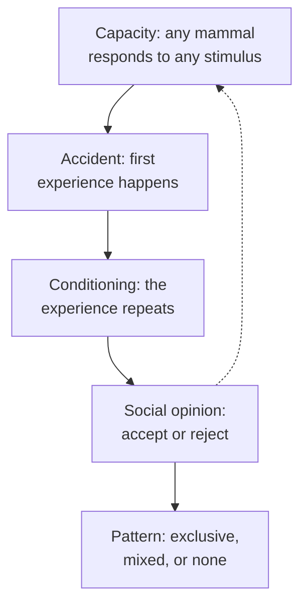
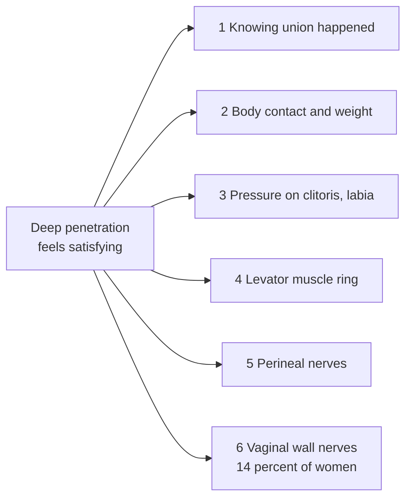
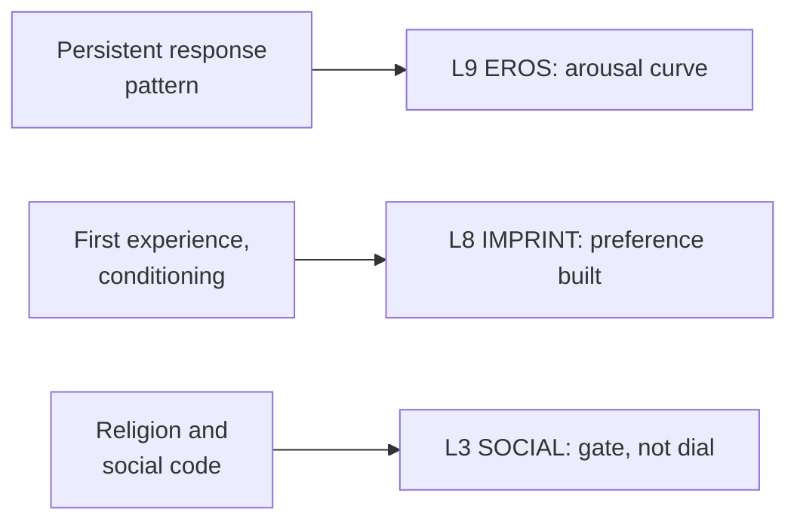

# 🧬 PSY.51 — Sexual Behavior in the Human Female — Kinsey et al. (1953)
### Knowledge Entry — Distill

Fantasy, not a how-to: what happens in these pages stays in them. Reader discretion advised.

The Kinsey team's 1953 survey reports interviews with about 8,000 American women, 5,940 of them used in this volume. It is a data book first and an argument second, and the argument is that sexual response is one body, one pattern, and many conditioned paths.

## TABLE OF CONTENTS
- [Core Thesis](#1-core-thesis)
- [Mind Models](#2-mind-models)
- [Framework](#3-framework--structure)
- [Key Concepts](#4-key-concepts)
- [Heuristics](#5-heuristics--decision-rules)
- [Invariants](#6-invariants)
- [Pitfalls](#7-pitfalls--myths)
- [Application](#8-application)
- [Cross-References](#9-cross-references)
- [Provenance](#10-provenance--confidence)

---

## 1 · CORE THESIS

Women and men share one anatomy and one physiology of response. The differences that show up sit in psychology, in conditioning, and in social rules. Labels like "homosexual" describe acts and contacts, not kinds of people.

---

## 2 · MIND MODELS

**Diagram 1 — the whole argument.**
Caption: *the book runs in three moves: how the data were gathered, what women actually do, and why the body is the same for both sexes.*

**Diagram 2 — the central mechanism (four factors behind a same-sex pattern).**
Caption: *a same-sex pattern needs no special cause: a shared capacity, a first accident, conditioning, and social opinion do the work in order.*

**Diagram 3 — the clitoris and vagina argument.**
Caption: *the book breaks the "vaginal orgasm" idea into six sources of satisfaction, and only the last one is the vagina's own nerves.*

**Diagram 4 — mapped onto the Command's 12-layer character stack.**
Caption: *three findings land on three layers: response signature on EROS, first events on IMPRINT, and social code on SOCIAL.*

---

## 3 · FRAMEWORK / STRUCTURE

| Part | What it does |
|---|---|
| I. History and Method (Ch. 1-3, pp. 3-96) | The authors state scope, sample, statistics, and the case-history interview. |
| II. Types of Sexual Activity (Ch. 4-13, pp. 101-566) | Ten chapters give incidence and frequency for each outlet, plus a female/male comparison table. |
| III. Comparisons of Female and Male (Ch. 14-18, pp. 567-~760) | Anatomy, physiology, psychology, nerves, and hormones, each ending in a comparison. |
| Summary and Conclusions | The authors restate the case that response is one system. |

Each type of activity follows one template. The authors give the mammal background, the anthropology, then incidence by age, marital status, and education.

---

## 4 · KEY CONCEPTS

| Concept | What it is | Why it matters |
|---|---|---|
| **Accumulative incidence** | The share of women who have ever done a thing by a given age (Ch. 2, p. 46) | It separates "ever" from "now," which are different facts. |
| **Active incidence and median frequency** | Who is doing it in a given period, and how often | A character can have a history without a present. |
| **Three same-sex measures** | Erotic arousal, physical contact, orgasm (Ch. 11, p. 452) | By 45, about 28 per cent had been aroused, 19 per cent had contact by 40, and 13 per cent had orgasm (pp. 453-454). |
| **Terms describe acts** | The authors want to drop "homosexual" as a noun for persons (p. 447) | Naming a contact does not name a person. |
| **Physiologic capacity** | Any mammal can respond to any sufficient stimulus (p. 447) | It removes the need for a special cause. |
| **Same orgasm in both sexes** | Female and male orgasm match in the physiologic elements (Ch. 15, p. 640) | The slow-woman rule has no data (p. 641). |
| **Vaginal insensitivity** | Only 14 per cent of women feel touch inside the vagina (Ch. 14, p. 582) | The "mature vaginal orgasm" has no anatomic basis (p. 582). |
| **Psychologic arousal gap** | Women fewer than men on 29 of 33 items (Ch. 16, p. 687) | A third of women match the average man (p. 688). |
| **Individual variation** | Six dials of response vary per person (p. 639) | Each person's pattern is distinct and stable. |
| **Guilt as a dial** | Guilt can be the largest factor in satisfaction (p. 640) | Satisfaction depends on acceptance, not only on touch. |

---

## 5 · HEURISTICS & DECISION RULES

| Situation | Do this | Not this |
|---|---|---|
| Writing a first same-sex moment | Make it an accident of place and partner, then show conditioning | Give it a deep hidden cause or trauma |
| Writing arousal | Give each character a stable signature (speed, spasm size, body areas) | Give every character the same build-up |
| Writing a woman's orgasm in intercourse | Credit several sources, including contact with the clitoris and labia | Make the vagina the sole engine |
| Writing a woman who is aroused by images or fantasy | Treat her as one of the 2 to 3 per cent, or the third at the male average | Treat it as a flaw or as typical |
| Writing a devout character | Let belief gate the start; once begun, her pace matches anyone's | Make belief slow every act |
| Writing a long relationship | Let satisfaction grow with knowing the partner (p. 640) | Treat novelty as the only fuel |

---

## 6 · INVARIANTS

1. **Anatomy and physiology of response are the same in both sexes.** Details differ; the elements do not (Ch. 15, p. 640).
2. **The capacity to respond to any stimulus is universal.** Preference is added by experience (Ch. 11, p. 447).
3. **Response patterns are individual and persistent.** They vary on six dials over a lifetime (p. 639).
4. **Acts, not people, are the unit of record.** The data count contacts, arousal, and orgasm (p. 452).
5. **Conditioning matters more in the male than the female in this sample.** The authors cite 33 bodies of data (p. 687).
6. **Social code gates who starts an act.** It changes the rate little after the start (p. 687).

---

## 7 · PITFALLS / MYTHS

- **The sample is not the population.** Volunteers, many college-educated, and four interviewers took the histories; two did 81 per cent (Ch. 2, pp. 36-37). The authors say so.
- **The data are from 1953.** Later survey work contests the sample and some figures. Use them as a period record, not as current rates.
- **The authors list groups the findings fit worst.** These include women over 50, rural women, and Catholic and devoutly Jewish groups (p. 36).
- Treating "orgasm needs a vagina" as science. The book argues against it with anatomy (p. 582).
- Treating a female-male psychology gap as a body gap. The book says the gap is in psychology, not physiology (p. 688).
- Reading "same-sex contact" as proof of an identity. The authors decline that reading (p. 447).

---

## 8 · APPLICATION

*Proposed, not ruled.*

- **Spine level:** L5.
- **12-layer character stack:** L9 EROS (primary, the arousal curve as a stable signature); L8 IMPRINT (primary, first experience and conditioning); L9 desire_vector and psychosexual_arousal_range (supporting); L3 SOCIAL (contextual, the gate).
- **plot_systems:** a first-experience scene and a conditioning chain give a ready beat map for an OXO character's orientation arc.
- **Setting:** contextual. The 1953 social code is a period gate for any 1950s setting.

The book gives the ORANGE work a plain way to write bodies. Each character carries one fixed response signature, so two characters in one scene never feel the same. The signature also stops a writer from using one climax shape for everyone. The first-event model gives each character a datable origin for preference, in the pattern the OXO shelf already calls IMPRINT. The three-measure split (arousal, contact, orgasm) lets a writer stage each as its own scene. A proposed variable, `response_signature`, would hold the six dials on L9.

---

## 9 · CROSS-REFERENCES

| Related entry | Relation |
|---|---|
| [[🧬 MSX.36 — The History of Sexuality — Foucault (1978)]] | Foucault argues naming makes a "species"; Kinsey argues the same naming misleads. |
| [[🧬 PSY.54 — Lovemaps — Money (1986)]] | Money builds a developmental map where Kinsey records conditioning by accident. |
| [[🧬 MSX.17 — Mating in Captivity — Perel (2006)]] | Perel's account of desire sits on the psychologic factors Kinsey measures. |

---

## 10 · PROVENANCE & CONFIDENCE

Full-text pdftotext extraction, 888 pdf pages. Title page confirms Kinsey, Pomeroy, Martin, Gebhard, W. B. Saunders, Philadelphia, 1953. Printed pages cited; pdf page equals printed page plus 34. Read: Ch. 1 front matter, the sample-inadequacy pages of Ch. 2 (pp. 35-37), Ch. 11 up to its comparison table (pp. 446-455 and the summary on p. 487), Ch. 14 on the vagina (pp. 581-583), Ch. 15 summary (pp. 639-641), Ch. 16 summary (pp. 687-689), and the Ch. 9 comparison table.

Skipped: Ch. 3, 4 to 8, 10, 12, 13, 17, 18, and the appendices. The pre-adolescent chapter was not read. The comparison tables are garbled in the extraction, so only prose figures are used. Sampling is the book's weak point; the authors admit it (p. 36). Confidence is medium for the data and high for the argument's shape. The `feeds:` keying is this distill's own synthesis.

## META
- Template: BVX-LEARN-v4.0
- Source classification: full-text extraction, targeted read of introduction, Ch. 11, 14-16
- Created / Updated: 2026-10-04
