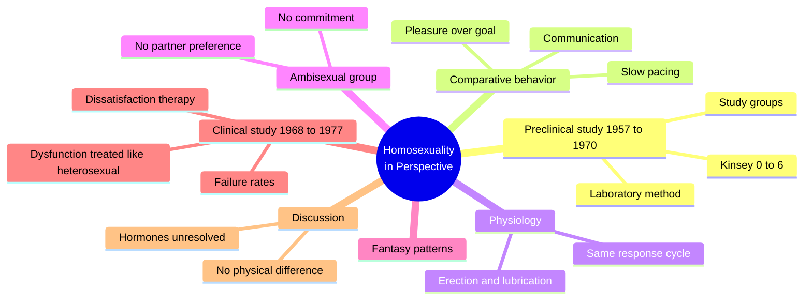
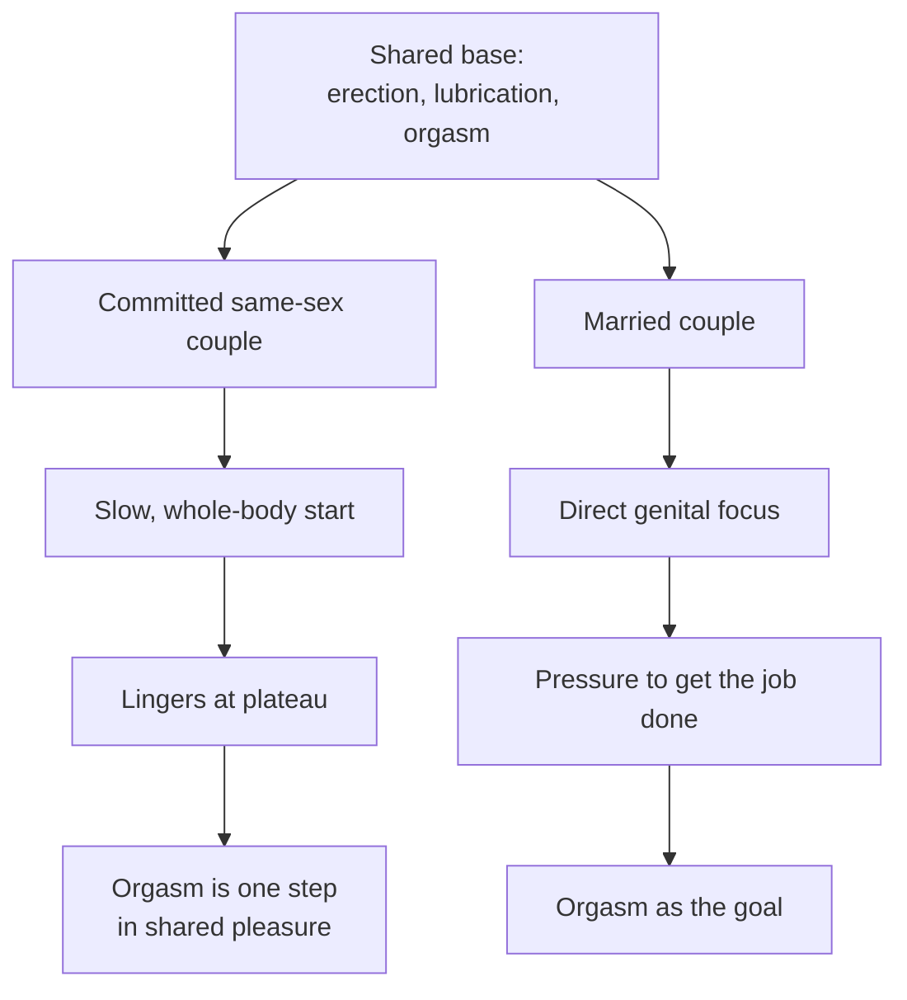
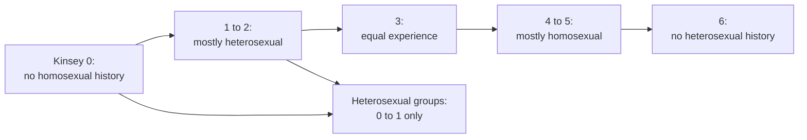

# 🧬 PSY.52 — Homosexuality in Perspective — Masters & Johnson (1979)
### Knowledge Entry — Distill

William Masters and Virginia Johnson published this clinical report with Little, Brown in 1979. It covers laboratory studies of same-sex and opposite-sex sexual response (1957-1970) and a clinical therapy program (1968-1977).

## TABLE OF CONTENTS
- [Core Thesis](#1-core-thesis)
- [Mind Models](#2-mind-models)
- [Framework](#3-framework--structure)
- [Key Concepts](#4-key-concepts)
- [Heuristics](#5-heuristics--decision-rules)
- [Invariants](#6-invariants)
- [Pitfalls](#7-pitfalls--myths)
- [Application](#8-application)
- [Cross-References](#9-cross-references)
- [Provenance](#10-provenance--confidence)

---

## 1 · CORE THESIS

The body responds the same way to same-sex and opposite-sex partners. What differs is behavior: committed same-sex couples move slowly and focus on shared pleasure. Sexual dysfunction has the same causes in every orientation, so the authors argue it needs the same treatment.

---

## 2 · MIND MODELS

**Diagram 1 — the whole argument.**
Caption: *the book runs a lab study, then a clinic, and reaches one claim: function is shared and behavior differs by couple type.*

**Diagram 2 — the central mechanism (same body, different pacing).**
Caption: *physiology is a shared base, and the pattern differences sit above it in how the couple moves.*

**Diagram 3 — the Kinsey scale as the study used it.**
Caption: *the authors rate preference by history alone and recruit the full homosexual range, but only Kinsey 0 or 1 for the heterosexual groups.*

---

## 3 · FRAMEWORK / STRUCTURE

The book has two sections: a preclinical study (chs. 1-11) and a clinical study (chs. 12-18).

| Part | Governing move |
|---|---|
| Preclinical Study, 1957-1970 (chs. 1-11, pp. 3-232) | Recruitment, laboratory method, comparative behavior, functional efficiency, physiology, ambisexuals, fantasy, and commitment |
| Ch. 1: Preclinical Investigation (pp. 3-12) | Sets the aims, the study groups, and the Kinsey frame |
| Ch. 5: Comparative Sexual Behavior Patterns (pp. 61-91) | Lab observation of masturbation, partner stimulation, and coital variants |
| Ch. 8: Ambisexual Study Group (pp. 144-173) | Defines and studies a group with no partner preference |
| Clinical Study, 1968-1977 (chs. 12-18, pp. 235-412) | Therapy for male and female dysfunction and for dissatisfaction, with statistics |
| Ch. 15: Male Homosexual Dissatisfaction (pp. 333-360) | Therapist neutrality, motivation, "conversion" and "reversion" programs |
| Ch. 18: Clinical Discussion (pp. 403-412) | Summary claims, failure rates, and the hormone literature |

---

## 4 · KEY CONCEPTS

| Concept | What it is | Why it matters |
|---|---|---|
| **Kinsey 0-6 scale** | A rating of sexual preference from history alone (ch. 1, pp. 8-9) | The authors call the history method "not always reliable" but usable |
| **Committed versus assigned couples** | Study pairs who live together for a year versus paired volunteers with no commitment (ch. 1, pp. 10-11) | It tests whether commitment changes behavior |
| **Pacing difference** | Committed same-sex couples move slowly; married couples are goal-focused (ch. 5, pp. 64-65) | The authors call it the dominant pattern |
| **Whole-body start** | Lesbian and gay male couples spend time on total body contact before genitals (ch. 5, pp. 66, 71) | Heterosexual couples spent under a minute (p. 66) |
| **Communication gap** | Husbands did not ask whether breast play hurt; lesbian partners asked (ch. 5, p. 68) | Sparse communication produced discomfort that went unspoken |
| **Masturbation mirrors technique** | A partner repeats his own masturbation style on the other (ch. 5, p. 70) | The authors tie forceful stroking to forceful partner play |
| **Ambisexual** | The Institute's term for a person who responds equally to either sex and wants no continuing relationship (ch. 8, pp. 145-146) | The authors separate it from bisexual |
| **Spectator role** | Watching one's own performance during sex (ch. 18, p. 406) | It disables any person, of any orientation |
| **Dysfunction versus dissatisfaction** | Trouble functioning versus wanting to change orientation (chs. 13-16) | The authors treat the second as a separate program |
| **Therapist neutrality** | The therapist may not impose his value system (ch. 15, p. 334) | It is the authors' stated rule for the dissatisfaction program |

---

## 5 · HEURISTICS & DECISION RULES

| Situation | Do this | Not this |
|---|---|---|
| Writing a same-sex sex scene | Give the body the same basic response as any scene | Invent a different physiology |
| Writing a pair's pacing | Make the pair's pattern a feature: slow or goal-driven | Make it a fixed gender trait |
| Writing a partner who stays silent | Show discomfort gone unspoken, then the partner's surprise | Write silence as consent |
| Writing performance fear | Show him watching himself and losing the moment | Tie it to orientation |
| Writing a character with no partner preference | Give him a ready, casual, uncommitted pattern | Call him bisexual by default |
| Writing a therapist or authority | Show him pressing his own values on a client | Write him as neutral |
| Writing a mixed-experience character (Kinsey 2 to 4) | Let him enjoy the sensual aspects regardless of the partner's gender | Make him choose a side |

---

## 6 · INVARIANTS

1. Erection, lubrication, and orgasm work the same way with any partner (ch. 18, p. 405).
2. Sexual dysfunction has the same causes in every orientation (ch. 18, p. 406).
3. Performance fear and the spectator role disable men and women alike (ch. 18, p. 406).
4. Partner preference is a spectrum, not two boxes (ch. 18, p. 405).
5. Homosexuality is "no more a unitary phenomenon than is heterosexuality" (ch. 18, p. 411).
6. A therapist who imposes his own values weakens the treatment (ch. 15, p. 334).

---

## 7 · PITFALLS / MYTHS

- Treating the study group as typical. The authors state the groups were selected for high sexual function and higher education, and are "not representative of the population as a whole" (ch. 1, p. 8). The subjects were volunteers who could reach orgasm in the lab.
- Treating the comparison as fair. The authors say heterosexual groups were limited to Kinsey 0 or 1, and homosexual groups spanned the range. They do not know how much that skewed the data (ch. 1, pp. 9-10).
- Treating "committed" as one measure. Marriage and one year of shared residence were the two definitions, and the authors call the lack of parallelism a flaw (ch. 1, p. 10).
- Dated and contested: the "conversion" and "reversion" therapy data (chs. 15 to 17). The authors report a failure rate near 35 percent for dissatisfaction therapy and call it "unacceptable" (ch. 18, p. 407). Later clinical bodies have rejected sexual-orientation change therapy, and the book's outcome figures have not stood. Treat chs. 15 to 17 as a record of 1970s practice, not as evidence it works.
- Dated: the hormone section reports studies that conflict, and the authors call all of them limited by sample size (ch. 18, p. 411).
- Reading the pacing finding as universal. The authors note exceptions on both sides (ch. 5, p. 65).
- Treating the book as a statement of social position. The authors say it "must not be construed" that way (Preface, p. ix).

---

## 8 · APPLICATION

*Proposed for the ORANGE work, not ruled.*

- **Spine level:** L5.
- **12-layer character stack:** L9 EROS (primary, pacing); L5 WOUND (primary, spectator fear); L2 VITAL (primary, shared physiology); L3 SOCIAL (supporting, imposed values); L6 DRIVE (supporting, gender-neutral appetite); L1 CORE (contextual, the Kinsey position).
- **plot_systems:** a scene where two men move at different paces is a built-in conflict. One is goal-focused, the other lingers, and neither says so.
- **Setting:** a 1970s clinic or lab is a ready institution with its own observers, rules, and consent frame.

The strongest addition is erotic pacing as a pair trait. A couple that lingers, with whole-body starts and little goal pressure, is a different EROS fingerprint from a goal-driven one. A writer can mismatch two men on pacing and get friction with no villain.

A second useful piece is the spectator role. A character who watches himself during sex has a WOUND-layer mechanism that explains stalled scenes without blaming desire.

Proposed use: add `erotic_pacing` and `spectator_fear` to the EROS and WOUND variable lists as paired fields.

---

## 9 · CROSS-REFERENCES

| Related entry | Relation |
|---|---|
| [[🧬 MSX.17 — Mating in Captivity — Perel (2006)]] | Perel studies desire inside long relationships; Masters and Johnson study committed-couple pacing in a lab |
| [[🧬 MSX.36 — The History of Sexuality — Foucault (1978)]] | The clinic that produced this data is the apparatus Foucault describes, in 1979 form |
| [[🧬 MSX.55 — Gay American History — Katz (1976)]] | Katz's Part II reprints the earlier treatment literature this book sits at the end of |
| [[🧬 MSX.14 — The New Bottoming Book — Easton & Hardy (2001)]] | Easton and Hardy teach communication that this book finds missing in many couples |

---

## 10 · PROVENANCE & CONFIDENCE

Full text by pdftotext, about 462 pdf pages; book page = pdf page minus 12. Copyright page confirms William H. Masters and Virginia E. Johnson, *Homosexuality in Perspective*, Little, Brown, 1979 (first edition). The Foreword is by H. Tristram Engelhardt, Jr.

Read in full: the Foreword, Preface, and ch. 1 (pp. 3-12); ch. 2's opening; ch. 5's pacing and partner-stimulation sections (pp. 63-71); ch. 8's opening (pp. 144-146); ch. 15's opening (pp. 333-336); ch. 18 (pp. 403-412). Skipped: chs. 3, 4, 6, 7, 9 to 14, 16, 17, the clinical case material, and the bibliography. Physiology (ch. 7) and fantasy (ch. 9) are known only from ch. 18's summary.

Dated and contested: the 1957-1970 lab sample was small, self-selected, and educated. The outcome statistics for orientation-change therapy are the book's most contested content. The pacing and physiology claims rest on observation in a laboratory, with all the limits that implies. Confidence is medium.

The `feeds:` keying is this distill's own synthesis. The book uses no layer vocabulary.

## META
- Template: BVX-LEARN-v4.0
- Source classification: full-text pdftotext, selected chapters read, remainder skipped
- Created / Updated: 2026-10-04
