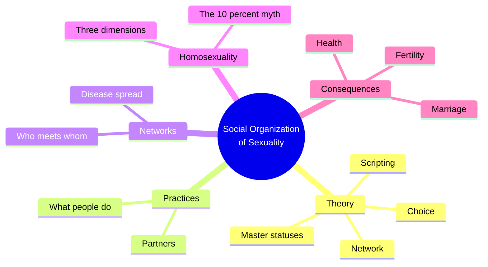
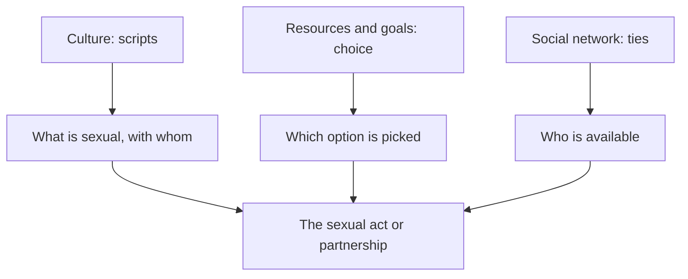
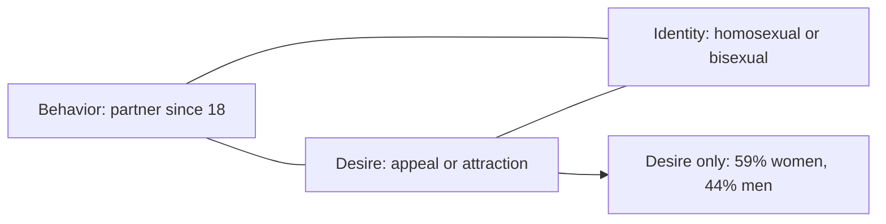
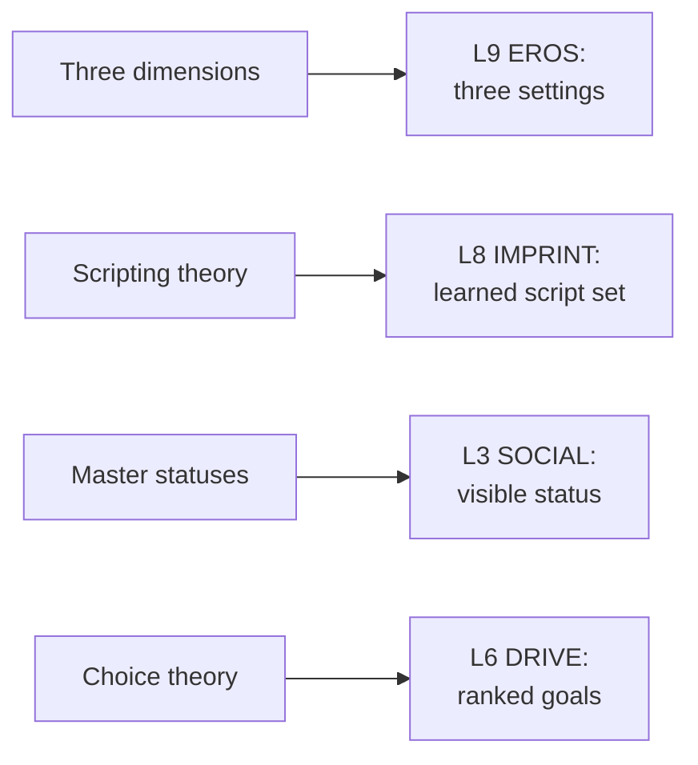

# 🧬 PSY.53 — The Social Organization of Sexuality — Laumann et al. (1994)
### Knowledge Entry — Distill

This 1994 book reports the National Health and Social Life Survey of 1992. It surveyed 3,432 U.S. adults aged 18 to 59, and it is a probability sample.

> *Fantasy, not a how-to: what happens in these pages stays in them. Reader discretion advised.*

## TABLE OF CONTENTS
- [Core Thesis](#1-core-thesis)
- [Mind Models](#2-mind-models)
- [Framework](#3-framework--structure)
- [Key Concepts](#4-key-concepts)
- [Heuristics](#5-heuristics--decision-rules)
- [Invariants](#6-invariants)
- [Pitfalls](#7-pitfalls--myths)
- [Application](#8-application)
- [Cross-References](#9-cross-references)
- [Provenance](#10-provenance--confidence)

---

## 1 · CORE THESIS

Sexual behavior is social, not only a matter of drive. Scripts, choices and networks shape it, and same-gender sexuality has three separate parts that rarely line up.

---

## 2 · MIND MODELS

**Diagram 1 — the whole argument.**
Caption: *three theories explain the social side of sex, and the survey tests them across the life course.*

**Diagram 2 — the central mechanism (three theories, one act).**
Caption: *scripts say what is possible, choices say what is picked, networks say who is available.*

**Diagram 3 — the three dimensions of same-gender sexuality.**
Caption: *a person can have any one, any two, or all three, and desire alone is the biggest group.*

**Diagram 4 — mapped onto the Command's 12-layer stack.**
Caption: *Laumann et al. give EROS three settings, IMPRINT a script set, and SOCIAL a master status.*

---

## 3 · FRAMEWORK / STRUCTURE

Three parts, fourteen chapters, an epilogue and appendices.

| Part | What it does |
|---|---|
| Part I, Ch. 1-2 | Theory (scripting, choice, network, master statuses) and the study design |
| Part II, Ch. 3-9 | Practices, partners, networks, epidemiology, homosexuality, early experience and victimization |
| Part III, Ch. 10-14 | Health, infections, fertility, marriage and cohabitation, attitudes |
| Epilogue and appendices | Policy, sampling, comparison with other samples, the questionnaire |

---

## 4 · KEY CONCEPTS

| Concept | What it is | Why it matters |
|---|---|---|
| **Scripting theory** | Cultural scenarios, interpersonal scripts and intrapsychic scripts guide conduct (Ch. 1.2, p. 5-7) | A person improvises on a script rather than obeying a drive |
| **Choice theory** | Sex pursues goals with limited resources (Ch. 1.3, p. 8-15) | Most people stay with one partner because the search is costly |
| **Network theory** | The dyad and its ties matter (Ch. 1.4, p. 16-24) | Partners come through networks, and networks carry infection |
| **Master statuses** | Gender, age, race, religion, education: visible, weighty, shaping (Ch. 1.6, p. 30-33) | They set scripts, choices and network position |
| **Master relationships** | Marriage, cohabitation, and other partnership types (p. 33-34) | Each carries its own visibility and expectations |
| **Probability sample** | Respondents chosen with known odds (Ch. 2, p. 35-70) | It allows a claim about the population |
| **Self-administered questionnaire** | A sealed form for the most sensitive items (Ch. 8, p. 294) | Privacy raises reporting of stigmatized acts |
| **Bridge** | A node whose removal splits two groups (Ch. 7, p. 280-281) | Bisexual partners are the only bridge between the two communities for AIDS |
| **Three dimensions** | Behavior, desire and identity (Ch. 8, p. 291-293) | Each can be present without the others |
| **Same-gender prevalence** | 2.8% of men and 1.4% of women identify as homosexual or bisexual; 4.9% of men had a male partner since 18 (Ch. 8, p. 294-296) | The figures vary by measure |
| **Desire only** | Desire without adult behavior or identity (Ch. 8, p. 298) | It is the largest group among those with any dimension |
| **The "10 percent myth"** | The common 10% figure came from one of Kinsey's thirteen statistics (Ch. 8, p. 287-289) | The authors say one number cannot describe a varied trait |

---

## 5 · HEURISTICS & DECISION RULES

| Situation | Do this | Not this |
|---|---|---|
| Writing a character's orientation | Set behavior, desire and identity separately | Use one word for all three |
| A character who desires men and has never acted | Make desire his only dimension, which is the common case (p. 298) | Count him as "closeted" and move on |
| A boy who had one early same-sex experience | Treat it as a common, often passing event (p. 296) | Treat it as a verdict on identity |
| A character's love life | Run it through the network: who introduced whom (p. 234-237) | Treat meetings as random |
| A character who stays with one partner | Cost the search: time, risk, reputation (p. 8-9) | Treat fidelity as only a virtue |
| A scene of a first time | Let the script and the improvisation both show (p. 6-7) | Show only instinct |
| A character's status | Pick which master status the room sees first (p. 30-31) | Make all statuses visible at once |

---

## 6 · INVARIANTS

1. Sexual conduct is learned from culture and adapted, not only driven (p. 5-7).
2. Most adults report one partner in the past year (71 per cent) (p. 9).
3. About 60 per cent of partnerships come through a third-party introduction (p. 236).
4. Same-gender behavior, desire and identity are only moderately linked (p. 296-298).
5. A single prevalence number for homosexuality rests on false assumptions (p. 283).
6. Probability sampling is the minimum for claims about a population (p. 34).

---

## 7 · PITFALLS / MYTHS

- The survey covers adults 18 to 59 living in households in 1992. It omits the institutionalized and the young and old.
- Self-report is the instrument. The authors expect some under-reporting of stigmatized behavior, and they say so (p. 285).
- The sample is a snapshot from the AIDS era. The book's findings on practices and infection reflect 1992.
- The authors give no theory of causes of orientation and say so (p. 291).
- The prevalence figures are lower than Kinsey's. The authors trace the gap to Kinsey's purposive, volunteer sampling and to his use of institutional recruits (p. 288-289). They also credit Kinsey for his pioneering role.
- "Desire only" is the largest group in a small subgroup of 143 men and 150 women. Do not extend it to the whole population.
- The 4.9 and 2.8 per cent figures count different things. The book gives a table for each measure.

---

## 8 · APPLICATION

*Proposed, not ruled.*

- **Spine level:** L5.
- **12-layer character stack:** L9 EROS (primary: three separate dimensions); L8 IMPRINT (primary: script set and improvisation); L3 SOCIAL (primary: master status; supporting: partnering network); L6 DRIVE (supporting: ranked goals); L7 ORIGIN (contextual: baseline by religion, school and region).
- **plot_systems:** a "dimension gap" scene. Someone reads a character's behavior as his desire, or his identity as his behavior, and gets it wrong.
- **Setting:** DCUS can get its own network map. Who introduces whom, and which statuses show on entry.

For the ORANGE work, the book gives EROS a form that holds Kinsey's idea in modern terms. Instead of a seven-point line, a character has three switches: what he does, what he wants, what he calls himself. A story can set them apart. A boy can want, not act, and not name it. A man can act, not want, and not name it. A man can name himself and do neither. Scripting theory also gives IMPRINT a plain job: record which scripts a character learned and where he improvises. The network finding gives plot a quiet engine, since most partners come through friends.

---

## 9 · CROSS-REFERENCES

| Related entry | Relation |
|---|---|
| [[🧬 PSY.50 — Sexual Behavior in the Human Male — Kinsey (1948)]] | Laumann et al. criticize Kinsey's sample (p. 288-289) and keep his lesson that no single number fits |
| [[🧬 MSX.36 — The History of Sexuality — Foucault (1978)]] | The authors cite Foucault on the late-nineteenth-century creation of the homosexual (p. 282) |
| [[🧬 MSX.60 — Tearoom Trade — Humphreys (1970)]] | Humphreys shows men with behavior and no identity, the case the survey counts as a dimension split |
| [[🧬 MSX.56 — Coming Out — Weeks (1977)]] | Weeks gives the history of identity, one of the three dimensions |
| [[🧬 MSX.48 — Gender Trouble — Butler (1990)]] | Butler's break between desire, gender and sex echoes the survey's three dimensions |

---

## 10 · PROVENANCE & CONFIDENCE

Full text, pdftotext extraction, 374 PDF pages. Title page: Laumann, Gagnon, Michael and Michaels, University of Chicago Press, 1994 (paperback 2000). The extract holds two printed pages per PDF page, interleaved as columns. Page cites here are the printed pages shown in the text, for example pp. 292-293 sit on PDF page 162.

Read: the Prologue (p. xxvii-xxxii), Ch. 1 on theory (p. 3-9 and 30-35), Ch. 2 on interviewer training (p. 62-63), Ch. 6 on introductions (p. 234-237), Ch. 7 on bridges (p. 280-281), and Ch. 8 on homosexuality (p. 282-298).

Skipped: Ch. 3 to 5, most of Ch. 6 and 7, Ch. 8 after p. 298, Ch. 9 to 14, the epilogue, all appendices and the questionnaire. Survey tables were not reproduced. The `feeds:` keying is this distill's own work. The authors use none of the 12-layer vocabulary.

## META
- Template: BVX-LEARN-v4.0
- Source classification: full-text pdftotext extraction, targeted read of Ch. 1, 2, 6, 7 and the first half of Ch. 8
- Created / Updated: 2026-10-04
