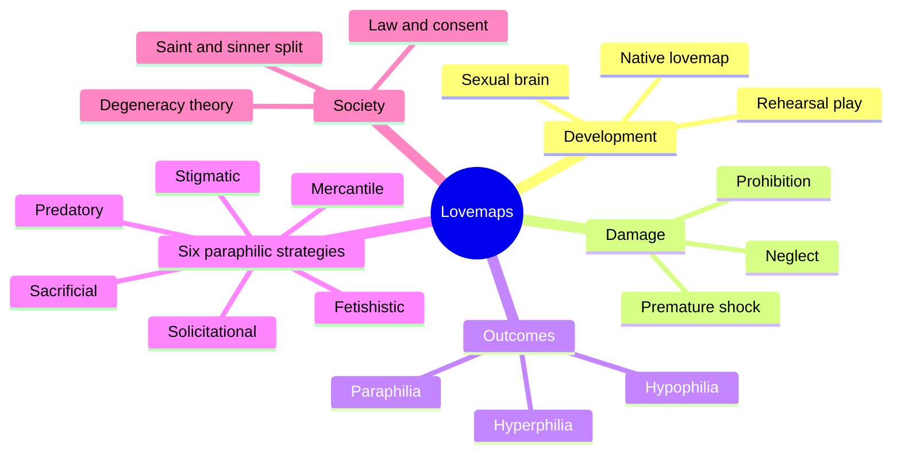
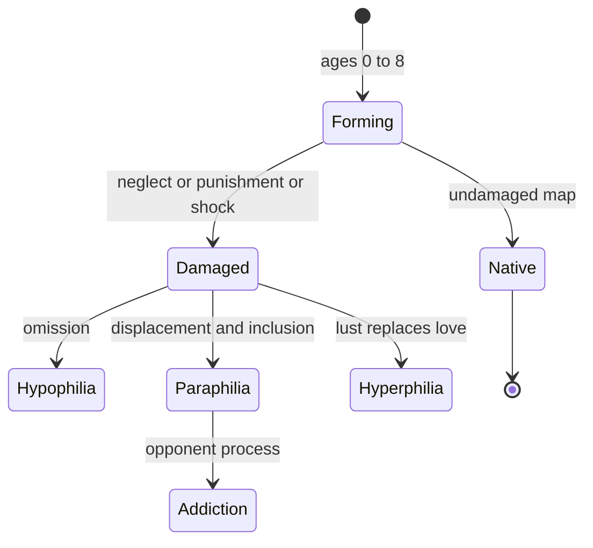
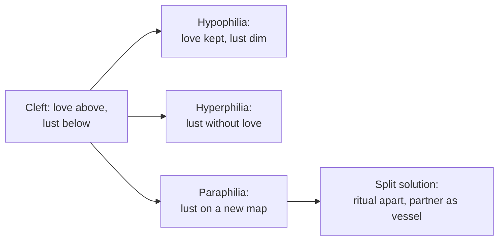
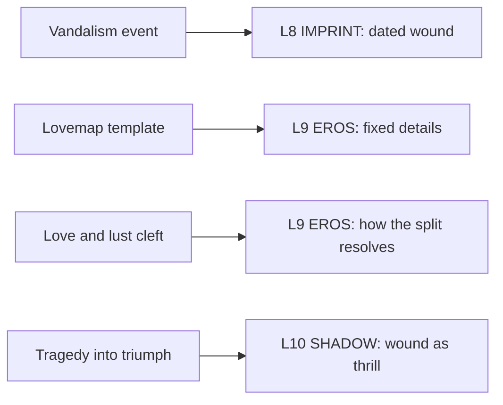

# 🧬 PSY.54 — Lovemaps — Money (1986)
### Knowledge Entry — Distill

Fantasy, not a how-to: what happens in these pages stays in them. Reader discretion advised.

John Money, a Johns Hopkins sexologist, coined "lovemap" in 1980. This 1986 book names the idea, then uses it to explain paraphilia, gender transposition, and how law and religion shape both.

## TABLE OF CONTENTS
- [Core Thesis](#1-core-thesis)
- [Mind Models](#2-mind-models)
- [Framework](#3-framework--structure)
- [Key Concepts](#4-key-concepts)
- [Heuristics](#5-heuristics--decision-rules)
- [Invariants](#6-invariants)
- [Pitfalls](#7-pitfalls--myths)
- [Application](#8-application)
- [Cross-References](#9-cross-references)
- [Provenance](#10-provenance--confidence)

---

## 1 · CORE THESIS

Each person carries a lovemap: an idealized picture of the lover and the acts. It forms in childhood and then resists change. When early events damage it, lust relocates to a redesigned map, and that map is a paraphilia.

---

## 2 · MIND MODELS

**Diagram 1 — the whole argument.**
Caption: *one idea, the lovemap, runs through development, damage, three kinds of outcome, and the social forces around them.*

**Diagram 2 — the central mechanism (a map is damaged, then heals crooked).**
Caption: *the book reads paraphilia as a repair: the wound is real, the new map keeps lust alive, and the price is that love and lust part ways.*

**Diagram 3 — the love and lust cleft.**
Caption: *the culture sets love above the belt and lust below; each outcome is a different way of living with the split.*

**Diagram 4 — mapped onto the Command's 12-layer character stack.**
Caption: *the book gives IMPRINT an event model, EROS a template and a split, and SHADOW a wound that turns into a thrill.*

---

## 3 · FRAMEWORK / STRUCTURE

| Chapters | What they do |
|---|---|
| Intro and Ch. 1-2 | Define lovemap, set human sexual rights, separate treatment from interference. |
| Ch. 3-4 | Show how a lovemap develops and why males show more paraphilia. |
| Ch. 5 | Give the saint-and-sinner cleft and opponent-process theory. |
| Ch. 6-11 | Walk the six paraphilic strategies, one per chapter. |
| Ch. 12-13 | Add phylisms, species-level behaviors recruited into the map. |
| Ch. 14-15 | Cover gender transposition and its causes. |
| Ch. 16-20 | Cover dissociation, treatment, consent, victimology, and degeneracy theory. |
| Ch. 21-26 | Give case studies, then childhood, prevention, and a glossary. |

---

## 4 · KEY CONCEPTS

| Concept | What it is | Why it matters |
|---|---|---|
| **Lovemap** | A developmental template of the ideal lover and shared acts, formed in childhood, shown first in fantasy (p. xvi) | It gives a character an erotic design with detail: build, color, temper. |
| **Rehearsal play** | Age-matched sexual play that Money treats as a developmental need (p. 15) | Monkeys raised without it could not mate. |
| **Vandalism** | Damage to the forming map by neglect, prohibition, or shock (p. 17) | It names the wound event. |
| **Catch-22 dilemma** | A child damned for telling and damned for staying silent (p. 18) | It explains why wounds stay hidden. |
| **Hypo-, hyper-, paraphilia** | Low lust, lust without love, or lust on a redesigned map (p. xvi) | The three outcomes are one family. |
| **Opponent process** | A thing first feared or hated becomes the thing craved (p. 38) | The addiction is to something specific, not to sex in general (p. 37). |
| **Proception and acception** | Courtship phase, then the phase of bodies together (p. 30) | Paraphilia hits the first phase; hypophilia hits the second. |
| **Visual threshold** | Money proposes men need less visual input to arouse and women need less touch (p. 27) | He treats it as threshold, not absolute, and unproven across cultures. |
| **Act versus status** | A same-sex act is not a same-sex status; status is who you fall in love with (p. 104) | A character can have either without the other. |
| **Phylism** | A species-level behavior recruited into the sexual map (p. xix) | It explains why paraphilias fall in six families. |

---

## 5 · HEURISTICS & DECISION RULES

| Situation | Do this | Not this |
|---|---|---|
| Giving a character an erotic template | Fix specific details: build, color, temper, scenario | Say "he likes anything" |
| Writing a fetish or ritual | Trace it to a specific early event that was reread as arousal | Give it no origin or a random one |
| Writing a lover with a split | Show lust and love in different rooms, partner as body only | Make the split a one-line label |
| Writing a repeated ritual | Show it needs staging or novelty to keep working (p. 32) | Make it work the same forever |
| Writing a same-sex act | Separate the act from the status; status is who the character falls in love with | Treat one act as an identity |
| Writing a community signal system | Let it match many people and miss the switchers (p. 48) | Make the signals complete |

---

## 6 · INVARIANTS

1. **The lovemap forms early and resists change.** After puberty it decodes more than it rewrites (p. 19).
2. **Damage heals as omission, displacement, or inclusion.** The scar is a substitute that works (p. 19).
3. **Paraphilias are specific.** Each addiction has a predicate, not a general appetite (p. 37).
4. **Love and lust split in some degree for everyone.** The question is how the split resolves (p. 31).
5. **The map shows first in fantasy.** The staging in action follows (p. xvii).

---

## 7 · PITFALLS / MYTHS

- **Money's claims are contested.** Treating heterosexuality as the undamaged default, "paraphilia" as pathology, and some of the hormone and gender theory has drawn sustained criticism. Report the model, not its verdicts.
- **The causal chain is conjecture.** Money says the vulnerable years, five to eight, are "conjectural" and the studies "remain to be done" (p. 19).
- **Case histories are clinic cases.** They come from patients and courts, not a random sample.
- Treating the "visual male, tactile female" line as settled. Money calls it threshold, not absolute (p. 27).
- Treating all kink as damage. Money says S/M can be a matter of mutual consent in law (p. xviii).
- Treating erotic material as contagious. Money calls that idea obsolete (p. xix).

---

## 8 · APPLICATION

*Proposed, not ruled.*

- **Spine level:** L5.
- **12-layer character stack:** L9 EROS (primary, template and cleft); L8 IMPRINT (primary, the dated event); L10 SHADOW (supporting, wound as thrill); L9 signal_fluency (contextual).
- **plot_systems:** a reveal that finds the origin event gives an ORANGE character a clean mystery beat.
- **Setting:** contextual. DCUS can show an institution that "blankets" erotic development with a taboo (p. 18).

The lovemap gives the ORANGE work a single field that holds what a character wants, the detail of the ideal lover, and the first event that set it. Writers can keep it small: one sentence of design, one dated event, one scene where it shows. The love and lust cleft supplies a ready-made partner conflict, since each lover sees a different half. The model fits drama but not diagnosis. A writer should use it as an inner logic for a character and leave the clinical verdict out. A proposed variable, `lovemap_design`, would hold the ideal-lover details on L9.

---

## 9 · CROSS-REFERENCES

| Related entry | Relation |
|---|---|
| [[🧬 PSY.51 — Sexual Behavior in the Human Female — Kinsey (1953)]] | Kinsey records conditioning by accident; Money builds a developmental map of it. |
| [[🧬 MSX.36 — The History of Sexuality — Foucault (1978)]] | Foucault treats "perversion" as manufactured by naming; Money names the paraphilias. |
| [[🧬 MSX.53 — Playing on the Edge — Newmahr (2011)]] | Newmahr studies S/M as a practice and not as a pathology. |

---

## 10 · PROVENANCE & CONFIDENCE

Full-text pdftotext extraction, 360 pdf pages. Title page confirms John Money, Ph.D., Johns Hopkins, Irvington Publishers, New York, copyright 1986; the paperback appeared in 1988 with Prometheus Books. Printed page equals pdf page minus 22. Read: the whole Introduction and Synopsis (pp. xv-xix), Ch. 1 opening, Ch. 3 pp. 14-20, Ch. 4 pp. 27-30, Ch. 5 pp. 31-38, Ch. 6 pp. 46-48, Ch. 14 pp. 103-106.

Skipped: Ch. 2, 7 to 13, 15 to 26, the case studies, the treatment chapters (including the hormone therapy), and the glossary. Some chapters concern harm and crime and were not read. The extraction has small OCR errors. Confidence is medium. The `feeds:` keying is this distill's synthesis.

## META
- Template: BVX-LEARN-v4.0
- Source classification: full-text extraction, targeted read of introduction, Ch. 3-6, 14
- Created / Updated: 2026-10-04
