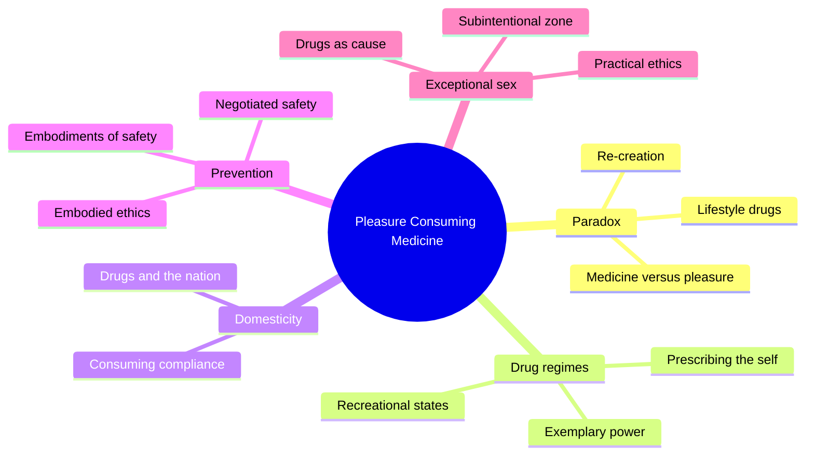
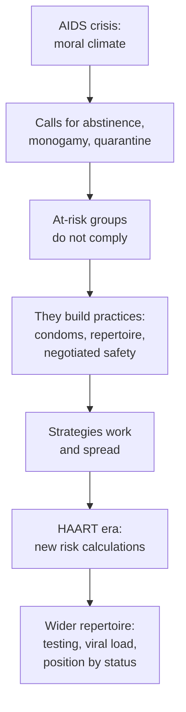
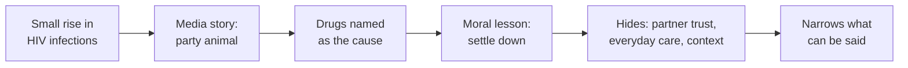
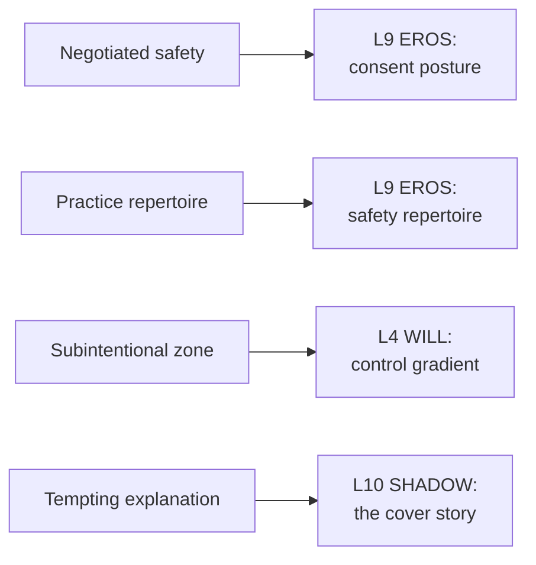

# 🧬 PSY.55 — Pleasure Consuming Medicine — Race (2009)
### Knowledge Entry — Distill

Kane Race's 2009 book argues that drugs, pleasure, and medicine are tangled together, and that gay men's HIV prevention built practical ethics out of pleasure and not against it. It sits on the shelf as the clinical-cultural account of how drug use, sex, and care coexist on the circuit.

## TABLE OF CONTENTS
- [Core Thesis](#1-core-thesis)
- [Mind Models](#2-mind-models)
- [Framework](#3-framework--structure)
- [Key Concepts](#4-key-concepts)
- [Heuristics](#5-heuristics--decision-rules)
- [Invariants](#6-invariants)
- [Pitfalls](#7-pitfalls--myths)
- [Application](#8-application)
- [Cross-References](#9-cross-references)
- [Provenance](#10-provenance--confidence)

---

## 1 · CORE THESIS

Medicine sells drugs for enhancement while the law punishes pleasure drugs, and both treat the user as a calculating self. Race argues for embodied ethics instead: care built from practice, pleasure included. HIV prevention among gay men shows it works.

---

## 2 · MIND MODELS

*Required. Minimum two diagrams, maximum five.*

**Diagram 1 — the whole argument.**
Caption: *seven chapters move from the medicine-pleasure paradox, through the law and the consumer, to HIV prevention and the way drugs came to explain gay sex.*

**Diagram 2 — the central mechanism (embodied ethics versus normative morality).**
Caption: *prevention worked when it met people's embodied practice and failed when it preached rules, and the same pattern should guide drug education.*

**Diagram 3 — how drugs come to explain gay sex.**
Caption: *the media story turns a mixed situation into a moral tale, which hides how care is already built into the scene.*

**Diagram 4 — mapped onto the Command's 12-layer character stack.**
Caption: *Race maps onto the stack as a consent posture, a care repertoire, a gradient of control, and a story the shadow tells.*

---

## 3 · FRAMEWORK / STRUCTURE

Seven chapters. Each chapter looks at one site where drugs, medicine, and the state meet.

| Chapter | Governing move |
|---|---|
| 1. Pleasure Consuming Medicine (pp. 1-31) | The paradox: medicine and pleasure seem opposed, yet medicine sells enhancement and law punishes pleasure use. Proposes that all drugs are "re-creational" (p. 9) |
| 2. Prescribing the Self (p. 32) | Medicine and self-administration. Not read here |
| 3. Recreational States (p. 59) | Drug law as "exemplary power": the state makes a bad example of certain consumers (pp. 59-61) |
| 4. Drugs and Domesticity (p. 80) | Drugs and the nation's family and fence. Not read here |
| 5. Consuming Compliance (p. 106) | Pharmaceutical narratives and bodies. Not read here |
| 6. Embodiments of Safety (p. 137) | HIV prevention as embodied ethics. Negotiated safety and the HAART-era repertoire |
| 7. Exceptional Sex (p. 164) | How drugs came to mediate sex in gay discourse. Argues for a more open, practical ethics |

Race's method turns to practice. He asks what a drug-using body in a given encounter is capable of (p. 189).

---

## 4 · KEY CONCEPTS

| Concept | What it is | Why it matters |
|---|---|---|
| **Re-creational** | All medicines recreate normative bodies, not only "repair" them (pp. 8-9) | Breaks the line between "lifestyle" and "need" |
| **Lifestyle drug** | A tag for medicines framed as enhancement (pp. 3-6) | Used to dismiss gay or female pleasure as trivial |
| **Exemplary power** | The state picks a visible drug case to make a bad example (ch. 3, p. 59) | Shows why some users are policed and others are not |
| **Embodied ethics** | Care built through practice and technique, versus a universal moral code (ch. 6, pp. 141-144) | Race's core alternative |
| **Morality vs. ethics** | Following Foucault: morality is rules, ethics is the practical work of becoming a subject of them (p. 143) | Lets a writer give a character an ethics without a lecture |
| **Negotiated safety** | Partners of the same HIV status agree on sex inside and outside the relationship (pp. 145-146) | A concrete, partner-made consent form |
| **Subintentional zone** | The range between strict intention and accident (p. 166) | A way to write intoxication and sex without a yes-or-no will |
| **The party animal** | The media image of the doomed, drug-fueled gay man (ch. 6, pp. 137-141) | A stereotype a character may be forced to carry |
| **The incidental subject** | A subject who is partly self-possessed and partly swept along (p. 166) | Describes how real pleasure feels |
| **Unspeakability of use** | Users have no legitimate voice, except in the language of recovery (p. 187) | Why a user's own account is missing from the debate |
| **Bionormalization** | The pressure to make bodies fit medical norms (p. 188) | What "just say no" quietly enforces |

---

## 5 · HEURISTICS & DECISION RULES

| Situation | Do this | Not this |
|---|---|---|
| Writing a scene with drugs and sex | Write the care already in the room: checks, rules, looks, friends | Make the drug the single cause of everything |
| Writing a character's consent | Let partners revise their agreement and say so | Treat consent as one early yes |
| Writing a risk a character took | Show the strategy they used and its limits | Write it as pure recklessness or pure wisdom |
| Writing intoxication | Use gradients: zoning out, getting carried away, getting surprised | Switch between sober and gone |
| Writing a user's reasons | Stack them: mundane, social, ecstatic, painful | Reduce use to a symptom of social pain (pp. 167-168) |
| Writing a doctor, nurse, or counselor | Let them meet the character's practice and not their morals | Write a lecture and a refusal |
| Writing a dance floor or party | Spread responsibility across the room | Put it on one character as a hero |

---

## 6 · INVARIANTS

1. **Pleasure is not the opposite of health.** HIV prevention worked when it built on embodied pleasure (pp. 1-2).
2. **Medical categories are made, and still real.** Calling a category constructed does not make it false (p. 4).
3. **Drugs are classified by who uses them.** The same chemical reads as treatment or vice by the user (pp. 7-8).
4. **Safe practice comes from embodied habit and improvisation, not abstract norms** (pp. 141-145).
5. **Risk strategies change with the medical context.** HAART reshaped them (pp. 146-148).
6. **No sovereign subject exists at the site of sex or drugs.** Intention comes in degrees (p. 166).
7. **Drugs get cast as the cause to restore respectable intention** (pp. 165-166, 140-141).
8. **Care is shared.** It runs through a room and not through a single actor (p. 188).

---

## 7 · PITFALLS / MYTHS

- Reading the book as pro-drug advice. Race writes, "my suggestions here should not be taken to amount to a prescription for crystal, or for anything else" (p. 186).
- Treating crystal as harmless. Race lists its documented harms, from muscle wasting to heart attack and stroke (p. 186).
- Treating every gay man's strategy as safe. Race criticizes the "populist romanticism" that celebrates each appropriation of medicine as inherently safe (pp. 147-148).
- Taking Australian data as universal. The strategies and surveys he cites come mostly from Sydney and Melbourne.
- Taking 2009 facts as current. The book predates later prevention tools and the changed picture of HIV treatment. This distill reports its argument, not current guidance.
- Treating the stereotype of the party animal as evidence. Race shows it as a cultural story, and he cites that almost half of new infections in Australia came from trust in conjugal intimacy (p. 140).
- Treating the book as clinical research. It is cultural analysis with some survey data, and the author is a participant (pp. 164-166).

---

## 8 · APPLICATION

*Proposed, never ruled.*

- **Spine level:** L5.
- **12-layer character stack:** L9 EROS (primary, consent posture and safety repertoire); L4 WILL (primary, control gradient); L10 SHADOW (supporting, the cover story); L6 DRIVE (supporting, stacked reasons); L3 SOCIAL (contextual, scene responsibility).
- **plot_systems:** a drug-and-sex scene with a care system in it is a plot unit.
- **Setting:** the circuit party and the club are SETTINGS with their own embodied rules.

Race gives the ORANGE work a way to write intoxicated sex without the cautionary frame. The scene holds a care system: who watches, what the partners agreed, which practices they use. The L9 variable `safety_practice_repertoire` records that system, and a character with a thin repertoire can read as less skilled than one with a rich one without any moral comment.

His second gift is the gradient of will. L4 can hold "carried away" and "surprised" as legitimate states, not only a switch between choice and loss. That fits the 06.1 fantasy-first container, where a scene can follow a character losing himself and the reader can see the care around him.

His third gift is the shadow story. A character may reach for the drug as the explanation for a thing that is harder to say. The L10 variable can hold that cover story and let a later scene test it.

---

## 9 · CROSS-REFERENCES

| Related entry | Relation |
|---|---|
| [[🧬 MSX.36 — The History of Sexuality — Foucault (1978)]] | Race builds his ethics on Foucault's later work on care of the self |
| [[🧬 PSY.08 — Lust, Men, and Meth — Fawcett (2015)]] | A clinical account of the same circuit drug scene |
| [[🧬 PSY.11 — Desire, Drugs, and Unsafe Sex — O'Byrne & Holmes (2011)]] | A study of how desire and drugs enter risk accounts |
| [[🧬 MSX.28 — Sex Pigs — PLWHA NSW (2007)]] | A community-health guide, the kind of practice Race praises |
| [[🧬 MSX.62 — Gay Macho — Levine (1998)]] | Levine records the pre-HIV circuit and the accounts men give of risk |
| [[🧬 MSX.54 — Intimate Matters — D'Emilio & Freedman (2012)]] | The history of the AIDS crisis behind Race's prevention story |
| [[🧬 MSX.50 — No Future — Edelman (2004)]] | A different answer to the same stigma, negativity instead of practice |

---

## 10 · PROVENANCE & CONFIDENCE

Full-text pdftotext extraction, about 272 pages, Duke University Press, Durham and London, 2009, copyright Duke University Press. The front matter confirms the author, title, subtitle, and 2009 copyright. Page numbers come from running heads and are reliable.

Read in full or near-full: the contents page and Preface opening; chapter 1 from its start through p. 10 (paradox, Viagra, lifestyle drugs, "re-creational"); chapter 3's opening (pp. 59-62); chapter 6 from its start through p. 149 (the party animal story, embodied ethics, negotiated safety, the HAART repertoire); chapter 7 from its start through p. 169 (the Sydney encounter, subintentional zone, user agency) and its Conclusion (pp. 185-189).

Skipped: chapters 2, 4, and 5; the rest of chapters 1, 3, 6, and 7, including the crystal and circuit-party discussion in chapter 7's middle; the notes and bibliography.

Contested or dated: the data are Australian and early 2000s. The argument for pleasure-based practice is Race's position in a larger debate. Later prevention tools are not in the book.

The `feeds:` keying is this distill's own synthesis. The `safety_practice_repertoire` and `scene_responsibility` variables are proposed here and are not yet in the schema.

## META
- Template: BVX-LEARN-v4.0
- Source classification: full-text pdftotext extraction, targeted read of chapters 1, 3, 6, 7
- Created / Updated: 2026-10-04
