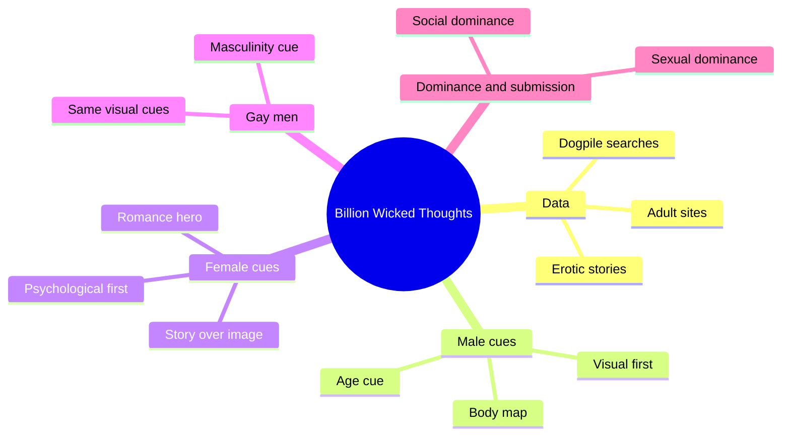
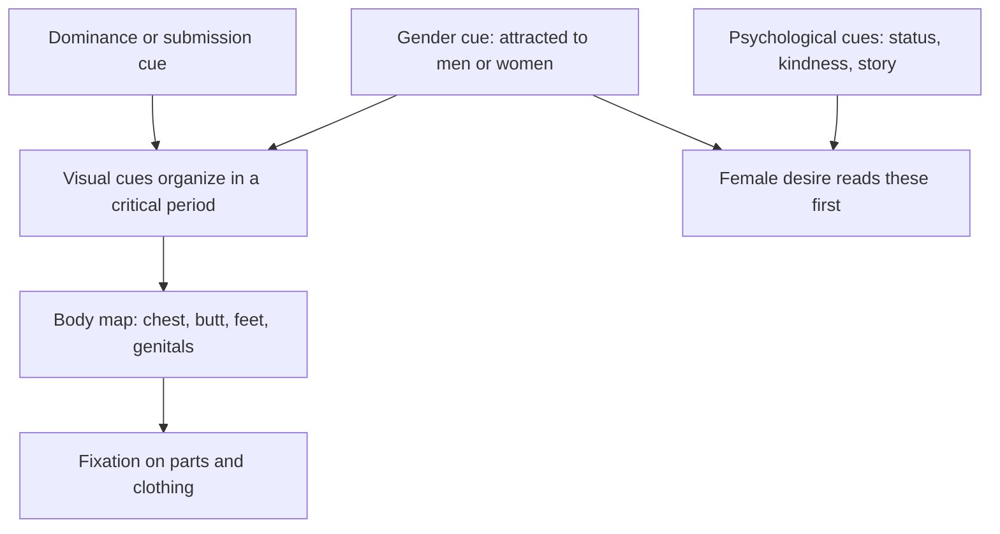
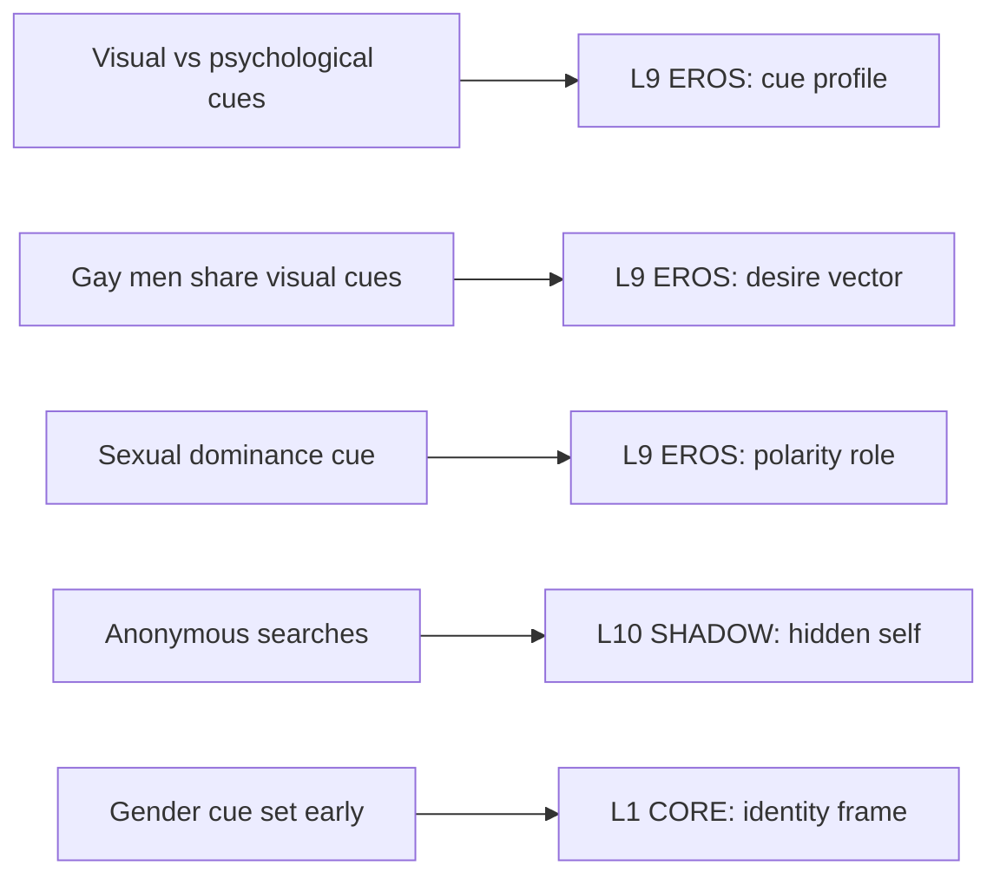

# 🧬 PSY.56 — A Billion Wicked Thoughts — Ogas & Gaddam (2011)
### Knowledge Entry — Distill

Fantasy, not a how-to: what happens in these pages stays in them. Reader discretion advised.

Ogi Ogas and Sai Gaddam, two neuroscientists, read what people actually searched for and wrote online. They use it to describe men's and women's desire as sets of cues. The library uses it as its main data source on what turns people on.

## TABLE OF CONTENTS
- [Core Thesis](#1-core-thesis)
- [Mind Models](#2-mind-models)
- [Framework](#3-framework--structure)
- [Key Concepts](#4-key-concepts)
- [Heuristics](#5-heuristics--decision-rules)
- [Invariants](#6-invariants)
- [Pitfalls](#7-pitfalls--myths)
- [Application](#8-application)
- [Cross-References](#9-cross-references)
- [Provenance](#10-provenance--confidence)

---

## 1 · CORE THESIS

Internet searches, sites, and stories show desire without a survey's filter. They reveal a few cues that switch desire on. Men's cues run visual; women's run psychological. Gay men share men's visual cues and aim them at men.

---

## 2 · MIND MODELS

**Diagram 1 — the whole argument.**
Caption: *the book measures desire as cues, and the same toolkit explains straight men, women, and gay men.*

**Diagram 2 — the central mechanism.**
Caption: *a gender cue picks the target sex, and a body map then points the visual cues at specific body parts.*

**Diagram 3 — mapped onto the 12-layer stack.**
Caption: *three book terms land on EROS, one lands on SHADOW, and the gender cue lands on CORE.*

---

## 3 · FRAMEWORK / STRUCTURE

The book has 11 chapters and a conclusion. Each chapter reads one cue family from data.

| Part | Governing move |
|---|---|
| Preface, Ch. 1 | Sex research suffers from weak data. The authors use search logs and sites instead of surveys. |
| Ch. 2-3 | Male visual cues, then male desire as a "hunter" (the book's Elmer Fudd). |
| Ch. 4-6 | Female desire as a "Detective Agency" (Miss Marple), then the romance hero and heroine as psychological cues. |
| Ch. 7-9 | Gay cues, then female visual cues, then male psychological cues. |
| Ch. 10-11 | Human cues (dominance and submission), then how cues build illusions. |
| Conclusion | Why human sexuality varies, and why people misread each other. |

---

## 4 · KEY CONCEPTS

| Concept | What it is | Why it matters |
|---|---|---|
| **Cue** | A sign that switches desire on. | The book's unit. It lets you list a person's triggers instead of one label. |
| **Visual cues** | Body parts, age, and clothing that men search for most. | Visual items carry male desire (Ch. 2, pp. 38-41). |
| **Psychological cues** | Status, stability, and kindness, delivered through story. | Female desire follows story (Ch. 5, pp. 103-106). |
| **Gender cue** | The cue that sets attraction to men or women. | In the male brain only this cue ranks above dominance (Ch. 10, p. 207). |
| **Body map** | The brain's map of body parts, which may point desire at regions. | A theory for why chests, butts, and feet recur (Ch. 7, pp. 157-158). |
| **Critical period** | A window, around puberty, when cue details set. | It explains why specific tastes feel fixed. |
| **Social vs sexual dominance** | Status in a group versus the physical role in sex. | They are different traits, so a top need not be a boss (Ch. 10, p. 208). |
| **Rule 34** | "If it exists, there is porn of it." | It sets the data frame: the Web holds every taste (Ch. 1, p. 22). |

---

## 5 · HEURISTICS & DECISION RULES

| Situation | Do this | Not this |
|---|---|---|
| Writing a man's arousal | Start from one or two concrete visual cues. | Start from a personality description. |
| Writing a gay male character's tastes | Give him the same fast, visual hunting as a straight man's, aimed at men. | Give him a flamboyance cue by default. |
| Writing attraction to a straight man | Treat "he is straight" as the cue itself (Ch. 7, p. 147). | Treat it as an obstacle only. |
| Writing a woman's arousal | Build it from a person's stability, status, and attention over time. | Reduce it to a body part list. |
| Writing a partner who differs in taste | Let each assume the other's cues match his own (Conclusion, p. 251). | Make both read each other's minds. |
| Writing top and bottom roles | Separate the sexual role from the social rank. | Make the boss always dominant in bed. |

---

## 6 · INVARIANTS

1. Desire runs on cues, and cues are specific, not general.
2. Men's search behavior is more visual than women's across the data.
3. Gay men's visual cues match straight men's, with the gender cue changed.
4. Dominance and submission are a cue pair in both sexes.
5. Averages describe groups. The authors say individuals differ (Preface, p. 14).
6. People assume others want what they want (Conclusion, p. 251).

---

## 7 · PITFALLS / MYTHS

- The data are searches. They show what people wished to find, not what they did (Ch. 1, p. 29).
- About two-thirds of searchers were American, from one search engine (Ch. 1, p. 29).
- The authors flag the body map as a guess. No neuroscientist has tested it (Ch. 7, p. 157).
- The evolutionary story behind the cues is the authors' model and is contested.
- The Reimer and Sambia cases support a fixed gender cue, but they are two small examples.
- The book is not a full catalog of tastes. The authors omit many interests (Preface, p. 14).

---

## 8 · APPLICATION

*Everything here is proposed, never ruled.*

- **Spine level:** L5, as set by the batch brief.
- **12-layer character stack:** L9 EROS (cue_profile, desire_vector, polarity_role), L10 SHADOW (shadow_double), L1 CORE (identity_frame, contextual).
- **plot_systems:** a scene engine in which two partners hold different cue profiles and each misreads the other.
- **Setting:** none direct.

The most usable move is the cue profile. A character's EROS layer would list his top three cues and say whether each is visual or psychological. A scene then runs on which cue fires first. The book also supports writing a gay man's desire as fast, specific, and visual. Fantasy comes first in the prose, with explicit content allowed under the standing 06.1 ruling. The one-line front-matter disclaimer carries the container, not the scene.

---

## 9 · CROSS-REFERENCES

| Related entry | Relation |
|---|---|
| [[🧬 PSY.64 — The Evolution of Desire — Buss (2016)]] | Buss supplies the evolutionary theory this book borrows. This book supplies the search-log data. |
| [[🧬 PSY.50 — Sexual Behavior in the Human Male — Kinsey (1948)]] | The authors name Kinsey as the last large survey and note its limits (Ch. 1, pp. 19-20). |
| [[🧬 MSX.65 — Gay Pornography — Mercer (2017)]] | A separate study of the same genre. This book counts what gay men search for. |
| [[🧬 MSX.84 — The Pornography Wars — Burke (2023)]] | Burke shows how the porn data get used in political fights. |

---

## 10 · PROVENANCE & CONFIDENCE

Full-text pdftotext extraction, 465 pdf pages, with page markers for pdf pages. Title page confirms Ogi Ogas and Sai Gaddam, Dutton (Penguin), first printing May 2011. Page cites are pdf pages, not printed pages.

Read: the Preface (pp. 12-16), Ch. 1 (pp. 17-30 and the Reimer and Sambia pages near pp. 27-28, plus the Kinsey section, the Gergen dark-room study, and the start of the Dogpile method), the opening of Ch. 2 (pp. 38-41), the opening of Ch. 4 (pp. 79-81), the opening of Ch. 5 (pp. 103-106), most of Ch. 7 (pp. 145-158), the opening of Ch. 10 (pp. 207-209), and the Conclusion (pp. 250-252).

Skipped: Ch. 3, the rest of Ch. 4-6, Ch. 8-9, Ch. 11, the notes, and the bibliography. The Ch. 7 reading stops before the pages on gay men's psychological cues in detail. Confidence is medium. The data frame is plain and well sourced, but the cue theory is the authors' model. The `feeds:` keying is this distill's own synthesis, and the book uses none of the 12-layer vocabulary.

## META
- Template: BVX-LEARN-v4.0
- Source classification: full-text extraction, targeted read of the Preface, Ch. 1, 2, 4, 5, 7, 10, and the Conclusion
- Created / Updated: 2026-10-04
