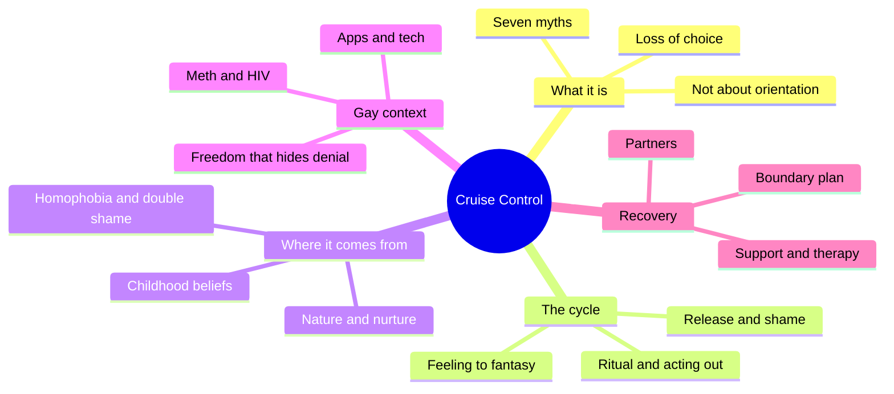
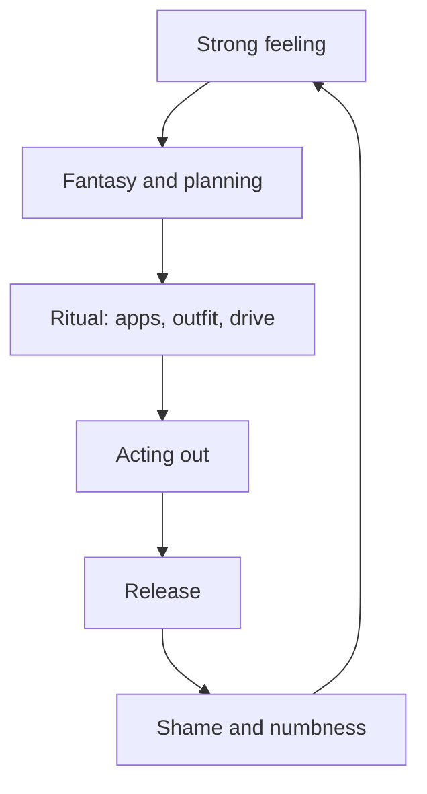
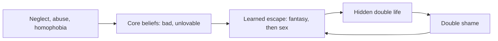
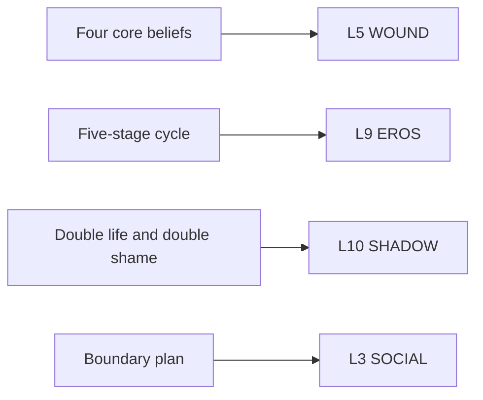

# 🧬 PSY.57 — Cruise Control — Weiss (2013)
### Knowledge Entry — Distill

Fantasy, not a how-to: what happens in these pages stays in them. Reader discretion advised.

Robert Weiss, a clinical social worker, wrote this recovery guide for gay and bisexual men. Patrick Carnes wrote the foreword. The book argues that compulsive sex is a coping habit, and it gives the cycle, the beliefs under it, and a plan to interrupt it.

## TABLE OF CONTENTS
- [Core Thesis](#1-core-thesis)
- [Mind Models](#2-mind-models)
- [Framework](#3-framework--structure)
- [Key Concepts](#4-key-concepts)
- [Heuristics](#5-heuristics--decision-rules)
- [Invariants](#6-invariants)
- [Pitfalls](#7-pitfalls--myths)
- [Application](#8-application)
- [Cross-References](#9-cross-references)
- [Provenance](#10-provenance--confidence)

---

## 1 · CORE THESIS

Weiss argues that compulsive sex in gay men is an emotional coping tool, not a product of orientation. The cycle runs from strong feeling to fantasy, ritual, acting out, and shame, then repeats. Insight eases the shame, but only written behavior boundaries and outside accountability interrupt the loop.

---

## 2 · MIND MODELS

*Required. Minimum two diagrams, maximum five.*

**Diagram 1 — the whole argument.**
Caption: *the book runs from a definition, through the roots of the habit, to a recovery plan, and the gay-specific material sits in the middle.*

**Diagram 2 — the central mechanism (the five-stage cycle).**
Caption: *the loop starts with a feeling, not with sex, and the shame at the end feeds the next feeling.*

**Diagram 3 — from childhood to the adult pattern.**
Caption: *abuse, neglect, and homophobia do not cause the habit directly, they teach a coping skill that the adult keeps using.*

**Diagram 4 — mapped onto the 12-layer character stack.**
Caption: *Weiss gives the stack a cause on the WOUND layer, a loop on EROS, a secret on SHADOW, and a practice on SOCIAL.*

---

## 3 · FRAMEWORK / STRUCTURE

Weiss builds the book in three movements. He defines the problem, explains its roots, and then teaches recovery.

| Chapters (PDF pages) | Move |
|---|---|
| 1 Am I a Sex Addict (12-32) | Defines addiction as loss of choice. Gives the cycle and the ten warning signs. |
| 2 Seven Myths (33-37) | Separates sex addiction from orientation, kink, offending, mental illness, and religion. |
| 3 Closer Look (38-50) | Lists the signs, stages, and consequences. |
| 4 How Did I Get Here (51-70) | Covers nature and nurture, the childhood belief sets, and gay-specific shame. |
| 5 Sex, Drugs, Multiple Addictions (71-84) | Explains why meth and sex fuse in gay social life. |
| 6 Boundary Plan (85-100) | Teaches the written inner, middle, and outer boundary plan. |
| 7-12 Support, therapy, technology, love addiction, partners, healthy sexuality (101-207) | Covers long-term recovery and the people around the addict. |

---

## 4 · KEY CONCEPTS

| Concept | What it is | Why it matters |
|---|---|---|
| **Sex addiction** | Loss of the ability to say no, with life getting worse in step with the behavior (Ch. 1, PDF p. 28). | Weiss refuses to judge the acts. Kink, many partners, and cruising are not the test. Lost choice is. |
| **Five-stage cycle** | Strong feeling, fantasy, ritual, acting out, release (PDF pp. 22-24). | It gives a writer a scene engine. The ritual stage (outfit, app, route) is the most filmable. |
| **Euphoric recall** | Replaying past encounters to feel excited and avoid a present feeling (PDF p. 24). | Fantasy is the first act of the habit, not a side effect. |
| **Sex as a drug** | The chase, the cruising, and the planning matter more than orgasm (PDF p. 55). | The sex act is the smallest part of the pattern. |
| **Sex for self-esteem** | The man hunts to be noticed, wanted, and needed (PDF pp. 55-56). | Weiss reads the need as healthy and the method as misguided. |
| **Four belief sets** | Self-esteem, body image, relationships, sexuality. Each has a belief, thoughts, and behaviors (PDF pp. 62-65). | The sets work as a ready template for a character's inner voice. |
| **Double shame** | Shame about being gay, plus shame about the secret acting out (PDF p. 68). | A character can accept himself and still hide. The two shames do not cancel. |
| **Boundary plan** | Inner ring: bottom-line behaviors. Middle ring: triggers and places. Outer ring: healthy goals (PDF pp. 89-90). | Recovery becomes a list of behaviors, not thoughts or fantasies. |
| **Gay culture and denial** | Sexual freedom is a fair response to a shaming culture, and it can also hide denial (PDF pp. 27-28). | Weiss holds both claims at once. |

---

## 5 · HEURISTICS & DECISION RULES

| Situation | Do this | Not this |
|---|---|---|
| Writing a character who hunts constantly | Give him a feeling he is avoiding: loneliness on a work trip, a family dinner, a breakup. | Write him as simply "horny." |
| Writing the hookup | Show the ritual first: app, outfit, route, drugs. | Skip to the act and its heat alone. |
| Writing an aftermath | Pair release with numbness, shame, and a promise ("this time was not so bad"). | End on pure satisfaction or pure regret. |
| A closeted or married man seeking "treatment" | Show that he wants his attraction removed, which is a different problem (PDF pp. 35-36). | Treat the attraction as the addiction. |
| A character in recovery | Give him a written plan with rings, a named accountability person, and a slip. | Let one therapy breakthrough fix him. |
| A kink or open-relationship character | Keep him separate from the compulsion unless his life is falling apart. | Use kink or many partners as shorthand for illness. |

---

## 6 · INVARIANTS

1. **Orientation does not cause the compulsion.** Gay and straight addicts share the same psychological dynamics (PDF p. 28).
2. **The behavior is a coping skill.** It started as a way to survive a feeling.
3. **The sex is the smallest part.** The chase, fantasy, and ritual carry the charge.
4. **Shame feeds the loop.** Each release ends in shame, and shame restarts the cycle.
5. **Insight alone changes nothing.** Behavior change needs repeated, committed steps (PDF p. 70).
6. **The boundary plan names behaviors.** It does not name thoughts or fantasies.
7. **Past harm still needs repair.** Understanding the cause does not erase what the man did (PDF pp. 51-52).

---

## 7 · PITFALLS / MYTHS

- **Contested frame.** Sex addiction is not an accepted diagnosis in the major manuals. The book follows the Carnes model, and Barker's [[🧬 PSY.65 — The Psychology of Sex — Barker (2018)]] criticizes that model.
- **Dated numbers.** The "10 percent of gay men" figure (PDF p. 28) is the author's estimate, not a measured rate.
- **Clinic sample.** The case stories are composites, edited for privacy. They come from men who sought treatment.
- **Mixed signals.** The book defends kink, many partners, and non-monogamy as not addiction. It also treats some of the same behaviors as danger signs. Read the test as lost choice and worsening life.
- **Orientation myth.** Weiss says treatment will not make a gay man straight (PDF p. 36).
- **Meth is not always sex addiction.** Many meth users lose interest in sex once they stop the drug (PDF p. 37).
- **Single-cause stories.** Abuse raises the odds, and most abused people do not become addicts (PDF p. 62).

---

## 8 · APPLICATION

*Proposed for the ORANGE work, not ruled.*

- **Spine level:** L5.
- **12-layer character stack:** L9 EROS (compulsion_cycle, primary); L5 WOUND (wound_belief_set, primary); L10 SHADOW (double_life_structure, primary); L3 SOCIAL (risk_management_practice, supporting); L11 DESTINY (growth_requirement, supporting).
- **plot_systems:** a recovery arc has a natural clock: a written plan, a check-in partner, a slip, a repair.
- **Setting:** the book names the venues that carry the loop in a gay city: apps, gyms, bathhouses, sex clubs, bars.

Weiss gives the character system a causal chain it can draw. A wound produces a belief. The belief produces a coping skill. The skill becomes a loop, and the loop produces a second shame.

A writer can use the loop on any character who runs from a feeling, whatever the drive is. The most useful move is to write the ritual stage. A man who changes his clothes, opens an app, and drives past the same corner has already left the scene he says he is in.

Proposed addition: a `compulsion_cycle` variable on L9 with five stage fields (trigger_feeling, fantasy_content, ritual_steps, acting_out_form, aftermath_pair). The aftermath pair records the release and the shame together, so each scene shows both.

The ORANGE prose rulings apply here as written. Explicit scenes are allowed, written as fantasy first. The cycle model gives the explicit scene a second job, because the reader sees what the man feels before and after.

---

## 9 · CROSS-REFERENCES

| Related entry | Relation |
|---|---|
| [[🧬 PSY.08 — Lust, Men, and Meth — Fawcett (2015)]] | Same recovery territory from a sex-therapist angle. Fawcett builds the template-and-meth model. Weiss builds the cycle-and-boundary model. |
| [[🧬 PSY.59 — Methamphetamine Addiction — Halkitis (2009)]] | Halkitis reviews the research literature on the meth and sex link that Weiss's chapter 5 covers for a lay reader. |
| [[🧬 PSY.65 — The Psychology of Sex — Barker (2018)]] | Barker challenges the sex addiction label and asks what the label opens and closes. |
| [[🧬 MSX.81 — The Gay Science — Race (2018)]] | Race attacks the recovery-by-abstinence advice that Weiss's school gives. |
| [[🧬 MSX.46 — Deviations — Rubin (2011)]] | Rubin's sex hierarchy explains why the "signs of addiction" list reads as a list of stigmatized acts. |

---

## 10 · PROVENANCE & CONFIDENCE

Full-text pdftotext extraction, about 68,500 words. Front matter confirms: Robert Weiss, LCSW, CSAT-S, *Cruise Control: Understanding Sex Addiction in Gay Men*, second edition, Gentle Path Press, 2013 (first edition 2005). Patrick Carnes wrote the foreword. The extract has no printed page numbers, so citations use PDF page numbers and chapter names.

Read in full: Preface and acknowledgments (PDF 9-11), Chapter 2 on the seven myths (33-37), Chapter 4 on origins (51-70). Read in part: Chapter 1 (cycle, gay versus straight, 22-28), Chapter 5 (meth, HIV, culture, 72-75), Chapter 6 (boundary plan, 87-89).

Skipped: Chapter 3's ten signs in detail, Chapters 7 to 12 (support, therapy, technology, love addiction, partners, healthy sexuality), the activity appendix, and the resource lists. The recovery-program machinery is described from chapter openings only.

Confidence is high on the cycle, the belief sets, and the boundary plan. It is medium on prevalence and on the clinical frame, which the author inherits from the Carnes tradition.

## META
- Template: BVX-LEARN-v4.0
- Source classification: full-text pdftotext extraction, deep read on chapters 2 and 4, targeted reads elsewhere
- Created / Updated: 2026-10-04
