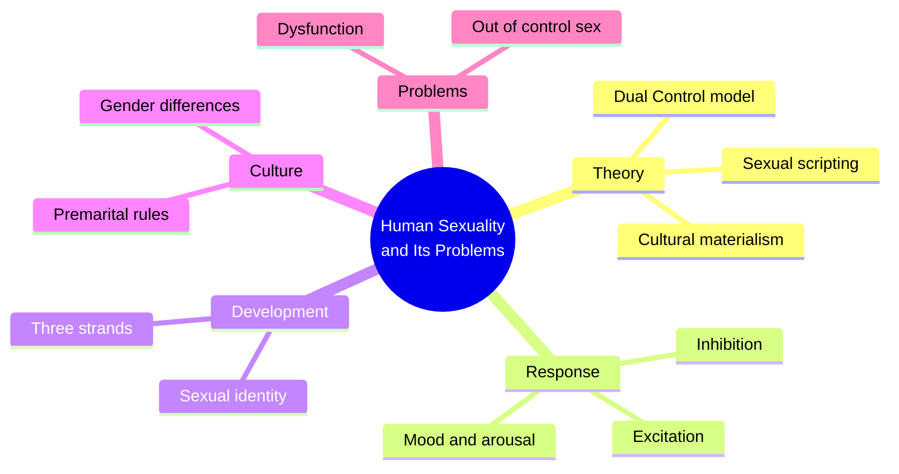
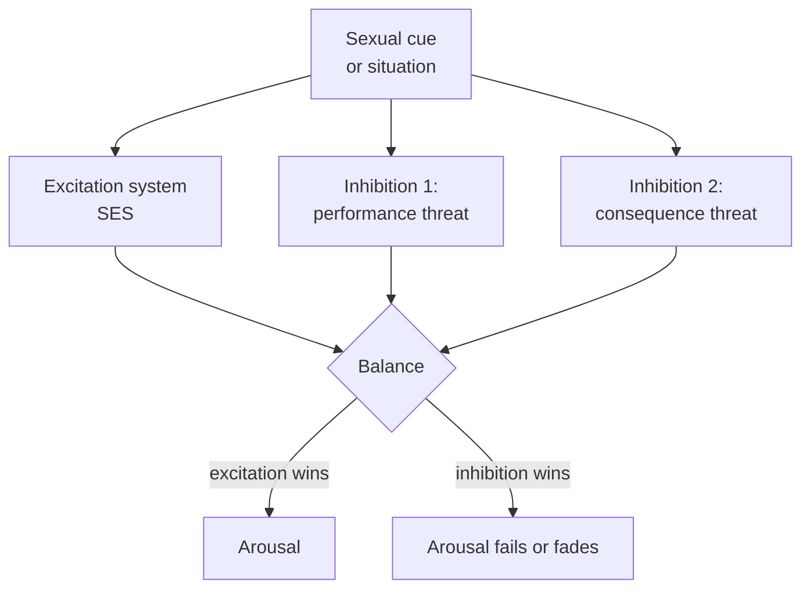
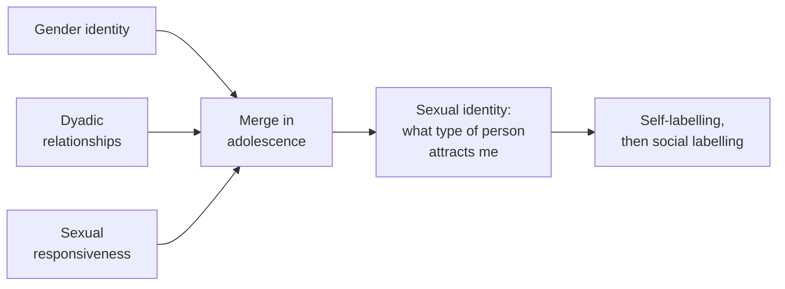
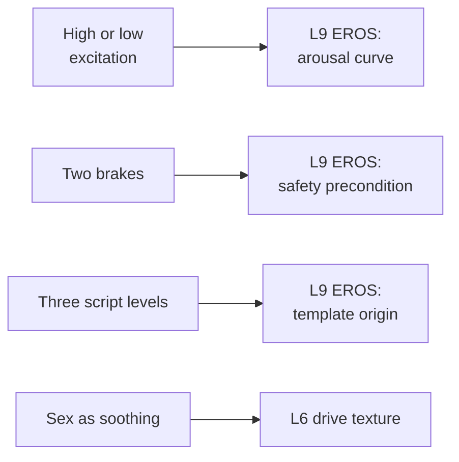

# 🧬 PSY.58 — Human Sexuality and Its Problems — Bancroft (2009)
### Knowledge Entry — Distill

John Bancroft, a psychiatrist and former director of the Kinsey Institute, wrote this textbook for clinicians. The third edition organizes sexual response, development and dysfunction around a few testable models. The library keeps it for its models of arousal.

## TABLE OF CONTENTS
- [Core Thesis](#1-core-thesis)
- [Mind Models](#2-mind-models)
- [Framework](#3-framework--structure)
- [Key Concepts](#4-key-concepts)
- [Heuristics](#5-heuristics--decision-rules)
- [Invariants](#6-invariants)
- [Pitfalls](#7-pitfalls--myths)
- [Application](#8-application)
- [Cross-References](#9-cross-references)
- [Provenance](#10-provenance--confidence)

---

## 1 · CORE THESIS

Sexuality comes from the meeting of a person's brain mechanisms and his culture. Each person varies in how easily he is turned on and how easily he is shut off. Models help us think; none is final.

---

## 2 · MIND MODELS

**Diagram 1 — the whole argument.**
Caption: *the book runs on one claim, nature and culture interact, and builds every chapter around it.*

**Diagram 2 — the central mechanism (Dual Control).**
Caption: *arousal is not one dial; it is a gas pedal and two brakes, and each man's settings differ.*

**Diagram 3 — three strands of sexual development.**
Caption: *sexual identity forms where three separate childhood strands meet, and stigma slows the meeting.*

**Diagram 4 — mapped onto the 12-layer character stack.**
Caption: *Bancroft's models give the EROS layer a measurable shape: curve, preconditions, scripts.*

---

## 3 · FRAMEWORK / STRUCTURE

The book has two halves. The first covers how sexuality works. The second covers what goes wrong and how to treat it.

| Part | Chapters | Content |
|---|---|---|
| Models | 1-2 | Introduction (pp. 1-3) and the role of theory (pp. 5-16) |
| Biology | 3-4 | Sexual differentiation, arousal and response |
| Development | 5-8 | Childhood to adulthood, heterosexuality, ageing, sexual identity |
| Variations | 9-10 | Sexual variation, transgender and gender non-conformity |
| Problems | 11-12 | Sexual problems, assessment and treatment |
| Health | 13-16 | Contraception, HIV and infections, offences, abuse |

---

## 4 · KEY CONCEPTS

| Concept | What it is | Why it matters |
|---|---|---|
| **Dual Control model** | Arousal depends on the balance of an excitation system and an inhibition system (p. 15) | Gives each character a profile instead of a single "libido" |
| **SES** | Sexual Excitation Scale; how easily a person becomes aroused (p. 15) | The gas pedal |
| **SIS1** | Inhibition from threat of performance failure (pp. 15-16) | Predicts erectile problems in men (p. 322) |
| **SIS2** | Inhibition from threat of consequences, such as infection or being overheard (p. 16) | A character's conditions for staying aroused |
| **Sexual scripting** | Cultural scenario, interpersonal script, intrapsychic script (p. 10) | The origin of sexual meaning is social |
| **Intrapsychic script** | The private mental rehearsal: fragments of desire, memory and plans (p. 10) | The inner theatre a character plays in |
| **Cultural materialism** | Harris's view that a society's material base shapes its sexual rules (pp. 12-14) | Setting rules follow from how a society makes a living |
| **Three-strand model** | Gender identity, dyadic relationships and sexual response develop apart, then merge (p. 169) | Explains why identity takes longer to settle for stigmatized boys |
| **Pre-labelling, self-labelling, social labelling** | Stages of sexual identity (p. 168) | Peers ask "straight or gay?" before the boy has an answer |
| **Basic pattern and superadded component** | A reproduction-driven core, plus pleasure that varies by person (pp. 131-133) | Bancroft's account of male-female difference; speculative |
| **Mood regulation** | Using sex to soothe a bad mood (p. 322) | One source of compulsive-looking sex |
| **Essentialist vs. nominalist** | Popper's two styles of researcher (p. 5) | Bancroft chooses models as tools, not truths |

---

## 5 · HEURISTICS & DECISION RULES

| Situation | Do this | Not this |
|---|---|---|
| Writing a man's arousal | Set three values: excitation, performance worry, consequence worry | Write one "high" or "low" libido |
| A man who loses arousal in a scene | Name which brake engaged: a thought of failing, or a risk | Blame the partner or call it a flaw |
| A high-excitation, low-inhibition man | Let him take risks that surprise him (p. 15) | Make the risk a moral verdict |
| A character who needs sex when low | Show sex as soothing, with intimacy lagging behind (p. 322) | Read it as pure appetite |
| A boy's early same-sex play | Let it occur without making him gay (p. 168) | Treat boyhood contact as destiny |
| Writing a character's inner sexual life | Give him an intrapsychic script: rehearsed fragments, memories, plans (p. 10) | Give him only outward behaviour |
| A scene of failure | Treat arousal as dependent on distraction and attention | Treat failure as a lack of desire |

---

## 6 · INVARIANTS

1. Arousal results from the balance of excitation and inhibition (p. 15).
2. People vary in their propensity for both (p. 15).
3. Inhibition is adaptive; it stops arousal where sex would be dangerous or distracting (p. 15).
4. High excitation with low inhibition predicts risky sex; low excitation with high inhibition predicts dysfunction (p. 15).
5. Sexual meaning is learned from social scripts, but scripts are incomplete and need improvisation (p. 11).
6. Most boys who have same-sex play at puberty do not develop a homosexual identity (p. 168).
7. Identity, once settled, governs later partners' gender (p. 169).
8. Sexual response and gender identity are largely separate in childhood (p. 169).

---

## 7 · PITFALLS / MYTHS

- Treating libido as one number. The model has three parts.
- Treating a model as reality. Bancroft says models are simplifications with heuristic value (p. 2).
- Treating SIS/SES results as population facts. Bancroft's own samples were convenience samples, "not representative" (p. 322).
- Treating the male-female "basic pattern" as settled. Bancroft calls the comparison politically incorrect and speculative (p. 1; p. 133).
- Treating the book as current. It is a 2009 text; later work on the model and on brain imaging is not here.
- Treating Kinsey's numbers as clean. Bancroft defends Kinsey's insight into variability (p. 1) and records that Kinsey's sampling has been attacked. Read Kinsey-derived figures with that in mind.
- The book gives almost no space to gay men's sexuality beyond identity development. It treats hetero- and homosexual cases unevenly.

---

## 8 · APPLICATION

*Proposed, not ruled.*

- **Spine level:** L5.
- **12-layer character stack:** L9 EROS `arousal_curve` (primary); L9 `erotic_safety_precondition` (primary); L9 `template_origin` (supporting); L6 `drive_texture` (supporting); L8 `sensory_imprint_rewiring` (contextual).
- **plot_systems:** none.
- **Setting:** none.

Bancroft gives the EROS layer a testable profile. Proposed: score each major character on three values, SES, SIS1 and SIS2, each high, middle or low. The three values predict how he behaves in a bed, in a club or in a quiet room.

Proposed: let SIS2 carry the "conditions" field already on the shelf. A man with high SIS2 needs a door that locks. A man with low SIS2 does not notice the door.

Proposed: write the intrapsychic script as its own paragraph for each lead. It lists his fragments, memories and plans. It supports the fantasy-first rule of 06.1, because the character's rehearsal is where the explicit material already lives.

For the character system, the three-strand model suggests that Quinn's identity and his intimacy can run on different clocks. A scene can show one strand ahead of the others.

---

## 9 · CROSS-REFERENCES

| Related entry | Relation |
|---|---|
| [[🧬 MSX.36 — The History of Sexuality — Foucault (1978)]] | Bancroft cites Foucault as the source of the postmodern challenge to sex science (p. 7) |
| [[🧬 MSX.17 — Mating in Captivity — Perel (2006)]] | Perel narrates desire; Bancroft measures excitation and inhibition |
| [[🧬 PSY.08 — Lust, Men, and Meth — Fawcett (2015)]] | Drug-linked arousal and risk fit the high-excitation, low-inhibition profile |
| [[🧬 PSY.11 — Desire, Drugs, and Unsafe Sex — O'Byrne & Holmes (2011)]] | Risk-taking read through inhibition |
| [[🧬 PSY.10 — Magnificent Sex — Kleinplatz & Ménard (2020)]] | The optimal-sex study sits on top of this arousal base |

---

## 10 · PROVENANCE & CONFIDENCE

Full-text pdftotext extract of the Elsevier 2009 third edition. The extract is two-column and interleaves lines, so quotations were checked against context. Read: the Introduction and personal statement (pp. 1-3); Chapter 2 on theory, in full for the Dual Control and scripting sections (pp. 5-16); the male-female basic pattern in Chapter 4 (pp. 131-133); the sexual-identity sections of Chapter 5 (pp. 159-169); the Chapter 6 masturbation conclusion and the cross-cultural premarital data (pp. 186-187); the arousal-and-problems section of Chapter 11 (pp. 321-322).

Skipped: Chapters 3, 7-10 and 12-16 in full; the physiology of arousal; transgender, ageing and treatment sections; infection and offence chapters; references.

Confidence is medium. Page numbers are printed folios from the extract headers and may drift by one on two-column spreads. The `feeds:` keying is this distill's own synthesis.

## META
- Template: BVX-LEARN-v4.0
- Source classification: full-text pdftotext extraction; theory and development chapters read, remainder sampled
- Created / Updated: 2026-10-04
