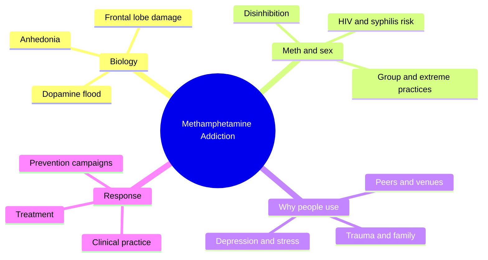
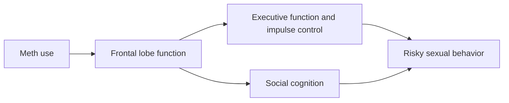
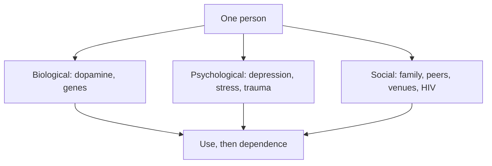
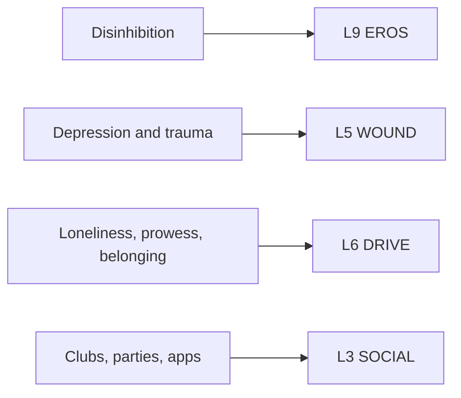

# 🧬 PSY.59 — Methamphetamine Addiction — Halkitis (2009)
### Knowledge Entry — Distill

Perry Halkitis, a public-health psychologist, synthesizes the research on methamphetamine for clinicians and community workers. Most of the sexual-behavior research he cites comes from gay and bisexual men, so the book is this shelf's data source for the meth and sex link.

## TABLE OF CONTENTS
- [Core Thesis](#1-core-thesis)
- [Mind Models](#2-mind-models)
- [Framework](#3-framework--structure)
- [Key Concepts](#4-key-concepts)
- [Heuristics](#5-heuristics--decision-rules)
- [Invariants](#6-invariants)
- [Pitfalls](#7-pitfalls--myths)
- [Application](#8-application)
- [Cross-References](#9-cross-references)
- [Provenance](#10-provenance--confidence)

---

## 1 · CORE THESIS

Halkitis argues that methamphetamine addiction needs a biological, psychological, and social lens at once. The drug strongly links to sexual risk, especially in gay and bisexual men, through impulsivity, disinhibition, loneliness, and identity. The research shows correlation clearly and cause poorly.

---

## 2 · MIND MODELS

*Required. Minimum two diagrams, maximum five.*

**Diagram 1 — the whole argument.**
Caption: *the book builds from the drug to the person to the community, and the sex chapter is the hinge for gay men.*

**Diagram 2 — the central mechanism (the proposed mediation path).**
Caption: *Halkitis proposes that the drug damages judgment first and risky sex follows through that damage, which is a hypothesis, not a proven path.*

**Diagram 3 — three lenses on one user.**
Caption: *no single factor explains use, so read each user across all three lenses.*

**Diagram 4 — mapped onto the 12-layer character stack.**
Caption: *the book gives EROS a switch, WOUND a pre-existing low mood, DRIVE a stated motive, and SOCIAL a set of rooms.*

---

## 3 · FRAMEWORK / STRUCTURE

Halkitis structures the book as a linear synthesis. It moves from drug to biology to behavior to treatment.

| Chapter (printed pages) | Governing move |
|---|---|
| 1-3 History, chemistry, illegal production (3-48) | Sets the social history, the dopamine chemistry, and the supply side. |
| 4 Biopsychosocial consequences (49-68) | Lists the body and brain effects. |
| 5 Meth, Sex, Sexuality, Sexual Risk Taking (69-82) | Reviews the meth and sex link for gay and bisexual men, then for heterosexual men and women. |
| 6 Motivations and Antecedents (83-106) | Sorts risk factors into biological, mental health, and social groups. |
| 7 Treatment (107-130) | Covers treatment, including a 12-step exhibit and a behavioral meth-sex intervention outline. |
| 8 Prevention (131-148) | Reviews prevention campaigns and their images. |
| 9-10 Clinic chapters (149-172) | Two practitioners describe medical and mental-health work with users. |
| 11 Future directions (173-184) | Argues for a total-health model. |

---

## 4 · KEY CONCEPTS

| Concept | What it is | Why it matters |
|---|---|---|
| **Biopsychosocial lens** | Biology, psychology, and social setting together (Preface, p. xvii). | Halkitis rejects a drug-only story. |
| **Dopamine depletion and anhedonia** | Repeated use drains dopamine, and users cannot feel simple pleasures when sober. Weiss describes it (PSY.57, PDF p. 75). Halkitis covers the biology in chapter 2, which this entry did not read. | The crash makes the next use feel necessary. |
| **Meth as the sexual drug** | For some users, the drug enables "fantastical and desired sexual experiences" (p. 70). | Many users explain their use in sexual terms (p. 72). |
| **Impulsivity pathway** | Meth use tracks with impulsivity and poor decisions, and impulsivity tracks with unprotected sex (pp. 70-71). | It is the proposed bridge from the drug to the risk. |
| **Dual epidemic** | The meth and HIV epidemics feed each other (p. 69). | Alarm about meth in this community grew out of alarm about HIV. |
| **Serosorting and positioning** | Choosing partners or roles by HIV status. Users do both while high (p. 77). | The risk is not uniform. Choices persist on the drug. |
| **Identity reinforcement** | Meth "reinforces the sexual identity of the user" (Reback, cited p. 73). | The drug can feel like belonging to a version of the self. |
| **Risk and resiliency** | Protective traits sit against risk traits, and the balance predicts use (pp. 102-103). | Not everyone who uses becomes dependent (p. 83). |
| **Depression as both** | Depression leads to use and results from use (p. 92). | A character's low mood can be older than the drug. |

---

## 5 · HEURISTICS & DECISION RULES

| Situation | Do this | Not this |
|---|---|---|
| A character on meth in a sexual scene | Show disinhibition, longer sessions, and a body that is hard to read. | Write the drug as the only reason he wants the act. |
| Explaining why he uses | Give a stated reason (fun, sociability) and a deeper one (loneliness, fear of age). | Reduce it to one cause. |
| An older character after loss | Let the drug counterfeit youth and desirability (Kurtz, cited p. 73). | Treat all users as the same age and wound. |
| A character with a diagnosis or fear of one | Let him choose partners or roles by status and still take risks. | Write risk as either total or none. |
| The crash | Write flat mood, sleep, and no interest in sex. | Write the morning after as ordinary tiredness. |
| A character's family history | Check for parental use, conflict, and violence (pp. 101-103). | Blame divorce itself, since the book finds conflict matters more. |
| A recovery arc | Show a fall in partners and a slow return of pleasure, with relapse possible. | Write recovery as a single decision. |

---

## 6 · INVARIANTS

1. **No single factor explains use.** Biology, mood, family, and venue interact (p. 83).
2. **Not every user becomes dependent.** Use runs from one try to social use to dependence (pp. 83-84).
3. **The meth and sex link is strong and correlational.** The cause is unproven (p. 80).
4. **Orientation is not the cause.** The link appears in heterosexual users too, with less research (pp. 77-79).
5. **Depression runs both ways.** It precedes and follows use (p. 92).
6. **Risk is not one number.** Serostatus, partner type, and route of use change it (pp. 77-78).
7. **Stigma shapes the research.** Halkitis warns against pathologizing a group that is already overly pathologized (Preface, p. xix).

---

## 7 · PITFALLS / MYTHS

- **Dated data.** The studies cited run mostly from 1986 to 2007. They predate modern HIV prevention, so the risk numbers describe an earlier era.
- **Convenience samples.** Many studies recruit from clinics, clubs, and testing sites. Most rely on self-report. The book itself notes that random samples are rare.
- **Correlation, not cause.** The mediation path (frontal lobe to risk) is a hypothesis. The book says users report equal sexual activity sober and high in one study (p. 73).
- **Small samples in the quotes.** Several figures come from studies of 16, 25, or 48 men. A writer should not generalize them.
- **Fear-tactic framing.** The book notes that "one use leads to addiction" is often a campaign slogan, not a finding (p. 84).
- **Group focus.** Most behavioral research covers gay and bisexual men because HIV funding followed them. The book warns this is a funding pattern, not a sign that the drug is a gay disease (Preface, p. xix).
- **Contested framing.** Kane Race criticizes the way public health made this practice a problem object. See [[🧬 MSX.81 — The Gay Science — Race (2018)]].

---

## 8 · APPLICATION

*Proposed for the ORANGE work, not ruled.*

- **Spine level:** L5.
- **12-layer character stack:** L9 EROS (chemical_disinhibition, primary); L5 WOUND (comorbid_wound, primary); L6 DRIVE (motive_for_use, supporting); L3 SOCIAL (venue_exposure, supporting); L11 DESTINY (growth_requirement, contextual).
- **plot_systems:** a drug in a scene works as a state change, a time cost, and a trust test between partners.
- **Setting:** circuit parties, sex clubs, bathhouses, private parties, and apps are the rooms the book names.

Halkitis gives the character system a way to show a drug without a lecture. The drug changes the body's state, and the state changes the scene. The writer can name the state (disinhibited, wired, flat) and let the reader see the choices.

The best tool is the gap between the stated motive and the real one. A character says he uses to have fun. The book's data say loneliness, fear of rejection, and fear of aging sit underneath. A writer can place both in one scene and let a second character see the gap.

The second tool is the crash. Weiss reports that sex is "completely uninteresting" in the crash (PSY.57's source, PDF p. 75). A character's desire therefore has a time signature that a scene can use.

Proposed addition: an L9 variable `state_dependent_desire` with fields for sober desire, loaded desire, and crash desire. It lets one character carry three different appetites without contradiction.

The ORANGE prose rulings apply as written. Explicit content is allowed, written as fantasy first, and no risk list belongs in the scene.

---

## 9 · CROSS-REFERENCES

| Related entry | Relation |
|---|---|
| [[🧬 PSY.57 — Cruise Control — Weiss (2013)]] | Weiss covers the same ground for a lay reader and gives the written recovery plan that Halkitis only outlines. |
| [[🧬 PSY.08 — Lust, Men, and Meth — Fawcett (2015)]] | Fawcett gives the template-fusion model. Halkitis gives the epidemiology. |
| [[🧬 MSX.81 — The Gay Science — Race (2018)]] | Race reads the same meth and HIV literature as a problematization and defends a harm-reduction approach. |
| [[🧬 MSX.35 — Sex Pigs — PLWHA NSW (n.d.)]] | A community harm-reduction text that sits beside this clinical one. |

---

## 10 · PROVENANCE & CONFIDENCE

Full text, pdftotext extraction, about 92,000 words. Title page confirms: Perry N. Halkitis, with contributions by Antonio E. Urbina and Daniel J. Carragher, *Methamphetamine Addiction: Biological Foundations, Psychological Factors, and Social Consequences*, American Psychological Association, Washington, 2009. Printed page equals PDF page minus 24 through chapter 5 and minus 23 from chapter 6. Citations use printed pages.

Read in full: Preface (pp. xvii-xxi), Chapter 5 on meth, sex, and sexual risk (pp. 69-80), and the opening of Chapter 6 (pp. 83-84). Read in part: the mental-health and family sections of Chapter 6 (pp. 91-92, 101-103). The contents and exhibit titles inform the structure table.

Skipped: Chapters 1 to 4 (history, chemistry, production, consequences), most of Chapter 6, Chapters 7 to 11 (treatment, prevention, clinic chapters, future work), and the reference list. The chemistry points come from the chapter headings and from Weiss (PSY.57, PDF p. 75).

Confidence is medium. The sexual-risk findings are cited faithfully, and the underlying studies are dated, small, and correlational.

## META
- Template: BVX-LEARN-v4.0
- Source classification: full-text pdftotext extraction, deep read on the preface and chapter 5, partial on chapter 6
- Created / Updated: 2026-10-04
