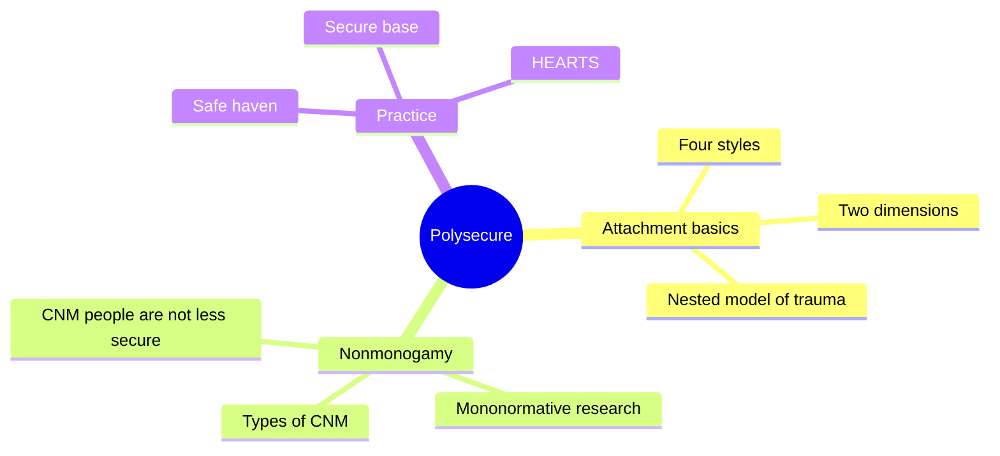
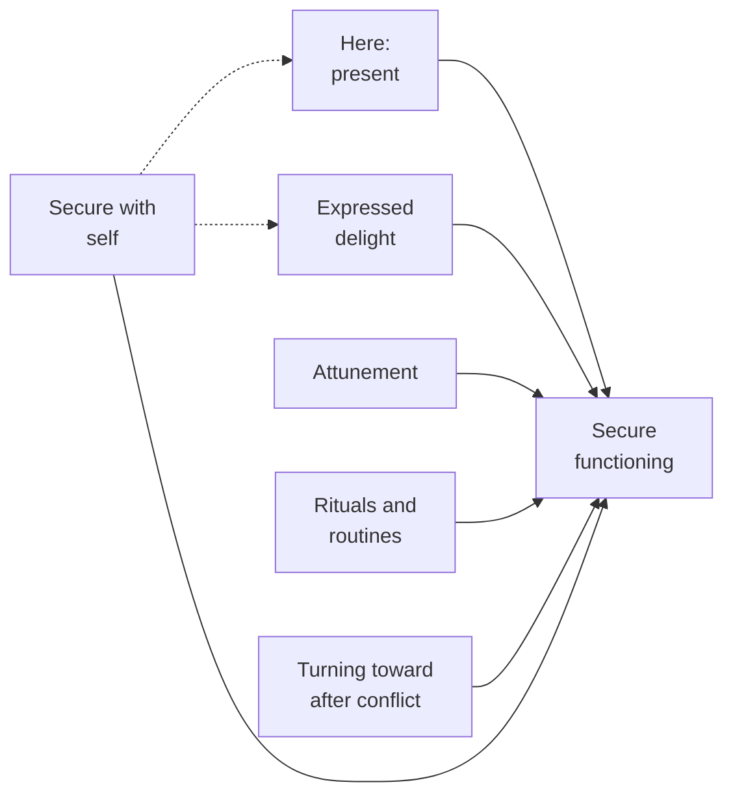
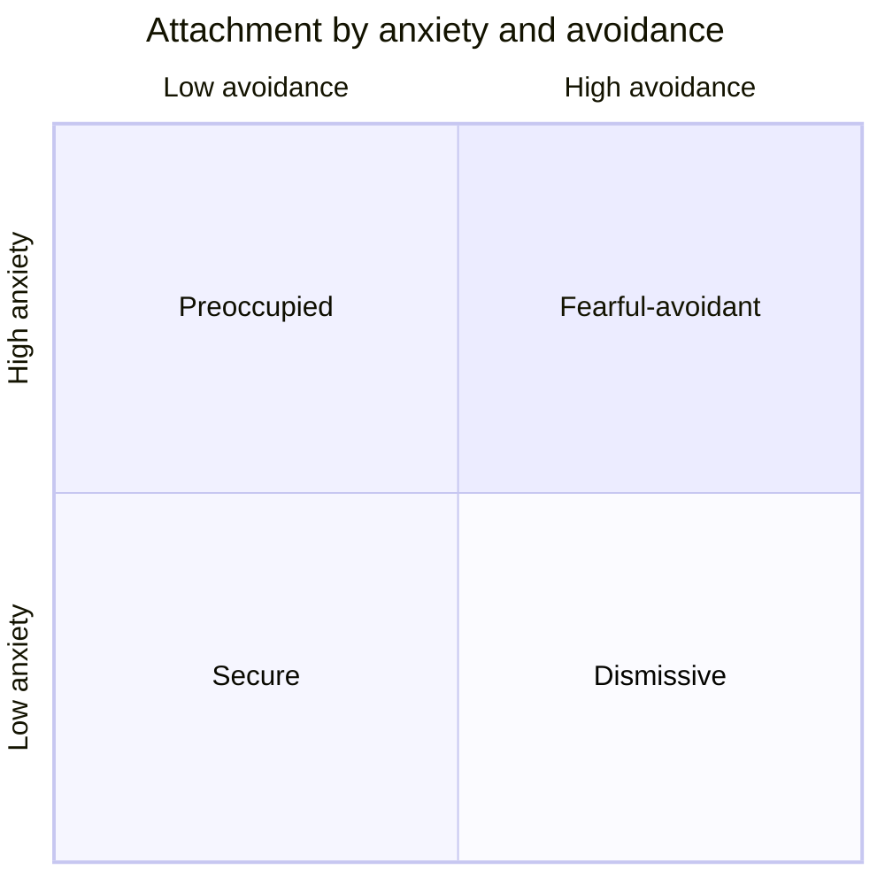
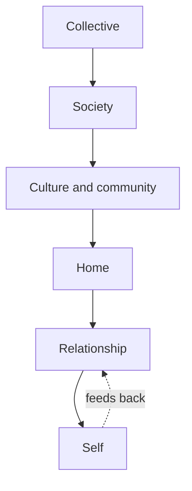

# 🧬 PSY.60 — Polysecure — Fern (2020)
### Knowledge Entry — Distill

Jessica Fern, a psychotherapist, applies attachment theory to people with several partners. She argues that secure bonds do not need exclusivity, and gives a six-part practice, HEARTS. The library keeps it for its model of intimacy and of trauma.

## TABLE OF CONTENTS
- [Core Thesis](#1-core-thesis)
- [Mind Models](#2-mind-models)
- [Framework](#3-framework--structure)
- [Key Concepts](#4-key-concepts)
- [Heuristics](#5-heuristics--decision-rules)
- [Invariants](#6-invariants)
- [Pitfalls](#7-pitfalls--myths)
- [Application](#8-application)
- [Cross-References](#9-cross-references)
- [Provenance](#10-provenance--confidence)

---

## 1 · CORE THESIS

Secure attachment does not require monogamy. It requires presence, delight, attunement, routine and repair, practiced with each partner and with oneself. Trauma is broken connection, and it works on several nested levels.

---

## 2 · MIND MODELS

**Diagram 1 — the whole argument.**
Caption: *a three-part book: how attachment works, how it meets nonmonogamy, what to do about it.*

**Diagram 2 — the central mechanism (the HEARTS).**
Caption: *five relational skills plus one inner skill; the S feeds the other five.*

**Diagram 3 — two dimensions, four styles.**
Caption: *the four styles are four corners of one grid; where a man sits inside a corner matters.*

**Diagram 4 — the nested model of attachment and trauma.**
Caption: *wounds enter at any ring, and the outer rings act on the inner ones.*

---

## 3 · FRAMEWORK / STRUCTURE

| Part | Chapters | Content |
|---|---|---|
| One | 1-3 | Attachment theory, two dimensions, the nested model of trauma |
| Two | 4-6 | Types of nonmonogamy, the research gap, Fern's clinical observations |
| Three | 7-10 | Safe haven and secure base, HEARTS, secure self, common questions |

The extract has no printed folios. Citations use PDF page numbers of the extract.

---

## 4 · KEY CONCEPTS

| Concept | What it is | Why it matters |
|---|---|---|
| **Attachment anxiety** | Fear of rejection, neglect or abandonment (ch. 2, p. 64) | Pushes a man to grasp for closeness |
| **Attachment avoidance** | Discomfort with closeness and reliance (ch. 2, p. 64) | Pushes a man to keep distance |
| **Four styles** | Secure, preoccupied, dismissive, fearful-avoidant (p. 64) | Quadrants of the two dimensions |
| **Trauma as broken connection** | Harm that overwhelms and leaves a person alone (ch. 3, p. 80) | Explains why relational wounds cut deepest |
| **Complex and relational trauma** | Ongoing harm, often from an attachment figure (p. 79) | The kind most likely to bend adult intimacy |
| **Nested model** | Self, relationship, home, culture, society, collective (pp. 83-90) | Lets a writer place a wound at the right ring |
| **Mononormativity** | The assumption that healthy bonds are dyadic (ch. 5, p. 119) | A bias in the research, not a finding |
| **Safe haven and secure base** | A partner to run to, and a partner to launch from (ch. 1, pp. 26-30) | The two functions of an attachment figure |
| **Attachment-based partnership** | A relationship both people choose to tend as an attachment bond (ch. 7, p. 160) | Not every partner is one |
| **HEARTS** | Here, Expressed delight, Attunement, Rituals, Turning toward, Secure self (ch. 8, p. 175) | Fern's practice list |
| **Rupture and repair** | Conflict is normal; repair builds security (ch. 8, p. 196) | A scene engine for any couple |

---

## 5 · HEURISTICS & DECISION RULES

| Situation | Do this | Not this |
|---|---|---|
| Placing a man's attachment | Give him a point on two axes, plus a reason | Label him with one of four types |
| A man with high avoidance and high anxiety | Show wanting closeness and fearing it at once (p. 64) | Write him as simply cold |
| A man with high avoidance and low anxiety | Let him feel little when a partner leaves, and not notice (p. 64) | Give him hidden longing by default |
| A man with several partners | Let each bond have its own style (p. 122) | Give him one style for the whole group |
| A character who has casual sex | Ask whether he seeks intimacy, avoids it or enjoys it from a secure place (p. 119) | Read the act as proof of insecurity |
| Two partners after a fight | Show the repair, not only the rupture (p. 196) | Treat conflict as the end |
| A partner "here" but absent | Put a phone, a worry or another partner between them (p. 177) | Count physical presence as presence |
| A wound's source | Name the ring: self, relationship, home, culture, society (pp. 83-90) | Trace every wound to childhood alone |

---

## 6 · INVARIANTS

1. Attachment shapes how a person seeks closeness and handles distance (ch. 2).
2. Trauma is, at root, broken connection (p. 80).
3. A history of secure attachment protects against trauma (p. 80).
4. Ruptures are inevitable; repair is what builds security (p. 196).
5. Presence needs more than proximity (p. 177).
6. Attachment bonds are individual; a person can be secure with one partner and insecure with another (p. 122).
7. Unspoken assumptions harm multi-partner bonds (p. 160).

---

## 7 · PITFALLS / MYTHS

- Calling nonmonogamy a sign of insecure attachment. Fern cites a survey of over 1,300 people with no anxiety difference and lower avoidance among nonmonogamous people (ch. 5, p. 121).
- Treating attachment style as fixed. Fern describes "earned" security (ch. 2, p. 66).
- Treating a sex act as diagnostic. Intention decides (ch. 5, p. 119).
- Treating HEARTS as validated science. Fern built it from her reading and her clients (ch. 8, p. 175).
- Data caveat, stated once. This is a self-help book by a therapist with a mostly nonmonogamous client base. She says fewer than a handful of studies link attachment and nonmonogamy (p. 121). The 179-gay-men study is small (p. 121). Treat her research claims as thin and her practices as clinical lore.
- The book centres polyamory with attachment-based partners, not casual or sex-only arrangements.

---

## 8 · APPLICATION

*Proposed, not ruled.*

- **Spine level:** L5.
- **12-layer character stack:** L9 EROS `intimacy_mode` (primary); L5 WOUND `wound` (primary); L9 `consent_posture` (supporting); L7 ORIGIN `origin_disciplinary_formation` (supporting); L11 `growth_requirement` (supporting).
- **plot_systems:** none.
- **Setting:** contextual. The nested model gives a school or a town six rings where harm can enter.

Fern gives the intimacy layer a grid. Proposed: replace the single attachment label on each character with two coordinates, anxiety and avoidance, each scored high, middle or low. Add one line saying what he does under strain.

Proposed: record attachment per relationship, not per man. Tori may be secure with one friend and preoccupied with a lover. The book supports that, and it gives a plot-ready split.

Proposed: use rupture and repair as a scene unit. Every pair in the cast gets a rupture, a missed repair and a late repair.

For the explicit work, the book gives fantasy a quiet counterweight. An act of casual sex means different things from a secure man and an avoiding man. Proposed: let the same scene read two ways on re-reading. The front-matter disclaimer keeps the container; the attachment point keeps the person.

---

## 9 · CROSS-REFERENCES

| Related entry | Relation |
|---|---|
| [[🧬 MSX.47 — The Ethical Slut — Easton & Hardy (2017)]] | The ethics and practice of nonmonogamy that Fern's foreword places before this book |
| [[🧬 MSX.17 — Mating in Captivity — Perel (2006)]] | Perel splits security from desire; Fern treats security as the base |
| [[🧬 PSY.03 — Unlimited Intimacy — Dean (2009)]] | Another view of closeness without exclusivity |
| [[🧬 PSY.02 — Understanding Threesomes — Scoats (2020)]] | Group sex studied as practice, where Fern studies the bond |
| [[🧬 MSX.36 — The History of Sexuality — Foucault (1978)]] | Fern's "mononormativity" is a case of Foucault's norm |

---

## 10 · PROVENANCE & CONFIDENCE

Full-text pdftotext extract of the Thorntree Press 2020 edition. Copyright page confirms Jessica Fern, 2020. Read in full: the Introduction (PDF pp. 16-26), Chapter 2 on the two dimensions (opening), Chapter 3 on trauma and the nested model (opening and the self and relationship levels), Chapter 5 on research (first half), Chapter 7 (opening), and the Chapter 8 sections on Here, Expressed delight, Attunement, Rituals and Turning toward.

Skipped: Chapter 1 on childhood styles in detail, the home, culture, society and collective levels of Chapter 3, Chapter 4's types of nonmonogamy, Chapter 6's clinical observations, Chapter 9's self-practices, Chapter 10 and the notes.

The extract has no printed page numbers, so page cites are PDF pages and approximate by one. The `feeds:` keying is this distill's own synthesis.

## META
- Template: BVX-LEARN-v4.0
- Source classification: full-text pdftotext extraction; intro, theory and HEARTS chapters read
- Created / Updated: 2026-10-04
